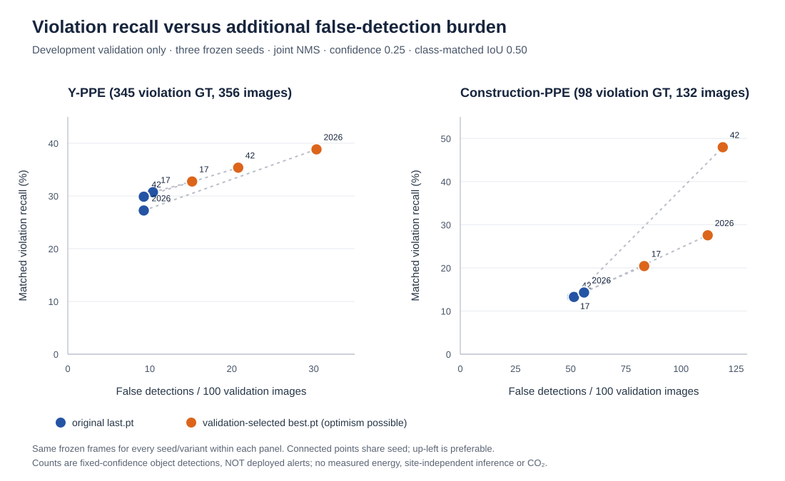
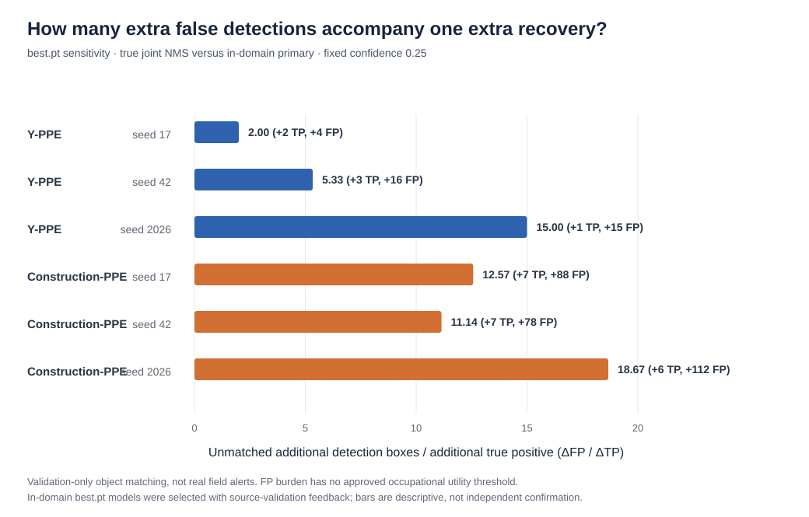

# When Does a Second Detector Help? Checkpoint-Sensitive Safety-Object Complementarity under PPE Domain Shift

*EcoSafe research track — revised working title for an evidence-based limits and failure-mode audit; not a novel field-ready routing-system claim.*

**Working manuscript — evidence-scope revision 2026-10-18**  
**Status:** DEVELOPMENT EVIDENCE ONLY. Not a peer-reviewed or submission-ready manuscript. All **six seed-by-domain expert pairs have now been evaluated on BOTH development validation domains, for BOTH the original last.pt protocol and the separately reported best.pt sensitivity**. Still outstanding: an independently justified absolute safety performance criterion, a frozen operational policy, held-out test, source-group-aware uncertainty, hardware energy benchmarking, novelty assessment and permissions.

## Abstract (journal-format candidate; development-only evidence)

Conditional inference with a second detector is useful for personal protective equipment (PPE) monitoring only when additional violation detections justify the associated false alarms and computation. We audited two previously trained, domain-specialized YOLO11m detectors across three matched seeds and two frozen development-validation domains: Y-PPE (356 images, 345 annotated violations) and Construction-PPE (132 images, 98 violations). Final-epoch checkpoints (last.pt) formed the primary comparison; validation-selected best-epoch checkpoints (best.pt) were reported separately as a potentially optimistic sensitivity. At confidence 0.25, class-aware matching IoU 0.50 and joint non-maximum suppression IoU 0.70, last.pt fusion recovered 94–106 Y-PPE violations without adding any true matches beyond the Y-trained expert. In Construction-PPE, it recovered 13–14 violations, with 67–74 unmatched detections. Using best.pt, fused true matches increased to 113–134 on Y-PPE and 20–47 on Construction-PPE but with larger false-detection burdens. Relative to the in-domain Construction expert, best.pt fusion added six or seven matched violations per seed alongside 78–112 additional false detections. Retrospective ground-truth-privileged analysis found only six to eight Construction images per seed benefiting from second-expert invocation. Confidence-only escalation did not establish an adequate safety–computation tradeoff. These findings characterize checkpoint-sensitive expert complementarity and its limits on development data; they do not demonstrate independent-site reliability, field safety, or measured energy savings.

**Keywords:** PPE monitoring; domain shift; checkpoint selection; conditional inference; false detections; construction safety.

## 1. Motivation and research question

A detector optimized on one PPE image source can behave very differently on another source. The prior bidirectional domain-shift study already examined cross-domain reliability of YOLO11m over two frozen nine-class PPE collections; EcoSafe must **not** duplicate those findings or describe the old model training as a new experiment. Its distinct, prospective question is:

> Given fixed, previously trained domain-specific experts, can a lightweight primary-only routing decision selectively invoke a second expert **on the frames where it is genuinely useful**, preserving a prespecified operational violation-detection standard with fewer second-expert executions than an always-both fusion reference?

This question requires distinguishing an expert *switch* (discard primary outputs and use secondary instead) from actual dual-expert fusion. The original pilot controller conflated these policies; the correction and object-level matching algorithm are implemented and tested in the branch associated with this working manuscript.

### Specific candidate contributions and scope

1. We report **object-level, class-aware paired error complementarity** rather than interpreting a difference between per-image FN totals as recovered safety objects; this difference is observable in frozen YOLO11m predictions.
2. We explicitly separate **true always-run-both fusion**, primary-only escalation, raw-concatenation oracle and GT-privileged frame-value audit. The latter gives a retrospective upper-bound diagnostic, not a deployable decision rule.
3. We expose **checkpoint-policy interaction and false-alarm burden** across two fixed nine-class PPE domains and three originally trained seeds, reporting both negative and positive results without selecting a favorable seed or threshold from final test data.
4. We critically analyze **why primary-only confidence is not automatically a reliable router signal** when the desired outcome is recovery of a missed critical-class bounding box, while documenting the very small positive-benefit sample and source-selection bias.

These are proposed methodological and empirical distinctions, **not a formal novelty proof**. Conditional model cascades, object-detection confidence calibration and cross-site PPE detection have been studied previously. No energy reduction, deployable safety, external-site generalization or independent confirmatory result is claimed.

## 2. Study resources and methodology

### 2.1 Immutable expert and data provenance

Six YOLO11m `last.pt` detector checkpoints, three random seeds (17, 42, 2026) for each training domain, were independently re-hashed against the existing frozen checkpoint lock. Models will never be retrained for the primary EcoSafe study. The distinct nine-class frozen sources are Y-PPE-h9-v2 (validation n=356) and Construction-PPE-h9-v2 (validation n=132). The safety-negative classes are `no_helmet`, `no_gloves` and `no_boots`. Both datasets retain original frozen manifests and full class mappings. Raw images, checkpoint binaries and per-image predictions remain in private storage. The separately analyzed sensitivity reuses six original validation-selected best.pt checkpoint files with a DIFFERENT immutable SHA-256 registry and explicitly reports source-validation selection optimism. All of these checkpoints were trained previously; neither their original training nor validation feedback is new to this extension.

### 2.1.1 Original collection provenance and pretraining label-based selection

The two source collections are **not untraceable ad hoc images**: Y-PPE originates from the `ALTAYYAR` project, Roboflow workspace/project `master-fylfq/altayyar-0oflt-lafos-qqauz-ty5nh`, **Version 2** YOLOv11 export (17 original classes); Construction-PPE derives from the published **Ultralytics Construction-PPE v1.0.0** collection (11 original classes, see [Dalvi et al., original Ultralytics documentation](https://docs.ultralytics.com/datasets/detect/construction-ppe)). The latter documentation identifies its AGPL-3.0 dataset distribution terms. The original Y-PPE Version 1 export reported CC BY 4.0, but **Version 1 is NOT the studied Version 2 source**; do not assume Version 2's public redistribution rights without version-specific confirmation. The project researcher reports ordinary academic use of the images is allowed; neither that report nor a hosted download link alone establishes an entitlement to redistribute all original worker images.

The study uses a **deterministic derivative** of the original releases. Original Y-PPE Version 2 split sizes (train/validation/test) are **1,625/468/234** and original Construction-PPE are **1,132/143/141**. Stage 2 corrected confirmed source-family overlap and annotations, retaining **1,595/459/234** for Y-PPE and **1,077/134/141** for Construction. Stage 4 mapped each source's native classes onto the strict nine-class ontology, preserving image membership.

**Crucial Stage 4.5 clarification:** Before any Stage 5 detector training, a frozen, model-independent label-completeness rule excluded an image if the nine-class map would leave it with no retained annotations or with a critical unmatched excluded source annotation. This rule analyzed **native annotation metadata from all three original splits, INCLUDING the held-out test annotations**; no test image pixels were opened for qualitative policy design, and model predictions were not used. It excluded **359 train/103 validation/48 test Y-PPE images** and **31 train/2 validation/3 test Construction images**. Thus the final fingerprinted datasets contain **1,236/356/186 Y-PPE** and **1,046/132/138 Construction-PPE** images. The historical original test sets were **not preserved in full** after this filtering; their final descendants are restricted to structurally harmonizable cases. Source-domain selection rates differed substantially: 20.51% of Stage 2 clean Y-PPE test and 2.13% of Stage 2 clean Construction test were excluded. The test was **not untouched by annotation processing**, although no test model performance was used to fit or select the present EcoSafe routing policies. Any future measured test result will be **conditional on this pretraining source-annotation selection**, not a population estimate for every original publisher frame.

Original Stage 2 audits removed known exact/pixel duplicates, conservative near-duplicate source-family overlaps and explicit filename-derived video leakage groups. Those bounded audits **do not provide a complete per-image original worksite, camera or recording-session registry**; therefore this paper makes no independently sampled site-generalization claim. Complete source links, exclusions, split tables, fingerprints and historical audit evidence are in `docs/DATASET_SOURCE_LINEAGE_AND_TEST_SELECTION_2026-10-18.md`.

### 2.1.2 Previously known individual-expert test performance: separating the two papers

The same Stage 5 trained models and final fingerprinted test images have **already been used** in the separate *Cross-Domain Reliability of YOLO11m for Safety-Critical PPE Monitoring* project. Its frozen Stage 6 protocol generated 12 single-expert last.pt held-out cells (each of six models evaluated on both test domains). The previously completed committee manuscript reports those individual-expert test results and a separately declared test-set best.pt checkpoint sensitivity. Hence the original Stage 5 held-out split is **NOT a fresh untouched benchmark at the project level**, although no new EcoSafe dual-expert fusion/router policy performance has been measured on that test during the work reported here.

To avoid duplicate publication or compromised confirmatory interpretation, we do **not** present any earlier Stage 6 detector-only test finding as a new EcoSafe experiment. A future novel fusion/router study would ideally be confirmed on a **new, genuinely source-group-independent dataset not examined in the prior paper**. If reusing the Stage 6 test images for extra fusion comparisons, those findings must be presented as **secondary analysis of a previously used benchmark**, with full disclosure of earlier access and prohibition on using the already-known individual detector scores to select a favorable new policy. Exact historical provenance and the pretraining annotation filter are recorded in `docs/HISTORICAL_STAGE6_TEST_REUSE_AND_INDEPENDENCE_2026-10-18.md`.

### 2.2 Primary, secondary and fusion policies

For each seed and both primary directions, compare: (i) Y expert alone, (ii) Construction expert alone, (iii) always run both and merge with fixed class-aware NMS, (iv) a genuinely selective primary-first cascade that uses exactly the same merger **only upon escalation**, and (v) a raw-concatenation upper-bound matching oracle. The fifth policy is *not* deployable; it only upper-bounds matchable ground-truth objects using both prediction sets.

The current exploratory detector export uses 640-pixel input, confidence floor 0.001 and per-model NMS IoU 0.70. The fixed safety operating point is confidence 0.25 with class-aware GT matching at IoU >=0.50. Joint class-wise NMS uses IoU 0.70. Primary-only uncertainty features are computed without secondary predictions or ground-truth access. These settings were evaluated on development data and **are not yet a prospectively locked held-out research protocol**.

For robust critical-object evaluation, maximum-cardinality class-aware bipartite matching is used, not differences between two aggregate FN totals. A separate NetworkX implementation cross-checks cardinalities on development images. A missing zero-detection frame must remain a frame with zero predictions, not an omitted record.

### 2.3 Outcomes and conditions for a legitimate sustainability claim

The principal safety outcomes must include per-class counts, TP, FN, FP, fixed-point recall and precision, with repeated seeds and grouping-aware uncertainty wherever source relationships are available. Compute proxies include secondary invocation fraction and expected expert executions per image. **Calls/image is not energy**: calibrated hardware-specific joules/image, memory, model loading, actual end-to-end latency, overhead and relevant carbon factors are separate future measurements. A relative non-inferiority margin to an already weak always-both detector is insufficient to demonstrate absolute worksite safety.

### 2.4 Training, threshold selection and held-out lock

Any logistic, calibrated or other learned lightweight router may be fitted only on development data with out-of-fold/cross-fitted predictions, preferably accounting for source groups. Candidate reference policies and an externally justified absolute safety target must be frozen before test access. No held-out images, labels or results are admissible in feature selection, threshold selection or the decision to retain EcoSafe.

### 2.5 Retrospective conditional-value-of-information audit

A separate, GT-privileged **diagnostic**, which is expressly not a deployable router, is defined on frozen validation outputs. Let `TP_i(P)` be the matched critical GT count for the primary detector at frame `i`, and `TP_i(J)` the matched count after class-aware NMS of both detectors. The per-frame benefit `delta_i = TP_i(J)-TP_i(P)` is scored *after* inference with GT. Positive-benefit frames have `delta_i>0`; frames with `delta_i<0` reflect harmful operational fusion. A hypothetical GT oracle invokes the second expert only on positive-benefit frames and avoids applying destructive fusion on negative-benefit frames. The resulting recall versus number-of-invocations curve is an **unattainable information-theoretic diagnostic for the frozen model outputs**, not a claim about routing policy performance or measured energy.

Two primary-only confidence signals are compared descriptively: `U_safety=1-max(confidence of safety-class predictions)` and `U_all=1-max(confidence of any predicted class)`, with a value of one if the selected prediction set is empty. Their tied-rank ROC AUC is computed for the retrospective per-frame positive-benefit label. The primary-only feature does not consult GT in deployment; the *label and AUC assessment* do. Small positive support, source-validation-selected best.pt weights, absence of source-site grouping and no held-out data preclude independent sensitivity, calibrated probabilities or prospective safety conclusions. Exact frozen dataset/chunk/model SHA checks are enforced and only nonidentifying aggregates leave private storage.

### 2.6 Statistical design, leakage and physical resource measurement (draft)

Model output is evaluated as class-aware, one-to-one *matched safety GT objects*, with per-frame pairing and explicit zeros for images with no detected objects. Fixed cutoffs are identified whenever reported. Differences between primary-only and joint policies should be computed **within the same original images**, with per-class denominators and FP/image shown alongside recall; raw GT objects are **not independent sampling units**. The six detector checkpoints are three repeated training seeds per source domain, not six independent sites. If an authorized source register establishes camera/site/sequence group IDs, a prespecified **group-cluster paired bootstrap** with whole-group resampling can estimate within-source uncertainty; without it, frame-level bootstrap is descriptive only and cannot establish independent-site generalization.

A frozen nine-class validation manifest has exact original image/label hashes but lacks verified site, session and video IDs; a separate development-only duplicate and perceptual similarity screen reports candidate similarities, not proof of source independence. The project researcher confirms that the images are legitimate materials routinely used for academic research; this assertion is recorded as research-use clarification, not an independently inspected license for public image redistribution. A protected source-group registry remains required before claims about independent construction sites. Permissions for publishing original identifiable images, if such figures are planned, must be checked separately, and the held-out evaluation policy must be frozen before consulting test outcomes. The exact statistical, provenance and preregistered-test draft are in `docs/STATISTICAL_AND_SOURCE_GROUP_ANALYSIS_PLAN_2026-10-18.md`, `docs/PRIVATE_CAPTURE_PROVENANCE_REQUEST_2026-10-18.md` and `docs/PROSPECTIVE_TEST_FREEZE_GATE_DRAFT_2026-10-18.md`.

**Energy and carbon status:** only the *number* of conditional expert calls has been computed, not energy. Full-system calibrated external wall-power, matched workload, identical software/device, actual router/fusion overhead, repeated timed power/performance traces and end-to-end latency would be needed to claim Joules/image or lower energy. We created a **fail-closed external-trace postprocessing auditor**, not a physical power measurement, in `scripts/14_audit_measured_wall_power.py`, with a separate metrology plan in `docs/HARDWARE_WALL_ENERGY_BENCHMARK_PLAN_2026-10-18.md`. These provide no energy or CO2e outcomes until real authorized meter logs exist.

## 3. Results — development-only two-domain, three-seed evaluation

### 3.1 Fixed-threshold violation recall and precision

| Validation domain (safety GT) | Y expert TP | Construction expert TP | Joint NMS TP | Concatenation oracle TP |
|---|---:|---:|---:|---:|
| Construction-PPE (98) | 7 | 8 | 13 | 14 |
| Y-PPE (345) | 106 | 1 | 106 | 106 |

On Construction validation, joint NMS achieved fixed-IoU recall 13.27% but precision 16.25%, whereas the Construction expert alone achieved recall 8.16% and precision 50.00%. On Y validation, joint NMS retained the Y expert’s 106 matches (30.72% recall) while reducing precision from 75.18% to 74.13% because it added two false positives. In **all 356** Y validation images, concatenation and joint NMS matched exactly the same number of safety GT objects as Y alone.

These percentages are **NOT COCO mAP**, and the two domains have different denominators and class distributions. They cannot establish a population-wide asymmetry or safety adequacy with seed-17 data alone.

### 3.2 First confidence-only selective-routing diagnostic

Define the exploratory primary-only uncertainty score as `1 - maximum safety-class confidence`, set to 1 if no safety-class detection is produced, and escalate when score >=0.50. On Construction validation this escalated 75.0% of images with Y as primary, retaining only 9/98 safety matches versus 13/98 for always joint NMS. With Construction as primary it escalated 94.7% of images, retaining 13/98 matches. On Y validation, Y-primary escalation invoked the secondary in 79.5% of images without any safety recall gain above the single Y expert. With Construction as primary it invoked Y in 99.7% of images to retain the joint NMS recall.

The simple confidence heuristic is therefore **not validated as an efficiency solution** under these settings. The scores and threshold are development-time diagnostics only, not a frozen optimal threshold or an energy benchmark.

### 3.3 Construction validation reproducibility across all three training seeds

Additional private, checksum-locked per-frame validation inference was completed for both source-domain experts at seeds **42 and 2026**. On the **same 132 Construction validation images** and 98 critical GT objects, all four models had full frame coverage. An independent NetworkX implementation confirmed all **1,056 per-frame policy-matching cardinalities** for these two additional seeds.

| Seed | Y alone TP/98 | Construction alone TP/98 | Joint NMS TP/98 | Joint NMS false positives | Joint gain over best single |
|---|---:|---:|---:|---:|---:|
| 17 | 7 | 8 | 13 | 67 | +5 |
| 42 | 9 | 5 | 13 | 68 | +4 |
| 2026 | 8 | 7 | 14 | 74 | +6 |

Joint NMS has a **descriptive** mean fixed-operating-point safety recall of **13.61%** across three training seeds (SD 0.59 percentage points). Mean joint precision is approximately **16.07%**. Despite repeated evidence of limited complementarity, these figures remain inadequate for a safety-critical deployment claim; only four no_boots GT objects exist in this validation domain, and the seed2026 joint NMS matched none of them. These are repeated models on **the same development images**, not three independent work sites or unbiased confirmatory tests.

Image-level paired bootstrap sensitivity was also examined for two seeds; any such uncertainty intervals are conditional on treating exported frames as resampling units. Genuine site- or source-sequence-cluster intervals cannot be asserted without adjudicated provenance groups. The full development table and limitations are preserved in `results/CONSTRUCTION_THREE_SEED_VALIDATION_2026-10-17.md`.

**The remaining Y-PPE validation runs were completed on 2026-10-18** and are documented in the next section. A pre-locked router protocol and independent absolute safety gate still precede any held-out test exposure.

### 3.4 Sensitivity to operating confidence: same frozen predictions

To evaluate whether extremely low fixed-operating-point recall might be explained solely by confidence 0.25, a retrospective four-threshold development grid (0.05, 0.10, 0.25 and 0.50) was applied to existing low-confidence exports. This is **exploratory and not a chosen final test threshold**. In Construction validation, decreasing confidence from 0.25 to 0.05 changed joint-NMS TP across seeds 17/42/2026 from **13/13/14** to **17/19/14**, while FP changed from **67/68/74** to **105/97/107**. Maximum observed joint recall across these tested settings was only **19.39%**, with substantial false-positive burden. Even a raw-concatenation matching oracle at 0.05 matched only 18, 19 and 15 of 98 safety objects, respectively. Thus within the examined thresholds a low cutoff does not provide a viable absolute safety result. Other thresholds, model checkpoints and operating conditions remain untested and cannot be ruled out.

This sensitivity further narrows the legitimate contribution: at present the project documents the limits of pretrained multi-expert complementarity and computes descriptive call-rate tradeoffs, **not** a deployable safe and sustainable controller. Full threshold counts and cautions appear in `results/CONSTRUCTION_CONFIDENCE_SENSITIVITY_2026-10-17.md`.

### 3.5 Y-PPE validation replication across three seeds (completed 2026-10-18)

Both experts were evaluated on every one of the **356** frozen Y-PPE validation images, with **345** annotated critical objects (`no_helmet` 40, `no_gloves` 251, `no_boots` 54). Seed17 results previously archived were complemented by complete, checksum-verified seed42 and seed2026 runs (23 nonoverlapping inference chunks per model, verified zero-detection image coverage). A separate NetworkX maximum-bipartite-matching implementation agreed with all **2,848** safety matching cardinalities (356 images × four policies × two newly evaluated seeds). The earlier seed17 independent check agreed in another 1,424 comparisons.

| Seed | Y expert safety TP / 345 | Construction expert TP / 345 | Joint-NMS TP / 345 | Y expert FP | Joint-NMS FP | Joint TP gain vs Y |
|---|---:|---:|---:|---:|---:|---:|
| 17 | 106 | 1 | 106 | 35 | 37 | **0** |
| 42 | 103 | 2 | 103 | 31 | 33 | **0** |
| 2026 | 94 | 2 | 94 | 33 | 33 | **0** |

The raw concatenation matching oracle gives **106, 103 and 94** matched objects, respectively, also identical to the Y expert alone at this operating point. The descriptive three-seed mean fused recall on the same Y validation images is **29.28%**; no claim of independent-site inference or satisfactory occupational safety follows from this estimate. Importantly, none of the three fused models exhibits *any* observed extra safety true positives above Y alone, although fusion adds two false positives for two seeds. Individual Y-expert class-TP counts across seeds 17/42/2026 are: no_helmet **15/18/15** of 40, no_gloves **71/66/63** of 251, no_boots **20/19/16** of 54.

For an exploratory primary-only uncertainty trigger at 0.50, Y-primary escalation occurred in **287/356 (80.62%)** frames for seed42 and **289/356 (81.18%)** for seed2026; neither yielded any additional safety TP relative to Y alone. In a secondary cutoff sensitivity at `conf=0.05`, seed42 fusion matches 115 of 345 (equal Y alone), whereas seed2026 fusion matches **113 vs Y-alone 111**, with 58 FP in either policy. At `conf=0.50`, seed42 fusion gains one TP over Y alone but has lower absolute TP count than at 0.25. Thus the zero marginal-gain finding is **specific to the main cutoff 0.25**, not a theorem covering all thresholds or hypothetical experts.

An image-level paired bootstrap of newly evaluated seeds has a zero observed joint-minus-Y recall difference at the selected cutoff, but **cannot** provide source/site-generalizable confidence bounds: the frozen manifest contains no validated site/video/scene IDs. Full provenance, class totals, local runtime, cutoffs and explicit nonclaims are in `results/Y_PPE_THREE_SEED_VALIDATION_2026-10-18.md`.

### 3.6 Checkpoint-selection sensitivity: best.pt versus last.pt (completed 2026-10-18)

Six original validation-selected best.pt checkpoints (all independently SHA-256 reverified) were run on **both full original validation domains**, keeping the final-epoch last.pt results frozen as the primary study. The best.pt variant used 16-frame checksum-locked prediction chunks, the identical 640-image input, inference export confidence 0.001 and NMS, and the **same fixed safety evaluation cutoff 0.25, IoU 0.50 matching and class-aware joint NMS at 0.70**. An independent NetworkX matcher reproduced **11,712/11,712** image/policy cardinalities across both domains, three seeds, four policies and two diagnostic operating cutoffs (0.05 and 0.25). All results below are from **development validation** and are not independent held-out tests.

| Validation domain | Seed | last.pt joint safety TP | best.pt joint safety TP | best.pt joint FP | best.pt joint recall |
|---|---:|---:|---:|---:|---:|
| Y-PPE (345 GT) | 17 | 106 | 113 | 54 | 32.75% |
| Y-PPE (345 GT) | 42 | 103 | 122 | 74 | 35.36% |
| Y-PPE (345 GT) | 2026 | 94 | 134 | 108 | 38.84% |
| Construction-PPE (98 GT) | 17 | 13 | 20 | 110 | 20.41% |
| Construction-PPE (98 GT) | 42 | 13 | 47 | 157 | 47.96% |
| Construction-PPE (98 GT) | 2026 | 14 | 27 | 148 | 27.55% |

At the main cutoff, the stronger Y-PPE best.pt expert by itself matched **111, 119 and 133** of 345 safety GT objects across seeds; adding Construction predictions recovered only **2, 3 and 1** extra objects, accompanied by **4, 16 and 15** additional FPs. Construction best.pt trained experts matched **13, 40 and 21** of 98 source-domain safety GT objects, while joint NMS matched **20, 47 and 27**. The seed42 raw-concatenation upper-bound matched 48 rather than the actual joint NMS's 47, confirming that the chosen NMS may also suppress a potentially matchable object.

The sensitivity grid further illustrates that lowering operating confidence does not resolve the false-alarm constraint: at confidence 0.05, Construction best.pt joint policies matched 56/60/49 GT objects across seeds but produced **575/559/458** false detections, and Y-PPE joint models matched 146/150/166 but generated **237/200/287** false detections. These are *not* independently selected thresholds; no safety adequacy or optimality claim is made.

**Checkpoint-policy selection bias is non-negotiable:** each source-specific best.pt file was historically selected using validation feedback on its **training-source domain**, so reporting that checkpoint on its own original validation split is not an unbiased confirmation of generalization. Results must be described as exploratory checkpoint-policy sensitivity and never substituted silently for last.pt outcomes. The cross-domain target was not necessarily the source model's selection set, but the fused model can still inherit selection optimism from the in-domain partner.

The detailed best.pt two-domain, three-seed analyses are recorded in results/BEST_PT_CONSTRUCTION_THREE_SEEDS_VALIDATION_2026-10-18.md and results/BEST_PT_Y_PPE_THREE_SEEDS_VALIDATION_2026-10-18.md. They reveal that a zero-complementarity finding under last.pt is **not invariant to checkpoint policy**, yet even the favorable best.pt development readings miss a majority of safety objects at confidence 0.25 and/or produce very large false-alarm counts.

### 3.7 best.pt confidence-only routing remains unsupported

A genuinely selective **primary-first** operational NMS cascade was simulated on the best.pt development outputs using only the primary expert's predicted safety confidence, with the exploratory router cutoff 0.50. On Construction-PPE validation, Construction-primary escalation invoked the Y expert on **131/132, 116/132 and 116/132** frames across seeds and matched **19, 42 and 24** safety objects, below always-run-both NMS (**20, 47, 27**). All six seed/direction cases on Construction delivered fewer TPs than a *rate-matched randomized-routing expected TP count* at this fixed cutoff; this expectation is a mathematical reference, not an empirically sampled significance test.

On Y-PPE validation, Y-primary escalation invoked the Construction expert on **279/356, 281/356 and 270/356** frames, matching **112, 120 and 133** GT objects. The corresponding always-joint reference matched **113, 122 and 134**, whereas primary-only Y matched **111, 119 and 133**. Thus the second expert is used in approximately three-quarters of frames to add at most one match above primary only under this rule. No router was trained, frozen or tested on unseen images, and no energy or latency savings were measured. The diagnostic is not evidence that more sophisticated routing can never succeed.

### 3.8 Sparsity of recoverable violations and failure of safety-only confidence as a routing signal

The previously exported `best.pt` validation predictions were re-analysed for all seeds and both primary directions with *no new detector inference or training*. Complete frame coverage and all primary, fused, oracle and false-positive totals were independently reconciled against the earlier SHA-locked aggregate reports. An auxiliary tied-rank AUC routine was cross-checked against scikit-learn on 40 synthetic datasets, in addition to the repository's synthetic CPU verification gate. The held-out tests were not used.

**Construction-PPE validation, with the in-domain Construction expert as primary:** 132 images, 98 safety GT objects. Only seven, eight or six frames across seeds 17/42/2026 had `delta_i>0` from invoking the Y-PPE expert. The operational joint NMS and the GT-privileged frame oracle compare as follows:

| Seed | Useful secondary frames / 132 | Primary TP | Always-joint TP / FP | Privileged GT-only oracle TP / FP | U_safety AUC | U_all AUC |
|---|---:|---:|---|---|---:|---:|
| 17 | 7 | 13 | 20 / 110 | 20 / 37 | 0.063 | 0.865 |
| 42 | 8 | 40 | 47 / 157 | 48 / 95 | 0.053 | 0.753 |
| 2026 | 6 | 21 | 27 / 148 | 27 / 45 | 0.085 | 0.858 |

For seed42, the GT oracle achieves one more match than indiscriminate always-joint NMS because the latter *loses* one primary true positive on a separate, harmful-fusion frame. No real controller has access to the GT information required to emulate this oracle. The AUC values for `U_safety` are *worse than reverse-random ranking* on this particular development split, while `U_all` appears more informative as a **ranking**. The positive-label prevalence (6–8 useful frames out of 132) means these ROC AUC values are statistically fragile and may vary substantially elsewhere.

**Y-PPE validation, with the in-domain Y expert as primary:** 356 images, 345 safety GT objects. Positive-benefit frames number only **2, 3 and 1** across the same seeds, respectively; `best.pt` operational fusion gains only 2, 3 and 1 GT matches over the stronger Y expert. The privileged oracle TP/FP totals would be **113/50, 122/61 and 134/95**, versus full joint TP/FP **113/54, 122/74 and 134/108**. The hypothetical low secondary-call rate is therefore a property of *rare recoverable violations* in the frozen data, **not proof of a successful or energy-saving deployable selector**.

As a transparent five-threshold developmental probe (no threshold selection), on Construction with Construction as primary, `U_all>=0.25` invokes the secondary on **46/132, 31/132 and 16/132** frames and recovers **19/98, 42/98 and 23/98** GT matches. This is below always-joint **20/98, 47/98 and 27/98** in all seeds. It is a potentially testable direction but cannot justify an absolute safety claim, and no final threshold has been frozen.

Full anonymous aggregates, class support, code and warnings are recorded in `results/BEST_PT_PRIVILEGED_ROUTING_OPPORTUNITY_2026-10-18.md`. In particular, the comparison is a retrospective **development analysis of best.pt checkpoints selected with original validation feedback**, not an independently tested new algorithm.

### 3.9 Incremental false-detection burden of an added in-domain expert

The count of **additional unmatched safety detections for each additional matched violation** was computed separately from all prior development aggregates, always comparing operational joint NMS to the correct **in-domain** primary expert (Y on Y validation, Construction on Construction validation). At confidence 0.25 under the source-selected `best.pt` sensitivity, adding the Y expert to Construction yielded **+7 / +7 / +6** matched critical GT objects but **+88 / +78 / +112** unmatched detection boxes (seeds 17/42/2026), i.e. **12.57 / 11.14 / 18.67 additional FPs per added TP**. On Y-PPE, adding Construction yielded **+2 / +3 / +1** matched objects and **+4 / +16 / +15** FPs, or **2.00 / 5.33 / 15.00** added FPs per added TP. Under the primary `last.pt` checkpoint on Y validation, no extra matched GT object was recovered by fusion at all.

These are **fixed-confidence evaluation false detections**, not verified real human-facing alarms, where alert smoothing and prevalence may alter false alert costs. This incremental ratio is descriptive; no occupational-safety authority has defined acceptable tradeoffs, and choosing an arbitrary utility weight retrospectively would manufacture a success claim. See `results/INCREMENTAL_SAFETY_FALSE_DETECTION_TRADEOFF_2026-10-18.md` for paired seedwise counts.

### 3.10 Figures from fully audited development aggregate data

**Figure 1 — Checkpoint policy shifts recall and false detections together.** The figure plots the class-aware safety-object joint-NMS recall (y-axis) and unmatched critical detections per 100 validation frames (x-axis) across three seeds per domain. Points linked by grey dashed lines use the *same seed* under last.pt and validation-selected best.pt. A greater detection percentage generally coincides with a greater false-detection burden, with substantially different tradeoffs across the two domains. All image frames are repeated across seeds; these plotted values are NOT independent site observations. Vector source: `figures/FIG1_CHECKPOINT_RECALL_FP_2026-10-18.svg`.

**Figure 2 — The additional false-detection cost of expert fusion.** For the *best.pt* development sensitivity at confidence 0.25, the figure uses **the in-domain-trained single expert as primary** for each validation domain and plots `[FP(joint)-FP(primary)]/[TP(joint)-TP(primary)]` when the denominator is positive. It never reports a value for a zero-denominator row. Construction has approximately 11–19 additional unmatched detections per newly recovered critical GT object; Y-PPE ranges 2–15 across seeds. The plots report evaluation-level detected boxes, NOT human-facing workplace alerts or a physical/ethical harm ratio. Vector source: `figures/FIG2_INCREMENTAL_FP_PER_RECOVERED_GT_2026-10-18.svg`.

Both figures are compiled **only from previously verified aggregate development comparisons**, with no new inference, original face/worker image visualization or held-out test. The corresponding numerators, denominators and methodology are documented in `results/INCREMENTAL_SAFETY_FALSE_DETECTION_TRADEOFF_2026-10-18.md`. Figure 1 uses fixed-confidence P/R object counting, not COCO mAP; neither figure measures power, latency, independently sampled site accuracy or carbon.

## 4. Discussion (provisional)

Across all three seeds under the **original last.pt checkpoint policy** at confidence 0.25, limited complementary object-level detections on Construction validation contrast with zero additional matches on Y validation. The separately documented best.pt sensitivity does show additional object-level matches on Y validation (two, three and one across seeds), demonstrating **checkpoint-policy sensitivity**, not robust transfer or safety adequacy. Domain and directional asymmetry therefore dominate the measured development-set value of an extra expert. It is inappropriate to infer unconditional safety gains from ensembling or sustainable-compute gains from invoking fewer networks.

Most importantly, the extremely low measured critical-state recall on Construction-PPE illustrates why selective-inference non-inferiority alone could be misleading: preserving an inadequate reference system is not evidence of field readiness. Any final paper must report the absolute safety target, miss costs, alert burden, site governance, uncertainty and performance under source dependence. The new privileged-oracle analysis clarifies the decision: the extra expert provides rare, highly localized marginal safety matches, but current safety-only uncertainty ranks those frames poorly, and an apparent all-class confidence ranking benefit has not been calibrated or validated independently. Thus, given the now-complete development evidence, **NO-GO** is the appropriate current decision for claims that this exact fixed-checkpoint cascade is demonstrably safe, universally beneficial or energy-efficient. A modified hypothesis may be worth testing, but no post hoc test selection, silent model substitution or fabricated positive conclusion is acceptable.

### 4.1 Why the current evidence does not warrant a safety/energy claim

The GT-privileged oracle's low theoretical second-call fraction is achieved by consulting labels unavailable to an operational router; it therefore cannot justify any performance/compute-saving or electrical saving percentage. Confidence-ranking AUC, especially with only 1–8 positive benefit frames per seed/condition, is a small-sample **development diagnostic**. Selection of best.pt weights on original source-domain validation further biases favorable sensitivity results. Excluding images without observed matches, changing thresholds after observing outcomes, using unverified site counts as independent samples, or reporting derived GPU-TDP energy would create invalid results.

The present defensible message is a **conditional failure-mode and checkpoint-policy robustness audit**. It is not a randomized comparison of algorithms, a proven new method for safe routing or an independent sample of construction worksites. Detailed follow-up protocols exist to allow the research to proceed without leaking final test information into policy selection.

**Research-to-research dependence warning:** The six models, frozen test subsets and some individual-expert last.pt/best.pt test outcomes were already analyzed in the previous cross-domain reliability paper (Stage 6). Thus reusing the same held-out images as the only "new independent test" for EcoSafe would not erase historical test knowledge. A new source-group-independent confirmation is preferred; otherwise any added same-test fusion result must be disclosed as secondary reuse, and the EcoSafe paper must contribute a genuinely distinct analysis without republishing the prior paper's mAP gap as a new result.

The separate prospective external evaluation proposal in `docs/EXTERNAL_CONFIRMATION_DESCRIPTIVE_PROTOCOL_DRAFT_2026-10-18.md` freezes candidate *descriptive metric definitions only*, but does not authorize evaluating new images or claim an approved safety margin. A genuinely eligible source cohort with a reviewed `no_shoes`/protective-`no_boots` semantic map remains pending. The corresponding-author access request is saved as an **unsent Gmail draft**, not a completed acquisition.

## 5. Submission-blocking research and documentation gates

- **COMPLETE (development):** all 2 domains × 3 seeds × 2 checkpoint policies × 2 detector sources were evaluated on immutable validation images, with 68 synthetic CPU scientific/integrity tests and independent object matching. All existing primary `last.pt` comparisons remain primary evidence; `best.pt` source-validation selection is an expressly biased sensitivity.
- **COMPLETE (documentation only):** narrowed literature map, draft inferential/statistical plan, original-capture provenance request, preliminary test-embargo checklist and hardware meter study specification. A wall-power trace *auditor* exists; it is NOT a measurement.
- **BLOCKER:** original site/camera/recording provenance, image-family overlap across train/validation/test from an authorized source steward, independent capture groups, and permissions are unverified.
- **BLOCKER:** externally justified **absolute** recall and false-alarm tolerances per critical PPE class and explicit intervention costs (not relative noninferiority to inadequate already-fused recall) have not been approved.
- **BLOCKER:** an operational primary-only router must be prospectively defined, fitted/calibrated with development-only leakage safeguards, and compared with same-fusion always-both, each expert individually and rate-matched random policies before final test. Current tested confidence-only heuristics do not pass this gate.
- **BLOCKER:** a new, source-group-independent confirmatory cohort **not previously used for Stage 6 test scoring**, or an explicitly disclosed SECONDARY analysis of the reused Stage 6 benchmark; a new policy and a single primary outcome/hypothesis must be locked before new scoring. Existing Stage 6 individual expert test metrics are NOT fresh independent evidence.
- **BLOCKER:** full-system wall-power, RAM, matched per-frame end-to-end latency, router overhead, idle/loaded model costs and justified CO2 system boundary have not been physically measured. Neither fewer expert invocations nor the new meter-audit script supplies energy savings evidence.
- **BLOCKER:** the complete literature review, manuscript novelty and submission rights/ethics declaration require independent academic/supervisor evaluation; do not equate passing CI or targeting a Q1 journal with acceptance/readiness.

The correctly bounded next work item is to retrieve protected original capture-group provenance and external safety acceptance criteria, *not* to tune further on hidden test scores or to manufacture a green-computing benefit.

### 5.1 Independent cohort search and why public datasets do not automatically close the test gate

A targeted source screening identified SH17 (17 positive-PPE/body-part classes but **none of the three direct absence labels**) and a 2025 2,286-image PPE set covering only helmets and vests; neither supplies a directly equivalent three-class critical-negative held-out evaluation without additional annotation and a new prespecified design. Wang et al. (2026), *Scientific Reports* 16:24591, describe a 313-image external cohort including `no-helmet`, `no-glove` and `no-shoes` boxes, but make the data **available on reasonable author request**, not via a verified direct reproducible image/GT download. The `no-shoes` ontology is **not presumed equivalent** to missing protective boots. Provenance, overlap with original training/Stage 6 images, and original-site keys must be checked before accepting this as fresh confirmation. No external images were acquired or evaluated in this screening.

An aggregate-only, metadata preflight (`scripts/15_external_cohort_preflight.py`) now enforces declared semantics/rights, independent original-family/site/camera/session keys, prior-study hash/group exclusion, and three-class GT support on multiple verified sites; **passing this gate does not run or authorize a model**. Its method and candidates are documented in `docs/EXTERNAL_TEST_CANDIDATES_AND_ELIGIBILITY_2026-10-18.md`. These are preparation artifacts, not new evidence of safe or sustainable inference.

### 5.2 Provisional Q1-journal editorial readiness (not scientific approval)

An **Automation in Construction**-oriented editorial preparation gate was implemented after the validation-only analysis, based on original Elsevier journal scope, publisher ethics/data-statement guidance, and official highlights guidance. The working abstract has been shortened to a **single paragraph (216 word-like tokens under the repository linter; below an internal conservative 250-word cap)**, with six indexing keywords and a separate file of **five highlights, each 72–73 characters long**. These formatting limits are used as conservative internal checks; they are not an independently confirmed 2026 journal-specific word-limit ruling. A provisional editor cover letter and author-disclosure forms explicitly remain UNSENT/UNAPPROVED pending co-author declarations and scientific evidence.

The automatic submission quality gate `scripts/16_submission_quality_gate.py` verifies the abstract, highlights, entire two-domain × three-seed × two-checkpoint **12-cell aggregate source registry**, all 12 plotted Figure 1 points and six Figure 2 marginal false-detection ratios. Its success demonstrates **internal manuscript/chart consistency only**, not peer-review approval, external robustness, adequate PPE safety or power savings. The preparation documents are `docs/Q1_TARGET_JOURNAL_EDITORIAL_QUALITY_GATE_2026-10-18.md`, `submission/automation_in_construction/HIGHLIGHTS_2026-10-18.txt`, `submission/automation_in_construction/COVER_LETTER_DRAFT_UNSENT_2026-10-18.md`, `submission/automation_in_construction/AUTHOR_DECLARATIONS_TEMPLATE_NOT_APPROVED_2026-10-18.md` and the immutable `submission/automation_in_construction/LOCKED_FIGURE_AGGREGATES_2026-10-18.json`.

A standard-library **no-email public-source YOLO preflight** `scripts/17_public_yolo_source_label_audit.py` is available if the researcher exports a suitable public Roboflow version. It verifies class mapping and source label integrity **before model scoring** but cannot certify original capture-site independence. No eligible external dataset was yet retrieved or evaluated, and neither physical wall energy nor an approved operational safety threshold is present. The paper therefore remains **scientifically incomplete for a Q1 original-research submission** despite improved formatting.

## 6. Related work and narrower novelty positioning (targeted, not systematic)

**Conditional cascades and uncertainty:** Lebovitz et al. [R1] already study efficient inference with cascades of existing models. Rabanser et al. [R2] examine confidence calibration and deferral. Pathiraja et al. [R5] demonstrate that confidence and localization calibration are themselves nontrivial in object detection, including under distribution shift. Thus neither model cascading, confidence-based early exit, nor calibration is claimed to have been invented here.

**PPE and construction domain shift:** Ahmad and Rahimi [R3] introduced a separate **17-class** manufacturing PPE benchmark with cross-domain validation, so a multi-source PPE study is not intrinsically new. Seong et al. [R4] show cross-site construction detection improvements using hard-negative mining with a single-model inference architecture; their independently sampled source sites are not comparable to the two original EcoSafe export domains without verified site provenance. Our fixed-operating-point GT safety recall must never be numerically compared with their mAP or other detector tasks.

**Leakage and deployment cost:** Barz and Denzler [R6] show that near-duplicate image leakage can distort nominal held-out estimates; our exact hashes and dHash preflight are not a complete substitute for original capture provenance. MLCommons [R7] provides guidance for physical whole-system power measurements, not an endorsement or certification of our (currently unexecuted) bench.

**Candidate distinction, not confirmed novelty:** class-aware safety-object complementarity under checkpoint-policy changes, **GT-privileged per-frame value of a genuinely fused second expert**, negative confidence-only routing diagnostics, and false-alert accounting on frozen PPE monitoring frames. Claims of novel algorithms, independent site-generalization and sustainable deployment remain outside available evidence. A targeted literature map and open tasks are documented in `docs/LITERATURE_AND_NOVELTY_EVIDENCE_MAP_2026-10-18.md`; a complete database search and bibliographic review are still required.

### References verified against publisher, conference or project sources (final journal formatting pending)

- [R1] Lebovitz, L., Cavigelli, L., Magno, M. & Müller, L. K. (2023). *Efficient Inference with Model Cascades*. Transactions on Machine Learning Research. https://mlanthology.org/tmlr/2023/lebovitz2023tmlr-efficient/
- [R2] Rabanser, S., Rauschmayr, N., Kulshrestha, A., Poklukar, P., Jitkrittum, W., Augenstein, S., Wang, C. & Tombari, F. (2025). *I Know What I Don't Know: Improving Model Cascades Through Confidence Tuning*. Google Research / preprint https://arxiv.org/abs/2502.19335 ; final formal venue should be checked.
- [R3] Ahmad, H. M. & Rahimi, A. (2025). *SH17: A dataset for human safety and personal protective equipment detection in manufacturing industry*. Journal of Safety Science and Resilience, 6(2), 175–185. https://doi.org/10.1016/j.jnlssr.2024.09.002
- [R4] Seong, J., Kim, H.-S. & Jung, H.-J. (2026). *Improving cross-site generalization in construction object detection via hard negative mining*. Automation in Construction, 182, 106761. https://doi.org/10.1016/j.autcon.2026.106761
- [R5] Pathiraja, B., Gunawardhana, M. & Khan, M. H. (2023). *Multiclass Confidence and Localization Calibration for Object Detection*. Proceedings of CVPR, pp. 19734–19743. https://openaccess.thecvf.com/content/CVPR2023/html/Pathiraja_Multiclass_Confidence_and_Localization_Calibration_for_Object_Detection_CVPR_2023_paper.html
- [R6] Barz, B. & Denzler, J. (2020). *Do We Train on Test Data? Purging CIFAR of Near-Duplicates*. Journal of Imaging, 6(6), 41. https://doi.org/10.3390/jimaging6060041
- [R8] Wang, S., Kim, H., Yeo, J. & Kim, J. (2026). *YOLOv10-based multi-scale variant object detection for multi-category PPE non-compliance monitoring on construction sites*. Scientific Reports, 16, 24591. https://doi.org/10.1038/s41598-026-53052-y (dataset from corresponding author on reasonable request; no access or inference performed).
- [R9] Huang et al. (2025). *Dataset of personal protective equipment*. Data in Brief, 62, 111988. https://doi.org/10.1016/j.dib.2025.111988 (four classes only, not a three-negative-PPE benchmark).
- [R7] MLCommons (official policy). *MLPerf Inference Power Measurement Rules*. https://github.com/mlcommons/inference_policies/blob/master/power_measurement.adoc

**Historical test-processing transparency:** All negative/positive EcoSafe detector and router **performance claims in this working draft are development-only**. Stage 4.5 historically used test-source annotation metadata to select which frames enter the final fingerprinted test derivative *before the detectors were trained*. This is distinct from consulting any test score to design the current router, which has **not** occurred. Future articles must not call the final test set wholly "untouched" or representative of unfiltered original imagery.

**Test reuse caveat:** Historical Stage 4.5 read native test annotation metadata for frozen pretraining label-based image selection, and a separate earlier Stage 6 paper already ran single-expert models on both resulting test splits. Neither should be concealed behind the phrase "wholly untouched held-out test." The present paper's NEW fusion/router experiments are validation-only, and fresh confirmation would require a new independent sample, or reuse must be transparently designated secondary.

## Publication integrity statement

This working draft records early research results, including negative findings. Its abstract, tables and conclusions are explicitly preliminary. It does not claim Q1 readiness, acceptance, field safety, unseen-domain improvement or lower carbon emissions, and it does not represent Stage 5/6 prior study results as a newly trained or independently tested architecture experiment.
