# SEER-PPE: Selective Evidence and Explanation Routing for Personal Protective Equipment Detection

**Ezzaldeen Al-Tayar**  
*Faculty of Engineering and Information Technology*  
*Taiz University*  
Taiz, Yemen  
**Corresponding author:** azzaltayyar@gmail.com

**Working manuscript v0.41 — native Pandoc Word-table export revision 22 November 2026**  
**Article class:** original empirical research candidate | **Status:** evidence-bounded manuscript; submission readiness remains conditional on author declarations, target-journal requirements and final visual layout approval.  
**Data constraint:** original Y-PPE corpus and the verified hosted 17-class ALTAYYAR RF-DETR Small model v2; local checkpoint or gradient access is not used or claimed in the current experiments.  
**Draft integrity statement:** original-model object detection, V27–V30 target perturbation, V33-A reanalysis, the completed V33-B 4×4 grid-resolution experiment, V34-A spatial map alignment/rank-correlation analysis, V34-B figure generation, V35-A numeric reconciliation and V35-B figure integration are recorded in the research branch. The study is scoped to image/object-level PPE detection and perturbation-response sensitivity; worker-level compliance, Person–PPE gold, actual review efficacy, independent/external explanation faithfulness, process memory and physical energy are outside the current empirical claim set. Do not cite the old model's 96.22% historical mAP@50 as a new SEER-PPE achievement.

## Abstract — image-level detection and perturbation-based XAI

**Background:** PPE object detection is a useful visual screening task, but detection boxes alone do not establish worker-level occupational compliance. **Objective:** This study evaluates an unchanged 17-class RF-DETR Small detector on the author-curated Y-PPE corpus and examines whether selective, target-specific black-box perturbation can characterize and prioritize visual evidence for PPE detections. The study does not claim worker-level compliance assessment. **Methods:** The Clean17 derivative contains 2,288 images; the current original-Source Validation analysis covers 459 images and 3,471 author-annotated objects. Predictions were matched to same-class references at IoU ≥0.50 and summarized across M0=459, M1=448 and M2=367 overlap-risk sensitivity cohorts. V27–V28 tested target-box occlusion, deletion and insertion; V30 executed a frozen eight-image, ten-target 8×8 progressive grid-occlusion study with 1,068 hosted model calls, 640 target-cell outcomes, 60 eleven-point curves and 60 AUCs, followed by an independent numeric audit. V33-A reanalysed these same ten targets without new inference. V33-B executed a separate 4×4 grid-resolution experiment on the same eight images and ten frozen targets using 496 additional hosted calls, producing 40 eleven-point curves and 39 valid AUCs; one ambiguous deletion point was retained as missing rather than imputed. V34-A then aligned the archived 8×8 and 4×4 single-cell sensitivity maps in exact pixel coordinates, pooled fine-cell responses by area, and computed signed per-target Spearman and Kendall rank correlations without new inference. V34-B rendered ten reproducible paired heatmaps and one summary figure directly from the V34-A archive; the renderer independently reproduced all ten Spearman, Kendall and top-four overlap results without new inference. **Results:** V26 yielded TP=3,297, FP=806 and FN=174 (micro-precision 0.803558, recall 0.949870 and F1 0.870610) on M0; M1 and M2 F1 were 0.870064 and 0.868157. V27 lost 9/10 target detections after Gaussian occlusion; V28 lost 10/10 after black-fill deletion and retained 7/10 under target-only insertion. V30 saliency deletion/insertion mean AUC was 0.496288/0.944195 for A5 and 0.397182/0.871354 for A6; six target slots were shared, and no policy superiority is inferred. In V33-B all ten maps were rankable at both resolutions; saliency favored one fixed random order in 8/9 scorable deletion curves and 10/10 insertion curves. V34-A found mean spatial Spearman ρ=0.542 and Kendall τ-b=0.424 across ten targets; the top four signed-sensitivity regions overlapped by 65% on average, with one target showing zero top-four overlap. This indicates moderate, target-dependent spatial agreement, not resolution-invariant maps. V34-B used one common symmetric display scale (±15.4709; 97.5th percentile of absolute displayed cell values); 17/800 values were saturated for display only, while all statistics used un-clipped archived values. V29 request round-trip averaged 1.5206 s and is not pure model latency. **Conclusion:** The evidence supports an internal image-level detection characterization and reproducible perturbation-sensitivity analysis of selected detector outputs, with moderate spatial rank agreement across the tested grid resolutions. It does not establish causal explanation faithfulness, worker-level compliance, Person–PPE association accuracy, actual human-review efficacy, acquisition-independent generalization, or electrical-energy savings.

**Keywords:** occupational safety; personal protective equipment; selective explanation; RF-DETR; abstention; image-source overlap; annotation provenance; risk-aware inference; Y-PPE.

## 1. Introduction

Construction-safety inspection increasingly benefits from computer vision models that can locate safety helmets, protective vests, gloves, and other equipment. Such detection systems are useful for screening complex sites, but a detector output alone does not verify a worker's compliance with the specific protective-equipment requirements of the assigned task. Moreover, a model can produce highly confident detections without identifying the visual evidence that made those detections reliable, while computing an elaborate explanation for every detection may impose costs that are material in resource-constrained deployment.

The researcher's earlier Y-PPE programme established a 17-class image corpus and evaluated RF-DETR Small for PPE and scene-related object detection. The original corpus comprises 2,327 images and 16,520 object annotations; a Roboflow training version generated 5,577 images after train-only augmentation. A historical RF-DETR evaluation reported mAP@50 of 96.22%. Those results demonstrate a foundation for this work and have already been disseminated in prior research; they are not proposed as new findings here.

SEER-PPE examines a narrower image/object-level question: how well an unchanged PPE detector identifies annotated equipment classes, and how selective black-box perturbation can characterize the sensitivity of each selected detection to its visual region. The routing layer prioritizes candidate detections for additional explanation or optional review requests under explicit call budgets. It does not infer which worker owns an item, whether an item is required for a particular task, or whether a worker is compliant. A `No Hard Hat` detection is treated as an object-class prediction only, not proof of an occupational safety violation.

The proposed framework does not treat post-hoc saliency heatmaps as verified explanations. Attribution quality must be tested for the relevant detected instance using target-matched perturbation and stability analyses. Likewise, energy awareness requires actual electric power measurements on named hardware, not proxy estimates based on FLOPs. Human review remains an abstention/request and cannot be counted as a successful safety intervention unless a subsequent independent outcome is measured.

This study evaluates three bounded contributions: (i) current-reference image-level detection performance of the unchanged 17-class RF-DETR Small model, (ii) target-matched black-box perturbation and progressive deletion/insertion sensitivity for selected PPE detections, and (iii) selective A5/A6-style prioritization under matched explanation-call budgets. The primary outcomes are detection metrics, target retention/confidence response, curve AUC and computational-call accounting. Worker-level compliance, actual review efficacy and physical energy are not endpoints of the current study.

## 2. Related work and literature boundary — focused 2024–2026 review; not a systematic review

### 2.1 Author's prior publications

- Al-Tayar et al. (2025a), *AI-Driven RF-DETR Decision System for Real-Time PPE Monitoring in Yemen's Development Projects*, DASA 2025, DOI: https://doi.org/10.1109/DASA68193.2025.11499131 — prior detector implementation and performance; **not new SEER experiments**.
- Al-Tayar et al. (2025b), *X-RF-DETR: A Framework for Explainable and Trustworthy PPE Decision Support*, DASA 2025, DOI: https://doi.org/10.1109/DASA68193.2025.11498849 — prior conceptual detector/XAI framework; it does not supply the current study's V27–V34 measurements.
- Al-Tayar et al. (2026a), *BIM-Integrated Explainable Vision for Real-Time PPE Safety in Yemen's Construction Sector*, eSmarTA 2026, DOI: https://doi.org/10.1109/ESMARTA70636.2026.11652079 — prior BIM and decision-support integration concept.
- Al-Tayar et al. (2026b), *PPE Detection in Yemeni Construction Sites: YOLOv11m vs. RF-DETRs*, eSmarTA 2026, DOI: https://doi.org/10.1109/ESMARTA70636.2026.11652190 — prior detector comparison; not to be replicated as novelty.

### 2.2 Closest methodological and construction-PPE prior work (focused source verification through 22 November 2026)

**Existing selective explanation methods.** Paes, Wei and Calmon's *Selective Explanations* (NeurIPS 2024, DOI [10.52202/079017-1765](https://doi.org/10.52202/079017-1765)) already studies routing between cheaper, potentially inaccurate amortized attributions and more expensive correction procedures, explicitly trading attribution quality against computation. This means that deciding when to compute an expensive explanation is **not** novel by itself. SEER-PPE would have to show added domain- and instance-level safety/faithfulness constraints empirically, not merely reproduce the selection principle.

**Uncertainty-triggered PPE verification.** Vaghani's 2026 *Sentry–Judge hybrid* ([Frontiers in Built Environment](https://doi.org/10.3389/fbuil.2026.1976288)) uses a lightweight YOLOv11m screener and uncertainty-triggered SAM 3 verification for ambiguous equipment-absence cases, and studies worker/PPE association plus downstream reporting. The authors report comparative false-alarm and throughput outcomes on their construction footage; these are **their own study's reported results**, not measurements on Y-PPE or independent replications by SEER. The strong direct overlap invalidates claims that a two-stage or uncertainty-gated PPE checker is unprecedented. It also motivates a prespecified strong **safety/review/compute-matched** uncertainty-gating comparator rather than an easy always-explain or no-explain control alone.

**Context and mandated requirements.** Bouguessa et al.'s 2026 CA4PPE (*Engineering Applications of Artificial Intelligence*, DOI [10.1016/j.engappai.2026.115725](https://doi.org/10.1016/j.engappai.2026.115725)) combines multiple detectors, scene awareness and context-dependent symbolic PPE rules. Yi, Xu and Tan (2026, *Advanced Engineering Informatics* 74:104612, DOI [10.1016/j.aei.2026.104612](https://doi.org/10.1016/j.aei.2026.104612)) use visual relationships and regulation-aligned scene graphs for work-at-height PPE. Worker-to-item relation modeling, context and rule-based occupational assessment therefore have demonstrated methodological precedents. SEER's exact policy-mandate semantics and unknown-state logic are valuable **if implemented and validated**, but cannot be advertised as globally novel components.

**PPE explainability and detector architecture.** Di Renzo et al. (2026, *Journal of Imaging* 12(5):195, DOI [10.3390/jimaging12050195](https://doi.org/10.3390/jimaging12050195)) evaluated qualitative/quantitative consistency of Vision Transformer PPE explanations including image similarity metrics. Explanation visualization or PPE heatmap consistency cannot be claimed as a SEER first. The RF-DETR detector itself was introduced by Robinson et al. (ICLR 2026; [arXiv 2511.09554](https://arxiv.org/abs/2511.09554)); SEER reuses an already trained 17-class RF-DETR Small checkpoint without proposing a detector architecture. Barlybayev et al.'s 2026 systematic PPE CV review ([*Computers* 15(6):388](https://doi.org/10.3390/computers15060388)) documents substantial prior detection architectures and real-world deployment/assessment limits, supporting cautious generalization and risk-of-bias reporting.

**Perturbation-based explanation evaluation.** Fong and Vedaldi (2017) established a model-agnostic meaningful-perturbation framework for testing black-box image explanations, while Petsiuk et al. (2018) used deletion and insertion metrics to evaluate the effect of progressively removing or restoring salient image regions. Adebayo et al. (2018) showed why visual plausibility alone is insufficient and proposed model/data randomization sanity checks; Hooker et al. (2019) likewise demonstrated the importance of quantitative baselines for feature-importance methods. These works motivate perturbation-based evaluation but do not make the present score-drop maps causal explanations. The current study did not execute model-parameter or label-randomization sanity checks, and its single deterministic random ordering is a limited control rather than a repeated-seed benchmark.

**Author's own previous overlap.** The prior 2025 *X-RF-DETR: A Framework for Explainable and Trustworthy PPE Decision Support* (Al-Tayar et al., 2025b; DOI [10.1109/DASA68193.2025.11498849](https://doi.org/10.1109/DASA68193.2025.11498849)) already presents detector/XAI integration in the original research programme. SEER must not reuse that integration, the author's earlier Y-PPE RF-DETR results, previous model comparisons or BIM-concept integration as a newly invented contribution.

### 2.3 Provisional, falsifiable SEER-PPE contribution boundary

The research **does not claim priority** over selective explanation, uncertainty-gated PPE verification, RF-DETR, worker/PPE association, regulatory scene reasoning, generic abstention or saliency visualization. What remains to test is a **joint, experimentally falsifiable** proposition: on an *identical fixed detector, images and equipment labels*, can a *safety-constrained* selective policy allocate per-instance, **target-matched quantitatively faithful** additional evidence and actual review under fixed review/compute budgets, while not increasing rigorously defined **confirmed worker false-clearance risk** relative to a preselected strong uncertainty-gated selective comparator? Unknown visual person–PPE links and undocumented task mandates must lead to `UNKNOWN`/`NOT_ESTIMABLE`, not manufactured negative outcomes.

A defensible distinctive finding requires **real experimental execution and supported denominators**: a matched A5-vs-A2-or-stronger primary comparison, actual failure-safe behavior when people or PPE associations are missed, target-matched deletion/insertion fidelity (including lost/ambiguous targets), measured review burden and **measured computational cost** under identical conditions. Physical energy claims require a valid Joule measurement. At present these policy-level outcomes **remain unmeasured**; the completed V19/V20/V22/V23 observations are source integrity and limited detector-reference analyses, not a superiority demonstration.

This [focused, dated 2024–2026 literature collision matrix](V24_VERIFIED_2024_2026_RELATED_WORK_NOVELTY_BOUNDARY.md) was verified using accessible official proceedings/publisher articles, an institutional publication record and several publisher abstracts. It is *not a PRISMA systematic search, complete related-work coverage or proof of worldwide novelty*. The CA4PPE full text was inaccessible in this screening, so claims about it are restricted to its published abstract. Additional reference verification and journal-specific formatting remain future editorial tasks.

## 3. Materials and Methods — image-level detection, V27–V30 perturbation and V33-A/V33-B robustness

### 3.1 Corpus, provenance and model identity

The historical 17-class Y-PPE corpus contains **2,327 images** and **16,520 object annotations**, with 1,625/468/234 train/validation/test images. Roboflow's original **`softyyemen/altayyar-0oflt-lafos-qqauz/2`** has a completed **RF-DETR Small** training based on its 5,577-image augmented version (4,875/468/234). Its previous platform mAP@50 of **96.22%** belongs to earlier Y-PPE work, not this study. Original version 3 contains the 2,327 unaugmented images but no completed training reported in the inspected version metadata.

The reproducibly reconstructed **Clean17** derivative contains **2,288 images** and **16,300 annotations** (1,595/459/234), backed up privately and byte-verified against ZIP SHA-256 `d47d9676b785a847ef1bcb8a871574815b0b67b967f9107680fb0b85b1a52d61`. The author reports that the corpus was assembled from multiple projects and work locations in Yemen in the context of civil-society organization projects, and that image selection, review and database curation were completed during the original preparation phase. The study therefore describes provenance at the **aggregate multi-project/multi-location level**; a named worksite or project ID for every image is not an analytical requirement, and no full-corpus reinspection is repeated. The original author-curated annotations are treated as a single-curator reference for the narrow internal image-level detection endpoint; this is not independent inter-rater validation. Previously identified exact pixel/byte cross-split duplicates and explicit video-family conflicts were corrected; seven low-dHash candidates were analyst-triaged as different photos/objects. A complete per-image site/session register is unavailable, so unknown acquisition families remain `SOURCE_UNKNOWN` and are not declared independent. This is an author-curated applied corpus rather than a documented probability sample of all Yemeni worksites or civil-society projects; its multi-project diversity is descriptive and does not support national prevalence estimates. This limitation does not preclude internal image-level detection analysis, but it prevents a claim of acquisition-independent multi-site generalization.

The Drive file `Y_RFDETR_s17/train/checkpoint_best_ema.pth` is **9-class seed-17**, not the original 17-class checkpoint. Roboflow has been verified to issue a temporary authorized original-model weights-download URL, but the bytes, checksum, classifier dimensions, local loader and gradients **remain unverified**. For the currently authorized **Roboflow-only** research design, run reproducible hosted inference on permitted Train cases using the fixed original model ID and logged confidence/overlap settings; local Colab execution and checkpoint download are optional only if the author later changes platform scope. The API supplies predictions, not model gradients or measured Joules.

### 3.2 Split policy and source-dependence sensitivity

Use **Train for exploration and implementation**, a previously unused-for-SEER **Validation subset for calibration**, and the historical **Test for one frozen internal evaluation**. The original author's Y-PPE curation involved iterative exposure to train, validation **and test outcomes**, and three image examples were used for engineering inference: the historical Test is **development-exposed, not an independent/unseen holdout**. Neither changing thresholds nor choosing competing arms on its SEER outcomes is permitted. Keep any previously used images flagged as exposed.

Cross-split leakage is treated separately from geographic provenance. The frozen audit screens stable filename/video-family tokens, exact hashes, near-image matching and documented visual review; only credible same-image, derivative, shared-scene or shared-site candidates require case-specific holds or exclusion. A dataset-level declaration that the corpus spans many projects/sites does not prove that every Train and Validation image is acquisition-independent. As of 22 November 2026, the author has confirmed two Valid images share the School 22 May–Aseefrah site family with Train, and Valid WA0026 shares scene content with Train WA0079 after changes/processing; these three Valid records remain held. Eight other P0 cases remain unresolved under their existing holds/quarantines. For descriptive internal detection analysis, report the frozen **M0=459**, **M1=448** (exclude 11 high-risk P0 cases) and **M2=367** (exclude 92 flagged source-risk cases) cohorts as risk-sensitivity analyses. These cohorts do not certify independent source families; unknowns remain `SOURCE_UNKNOWN`. Per-image site identification is not required, but credible cross-split overlap controls are retained.

### 3.3 Worker-level compliance reference — outside current study scope (V32)

The current manuscript does not estimate worker-level PPE compliance or occupational violations. Accordingly, a complete Person–PPE gold reference, worker identities, task/site mandates, false-clearance denominators and independent safety adjudication are **not required to complete the current image-level detection/XAI study**. Existing single-curator Person–PPE pilot records are retained as exploratory engineering artifacts only; missing or unsigned cells are not imputed, and no worker-level metric is calculated. Any future worker-safety study would require a separately approved protocol and reference construction.

### 3.4 Person–PPE association — exploratory only, not a scored endpoint

Previously saved person-to-equipment links and Train-pilot geometry remain archived for implementation history. They are not treated as validated worker ownership labels, are not used to compute compliance, and are not a prerequisite for the current image-level endpoint. The study evaluates PPE detections as image regions/classes. A missed or ambiguous detection is reported as a detector outcome, not as evidence that a particular worker lacks equipment.

### 3.5 Detection-instance explanation routing and review requests

The routing layer operates on detector outputs and image-level evidence only. `BASIC` retains a detection without additional explanation; `EXPLAIN` selects a target for perturbation-based analysis; `REVIEW` denotes a request for visual inspection of an uncertain or priority detection. Routing may use detector confidence, class, target size, visibility, uncertainty proxies and a fixed XAI-call budget, but never reference/test labels. A review request is a prioritization output only: no completed human review, compliance decision or safety intervention is claimed. Compare policies under matched target and call budgets, and report selection overlap, target detection correctness where a valid image-level reference exists, and actual model-call counts.

### 3.6 Target-matched perturbation tests

For each selected original PPE-class/box target, evaluate target-region occlusion, deletion and insertion responses, progressive deletion/insertion curves, and non-target control regions under the frozen perturbation designs. This model-agnostic perturbation framing follows the general meaningful-perturbation approach (Fong & Vedaldi, 2017), while deletion/insertion curves have been used as quantitative explanation diagnostics (Petsiuk et al., 2018). Match perturbed predictions to the **same class and instance** using predetermined spatial/IoU criteria. Record MATCHED, LOST and AMBIGUOUS separately; do not change targets or set lost detections to fictitious zero fidelity. Explanations may be sensitive to out-of-distribution masking, so visual appeal or score drop alone is not proof of causation (Adebayo et al., 2018; Hooker et al., 2019). Gradient methods remain outside the current hosted-only endpoint unless the exact original checkpoint and differentiable implementation are independently verified.

### 3.7 Comparator selection and ablations

Compare detector-only and selective explanation alternatives (A0 detector-only, A1 Explain-All, A2 confidence-only, A3 budget-only, A5 and A6) on the same eligible image targets. Match explanation-call/target budgets where possible and disclose target overlap, source exposure and any unmatched cases. A4 safety-guard-off is not a relevant primary comparator under the V32 scope and is retained only as historical design documentation. Do not describe A5/A6 as safety comparators or claim superiority from the current small, overlapping sample. Report selection behavior, detection alignment and XAI-call cost.

### 3.8 Image-level decision criteria and calibration

Primary endpoints are exact-class detection precision, recall and F1 at the frozen matching rule, class-wise support, target retention/confidence response under perturbation, and deletion/insertion curve AUC. Secondary endpoints include selected-target overlap, XAI/model-call count and hosted request round-trip. Thresholds and target selection rules must be frozen on development/Validation data before any final descriptive analysis. Detection confidence is not a probability of worker safety, and no worker-level risk or compliance calibration is attempted.

### 3.9 Hosted compute accounting and statistical design

Report actual model-call counts and hosted request round-trip when measured; distinguish request latency from internal detector inference time. Memory and physical Joules are not measured in the current platform evidence and are not claimed. Do not infer energy savings from calls, FLOPs or response time. Use image-level paired comparisons for policies and target-level curves with appropriate clustering by source image; disclose development exposure and source-overlap sensitivity. The historical Test remains protected from tuning and is not described as an untouched independent holdout.

### 3.10 Image/target-level audit trail and reproducibility

Log pseudonymous image, source-group and target IDs; dataset/model identifiers and available hashes; processing/configuration/library versions; raw boxes/classes/scores; target-selection and routing reasons; perturbation settings and target-match statuses; actual model-call counts and hosted request round-trip where available. Keep source images, identifiable metadata and runtime inference logs in separated, access-controlled stores. Do not feed post-hoc reference labels into online routing. No image, checkpoint or model redistribution is presumed lawful without authorizations; release scope remains an explicit question for the author.

### 3.11 Readiness gates and actual status (V32 scope)

**Completed:** Clean17 integrity and source mapping; current original-source 459-image detection evaluation; V27–V29 target perturbation and hosted timing; V30 progressive black-box perturbation curves and independent numeric audit; V33-A matched-target reanalysis; V33-B's actual 4×4 grid-resolution experiment and independent numeric audit; V34-A spatial map alignment/rank correlation; V34-B scientific figure generation; V35-A numeric reconciliation; and V35-B integration of all eleven figures into manuscript v0.37. **Remaining for final submission preparation:** confirm author-level ethics/consent, funding, competing-interest and contribution declarations; verify the two eSmarTA 2026 author lists against final IEEE metadata; select the target journal; and complete final rendered layout/link/archive QA. The v0.38–v0.40 are preserved as intermediate exports; v0.41 uses Pandoc's native Word reference template and table structures, with the empty generated TOC removed. Repeated random seeds or alternative masking/blur baselines require a separate prospective design and are not retroactively claimed. Worker-level Person–PPE gold, task mandates, actual review efficacy, independent acquisition generalization, local checkpoint/gradient access and physical energy are outside the current endpoint scope. No retraining or Test access is authorized.

### 3.12 Operational source-lineage and Person–PPE evaluation contract (V11; executable but not authorized for scoring)

**V32 scope note:** Sections 3.12–3.16 below preserve historical source-lineage and Person–PPE engineering contracts from earlier study designs. They are not scored endpoints under V32 and do not reinstate a worker-compliance requirement. The current study's active methods are image-level detection, target-specific perturbation analysis and selective explanation prioritization.

To prevent a similarity shortlist from being confused with scientifically eligible Validation data, all **468 original Valid** Source IDs are now indexed in a baseline eligibility ledger. The ledger retains the five pre-existing research holds, 94 additional unsigned source-lineage candidates, and 369 no-screen-flag images whose independence is still uncertified. Original Source-ID evidence, nearest Train neighbors, observed dHash edges and 27 descriptive similarity-component IDs are linked without changing Roboflow splits. A separate append-only decision overlay is initially empty and requires per-image acquisition/source evidence, a dated reviewer signoff and an explicit Train-family comparison to record potential independent-source eligibility. Previously held cases cannot be lifted by V11's automatic gate. Evidence of same named 22 May School – Aseefrah in held cross-split images remains traceable to the earlier visual-source audit; it is not a new independent-curator signature.

A standalone Node.js Validation-only evaluator implements **structural safety gates** for source-independence decisions, original-to-Clean17 membership, signed worker coverage (including missed persons and zero-person controls), six visual status cells per worker, separate task mandates, item/person correspondence, locked reference/parameter plan and a dated research freeze. It can then compute descriptive selective visual-PPE counts and per-class retained coverage, abstention, conditional accuracy and PRESENT precision/recall, plus item-owner pair precision/recall/F1 **only conditional on verified item and person correspondence**. Human `UNKNOWN` is excluded from binary denominators and reported separately; `NOT_RECORDED` or absent prediction records cannot be silently converted to `ABSENT`. The tool never reports occupational compliance from unknown task policy, nor model mAP, energy joules or independent-Test performance. The real Validation freeze is **unsigned, with scoring disabled**. Synthetic tests exercise program logic only. This is a reproducible implementation and evaluation contract, **not** an empirical SEER policy comparison or achieved model improvement.

### 3.13 SHA-pinned direct photographic-content and cross-split source-family verification (V13; non-scoring)

After the complete V12 source-ID/filename metadata crosswalk, the study performed direct image-content verification on immutable original Valid images and corresponding unaugmented Clean17 Valid export images in temporary GitHub Actions environments. Each original and cleaned/export file was individually validated against its separately archived SHA-256 fingerprint; exact cross-export raw-byte identity was not presumed because Roboflow export applies preprocessing and encoding. The comparison used EXIF-oriented RGB and ordinary resizing candidates, selected grayscale structural similarity (SSIM), normalized RGB mean absolute error and ORB matched-feature evidence. A high-consistency engineering flag required SSIM ≥0.94 with normalized RGB MAE ≤0.075 or SSIM ≥0.88 with MAE ≤0.11 and ≥24 geometric ORB inliers. The threshold is a reproducible conservative technical screen, not a calibrated false-identity probability, external source-provenance certificate or person-level performance measure. A random synthetic negative image control was included in CI.

To distinguish export identity from **Train↔Valid acquisition dependence**, the study separately re-acquired original Source image bytes for 46 prior near-dHash Train↔Valid pairs and four extra cross-split same-named-school pairings. The original SHA was revalidated; same-frame technical candidates required SSIM ≥0.90 and RGB MAE ≤0.05. Distinct frames, especially from the same named school, remain source-family dependent when supported by site evidence even if image SSIM is low. Neither screen enters individual source-family human verdicts or changes frozen Roboflow data. Full numeric records are retained without image media or private URLs, and no Test image was decoded or inferred.

### 3.14 Conservative direct-evidence research quarantine for source-independent Validation (V14)

To avoid promoting image-similarity candidates into signed source-family decisions, the V14 source-eligibility protocol separates **existing research holds**, **additional technical overlap quarantines**, **other source-family review cases** and **images without a screening flag but without signed independence evidence**. The process joins the V11 original Valid Source-ID ledger, the 459 direct original↔Clean17 photo comparisons, and the V14 99-source Train↔Valid comparison records. It does not relabel Roboflow data and deliberately leaves all six new technical quarantines unsigned. The pre-scoring evaluator hard-rejects the five old holds and six V14 high-content overlap quarantines even if a future generic user-supplied scoring bundle asserts eligibility; a separate explicit, evidence-qualified conflict-adjudication protocol would be needed before any such case could be reconsidered. All remaining source-independent claims require individual signed acquisition/source-family comparison evidence. The [V14 preregistration draft](VALIDATION_PRE_FREEZE_STUDY_DESIGN_2026-11-21_V14.md) keeps original model parameters unchanged and prohibits Test-driven design.

### 3.15 Evidence-locked source-group attestation and independently signed Validation reference contracts (V15; executable, no human signatures created)

Version V15 formalizes two independent units of research certification. **Original Valid Source-ID/source-group membership** is verified against the V13 direct source↔Clean17 image-content evidence and the V14 immutable administrative quarantine (5 old holds, 6 additional technical Train-overlap quarantines, 81 other flagged source-uncertain records and 367 unflagged but unsigned). An individual independent-source attestation, if genuinely issued in a future controlled review, must bind the exact original/clean file names, a dated reviewer and per-image observation, a site identifier, acquisition session and source-family identifier, an explicit Train site/session-family overlap examination, and SHA-256-pinned repository evidence. File hashes attest **integrity of the review record**, not that a reviewer's conclusion is true. The 11 historical-hold/high-image-overlap conflicts cannot be cleared by simply entering a generic independent-source boolean; they remain methodologically blocked until separately adjudicated.

The **human Validation Person–PPE reference** is a distinct record type, never inherited from exploratory Train-only A/B/C/D cases. Its executable V15 contract validates per-image human person count and complete person/item coverage, individually reviewed normalized boxes, each person's six PPE visual states (`PRESENT/ABSENT/UNKNOWN`) and separate PPE task mandates (`REQUIRED/NOT_REQUIRED/POLICY_UNKNOWN`), per-item ownership with consistency checks, explicit human-signed zero-person scenes and dated SHA-bound observation evidence. Undefined or unobserved equipment is not automatically classified absent, and a model prediction cannot become human ground truth. The evaluator remains unable to score a source-dependent or unsigned Validation cohort even with a technically perfect original-to-export photo mapping.

### 3.16 Read-only RF-DETR Train-pilot execution, conservative geometric person–equipment attribution and qualitative cue audit (V16; not independent Validation)

The fixed original `altayyar-0oflt-lafos-qqauz/2` RF-DETR Small was executed on four **existing Train-only exploratory images** A/B/C/D through a previously published read-only Roboflow Workflow (`61llCTFuQ4Aq4goQ9HiP`, `SEER-PPE Conservative Review Cues v0.2`). The inference Workflow disables active learning and applies candidate confidence ≥0.20 and high-cue confidence ≥0.60; the model was neither retrained nor replaced. Only numerical predictions, detector class, confidence, geometry, case revision and workflow review codes were archived—never raw images, signed retrieval URLs or inference visualization bytes. This repeats an already documented exploratory Train Workflow pilot (V09) but now preserves reproducible item-level prediction geometry and reference comparison; it is not a new Validation experiment.

For each specific PPE cue, a deterministic read-only post-detector evaluator computed fractional overlap of the predicted PPE box within detected person boxes, accepting boxes overlapping by at least 0.25 as geometric review candidates. If one candidate covered ≥0.75 of the PPE box and either no secondary candidate exceeded 0.45 or the best–second margin was ≥0.30, it generated a *single strong geometric ownership proposal*. All other cases were routed to person coverage/overlap review. A geometric proposal is **not** an approved Person–PPE association; the negative legacy detector classes (`No Face Mask`, `No Safety Boots`, etc.) remain review cues and can never auto-label human `ABSENT`. `No Safety Attire` is a non-specific context class, not a typed PPE absence. Policy applicability remains `POLICY_UNKNOWN`; no compliance verdict is returned.

A separate exploratory crosscheck re-read the *existing researcher-entered Train reference* from Roboflow (A/B/C/D cases at revisions 2/2/4/1, 19 approved item-owner links and 38/42 visual states), and performed a globally optimal deterministic **one-to-one person-box matching** using IoU ≥0.50. Corresponding detector cue directions were checked only against already recorded `PRESENT/ABSENT/UNKNOWN` visual states, yielding qualitative review categories (direction-compatible, opposing, human-unknown, unrecorded, or no clear person geometry). This is not detector AP/precision/recall or association F1, since the correspondence, labels, sample independence and Validation eligibility are not scientific scoring-certified. Any oppositions are review candidates rather than human-confirmed model errors; GT state was never overwritten.

### 3.17 Actual original-source Valid class-composition audit and historical-score reference-version reconciliation (V20–V22)

A V20 **internal, non-independent, historical-only** object-detection protocol was committed before reading its individual stored Valid outcomes. It specified the unchanged RF-DETR Small model `altayyar-0oflt-lafos-qqauz/2`, Roboflow model Eval `KyzP9neuyNTN5eQpGCAY` from September 2025, explicit `split=valid`, confidence threshold 0.20, exact original Source-image `imageId` matching, and metadata-defined nested risk strata M0/M1/M2 containing 459/448/367 retained images. Previous author review of source-image object labels was accepted as **single-curator original annotation reference**; no second reviewer, reinspection or novel worker-level labels were introduced. This evaluation reuses *historically stored TP/FP/FN* from model version 2, not fresh current annotation geometry, and uses micro metrics `TP/(TP+FP)`, `TP/(TP+FN)` and `2TP/(2TP+FP+FN)`, with undefined ratios reported as missing.

The V22 extension is a **read-only composition audit** of the currently saved original Source `Valid` annotation envelopes previously retrieved for all 459 corrected-Valid-mapped original image IDs. For every image, the immutable Source ID, original filename, 17-class category counts, total saved boxes, and pre-existing number of `labeledByModel` provenance markers were obtained from the saved V20 count ledger. Data-integrity conditions require a unique 459-ID join, each image's class counts to sum exactly to its saved total, risk groups nested 367 ⊆ 448 ⊆ 459, every class name in the unchanged 17-category vocabulary, and identical image/object/provenance totals to the historical V20 analysis. Images with no stored boxes would be tracked explicitly; there are zero in this current snapshot. The source-risk strata are entirely predefined from **image-source overlap metadata**, not from model correctness or observed class representation.

For each cohort and category we report (i) **object-instance count**, (ii) **number of distinct images containing the category**, and (iii) within-cohort fractions. We also report the proportion of boxes and images with an annotation-assistance provenance marker *at the image/aggregate level only*. Because the archived V20 counts do not attribute assistance markers to specific classes, class-specific manual-versus-assisted provenance **cannot** be inferred. Historical model-Eval GT count (`TP+FN`) is reconciled with present-day Source label counts by exact image ID; this is **only a count-level compatibility check** and cannot prove coordinate or label equivalence. No original images, boxes, splits or model weights were changed; no new detector inference, XAI, human review or Test access occurred in V22. All findings are descriptive and cannot identify task-specific violation rates, inter-rater reliability, source independence or safety improvements. The deterministic pipeline, synthetic fail-closed tests, input hashes and numeric ledger are saved in [V22 class-support output](VALID_CURRENT_CLASS_SUPPORT_RISK_COHORTS_V22.json) and [V22 scorer](tools/analyze_valid_class_support_v22.mjs).

### 3.18 Frozen five-image current original-Source Valid model geometry feasibility check (V23; engineering pilot)

The V23 box-pairing protocol was committed **before any new model inference**. Five predetermined original `Valid` Source IDs were selected as the **lexicographically first five IDs** in the preexisting M2=367 technical-risk screen (V19): `07BnOpgFJyNaOhuzvh5i`, `084u5kuwQXhWa4EKdsQ5`, `09WO3iVNf9jOt21QAxmb`, `0ABzMrjnd6I0Ws6FH7qo` and `0aGYjxE5LmocXyvuLHs8`. All five are **unflagged but source-independence uncertified**, and were exposed to the original model-development environment, making this an engineering pilot only. Their original current saved annotations contained respectively **13, 1, 3, 5 and 1 boxes** (23 total); the original image identities, Valid split, filenames, label group versions and image dimensions were checked against Roboflow's read-only native annotation API and the archived V20 Source count record. The author-curated labels were reused without further human image review.

One real hosted inference request per preselected original Source image used the **unchanged pretrained RF-DETR Small** `altayyar-0oflt-lafos-qqauz/2`, original image input and prespecified `confidence=0.20` and `overlap=0.50`, without tuning from observed predictions. The 23 returned real prediction rectangles and 23 original Source reference rectangles were scored by a deterministic implementation of **class-exact, confidence-descending, single-assignment greedy matching** at clipping-aware bbox **IoU ≥0.50**. Each prediction matches at most one original reference, and a GT matched at most once; unmatched detections count FP and unmatched GT count FN. Micro precision/recall/F1 are calculated using conventional TP/FP/FN denominators. The script rejects changed source IDs, split, label counts/classes, box coordinates, duplicate detection IDs, modified model identity and unsupported independent-source assertions. This benchmark is **not** a full 459-image current-label evaluation, a random validation draw or a new A5-vs-strong-selective policy comparison.

The frozen method, real original-model numeric results, read-only original-Source annotations, executable scorer and successful CI are [V23 protocol](V23_VALID_CURRENT_BOX_GEOMETRY_FROZEN_PILOT_PROTOCOL.md), [V23 model/label geometry snapshot](VALID_ORIGINAL_SOURCE_CURRENT_BBOX_MODEL_PILOT_V23.json), [V23 scorer](tools/score_current_valid_source_boxes_v23.mjs) and [V23 actual five-source scoring result](VALID_CURRENT_SOURCE_REAL_MODEL_BOX_MATCH_V23.json). No Test, original label changes, model retraining, XAI, occupational mandate verification, worker-level compliance or electrically metered energy were involved.

### 3.19 V25 paired safety-constrained selective routing on actually saved original-detector outputs

A V25 offline experiment **actually executed two different post-detector selection algorithms** on **four original Train images with 51 real saved RF-DETR Small predictions (V16)** plus **five existing development-exposed original Source Valid images with 23 real predictions (V23)**. The [V25 protocol](V25_A2_A5_PAIRED_ROUTING_PROTOCOL_FROZEN_2026-11-21.md) was committed before its first model-policy execution; it fixes the unchanged model `altayyar-0oflt-lafos-qqauz/2`, the nine original image identities, input classes, predicted box coordinates and confidence, and identical per-image safety and review/explanation budgets. **No source labels or V23 prediction-matching correctness enter A2 or A5 ranking**; the V23 GT-based FP check is joined *separately after routing*.

A0 is unchanged raw detector output, with no safety-decision policy. Both A2 and A5 operate on 12 typed PPE cue classes (six positive and six negative-named model outputs); `Persons` are detected candidate people and `Pants`, `Soft Hat`, `Animal`, `Child` are context. PPE-to-person geometric association is **tentative**: require the cue center to lie inside the detected Person rectangle and a prespecified relative body region, compare candidate cue-inside-Person overlap and allow `TENTATIVE_SINGLE`, `TENTATIVE_MARGIN`, `ASSOCIATION_AMBIGUOUS`, `ASSOCIATION_UNKNOWN` or `PERSON_CANDIDATE_NOT_DETECTED`. All images retain `PERSON_COVERAGE_UNVERIFIED`; there is **no confirmed task-specific PPE requirement**.

A2 selects its highest `u=1−confidence` cue per image; A5 selects its highest **uncalibrated engineering** priority `q=u+0.26 I(negative-named)+0.24 I(unresolved association)+s(class)`, with fixed severity proxies (head PPE 0.12, boots 0.10, vests/attire/goggles 0.08, gloves 0.04, masks 0.03). Both are constrained to **one suggested explanation target and one suggested human-review item per image**; if no cue exists, both select none. No explanation, human review or new model inference is actually triggered. All unselected cues remain `PENDING_EVIDENCE_NOT_CLEARED`, and both systems always preserve `POLICY_UNKNOWN`, `NOT_ADJUDICATED` visual state and null worker `COMPLIANT`/violation/safe-clearance verdicts. A2 here is a **confidence-only engineering comparator** with the same mandatory safety guard, not yet the stronger full uncertainty-gated actual-verification comparator required for a definitive efficacy study. Original source data, trained model, and protected Test were not changed or accessed.

The executable [V25 matcher-free routing policy](tools/run_v25_paired_selective_routing.mjs) validates both real input snapshots and runs deterministic tests against Test-split contamination, model drift, input changes, unknown human coverage, absent cue cases, person-overlap ambiguity, safe-clearance errors and ground-truth leakage. The exact [V25 machine-readable execution trace](ACTUAL_A0_A2_A5_PAIRED_OFFLINE_ROUTING_V25.json) records all proposals, budgets and abstentions.

### 3.20 Executed all-459 original Source Valid object-bbox evaluation using current saved author labels (V26)

**Prospectively frozen geometry evaluation scope.** Before V26 numeric evaluation, a fixed [all-459 original Valid protocol](V26_FROZEN_FULL_CURRENT_SOURCE_VALID_BBOX_PROTOCOL_2026-11-21.md) identified exactly the 459 original Source IDs already matched to corrected Clean17 Valid, out of 468 original Source images. Pre-existing M0/M1/M2 *technical source-risk* membership contained 459/448/367 images, with 13 known current-label versus 2025 historical-provider reference-count mismatch IDs and five previously V23-used original Valid IDs as predeclared sensitivity exclusions. Original image ID, filename, 17-class vocabulary, original width/height, current annotation group version, current per-class reference totals and model-assisted annotation provenance were checked against the original-source V20 author reference manifest. No second reviewer or repeat examination of the author's curated images occurred.

**Same fixed model, uniform new inference.** The pre-score [uniform vectorized execution addendum](V26_FROZEN_VECTOR_BATCH_INFERENCE_ADDENDUM_2026-11-21.md) explicitly superseded the *per-image call mechanism*, not the thresholds: all 459 original Source Valid images were newly inferred with unchanged RF-DETR Small **altayyar-0oflt-lafos-qqauz/2** using the same side-effect-free Roboflow model block, **confidence 0.20**, hosted overlap **0.50**, and no active learning. The model block returned original pixel-coordinate predictions and native original dimensions, and each per-batch result was validated by exact output order and model identity. The five images previously used in V23 were **freshly re-inferred** with the same V26 mode; none of their earlier prediction boxes were mixed into V26. This precaution follows observed small differences between separate hosted inference routes even with the same resolved model identity. Original image pixels/URLs and credentials were never committed to GitHub; only numeric source/prediction geometry was archived in 12 immutable input shards. The original model weights, dataset splits and original labels were not changed, and Test was not accessed.

**Scoring rule and reproducibility.** A new [fail-closed, independently rerunnable evaluator](tools/score_original_valid_current_boxes_v26.mjs) clips boxes to the original image frame, sorts predictions by descending confidence with deterministic ID tie-breaking, greedily matches each box to the still-unused **same exact class** author reference with highest native-coordinate **IoU ≥0.50**, and counts one-to-one TP/FP/FN with per-source conservation. It calculates micro precision TP/(TP+FP), recall TP/(TP+FN) and F1 2TP/(2TP+FP+FN), plus each of the 17 fixed classes, all source-risk groups, and the two predeclared exposure/reference-version sensitivities. The evaluator fails on an impossible original Source identity, out-of-split source, modified model, changed author reference, invalid geometry, missing source or wrong class; annotation boxes without original user-generated IDs receive only a **local, stable positional evaluation identifier**. No original annotations were altered. Current original GT annotation provenance flags and all 459 Source IDs are retained in the [full numeric matching output](ACTUAL_CURRENT_SOURCE_ORIGINAL_VALID_459_CLASS_BBOX_METRICS_V26.json); a compact [17-class M0/M1/M2 summary](V26_VALID_CURRENT_SOURCE_459_NUMERIC_SUMMARY.json) and [human-readable audit](V26_VALID_CURRENT_SOURCE_459_RESULTS_REPORT.md) are separately indexed.

**Scientific endpoint boundary.** V26 uses the present-day single-curator original bbox labels, not reconstructible 2025 provider Eval GT geometry; the two evaluation versions and inference modes cannot be interpreted as a controlled detector-change experiment. The M2=367 group is unflagged by metadata, **not source-certified independent**. The historical original Valid split participated in prior model development, so the new results are internal object-class detection diagnostics, **not independent generalization**. No worker PPE mandate, individual compliance, safety false clearance, A5 policy benefit, XAI faithfulness, review completion, latency or electrical Joules was measured.

### 3.21 V27 frozen target-box Gaussian occlusion and matched-budget A5/A6 comparator

The V27 target manifest and ten Roboflow Workflow specifications were frozen before V27 inference. The fixed sample comprised **nine development-exposed original images** (four Train and five Valid) and **ten unique target detections**; one Valid image had no selected PPE target. A5 and the class-error-calibrated selective comparator A6 each had **eight target slots**, with six shared targets and two arm-specific targets. Seven target tests had preselected control regions. The unchanged hosted RF-DETR Small model altayyar-0oflt-lafos-qqauz/2 used confidence 0.20, overlap/NMS 0.50 and Active Learning disabled.

Each target workflow executed a baseline inference and a second inference after Gaussian BlurVisualization on the frozen target box (kernel 51, padding 5 pixels). Seven workflows also executed a third inference after blurring the preselected control box, for **27 model passes total** (10 baseline + 10 target perturbation + 7 control perturbation). Target isolation was accepted only when the frozen sequential filter returned exactly one detection. The perturbed target was matched to the baseline target using the same class and original-box IoU ≥0.50; the matched confidence was set to zero only when no such detection remained. Target confidence drop was baseline minus perturbed confidence; the control specificity margin was target drop minus control drop.

A5/A6 target assignments were not changed after outcomes. The five Valid target IDs were joined **after selection** to the existing V23 current-author-box TP/FP ledger by exact detection ID. This post-selection diagnostic was not a routing input. All images were previously exposed during development, including the five Valid images used in V23; source independence is not established.

### 3.22 V28 one-step black-fill deletion and target-only insertion probes

V28 reused the exact ten V27 target IDs, image IDs, arm assignments, model, confidence threshold, NMS setting and same-class IoU matching rule. Each of ten Workflows executed a baseline inference, one inference after fully opaque black ColorVisualization over the frozen target box, and one inference after BackgroundColorVisualization masked all pixels outside that target box in black. The archived repeat therefore contains **30 model passes**. An initial 30-pass attempt produced no persisted outputs; it was repeated once under the same frozen specifications. Total V28 model calls were therefore **60**, but only the second 30-pass set is used in the scientific analysis. Target-box area fraction was retained to expose the effect of box size.

The black-fill test is a **single-step deletion-style perturbation**. The target-only image is a **single-step insertion/sufficiency probe**. Neither is a progressive pixel-ranked deletion/insertion curve, neither yields an AUC, and neither is interchangeable with V27 Gaussian blur. No pixel-saliency ranking or human explanation ground truth was available from the hosted black-box model.

### 3.23 V29 hosted request round-trip microbenchmark

A separate V29 timing protocol fixed five already development-exposed images (four Train and one Valid), two sequential direct hosted inference repetitions per image, and the same model and thresholds, for **ten additional model calls**. Client-side request round-trip was timed around each request. The hosted response returned a nested result envelope but no numeric server-side inference-time field. Round-trip therefore includes network, connector, queue and provider overhead and is not pure model latency.

The connected Roboflow workspace returned **zero registered edge devices**. The hosted serverless Workflow and inference APIs did not expose process memory, physical energy in Joules or account-level credit/USD usage through the available connection. These quantities are recorded as unavailable/unmeasured rather than estimated.

### 3.24 V30 frozen hosted black-box grid occlusion and progressive AUC (executed 22 November 2026)

The prospective [V30 frozen protocol](V30_FROZEN_PROGRESSIVE_XAI_PROTOCOL_2026-11-22.md) fixed **ten unique target detections in eight original development-exposed images** (four Train; four Valid) before any V30 perturbation: six targets belonged to both A5 and A6, two only to A5 and two only to A6. Each arm therefore contributed eight **selected slots**, which are not independent samples. The original RF-DETR Small `altayyar-0oflt-lafos-qqauz/2` was held unchanged, with confidence threshold 0.20 and overlap/NMS threshold 0.50. All original images and coordinates were matched to the [frozen V30 manifest](V30_FROZEN_TARGETS_2026-11-22.json). Eight direct model baselines reproduced all ten target boxes and confidences exactly; the separate cloud runner reused these archived baselines rather than repeating the same calls.

For every image, we first inferred its fully Gaussian-blurred counterpart at radius `max(3, round(0.01 × min(height,width), 3))`. We then applied an 8×8 image-wide grid, replacing **one cell at a time** with neutral RGB (127,127,127) and invoking the detector once per cell. An image's 64 perturbed prediction lists were shared across all targets in that image; hence **512 grid model calls yielded 640 target-cell scoring records** across the ten detections. Target score was the confidence of the unique same-class detection matching the frozen original bounding box at IoU ≥0.50. No match gives score zero (`LOST`); ambiguous same-class matches within the 0.03 IoU margin give a missing score and block that target's AUC. Importance was the difference between the frozen target confidence and the single-cell perturbed target confidence, retaining negative values. Ranking used descending positive importance with deterministic row-major tie breaking, against one SHA-256(target-ID)-seeded random ordering and the inverse ranking. Non-rankable maps or ambiguous blurred endpoints were prespecified null results.

For every rankable target, each of the three orders was evaluated as **deletion and insertion** at 0,10,…,100% of cells. Deletion substituted the blurred pixels into the original image; insertion restored the original pixels into the blurred image. The reference score and blurred endpoint were reused, with **nine intermediate model calls per curve**. The recorded x-coordinate is the actual modified pixel-area fraction, not the rounded target fraction. For each point, the stored raw confidence is normalized by `clip(score/original_confidence,0,1)`; AUC is computed by trapezoidal integration. Lower deletion AUC and higher insertion AUC indicate greater sensitivity/sufficiency **under this specific perturbation protocol**. Such responses are not verified causal evidence masks or external explanation annotations.

The executed model-call ledger is **8 original-image baselines + 8 full-blur endpoints + 512 single-cell occlusions + 540 intermediate curve evaluations = 1,068 calls**. Computation was on temporary GitHub-hosted cloud infrastructure with Roboflow's hosted detector; no source images or keys were checked into GitHub, no Test data were accessed, and there was no retraining. The [original execution](https://github.com/EZZALDEEN049/Y-PPE-Detection-RFDETR/actions/runs/44964287536) saved complete numeric curves, metadata and hashes. The [independent post-run audit](https://github.com/EZZALDEEN049/Y-PPE-Detection-RFDETR/actions/runs/44965260120) recomputed the AUC of all complete curves, validated the target/arm identity and call accounting, and checked all eight image SHA-256 fingerprints against a separate completed cloud preflight. The two studies do **not** establish acquisition-source independence or worker-level safety effects.

### 3.25 V33-B frozen 4×4 grid-resolution robustness experiment (executed 22 November 2026)

V33-B prospectively reused the exact eight V30 development-exposed Train/Valid originals, ten frozen target IDs, target classes/boxes/baseline confidences and A5/A6 assignments, without reselecting targets or rerunning original-image baselines. The original hosted RF-DETR Small model altayyar-0oflt-lafos-qqauz/2 and confidence/overlap thresholds (0.20/0.50) were unchanged. A read-only cloud preflight verified all eight source-image downloads and their SHA-256 matches to the archived V30 cloud-runner bundle, all ten target identities and the protected Test boundary. The hashes establish repeatability against the archived V30 download bundle, not independent source-side identity.

The 4×4 protocol generated 16 neutral-gray single-cell occlusions per image (128 shared image-cell inferences across eight images), one Gaussian-blurred endpoint per image (8 inferences), and two curve orderings (saliency and one deterministic target-ID-seeded random order) in two directions (deletion and insertion) for each of ten targets. Each curve used nine intermediate model calls and eleven total points; AUC used the actual modified pixel-area fraction. The authorized additional-call ceiling was 496 = 8 + 128 + (10 × 2 × 2 × 9). The single completed cloud run attempted and succeeded on exactly 496 calls, with zero failures and no automatic retries. Original-image baseline calls were reused; no Test access, retraining, image/annotation/split change or Roboflow dataset mutation occurred.

The frozen protocol and call ledger are in the [V33-B protocol](V33_B_GRID4_PROSPECTIVE_PROTOCOL_2026-11-22.md) and [actual result archive](V33_B_GRID4_ACTUAL_RESULTS_2026-11-22.json). The [independent numeric audit](V33_B_GRID4_NUMERIC_AUDIT_2026-11-22.json) recomputes each available AUC from the recorded actual-area curve points and verifies the 496-call ledger, frozen target identity, map/cell dimensions, paired V30 targets and claim guardrails. Its maximum AUC recomputation error is 2.22×10⁻¹⁶. This is a numeric-integrity audit, not an external explanation-fidelity or independent-source audit.

### 3.26 V34-A spatial map alignment and rank-correlation analysis (offline; zero new inference)

V34-A aligns the ten frozen V30 8×8 and V33-B 4×4 single-cell gray-occlusion sensitivity maps using exact original-image pixel coordinates. Target maps are joined by the same frozen target ID, image key, class and A5/A6 assignment. Original width and height are read from the V30 frozen target manifest. Both runners use floor-based pixel bounds; each 4×4 cell is exactly partitioned by the corresponding four 8×8 children at rows 2r/2r+1 and columns 2c/2c+1. Actual pixel and normalized-pixel bounds are retained in the result archive.

For each cell, signed score drop is baseline target confidence minus the matched perturbed target confidence. The primary value is signed score drop divided by the exact cell-area fraction. The aligned 8×8 value for a 4×4 region is the area-weighted mean of its four fine-cell signed densities, equivalently the sum of their score drops divided by their combined area. This is compared with the direct 4×4 score drop divided by the same coarse-region area. Negative values are preserved; unlike the deletion/insertion ordering implementation, they are not clipped to zero for this spatial map correlation.

Per target, Spearman ρ is computed with average ranks for ties and Kendall τ-b uses tie correction over the 16 corresponding coarse regions (Spearman, 1904; Kendall, 1938). An area-weighted Spearman sensitivity summary uses the exact 4×4 pixel-area fractions. Top-four overlap is the count of common regions among the four highest signed values, with row-major tie resolution. A secondary additive diagnostic compares direct 4×4 raw score drop with the sum of the four 8×8 child drops; it does not assume that perturbation responses are additive.

The analysis validates all ten target identities, both map/trial records, map rankability, cell-area partitioning and signed scores. It is fully offline: **zero new model calls**, no Test access, no retraining and no mutation of images, annotations or splits. The sample remains eight development-exposed images and ten selected targets, with two targets sharing an image in Train C and two in Valid 0AB. Cell-level inferential tests are not used because spatial cells are dependent; target-level coefficients are descriptive, not independent-sample evidence. The complete [V34-A report](V34A_SPATIAL_MAP_ALIGNMENT_RANK_CORRELATION_REPORT_2026-11-22.md), [machine-readable aligned maps and correlations](V34A_SPATIAL_MAP_ALIGNMENT_RANK_CORRELATION_2026-11-22.json), [analyzer](tools/analyze_v34a_spatial_map_alignment.py) and [synthetic tests](tests/test_v34a_spatial_map_alignment.py) preserve the calculation.

### 3.27 V34-B data-derived scientific figure generation and numerical reproduction (offline; zero new inference)

V34-B renders the ten V34-A map pairs directly from the archived machine-readable V34-A JSON; it does not generate new perturbation scores. For each target, the native 8×8 map is reconstructed from the 64 fine-cell score drops divided by exact pixel-area fractions, and the right panel shows the direct 4×4 signed score-drop density. The four top-ranked pooled 4×4 regions are shown as 2×2 fine-cell footprints on the 8×8 panel; the direct 4×4 panel shows its own four top-ranked regions. The reported spatial correlations continue to compare the 16 aligned coarse regions (direct 4×4 against area-pooled 8×8), not the 64 fine cells against 16 coarse cells.

All ten target maps share one symmetric diverging scale centered at zero. Its absolute limit is the 97.5th percentile of the absolute values across the 800 displayed cells (ten targets × (64 fine cells + 16 direct coarse cells)), giving ±15.470900859749108. Seventeen of 800 values (2.125%) exceed the display limit and are saturated only in the plotted colors. No clipping is applied to the archive, ranking, top-four selection or statistics. The renderer independently reconstructs all 64 fine cells and both 4×4 arrays per target, recomputes top-four sets with the archived row-major tie rule, recalculates Spearman ρ and Kendall τ-b across 16 aligned regions, and verifies top-four overlap against the V34-A target summaries. All ten target checks passed at absolute tolerance 1e-10. Outputs comprise ten 300-dpi target PNGs, one summary PNG, an 11-page PDF, a metrics CSV and a JSON provenance manifest. The [V34-B report](V34B_SCIENTIFIC_FIGURE_GENERATION_REPORT_2026-11-22.md), [renderer](tools/render_v34b_scientific_figures.py), [synthetic tests](tests/test_v34b_scientific_figures.py) and [generated figure directory](figures/V34B_2026-11-22/) preserve the process. No new model calls, Test access, retraining or source-data mutation occurred.

## 4. Results — V26 detection, V27–V30 XAI and V33-A/V33-B/V34-A/V34-B analysis; no worker-compliance endpoint

### 4.1 Reconstructed dataset integrity (measured, descriptive evidence)

The corrected 17-class Y-PPE image collection was reconstructed from the immutable clone, backed up into three private archive segments, downloaded again, reassembled, verified against SHA-256 digests, and extracted successfully. The internal archive contains 4,579 files totaling 127,166,577 bytes. The archive SHA-256 digest is `d47d9676b785a847ef1bcb8a871574815b0b67b967f9107680fb0b85b1a52d61`. The 7 low-distance cross-split image candidates were visually inspected by a single analyst and judged to depict different photos/objects; this does not establish independent acquisition groups or replace specialist review.

| Split | Images | Object annotations | Images with `Persons` annotations | Images with `No Hard Hat` annotations |
|:--|--:|--:|--:|--:|
| Train | 1,595 | 11,698 | 820 | 121 |
| Validation | 459 | 3,471 | 240 | 39 |
| Historical test | 234 | 1,131 | 104 | 16 |
| **Total** | **2,288** | **16,300** | **1,164** | **176** |

The 16 historical-test images include 22 `No Hard Hat` object labels; they are **not** 22 independently confirmed worker violations. The table is descriptive dataset support, not held-out SEER effectiveness evidence.

### 4.2 Analyst-only pilot eligibility screen (measured, NOT expert adjudication)

All 30 previously prepared development images were visually reviewed at thumbnail level for **context triage only**. Fourteen had a visually plausible work-related scene, fourteen were clear product-only or non-work-context negative controls, and two could not be categorized confidently. **None** has a verified task PPE rule, independent worker-compliance adjudication, per-image redistribution clearance or a completed qualified external review. This deliberately stratified pilot **cannot estimate prevalence** in Y-PPE.

### 4.3 Image-level explanation and routing results — partially measured

V27–V28 show target-specific confidence/detection responses to Gaussian occlusion, black-fill deletion and target-only insertion. V30 adds 60 progressive eleven-point deletion/insertion curves and 60 audited AUC values over ten targets on eight development-exposed images. These are **perturbation-sensitivity measurements**, not externally grounded explanation truth or causal faithfulness. The A5/A6 AUC differences are descriptive because six target slots overlap and the sample is small and development-exposed. The remaining work is to test robustness to perturbation design, grid resolution and target-selection choices, and to expand the matched-budget comparison without changing the frozen detector or protected Test. Worker-level safety, compliance and Joule outcomes are not endpoints of this paper.

### 4.4 Direct original Roboflow Source-byte integrity pilot (measured, descriptive only; 21 November 2026)

To separate source-provenance hypotheses from image-embedding resemblance, we retrieved six **original Source images**, identified by immutable Roboflow Source IDs and frozen Train/Valid assignments, inside a temporary read-only GitHub Actions environment. Each image was decoded and passed raw-byte SHA-256, EXIF-oriented decoded-RGB SHA-256 (with image dimensions), and 64-bit dHash computation. The source access path used the existing credential and did not store original media, credentials or image access URLs in the public repository. The exact executable run is [44833885353](https://github.com/EZZALDEEN049/Y-PPE-Detection-RFDETR/actions/runs/44833885353).

| Previously flagged Valid image | Compared Train image | Byte-identical | RGB-pixel-identical | dHash Hamming distance |
|:--|:--|:--:|:--:|--:|
| `v99.jpg` | `v74.jpg` | No | No | 11 |
| `image_1372.jpg` | `image_1342.jpg` | No | No | 29 |
| `v16.jpg` | `v15.jpg` | No | No | 18 |

These observations establish **nonidentical bytes and decoded pixel arrays** for the **three compared pairs** only. Their greater-than-eight dHash distances are not a test of independent photographic acquisition: a cropped, watermarked or reframed derivative may be source-dependent despite dissimilar 64-bit perceptual hashes. In particular, an AI-only visual description suggests possible shared stock-media content for the `image_1372/image_1342` pair, which remains **unconfirmed**. None of the three pairs was certified independent by a human reviewer, and no existing Valid hold was lifted. Only **6 of the 2,093 Train/Valid original Source images** had undergone this direct-byte step at the time of the pilot. The full 2,093-source audit was separately requested and must be assessed from its own completed run record.

This subsection reports **dataset audit evidence, not SEER-PPE detection accuracy, worker-level safety/compliance, explanation fidelity, source-independent validation, or energy performance**. The frozen Test split was not accessed. Full methods, hashes and source IDs are archived in [the original-Source pilot report](SOURCE_ORIGINAL_PIXEL_PILOT_2026-11-21_V01.md), with an independently verified GitHub Actions artifact digest.

### 4.5 Full original-Source Train–Valid audit and unresolved media-family overlap (measured; 21 November 2026)

The verified six-Source pilot in Section 4.4 was followed by a **complete read-only original-Source audit** across all 2,093 original Roboflow Source images assigned to development Train (1,625) and Validation (468), using immutable Source IDs rather than ambiguous filenames or generated augmented images. Each original was fetched into an ephemeral GitHub Actions environment, decoded, and fingerprinted with raw-file SHA-256, EXIF-oriented RGB-pixel SHA-256 and 64-bit dHash. The run successfully validated **2,093/2,093 images, zero missing files, zero decode errors and no Test-image access**. The exact execution is [GitHub Actions run 44834307184](https://github.com/EZZALDEEN049/Y-PPE-Detection-RFDETR/actions/runs/44834307184), and the recorded audit metadata ZIP digest is `4303a220ef1ceb5d9c688c6a57b6b74ce1c8e53826c9b5fca52590199cb6e212`.

| Original-source audit outcome | Measured quantity |
|:--|--:|
| Train and Valid originals retrieved/decoded | **1,625 + 468 = 2,093** |
| Cross-split Train × Valid image comparisons | **760,500** |
| Exactly equal original raw-byte hashes | **0 pairs** |
| Exactly equal decoded RGB-pixel hashes | **0 pairs** |
| Cross-split 64-bit dHash distance ≤8 | **46 candidate pairs** |
| Unique Valid Source IDs in the 46 near pairs | **31** |
| Previously queued Valid Source IDs | **83** |
| New non-overlapping Valid review candidates | **16** |
| Unified Valid source-family review candidates | **99 of 468** |

The dHash distances in the 46 flagged pairs were 0 (4 pairs), 1 (3), 2 (2), 3 (3), 4 (2), 5 (6), 6 (3), 7 (4), and 8 (19). **Not a single pair was raw-byte or decoded-RGB identical**, including the four pairs with identical 64-bit dHash. This distinguishes exact image identity from perceptual resemblance. It **does not** demonstrate independent photographic origin: related views from one construction project or adjacent video frames, or differently scaled and watermarked derivatives of the same stock photo, can have different decoded RGB arrays and substantially different dHash values.

A separate *AI-only pre-review* of original images flagged high-priority potential media-family overlap among `Safety-Glasses-Toolbox-Talk/image_719`, adjacent `Sapi 7_mp4-223/224` frames, `images13` versus a commercial brown-sandal image, `h20/h2` white `SAFETY FIRST` helmets, `image_153-1-/image_153` uniformed-worker scenes, `TimePhoto_...152820/...152819` construction scenes, and `image_314` versus the `Getty/iStock 173233703` portrait. These are **prioritized shared-source hypotheses, not human-certified equivalences**.

The earlier **five specific Valid research holds** remain in force; no new automated holds or independently eligible sources were declared. Exactly **99 unique Valid Source IDs** now require prioritized source-family human review in the [machine-readable V06 queue](SOURCE_FAMILY_REVIEW_QUEUE_2026-11-21_V06.json). Other Valid images not flagged by the combined filename/embedding/dHash triage are **not thereby certified independent**. The results establish a reproducible original-file-integrity baseline, **not** final source-independent evaluation eligibility or a new RF-DETR/SEER-PPE efficacy result. Original Roboflow labels, dataset splits, trained weights and protected Test images remain untouched. Full technical evidence is recorded in the [original-source audit report](SOURCE_ORIGINAL_FULL_AUDIT_2026-11-21_V01.md).

### 4.6 Historical Person–PPE pilot records — retained but not part of the current endpoint

The archived Train-pilot contains **19 researcher-approved item→worker links** and **38 of 42** expected person×PPE visual-state cells; four Case B cells remain unentered and Case D has no signed no-person reference. These records are retained for transparency and possible future research, but the V32 image-level detection/XAI study does not score them, fill missing cells, infer task mandates or make worker-compliance claims. Their incomplete status is therefore **not a blocker** to the current manuscript.

### 4.7 Author-approved visual review and conservative Validation eligibility planning (21 November 2026)

The author confirmed that **all images had been reviewed correctly and appropriately**. This statement closes the general human visual-inspection task as reported by the author; it does not specify which cross-split images share a photographic source, capture session or worksite, or imply task-specific PPE-policy compliance.

For an auditable, nondestructive handoff from source integrity checking to evaluation design, an immutable-Source-ID [Validation planning manifest](VALIDATION_ELIGIBILITY_PLANNING_MANIFEST_2026-11-21_V08.json) was assembled for all **468 original Valid** images. It retains **5 previously imposed specific source holds**, distinguishes **94 additional cases with unresolved lineage signals** without creating new exclusions, and records **369 images without a current screening flag** whose source-independence remains **uncertified**. The partitions are planning strata, *not* demonstrated class- or source-independent test cohorts, and **none is authorized for held-out scientific efficacy scoring by this manifest**. The frozen Train/Valid/Test assignment and Roboflow source labels remain unchanged.

This conservative status is consistent with the complete original-file audit (2,093/2,093 images; no exact byte/pixel duplicate across Train and Valid) and the 46 perceptually near pairs: pixel inequality cannot exclude shared scenes, stock-asset derivatives or video sequences. Likewise, the remaining unentered four Case B per-person mask/boot states and unsigned Case D person-coverage reference concern **formal individual adjudication records**, not a claim that the author neglected general image inspection. No such missing field was inferred from the blanket quality confirmation.

The [author acceptance record](AUTHOR_VISUAL_REVIEW_ACCEPTANCE_2026-11-21_V08.md) and machine-verifiable Valid planning manifest provide a traceable preregistration boundary for future **unscored development preflight**, while maintaining `scoring_ready=false` until individually supportable source-family and Person–PPE reference eligibility is established.

### 4.8 Train-only conservative Workflow execution and per-person reference record (engineering preflight; 21 November 2026)

The author-approved visual-image review and verified Train/Valid original-byte scan were followed by a **four-image Train-only, unscored engineering execution** of the existing published Roboflow `SEER-PPE Conservative Review Cues v0.2` Workflow. Its detection block references the unchanged original 17-class `altayyar-0oflt-lafos-qqauz/2` RF-DETR Small model, with Active Learning disabled, a provisional candidate-confidence floor of **0.20**, and a provisional high-confidence cue cutoff of **0.60**. The published block configuration was checked for read-only behavior before the four calls; no model training, source-label edits, Eval-case writes, Validation/Test inference or postprocessing threshold optimization was performed.

| Previously prepared Train pilot | Model candidate detections | High-score candidates | Lower-score review candidates | Model `Persons` candidates |
|:--|--:|--:|--:|--:|
| A — `image_604.jpg` | **5** | 5 | 0 | **1** |
| B — `000760.jpg` | **16** | 15 | 1 | **2** |
| C — `Kathiah Gets a Chance03.jpg` | **29** | 26 | 3 | **4** |
| D — `h1.jpg` | **1** | 1 | 0 | **0** |

These are *raw detector candidate counts*, not comparisons with reference objects or model accuracy measures. The Workflow returned `ASSOCIATION_UNKNOWN` and `POLICY_UNKNOWN` in **all four** cases. In B and C, the lower-score cue returned `LOW_CONFIDENCE_NEEDS_REVIEW`. In D, `PERSON_COVERAGE_UNKNOWN` was correctly emitted despite zero `Persons` candidates, preventing an unsupported assertion that the image has no human occupant. Center-overlap and other geometric candidates are not validated item-to-worker assignments or safety compliance findings. This execution is [recorded in the Train-only engineering preflight](TRAIN_ONLY_UNSCORED_PREFLIGHT_2026-11-21_V09.md), with no image bytes in the public result.

Following the runs, a **fresh live readback of the separate Roboflow Workflow Evals Train-pilot reference** confirmed that all A–D cases were still incomplete, revisions **2, 2, 4, 1**, with **19** saved researcher-approved wearer-to-PPE links unchanged. Of **42** anticipated person×PPE visual-state records across seven saved workers, **38** were filled by existing researcher judgments: **22 PRESENT, 3 ABSENT, 13 UNKNOWN**. The **four unrecorded** cells all concern B's P001/P002 `face_mask` and `safety_boot`. These descriptive counts are *reference coverage only*, **not class supports for a final benchmark or estimates of performance or compliance**. Case D's empty-person negative-control reference has not been independently signed by the researcher, notwithstanding the detector's zero person candidates; all saved task PPE mandates remain `POLICY_UNKNOWN`. The [pseudonymous full prior-reference state matrix](PERSON_PPE_REFERENCE_LIVE_SNAPSHOT_2026-11-21_V09.md) retains existing human decisions and explicitly distinguishes `NOT_RECORDED` from `UNKNOWN`.

The four-image preflight demonstrates **successful technical execution of a conservative routing/review Workflow** and an auditable distinction between model candidates and prior human ground truth. It does **not** demonstrate reduction of false worker clearance, calibrated risk, source-independent validity, faithful explanations, review-burden tradeoffs, F1/mAP improvement or joules/image; such claims remain blocked until the source-family adjudication and case completeness gates are satisfied.

### 4.9 Similarity-component structure and fail-closed research-record handoff (21 November 2026; non-scoring engineering analysis)

An offline, deterministic connected-component analysis was run on the previously verified **46 Train–Valid dHash-close original-image pairs** (`dHash <= 8`) from the frozen original-image audit. The edges involve **31 unique Valid** and **41 unique Train** source IDs, producing **27 candidate similarity-connected components**; **8** components contain more than one pair. The largest component contains 3 Valid and 4 Train Source IDs joined by 6 edges. Component membership is **not** a photographer/source-family identification, site independence verdict, duplicate proof, or new exclusion. All five previous source research holds remain unchanged. The V08 planning register still partitions all 468 Valid images into 5 prior holds, 94 additional unresolved source-family candidates and 369 unflagged-but-uncertified images; none has an independently signed research-scoring eligibility verdict.

Separately, a strict read-only record contract was applied to the **previously generated V09 Train Workflow outputs**, not to new model runs. In all A–D records, both `POLICY_UNKNOWN` and `ASSOCIATION_UNKNOWN` require abstention from automatic worker compliance or confirmed violation decisions; D also has `PERSON_COVERAGE_UNKNOWN` despite zero detected `Persons`. Thus **four of four** cases yield a *proposed* review disposition in this offline rule check, not four physically fulfilled human reviews. The saved person–PPE researcher reference remains 19 accepted links, 38/42 entered visual cells, 4 B missing mask/boot cells, D zero-person signoff absent, and zero of four cases complete. The rule check introduces no adaptive-policy effectiveness result or new mAP/F1, violation-miss risk, explanation fidelity, resource savings, or Joule measurements.

These new **descriptive graph counts and software guards** can be reproduced using [the V10 tool](tools/validate_v10_source_components_and_guardrails.mjs) and its [evidence note](SOURCE_COMPONENTS_AND_GUARDRAIL_CONTRACT_2026-11-21_V10.md). They do not relax source-independence, truth-record, or experimental eligibility gates.

### 4.10 Explicit source eligibility register and executable non-scoring Person–PPE gate (21 November 2026)

The V11 research deliverable is a machine-readable **468-row original-Valid source eligibility ledger** with **5** preserved historical research holds, **94** flagged but unsigned source-lineage cases, and **369** unflagged but uncertified cases. The independent-source human decision overlay contains **zero** new signatures and so authorizes **zero** site-independent model evaluation images. The ledger retains evidence of 46 dHash-close pairs across 27 graph components but treats neither as human adjudication. An executable Validation-only Person–PPE evaluator and unsigned freeze record were added; its synthetic unit tests are engineering checks and its real-record audit is required to fail closed. No new Roboflow inference was run for this result. Original Train A/B/C/D remain incomplete (19 links, 38 of 42 visual states, four B missing cells, unsigned D negative-control reference), so no actual Validation Person–PPE performance, worker-level safety risk, explanation fidelity or electrical energy can yet be reported. See [V11 evidence/decision protocol](SOURCE_ELIGIBILITY_DECISION_PROTOCOL_2026-11-21_V11.md) and [executable evaluation protocol](PERSON_PPE_EXECUTABLE_EVALUATION_PROTOCOL_2026-11-21_V11.md).

### 4.11 Metadata-only original-to-Clean17 Validation mapping (V12; executed, non-scoring; 21 November 2026)

A reproducible GitHub Actions workflow downloaded **existing metadata-only image-fingerprint audit artifacts** from the 2,093-image original Train/Valid investigation and the independently audited Clean17 file inventory. The original collection holds **1,625 Train and 468 Valid** images; the corrected archive retains **1,595 Train and 459 Valid** files after 30 Train and 9 Valid documented exclusions, respectively. No Test image bytes were read. Original Source IDs were compared only to within-split Clean17 filenames/binary digest metadata; file contents were not copied into the research repository.

An initial strict join found **zero bitwise identical source-to-export images**, **426 unique normalized-name Valid candidates**, **33 ambiguous original filename groups** and **9 original Valid entries not found in the clean name index**, precisely matching the documented nine Valid exclusions. A second, explicit disambiguation pass ranked Clean17 candidates *within the same normalized-name group* by dHash Hamming distance and demanded a unique minimum, then checked one-to-one assignment. This produced **459 unique provisional original-Valid→Clean17 export filename mappings**, covering all 459 Clean17 Valid files; there were **no duplicate export targets**. For the 33 disambiguated cases, the smallest margin between the best and second-best dHash candidate was **15 bits**, and the greatest best-candidate distance was **6 bits**. Neither a large dHash margin nor matching text is a validated pixel identity or proof of acquisition/source independence. Roboflow export resampling/encoding and differing hash conventions can prevent byte-exact equivalence. Accordingly, **zero** image-to-Clean17 identities are cryptographically confirmed by these stored artifacts, **zero** new source-lineage signoffs have been entered, and **zero** original Valid images are newly approved for scientific performance scoring. The five previous research holds and the original model/splits/annotations remain untouched.

The full [V12 provisional Valid Source-ID ledger](SEER_PPE_VALID_TO_CLEAN17_PROVISIONAL_V12.json), [CSV candidate crosswalk](SEER_PPE_VALID_TO_CLEAN17_PROVISIONAL_V12.csv), [V12 report](SEER_PPE_VALID_TO_CLEAN17_PROVISIONAL_V12.md) and [read-only reproducible metadata workflows](tools/refine_valid_clean17_candidates_v12.py) retain these traceable research-planning results. A fail-closed software gate ensures that these plausible mappings cannot be silently promoted to verified Clean17 membership. Human Person–PPE reference and task-specific mandate prerequisites remain unchanged; no new mAP/F1, false-clearance, causal explanation or Joule result exists.

### 4.12 Source-eligibility status of the provisional Clean17 Valid candidates (21 November 2026)

The immutable Source-ID join between the V12 Clean17 candidate file ledger and the V11 original Valid research-eligibility register yields a narrower planning result: the **459 one-to-one prospective Clean17 Valid export file links** comprise **5 previously held source candidates**, **87 additional source-lineage review candidates lacking image-specific independent-source signoff**, and **367 without a current similarity-screening flag but lacking independence certification**. The nine historical original Valid exclusions consist of **seven** additional flagged cases and **two** previously unflagged cases. Crucially, **all five existing research holds remain represented as candidate Clean17 export files**; the prior cleanup should therefore not be described as having resolved all Train↔Valid site or source-dependence concerns. This is an administrative comparison of provenance records, not human validation of the image-level file correspondence. All 459 cross-export links remain provisional and none is authorized for source-independent scientific efficacy scoring. See the [V12.2 machine crosswalk](VALID_CLEAN17_SOURCE_ELIGIBILITY_CROSSWALK_2026-11-21_V12.json) and its [research note](VALID_CLEAN17_SOURCE_ELIGIBILITY_CROSSWALK_2026-11-21_V12.md).

### 4.13 Direct content correspondence of all 459 Valid Clean17 images and original cross-split source evidence (21 November 2026)

The successfully executed [V13 full direct-image run](https://github.com/EZZALDEEN049/Y-PPE-Detection-RFDETR/actions/runs/44843940099) compared all **459** original-Valid/clean-export candidate pairs using original media in a private runner. Exactly **459/459** original SHA-256 values and **459/459** frozen export-file SHA-256 values were reproduced; **459/459** exceeded the prespecified high technical content-consistency screening criterion. The grayscale structural similarity had **minimum 0.90624** and **median 0.98079**; maximum normalized RGB MAE was **0.03084**. These are not mAP, detection accuracy or proof of independent acquisition groups. Five previous research-held Valid sources remained present in the corrected Valid candidate set with consistent exported image content.

An independent [V13 original Train–Valid 50-pair audit](https://github.com/EZZALDEEN049/Y-PPE-Detection-RFDETR/actions/runs/44844340636) verified **76** original Source image hashes and compared 46 prior dHash-close pairs with four known named-school cross-split pairs. **Seven** pairs showed high pixel-alignment evidence for potentially repeated underlying frames, while **43** were below the deliberately strict same-frame threshold. All 50 lacked raw-byte equality, which does not rule out re-encoding/cropping or shared acquisition settings. Of the seven high-alignment pairs, **two** were already Valid research holds, **four** were retained Clean17 candidates previously flagged for lineage adjudication but not already held, and **one** was among the earlier Clean17 exclusions. A previously documented same-named **22 May School – Aseefrah** site spanning Train and Valid remains disallowed for site-independent evaluation despite its visually distinct views and low SSIM across those four school pairs.

The five original research holds remain unchanged; the four new high-alignment retained Valid cases are conservatively labeled high-priority technical overlap **candidates**, not automatically adjudicated leakage or new signed research holds. The source-family decision and Person–PPE human records remain incomplete. As a result **no independent source-group scoring cohort or worker-compliance performance metrics were authorized**. See the [full evidence note](DIRECT_IMAGE_AND_SOURCE_EVIDENCE_REPORT_2026-11-21_V13.md), [prioritized seven-candidate ledger](DIRECT_SOURCE_OVERLAP_PRIORITY_2026-11-21_V13.json) and [V13 fail-closed gate](tools/validate_v13_full_media_and_source_gate.mjs).

### 4.14 Exhaustive evidence screening of the 99 flagged original Valid sources (V14; no model evaluation)

An actual [GitHub Actions V14 direct-source audit](https://github.com/EZZALDEEN049/Y-PPE-Detection-RFDETR/actions/runs/44845378772) reacquired **304 unique original Train/Valid Source files** (99 original Valid, 205 Train), each SHA-256 verified against the prior source-byte inventory. The preexisting 50 V13 Train↔Valid comparisons were reproduced and **230 newly selected embedding-neighbor candidate comparisons** were added, producing **280** successfully computed cross-split comparisons with no original image fetch errors. The comparison union covered **all 99 flagged Valid Source IDs**; 92 of these remain in Clean17's corrected Valid export and seven were historically excluded.

The technical same-frame screen identified **12 high-alignment pairs**, involving **nine distinct Valid Source IDs**: **eight** present in Clean17 and **one** excluded. Of the eight retained, **two** were already among the five formal research holds and **six** additional Valid images were labeled high-priority *technical research quarantines*, not automatically adjudicated duplicates or new formal holds. The new V14 candidates included `v141.jpg` paired with `v139.jpg` (SSIM 0.93731), and `v150.jpg` paired with `v149.jpg` (SSIM 0.92751). Ninety other flagged original Valid Source IDs did not meet the strict same-frame similarity threshold on their tested candidates; this is **not** evidence of independently acquired source families or sites.

The corrected Clean17 Valid **459-image technical screening register** consequently contains **5** old research holds, **6** additional high-overlap quarantines requiring source decision, **81** other source-family review cases, and **367** unflagged but source-uncertified files. No additional human independence signatures were entered, no new official image holds were created, and the scientific scoring-eligible cohort remains **zero**. This describes research readiness and detection of potential data dependence, not model mAP/F1, worker compliance or energy results. See [V14 exhaustive original-pair evidence](ORIGINAL_99_VALID_SOURCE_FAMILY_PAIRS_2026-11-21_V14.json), [screening register](VALIDATION_TECHNICAL_QUARANTINE_V14.json), and [six high-priority source packets](VALIDATION_P0_HIGH_OVERLAP_HUMAN_REVIEW_V14.json).

### 4.15 Evidence-pinned Validation cohort readiness and human-reference preflight (V15, 21 November 2026)

The [V15 executed GitHub Actions evidence-readiness audit](https://github.com/EZZALDEEN049/Y-PPE-Detection-RFDETR/actions/runs/44847476625) checked **459/459 corrected Valid Source-ID records** for matching source-to-Clean17 direct media proof, strict preservation of V14 risk partitions and the existence of separately attributable source-family signoffs. At this stage **zero source-family independence attestations** were available. The source-cohort readout remained **5 old research holds, 6 additional technical high-overlap quarantines, 81 additional source-family flagged and unsigned, and 367 unflagged but uncertified**, with **no signed independent scientific cohort**. The signed-source overlay and train-case reviewer overlay were intentionally empty. Synthetic tests verified that forged image filenames, Test Source IDs, hard-held/technically quarantined cases, expired evidence hashes, and invented human PPE states cannot clear the gate. These software tests are not model efficacy measurements.

Re-reading the live Roboflow exploratory Eval Cases A/B/C/D returned case revisions 2/2/4/1, person counts 1/2/4/0, and 6/8/24/0 visual person–PPE entries, respectively. The exploratory reference therefore continues to record **19** human-approved item-owner links and **38/42** visual cells; the four missing Case B states and human-signed Case D zero-person decision remain open. They were **not** silently replaced by `UNKNOWN` or by detector outputs. The new [Validation-only human-reference overlay](VALIDATION_PERSON_PPE_SIGNED_REFERENCE_V15.json) is intentionally **empty** (0 original Valid gold instances), with a [strict executable reference contract](tools/validate_v15_validation_person_reference.mjs) designed to reject missing person coverage, unsupported item ownership, missing task state or Test injection. Without a genuine signed independent-source cohort and independently built Valid human gold, a scoring-freeze state of `NOT_FROZEN` is required. No new detector mAP, visual F1, violation false-clearance, energy or XAI faithfulness result is reported.

### 4.16 Actual Train-only detector output and safety-preserving abstention behavior (V16, 21 November 2026)

The completed [V16 Roboflow preflight saved-output suite](ROBOFLOW_TRAIN_ONLY_REAL_MODEL_PREFLIGHT_2026-11-21_V16.json) recorded **51** raw candidate detections on four existing Train controls: A **5**, B **16**, C **29**, D **1**, of which **seven** were class `Persons` detections (1/2/4/0) and **four** were below the engineering high-confidence cue threshold (0/1/3/0). These are detector output counts, **not detection accuracy**. The [read-only deterministic geometric triage](TRAIN_ONLY_PERSON_PPE_GEOMETRIC_REVIEW_V16.json), executed in successful [CI run 44849621364](https://github.com/EZZALDEEN049/Y-PPE-Detection-RFDETR/actions/runs/44849621364), identified **38** typed PPE review cues, of which **34** had one strong geometrical person proposal and **four** required review because attribution was absent or ambiguous. All **34** owner proposals stayed unsigned; **0** worker compliance verdicts were produced. Case D contained one high-confidence `Hard Hat` detection but **no** person detection; the protocol therefore returned `ZERO_DETECTED_PERSONS_HUMAN_SCENE_REVIEW_NEEDED` and did not claim a human-signed no-person scene.

In a distinct [V16 human-reference cue audit](TRAIN_ONLY_DETECTOR_VS_ACCEPTED_HUMAN_REVIEW_V16.json), executed in successful [CI run 44849892529](https://github.com/EZZALDEEN049/Y-PPE-Detection-RFDETR/actions/runs/44849892529), all **seven** model Person boxes had exploratory one-to-one overlap matches at IoU ≥0.50 to existing researcher-entered Train Person boxes. The **38** typed detector cues were partitioned into **21 direction-compatible cues**, **four opposing cues**, **seven cues corresponding to human `UNKNOWN` states**, **two cues whose human state was not recorded**, and **four cues without an unambiguous geometry-to-reference person**. The four opposing cues were exclusively `No Safety Boots` detector markers in Case C, directionally opposed to pre-existing researcher-entered `PRESENT` safety-boot states for three persons (P001 twice, P003, P004 once each). These are **qualitative cue disagreements only**, not four proven false positives or four worker safety violations; image visibility, PPE certification and independent source-family controls do not support that claim. The previously accepted human reference remains unchanged, including the four missing Case B cells and unsigned zero-person scene in D. No Validation or Test image was inferred, no scientific mAP/F1 or risk endpoint was computed, and no power/energy measurement was made.

This exploratory observation supports the architecture's **need for abstention and human-grounded attribution** but does not empirically establish that the proposed SEER-PPE policy improves accuracy, risk or energy over the baseline on independent data. The [V15 source-eligibility gate](VALIDATION_459_SIGNED_SOURCE_COHORT_READINESS_V15.json) remains blocked, with **0** independently signed Valid subjects and `scoring_ready=false`.

### 4.17 Current author-curated Valid annotation composition, historical detector reconciliation and cohort-selection sensitivity (V20–V22; 21 November 2026)

**Current object reference, not newly measured Valid detector predictions.** The original-Source Valid image IDs matched the archived original Source manifest **468/468**, and exactly **459** align with the corrected Clean17 Valid export. Read-only retrieval of current original saved annotations for these 459 images returned **3,471 object boxes across the complete 17-class vocabulary**, with **729** boxes (21.00%) bearing existing model-assisted provenance markers and **113/459** images containing at least one such marker. The author's completed curation is accepted as the primary, *single-reviewer* reference. Marked assistance is annotation provenance, not automatic proof of labeling error or independent manual-only creation.

| Current Valid source annotation cohort | Images | Current saved boxes | Mean boxes / image | Model-assisted markers | Images with assisted markers | Classes present |
|:--|--:|--:|--:|--:|--:|--:|
| M0: all Clean17-matched source IDs | 459 | 3,471 | 7.562 | 729 | 113 | 17 |
| M1: exclude previous holds and high-overlap technical quarantines | 448 | 3,433 | 7.663 | 725 | 112 | 17 |
| M2: additionally exclude other possible source-family risk flags (independence NOT certified) | 367 | 3,049 | 8.308 | 655 | 97 | 17 |

**Class support at the original-current Source label level** is detailed below; `images` counts distinct original Valid images with at least one box of the class, not independently verified workers, and therefore can exceed or differ from the person-count denominator. `M2/M0` is the share of **boxes of that class retained**, not recall, model accuracy or false-negative rate.

| Original class name | M0 boxes | M0 images | M2 boxes | M2 images | M2/M0 boxes retained |
|:--|--:|--:|--:|--:|--:|
| `Persons` | 488 | 240 | 437 | 207 | 89.5% |
| `Hard Hat` | 388 | 207 | 330 | 161 | 85.1% |
| `Safety Boots` | 365 | 117 | 315 | 94 | 86.3% |
| `No Gloves` | 328 | 127 | 298 | 114 | 90.9% |
| `Safety Vests` | 315 | 150 | 273 | 123 | 86.7% |
| `No Face Mask` | 280 | 172 | 253 | 153 | 90.4% |
| `Gloves` | 278 | 125 | 240 | 103 | 86.3% |
| `Pants` | 207 | 113 | 185 | 97 | 89.4% |
| `Goggles` | 189 | 146 | 154 | 113 | 81.5% |
| `No Safety Vest` | 160 | 109 | 146 | 96 | 91.3% |
| `No Safety Boots` | 93 | 39 | 82 | 35 | 88.2% |
| `No Safety Attire` | 87 | 51 | 75 | 42 | 86.2% |
| `Face Masks` | 80 | 32 | 69 | 23 | 86.3% |
| `Animal` | 66 | 33 | 60 | 30 | 90.9% |
| `Soft Hat` | 60 | 40 | 54 | 35 | 90.0% |
| `No Hard Hat` | 56 | 39 | 50 | 36 | 89.3% |
| `Child` | 31 | 22 | 28 | 19 | 90.3% |

A total of **92/459 images (20.04%)** are absent from M2, but these contain only **422/3,471 saved objects (12.16%)**. The removed images average **4.59** boxes per image, whereas retained M2 images average **8.31**. Category representation also changes: `Goggles` retains **154/189 (81.5%)** of M0 boxes and `Hard Hat` **330/388 (85.1%)**, while `No Safety Vest` retains **146/160 (91.3%)**. This demonstrates that selecting a source-risk subset changes label density and category composition. Such differences can modify *micro-averaged* outcomes even when no model is changed, and must not be interpreted as independent validity or causal evidence of data leakage.

**Historically stored detector evaluation (provider assessment, not current-label rescoring):** The 2025 Roboflow RF-DETR Small model-v2 `Valid` assessment supplied TP/FP/FN at confidence 0.20. The exact 459 original Source IDs had **3,252 TP, 642 FP, 203 FN**, yielding historical micro-precision **0.835131**, recall **0.941245**, and F1 **0.885018**. The M1 subset yielded **3,217/639/200** (precision **0.834284**, recall **0.941469**, F1 **0.884642**); M2 yielded **2,851/589/183** (precision **0.828779**, recall **0.939684**, F1 **0.880754**). The resulting M1/M2 differences from M0 in F1 are **−0.0376/−0.4264 percentage points**. They are **nonexperimental subset-composition sensitivities**, not detector upgrades or SEER-PPE comparative results.

**Reference-version compatibility limitation:** The historic provider Eval's total `TP+FN` implies **3,455** legacy GT objects in these same 459 image IDs, while **current Source** holds **3,471** boxes. Counts agree in **446** images and differ in **13**, totaling **16** additional current labels; differences at image level are logged in V20. Because the legacy Eval does not expose reliably attributed per-image geometry, the historic TP/FP/FN cannot be claimed to match today's box coordinates, present annotation decisions, or a freshly recomputed COCO mAP. This distinction is retained explicitly rather than relabeling the old score as new SEER-PPE success.

**Absent efficacy endpoints:** None of the V19–V22 source audits measures worker-level false safe-clearance, true employer-required PPE violations, successful human review, SEER-vs-strong-selective policy benefit, target-matched explanation faithfulness or metered electrical Joules. Negative-class detector names such as `No Gloves` and `No Hard Hat` are object labels, **not confirmed occupational breaches**. The strict signed independent-source worker safety freeze remains `NOT_FROZEN`, `scoring_ready=false`. [V22 numeric ledger](VALID_CURRENT_CLASS_SUPPORT_RISK_COHORTS_V22.json) and [V20 historical source-ID metrics](HISTORICAL_VALID_INTERNAL_METRICS_V20.json) provide the reproducible evidence.

### 4.18 Actual fixed original RF-DETR geometry versus current saved author boxes on five prespecified original Valid images (V23)

The precommitted [V23 protocol](V23_VALID_CURRENT_BOX_GEOMETRY_FROZEN_PILOT_PROTOCOL.md) selected exactly five original `Valid` Source images from the preexisting M2 subset by Source-ID ordering, **before any 2026 hosted model prediction**. The unchanged original `altayyar-0oflt-lafos-qqauz/2` was actually executed read-only on all five, using **confidence 0.20**, **overlap 0.50** and their native original dimensions. The current author-reviewed Source geometry contains **23 ground-truth bounding boxes**, and the hosted original model returned **23 predicted boxes**. Same-class one-to-one bbox matching at **IoU ≥0.50** yielded **TP=22, FP=1, FN=1**: descriptive micro-precision **0.956522**, recall **0.956522** and F1 **0.956522** (95.65% each). This is a *current-label, actually re-inferred, five-image engineering pilot* and should not be confused with the *2025 historical 459-image provider Eval counters* reported in §4.17.

| Predeclared original `Valid` source filename | Current author GT boxes | Real model predictions | TP | FP | FN |
|:--|--:|--:|--:|--:|--:|
| `image_1282.jpg` | 13 | 13 | 13 | 0 | 0 |
| `5731201_4.jpg` | 1 | 1 | 1 | 0 | 0 |
| `c1e5a26df8225afb5be5beceae128ad5.jpg` | 3 | 3 | 3 | 0 | 0 |
| `imagem40.jpg` | 5 | 5 | 4 | 1 | 1 |
| `a16ea468abd845e68ea9ccbbe4f9762e.jpg` | 1 | 1 | 1 | 0 | 0 |
| **Total (micro)** | **23** | **23** | **22** | **1** | **1** |

The two object-detection errors (one FP and one FN) occurred under the **`Safety Vests` detector class** in `imagem40.jpg`. This is an object-box matching discrepancy; it is **not** direct evidence that a particular worker lacks a required vest or is unsafe. All **23** boxes in these five source references lacked a previously recorded model-assistance provenance marker; that is a property of this tiny deterministic pilot, not the broader 729-marker Valid reference.

**Generalization constraint:** the five images were not randomly sampled, contain only 23 labeled objects and come from a source family whose independence is unverified and whose model-development exposure is historical. A high F1 within these cases cannot be extrapolated to 459 Valid photos, cannot be compared as a policy treatment effect against V20 historical scores, and cannot establish statistical uncertainty, occupational compliance, SEER A5 effectiveness, XAI fidelity or energy benefit. Future full current-label scoring must preserve exact annotation/provenance version, pre-fixed thresholds, source-risk membership and an explicit development-exposure flag.

Actual, read-only, reproducible model/source evidence is retained in the [five-image current geometry ledger](VALID_ORIGINAL_SOURCE_CURRENT_BBOX_MODEL_PILOT_V23.json), [executed numeric evaluation](VALID_CURRENT_SOURCE_REAL_MODEL_BOX_MATCH_V23.json) and [CI verification of exact TP/FP/FN](https://github.com/EZZALDEEN049/Y-PPE-Detection-RFDETR/actions/runs/44860810115).

### 4.19 Actually executed A2/A5 matched-budget proposal routing (V25; development feasibility only)

The actual [V25 execution output](ACTUAL_A0_A2_A5_PAIRED_OFFLINE_ROUTING_V25.json), derived exclusively from the **74 already hosted-inferred boxes** from the fixed original RF-DETR model, contains **nine development-exposed images (four Train, five Valid)**, **10 Person candidate detections**, **59 typed PPE cues** and **five non-PPE context boxes**. **Four scenes had no detected Person**, a state that remains **person coverage unknown**, not proof of no worker; one scene had no typed PPE cue.

| Original image | Split | Real model boxes | PPE cues | A2 first proposed class | A5 first proposed class | Same exact chosen ID? |
|:--|:--|--:|--:|:--|:--|:--:|
| `image_604.jpg` | train | 5 | 4 | No Face Mask | No Face Mask | Yes |
| `000760.jpg` | train | 16 | 13 | Gloves | Gloves | Yes |
| `Kathiah Gets a Chance03.jpg` | train | 29 | 25 | Face Masks | No Safety Boots | No |
| `h1.jpg` | train | 1 | 1 | Hard Hat | Hard Hat | Yes |
| `image_1282.jpg` | valid | 13 | 9 | Goggles | No Gloves | No |
| `5731201_4.jpg` | valid | 1 | 0 | — | — | Yes |
| `c1e5a26df8225afb5be5beceae128ad5.jpg` | valid | 3 | 2 | Safety Boots | Safety Boots | Yes |
| `imagem40.jpg` | valid | 5 | 4 | Safety Vests | No Face Mask | No |
| `a16ea468abd845e68ea9ccbbe4f9762e.jpg` | valid | 1 | 1 | No Safety Boots | No Safety Boots | Yes |

At exactly the **same cap of one proposed extra explanation and one proposed human review per eligible image**, A2 and A5 each proposed **8 explanation targets** and **8 human-review items**, **without executing or dispatching any**. They selected identical detection IDs on **6/9 scenes** (including the no-cue scene) and different IDs on **3/9**; each left **51 typed cues pending evidence** after its per-image selection. Both policies kept every unverified person/task/visual safety state unknown and issued **zero automatic compliant/safe-clearance or verified-violation verdicts**, **by construction, not as an empirically verified zero-error rate**. Actual additional model calls: **0**; XAI calls executed: **0**; human reviews completed: **0**; measured electrical energy: **none**. The proposed budgets were equal, so **no proposal-count saving** was observed or could be claimed.

**Post-selection, object-level-only diagnostic:** The separate V23 five-image current-annotation matching ledger had exactly **one known detection-box FP** (`Safety Vests`). A2 happened to prioritize this box for proposed review, whereas A5 prioritized another matched object class (`No Face Mask`), producing **1 vs 0 selected object-FP boxes**. Neither policy accessed this GT result for ranking. A sample with just one known FP cannot establish which review priority is beneficial for worker safety, and neither the `No Face Mask` prediction nor the vest FP is a verified site-mandate violation. This is **not** a paired efficacy effect, false-clearance rate, XAI faithfulness result or energy finding.

**Scientific interpretation:** V25 demonstrates **working, deterministic safety-invariant prioritization on real detector outputs under equal *proposed* budgets**, not executed selective explanation, review efficacy, or verified occupational PPE safety. The actual strong uncertainty-gated PPE comparator, measured explanation fidelity/review/compute work and worker/task safety reference remain required. The independent-source worker-safety gate remains `NOT_FROZEN`, `scoring_ready=false`. [Successful repeatable CI V25](https://github.com/EZZALDEEN049/Y-PPE-Detection-RFDETR/actions/runs/44944842661).

### 4.20 Newly measured full current-author-reference original Source Valid detection (V26; 459/459 images)

V26 executed a **uniform, new read-only inference** of the exact 459 original Valid Source images on the existing unchanged 17-class RF-DETR Small model and computed class-exact one-to-one native-bbox IoU≥0.50 matches to the current single-curator original Source boxes. **All 459 original source identities and current annotation counts passed; zero source image or inference records were lost.** The evaluation used hosted confidence 0.20 and overlap 0.50, and is **not** the 2025 Roboflow provider-evaluation GT, COCO mAP or SEER-PPE policy efficacy.

| Pre-specified original Source Valid risk cohort | Images | Current author GT | New model boxes | TP | FP | FN | Precision | Recall | F1 |
|:--|--:|--:|--:|--:|--:|--:|--:|--:|--:|
| M0: complete matched Valid | 459 | 3471 | 4103 | 3297 | 806 | 174 | 80.36% | 94.99% | 87.06% |
| M1: exclude holds/high overlap | 448 | 3433 | 4063 | 3261 | 802 | 172 | 80.26% | 94.99% | 87.01% |
| M2: unflagged, NOT independent | 367 | 3049 | 3618 | 2894 | 724 | 155 | 79.99% | 94.92% | 86.82% |

In M0 the unchanged detector produced **4,103** current predictions against **3,471 current original Source reference objects**. Of these, **3,297** predictions matched one-to-one, leaving **806 false-positive model boxes and 174 unmatched reference objects**: micro-precision **80.36%**, recall **94.99%** and **F1 87.06%**. M1 and M2 F1 were **87.01%** and **86.82%**, respectively, at precisely the same matching settings. These descriptive strata differ in box count/class composition and possible shared acquisition sources; their metric differences cannot quantify source leakage or certify independent external generalization.

**Individual classes of the current reference (all 17):**

| Original detector class | M0 current GT | M0 TP | M0 FP | M0 FN | M0 Precision | M0 Recall | M0 F1 | M2 current GT | M2 F1 |
|:--|--:|--:|--:|--:|--:|--:|--:|--:|--:|
| Animal | 66 | 66 | 9 | 0 | 88.00% | 100.00% | 93.62% | 60 | 93.02% |
| Child | 31 | 29 | 8 | 2 | 78.38% | 93.55% | 85.29% | 28 | 85.25% |
| Face Masks | 80 | 74 | 27 | 6 | 73.27% | 92.50% | 81.77% | 69 | 81.76% |
| No Hard Hat | 56 | 55 | 9 | 1 | 85.94% | 98.21% | 91.67% | 50 | 93.33% |
| No Safety Boots | 93 | 85 | 41 | 8 | 67.46% | 91.40% | 77.63% | 82 | 77.08% |
| Soft Hat | 60 | 57 | 12 | 3 | 82.61% | 95.00% | 88.37% | 54 | 87.93% |
| Hard Hat | 388 | 377 | 39 | 11 | 90.63% | 97.16% | 93.78% | 330 | 93.14% |
| No Safety Vest | 160 | 156 | 42 | 4 | 78.79% | 97.50% | 87.15% | 146 | 87.12% |
| Pants | 207 | 201 | 62 | 6 | 76.43% | 97.10% | 85.53% | 185 | 85.78% |
| No Face Mask | 280 | 269 | 51 | 11 | 84.06% | 96.07% | 89.67% | 253 | 89.67% |
| No Safety Attire | 87 | 80 | 25 | 7 | 76.19% | 91.95% | 83.33% | 75 | 81.93% |
| No Gloves | 328 | 308 | 115 | 20 | 72.81% | 93.90% | 82.02% | 298 | 83.28% |
| Gloves | 278 | 250 | 80 | 28 | 75.76% | 89.93% | 82.24% | 240 | 80.91% |
| Safety Boots | 365 | 337 | 105 | 28 | 76.24% | 92.33% | 83.52% | 315 | 82.69% |
| Safety Vests | 315 | 297 | 45 | 18 | 86.84% | 94.29% | 90.41% | 273 | 90.21% |
| Goggles | 189 | 183 | 33 | 6 | 84.72% | 96.83% | 90.37% | 154 | 89.16% |
| Persons | 488 | 473 | 103 | 15 | 82.12% | 96.93% | 88.91% | 437 | 89.05% |

The strongest M0 object F1 among PPE classes includes **Hard Hat (93.78%)** and **Safety Vests (90.41%)**; more uncertain examples include **No Safety Boots (77.63%)**, **No Gloves (82.02%)** and **Gloves (82.24%)**. Reported per-class F1 uses exact **model class labels and bbox matches**, not verified worker task requirement, compliance, incident prediction or PPE ownership. The small `Child`, `No Hard Hat` and other rare-class denominators do not establish generalizable risk-specific behavior.

**Prespecified descriptive stability and historical-label discrepancy tests:**

| Exclusion fixed before current V26 outcomes | Images | Current reference boxes | TP | FP | FN | F1 |
|:--|--:|--:|--:|--:|--:|--:|
| M0 minus 13 current vs old GT count differences | 446 | 3152 | 3022 | 658 | 130 | 88.47% |
| M0 minus 5 V23 pilot exposures | 454 | 3448 | 3275 | 805 | 173 | 87.01% |
| M2 minus 5 V23 pilot exposures | 362 | 3026 | 2872 | 723 | 154 | 86.75% |

Removing the **13 pre-existing historical/current object-count-mismatch Source images** leaves **446 images** and **3,152 current author boxes**, increasing descriptive F1 from **87.06% to 88.47%**. This is **not** evidence that the 16 net additional current boxes *caused* a 1.41 percentage-point difference: removing those 13 *entire images* eliminates **319 current GT objects**, potentially harder scenes and different classes. Dropping the five V23 previously used original Valid pilot images yields another prespecified development-exposure sensitivity, not an unexposed or independently sampled dataset.

**Strict separation from historical provider evaluation:** The 2025 original model-v2 Roboflow Valid provider counters recorded F1 **0.885018 / 0.884642 / 0.880754** across M0/M1/M2. That evaluation used a historical reference whose geometry was not retrieved, with object count differing from the current original Source annotations in **13 image IDs (16 more current labels overall)**. The new V26 vectorized original-model inference also differs operationally from previous per-image hosted runs. **Neither comparison demonstrates causal model accuracy improvement, degradation, changed weights or SEER-A5 safety benefit.** The current V26 fully saved [numeric report](V26_VALID_CURRENT_SOURCE_459_RESULTS_REPORT.md), [compact 17-class JSON](V26_VALID_CURRENT_SOURCE_459_NUMERIC_SUMMARY.json) and [full original-source per-object GT/prediction matching](ACTUAL_CURRENT_SOURCE_ORIGINAL_VALID_459_CLASS_BBOX_METRICS_V26.json) provide direct provenance.

**Absent intervention endpoints:** No actual V26 XAI, human review, task-specific PPE obligation, worker person-to-equipment clearance, metered energy or A5-versus-strong-selective comparator effect was measured. Strict independent worker-safety scoring remains `NOT_FROZEN` and `scoring_ready=false`.

### 4.21 Executed V27 target-box occlusion and A5/A6 comparison

All **10/10** target workflows returned exactly one frozen target; all **7/7** control filters returned exactly one control. The 27 original-model passes produced **9/10 target-detection losses** after Gaussian target-box blur and one retained target. Mean target confidence drop was **0.622325**; mean control-region confidence drop across seven controls was **0.008304**; mean target-minus-control specificity margin was **0.616005**. Mean Workflow wall-clock was **2,912 ms per Workflow**, including platform/network overhead, not per-model latency.

| Matched-budget V27 measure | A5 | A6 |
|:--|--:|--:|
| Frozen target slots | 8 | 8 |
| Shared target slots | 6 | 6 |
| Target detections lost after target blur | 7/8 | 7/8 |
| Mean target confidence drop | 0.641018 | 0.621806 |
| Mean specificity margin (five controlled targets per arm) | 0.645060 | 0.615807 |

A5 and A6 disagreed on two images: Train C (No Safety Boots versus Face Masks) and Valid imagem40.jpg (No Face Mask versus Safety Vests). In the post-selection V23 object-detection join, A5's four selected Valid target boxes were **4 TP / 0 FP**; A6's four were **3 TP / 1 FP**. On imagem40.jpg, the A5 No Face Mask target was a V23 TP while the A6 Safety Vests target was a V23 FP. The V23 ledger covers five historically exposed Valid images only; this is a small detector-box alignment diagnostic, not a worker-level PPE or safety result.

### 4.22 Executed V28 black-fill deletion and target-only insertion

The archived V28 repeat completed **10/10** Workflows, with all ten target filters exact-one. Fully opaque black deletion removed the matched target detection in **10/10** cases, with mean target confidence drop **0.716721**. Target-only insertion retained the matched detection in **7/10** cases and lost it in three; mean target-only confidence was **0.630300**, mean confidence delta relative to baseline **−0.086421**, and mean insertion sufficiency ratio (including zero for losses) **0.704532**.

All three insertion failures were the three smallest boxes: areas **0.011%, 0.025% and 0.102%** of their images. All seven retained targets had area at least **0.732%**. The Train D Hard Hat box covered **63.75%** of its image: Gaussian blur retained that target in V27, whereas black-fill deletion removed it in V28. Thus **9/10** target-retention outcomes agreed between blur and black fill; the large Train D box was the single method-dependent case.

| Matched-budget V28 measure | A5 | A6 |
|:--|--:|--:|
| Frozen target slots | 8 | 8 |
| Target detections lost after black-fill deletion | 8/8 | 8/8 |
| Mean black-fill confidence drop | 0.759013 | 0.739801 |
| Target-only insertion retained | 6/8 | 6/8 |
| Mean insertion sufficiency ratio | 0.757727 | 0.758744 |

The first V28 30-pass attempt had no persisted output and was excluded; an exact 30-pass repeat was archived. V28 therefore consumed **60 actual passes**, but only the repeat is analyzed.

### 4.23 V29 hosted timing and compute accounting

Ten sequential direct hosted inference calls (five images × two repetitions) completed without request errors. Mean request round-trip was **1,520.6 ms**, median **1,469 ms**, minimum **1,383 ms** and maximum **1,835 ms**. No separate provider-reported inference duration was returned. The API returned a nested result payload, but the prediction count was not recorded and is not reported as zero.

Across V27–V29, the original model was called **97 times**: V27 27 passes, V28 60 passes (30 uncaptured first-attempt passes plus 30 archived-repeat passes), and V29 ten direct timing calls. Numeric perturbation outputs are archived for 57 passes (V27 27 + V28 repeat 30); V29 stores request timing and response-envelope metadata. Financial credit/USD cost, process memory and physical Joules remain unavailable/unmeasured.

### 4.24 Completed V30 progressive black-box explanation-sensitivity study and independent numeric audit (22 November 2026)

The unchanged hosted original detector completed the full frozen V30 run with **1,068 model calls** (8 original-image baselines already archived; **1,060** new calls in the authorized cloud run). All **8/8 source images** decoded and passed source-manifest checks; all **10/10 target maps** were rankable, with **640 target-cell outcomes** from 512 shared grid inferences. The ten targets generated **60 actual 11-point progressive curves** (3 orderings × 2 directions × 10 targets) and **60 computed AUCs**, with **zero blocked curves** and no target-match ambiguity in the final curves. Six blurred target endpoints were `LOST` (zero by the frozen target-score convention); four remained `MATCHED`.

| Selected cohort (8 slots each) | Saliency deletion AUC ↓ | Random deletion AUC | Saliency insertion AUC ↑ | Random insertion AUC | Saliency vs. random favorable targets (D / I) |
|:--|--:|--:|--:|--:|:--:|
| A5 | **0.496288** | 0.635836 | **0.944195** | 0.800164 | 6/8 / 8/8 |
| A6 | **0.397182** | 0.619275 | **0.871354** | 0.752773 | 7/8 / 7/8 |

The saliency ordering's mean deletion AUC was **0.139549 lower** than random for A5 and **0.222093 lower** for A6. Saliency's mean insertion AUC was **0.144031 higher** than random for A5 and **0.118581 higher** for A6. These are descriptive target-slot means only. The inverse order's insertion/deletion AUCs mirror those of saliency deletion/insertion in these recorded tests; the inverse is a **deterministically related counter-order**, not an independent external control. The one random permutation per frozen target ID is a reproducible comparator, not a distribution over random seeds.

The arm comparisons cross directions: A6 has lower mean saliency deletion AUC, whereas A5 has higher mean saliency insertion AUC. **No overall winner is identified**; the arm means differ partly because only two targets in each arm are unique, while six are reused identically across A5 and A6. Per-image effects can be very heterogeneous: the isolated Train D Hard Hat target retains almost all confidence when blurred and has deletion AUC close to 1; other PPE targets vanish readily after perturbation. This pattern limits a global faithfulness claim. The four Valid originals are **development-exposed**, not independent held-out validation. These metrics evaluate selected detector-instance sensitivity, not per-person PPE mandate correctness, worker false-clearance risk, reviewer benefit, energy consumption or financial cost.

Full numeric evidence including each target's 64 occlusion trials, map, 66 curve points and AUCs is in [V30 results](V30_ACTUAL_PROGRESSIVE_XAI_RESULTS_2026-11-22.json). The [independent reproducibility audit](V30_INDEPENDENT_NUMERIC_AUDIT_2026-11-22.json) passed **10 target IDs, 8 source SHA-256 values, 60 trapezoidal AUCs, 8+1,060 calls, zero Test**, without launching any further inference. Its scope is **numerical integrity**, not external annotation accuracy or causal fidelity certification.

### 4.25 V33 read-only matched-target A5/A6 and explanation robustness reanalysis (22 November 2026)

The V33-A post-hoc numeric study recomputed all **60 previously measured** V30 AUCs from their actual modified-area x-values (maximum absolute recomputation error **2.22×10⁻¹⁶**) without any new model calls. Saliency ordering outperformed the single seeded random ordering in **8/10 unique targets for deletion** (one tie, one worse) and **9/10 for insertion**. Recalculating partial AUC in the first **30% of actual modified image area** yielded a favorable saliency-minus-random direction for **8/10 targets in each curve direction**. Replacing actual pixel-area fractions with nominal 10%-step x-values shifted AUC by at most **0.004748** per target. These are descriptive robustness diagnostics within the same development-exposed sample, not new independent validation.

**Matched-target composition matters:** A5 and A6 each contain eight selected target slots, but six IDs overlap and share exactly the **same previously inferred explanation curves**. The difference between A5/A6 arm means therefore arises entirely from two A5-only versus two A6-only selected targets, not differences in explanation algorithms on any shared target. Holding the six shared targets fixed and conditionally reallocating the four distinct targets in all six possible balanced 2+2 partitions yielded two-sided tail fractions **4/6=0.667** for observed deletion AUC A5–A6 difference (+0.099106) and **2/6=0.333** for insertion difference (+0.072841). These are **conditional post-hoc combinatorial diagnostics**, not conventional randomized-trial p-values or statistical confirmation of a winner. Leave-one-image-out comparison of the *insertion improvement over random* reversed A5/A6 preference in **one of eight** image omissions.

**Interpretive cautions:** In V30, three of ten targets retained at least **80%** of baseline target confidence after whole-image Gaussian blur, while six targets had zero matched blurred confidence. Thus AUC is affected by substantial response-floor/ceiling heterogeneity. The inverse-saliency deletion AUC equals saliency insertion AUC, and the inverse-saliency insertion AUC equals saliency deletion AUC, within floating-point tolerance; the inverse ordering is not an independent random control. Only one frozen random permutation per target was evaluated. V33-A itself remains a zero-new-inference reanalysis; the separately executed V33-B 4×4 experiment and its resolution-sensitivity findings are reported in Section 4.26 and Appendix V.

The complete [V33 target-level record](V33_A5_A6_NUMERIC_ROBUSTNESS_2026-11-22.json), [interpretive report](V33_A5_A6_NUMERIC_ROBUSTNESS_REPORT_2026-11-22.md) and [mutation-checked recomputation script](tools/verify_v33_existing_xai.mjs) preserve the ten source-linked targets, exact six-target overlap, conditional reassignment outcomes and non-inferential boundary. No worker-level compliance, actual human-review efficacy, causal explanation faithfulness, source-independent generalization or physical energy conclusion follows.

### 4.26 V33-B completed 4×4 grid-resolution robustness experiment (22 November 2026)

The one-time V33-B cloud run [45019831430](https://github.com/EZZALDEEN049/Y-PPE-Detection-RFDETR/actions/runs/45019831430) completed successfully after the read-only preflight [45019722753](https://github.com/EZZALDEEN049/Y-PPE-Detection-RFDETR/actions/runs/45019722753) passed. The experiment reused the same eight development-exposed originals (four Train, four Valid), ten frozen target IDs, original RF-DETR Small endpoint and 0.20/0.50 inference settings as V30. It made **496 additional calls: 8 blurred endpoints + 128 shared 4×4 single-cell image occlusions + 360 intermediate curve calls**. All 496 attempts succeeded; there were no failed calls or automatic retries. The independent audit CI [45020503717](https://github.com/EZZALDEEN049/Y-PPE-Detection-RFDETR/actions/runs/45020503717) passed.

All **10/10** 4×4 target maps were rankable, and all ten retained the same categorical RANKABLE status as their V30 8×8 counterparts. This agreement concerns map eligibility only; it is not a spatial cell-ranking correlation. The ten targets generated **40 eleven-point curves**. **39/40 AUCs were valid**: saliency deletion 9/10, saliency insertion 10/10, random deletion 10/10 and random insertion 10/10. One saliency-deletion AUC for the Valid Safety Boots target was left null because a same-class target match was ambiguous at requested 20% deletion (18.7431% actual modified area; best IoU 0.519474). No score or AUC was imputed.

Against one deterministic random order per target, saliency was favorable in **8/9 scorable deletion curves** (one unfavorable, one unscored) and **10/10 insertion curves**. The deletion advantage (random minus saliency) had mean **+0.162915** and median **+0.018301**; the insertion advantage (saliency minus random) had mean **+0.229045** and median **+0.156418**. These are descriptive target-level contrasts, not inferential tests or a random-seed distribution.

The paired 4×4-minus-8×8 saliency deletion AUC delta had mean **−0.021799** across nine pairs but median **+0.013040**; five target deltas were positive and four negative, so mean and median point in opposite directions. The corresponding insertion delta had mean **−0.017560** and median **−0.001365** across ten pairs. The sign of saliency's advantage over random was preserved across resolutions in **6/9 comparable deletion targets** (three changed direction; one not comparable) and **9/10 insertion targets** (one changed direction). These results indicate **partial, direction-dependent resolution robustness**, with insertion behavior more consistent than deletion behavior; they do not establish universal stability or superiority of either grid.

A5 and A6 each selected eight target slots, with six shared target IDs and two unique targets per arm. The six shared targets reuse identical target-specific curves; the two unique targets differ in class and image. The shared-target saliency deletion mean was **0.493773** across five valid curves and insertion mean was **0.912089** across six. The all-slot A5/A6 means are therefore composition-dependent and do not identify a policy winner. The full target-level record, independent audit and interpretation limits are in [V33-B results](V33_B_GRID4_ACTUAL_RESULTS_2026-11-22.json), [V33-B report](V33_B_GRID4_ACTUAL_RESULTS_REPORT_2026-11-22.md) and [V33-B numeric audit](V33_B_GRID4_NUMERIC_AUDIT_2026-11-22.json).

The sample remains eight development-exposed images and ten selected targets; multiple targets share images and only one deterministic random order was used per target. These data do not establish independent acquisition generalization, causal/external explanation faithfulness, A5/A6 superiority, worker-level compliance, actual human-review efficacy, safety improvement, financial cost or electrical-energy savings. No Test data were accessed, no retraining occurred, and original images, annotations and splits remained unchanged.

### 4.27 V34-A spatial alignment and rank correlation of 8×8/4×4 sensitivity maps (22 November 2026)

V34-A retrospectively aligned the V30 8×8 and V33-B 4×4 single-cell gray-occlusion maps for the exact same ten frozen target IDs and eight original Train/Valid images. It used exact floor-based pixel bounds and paired each 4×4 region with its four 8×8 children. The primary comparison was signed score drop per exact cell-area fraction for the direct coarse cell versus the area-weighted mean of the four fine-cell signed densities. Negative values were retained. Spearman used average ranks for ties and Kendall τ-b corrected for ties. No new detector inference was performed.

All ten target IDs and map/trial records matched. All 10/10 V30 maps and 10/10 V33-B maps were rankable. The maximum difference between archived map values and their cell-trial score drops was zero; the maximum discrepancy between a 4×4 cell area and the sum of its four 8×8 child areas was **6.94×10⁻¹⁸**. There were no null cell scores. The archives contain 26 V30 8×8 and 17 V33-B 4×4 LOST cell outcomes; these remain numeric under the frozen zero-score convention and were not treated as missing.

Across the ten targets, mean signed area-normalized Spearman ρ was **0.5416** (median 0.5656; range 0.2295–0.6794), and mean Kendall τ-b was **0.4239** (median 0.4384; range 0.1514–0.5500). All ten target coefficients were positive. Area-weighted Spearman averaged **0.5413**, almost identical to the unweighted value. The secondary direct-coarse-versus-summed-fine raw-drop diagnostic gave mean Spearman ρ=**0.5353** and Kendall τ-b=**0.4203**, similar to the primary result but not evidence of additive perturbation effects.

The four highest signed-sensitivity regions overlapped by **2.6/4 regions (65%)** on average: eight targets shared 3/4, one shared 2/4, and one shared 0/4. The zero-overlap case was the Train C Face Masks target (Spearman ρ=**0.230**, Kendall τ-b=**0.151**). Other target-level Spearman coefficients ranged from 0.429 to 0.679. Descriptive Train and Valid means were 0.502 and 0.581 respectively, but each split contains only four unique development-exposed images and two images contribute two target detections; no split difference is tested or interpreted as generalization.

The defensible finding is **moderate, target-dependent positive spatial rank agreement** between the 4×4 and 8×8 perturbation-sensitivity maps. The maps are not spatially interchangeable or resolution-invariant. Different mask sizes and nonlinear detector responses can create local discrepancies; the analysis does not identify a causal explanation for any individual mismatch. It does not establish external explanation truth, causal faithfulness, worker-level PPE compliance, human-review efficacy, A5/A6 superiority or independent-site generalization. Full per-target aligned maps, exact bounds, statistics and checks are in [V34-A JSON](V34A_SPATIAL_MAP_ALIGNMENT_RANK_CORRELATION_2026-11-22.json) and [the analysis report](V34A_SPATIAL_MAP_ALIGNMENT_RANK_CORRELATION_REPORT_2026-11-22.md).

### 4.28 V34-B data-derived paired heatmaps and figure-level numerical verification (22 November 2026)

V34-B generated ten individual paired heatmap figures and one aggregate summary figure directly from the V34-A aligned-map archive. Each target figure presents the native 8×8 fine-cell signed sensitivity map beside its direct 4×4 map. Gold outlines on the 8×8 panel identify the 2×2 fine-cell footprints of the four highest-ranked pooled 4×4 regions; gold outlines on the 4×4 panel identify its own four highest-ranked regions. The summary figure shows target-level Spearman ρ, Kendall τ-b and top-four overlap. The aggregate comparison is presented in **Figure 1**, while the ten target-specific maps are presented in **Figures 2–11 in Appendix X**.

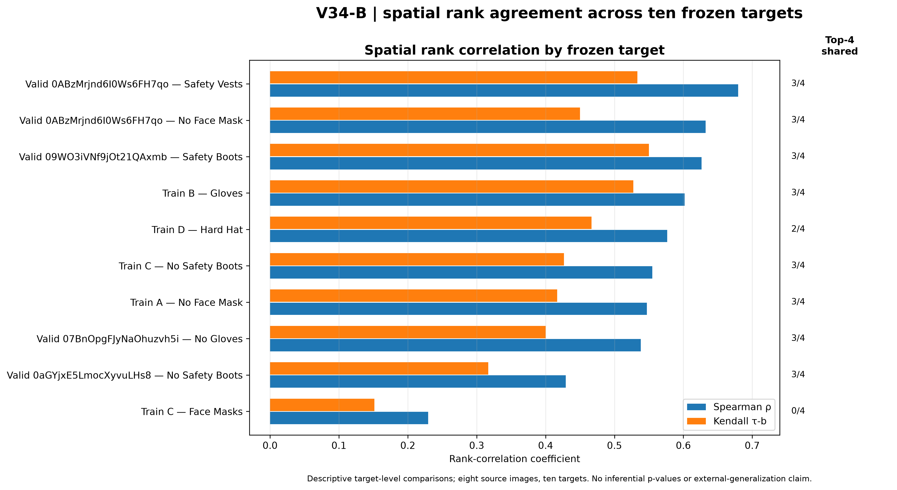

**Figure 1.** Summary of V34-A spatial rank agreement across the ten frozen target detections. The figure reports per-target signed area-normalized Spearman ρ, Kendall τ-b and top-four region overlap. The aggregate means are ρ=0.5416, τ-b=0.4239 and 65% top-four overlap. These are descriptive comparisons across eight development-exposed images, not an independent-site validation or an external explanation-ground-truth assessment.

The renderer reconstituted 64 fine cells and both 4×4 arrays for each of ten targets. It independently recalculated all ten Spearman and Kendall coefficients from the 16 aligned coarse regions, recomputed both top-four sets and their intersections, and verified exact agreement with the V34-A archive for all ten targets. The two new synthetic tests passed. The common display scale is symmetric around zero at **±15.470900859749108**, the 97.5th percentile of absolute values among the 800 displayed cells. **17/800 values (2.125%)** exceed this limit and are saturated in color only; all ranking and correlation calculations use the un-clipped archived values.

The target-level values are unchanged from V34-A: mean Spearman ρ=**0.5416**, mean Kendall τ-b=**0.4239**, and mean top-four overlap=**65%**. The Train C Face Masks target remains the lowest-agreement case (ρ=**0.2295**, τ-b=**0.1514**, overlap **0/4**); Train D Hard Hat has 2/4 overlap, while the other eight targets have 3/4 overlap. The figures provide a transparent visual presentation of the existing numerical analysis, not an additional independent sample or a new test of explanation quality.

The complete set comprises ten individual 300-dpi PNGs, a summary PNG, an 11-page PDF (summary plus ten targets), a metrics CSV and a JSON manifest. Files are stored in [figures/V34B_2026-11-22/](figures/V34B_2026-11-22/); the [V34-B generation report](V34B_SCIENTIFIC_FIGURE_GENERATION_REPORT_2026-11-22.md) records source hashes, scale policy, per-target metrics and integrity checks. The final engineering workflow [45024648943](https://github.com/EZZALDEEN049/Y-PPE-Detection-RFDETR/actions/runs/45024648943) passed, including figure-generation tests and artifact upload. This stage used **zero new detector inference calls**, did not access Test, and did not change the source images, annotations or splits.

## 5. Discussion — interpretation of completed measurements and untested SEER-PPE hypothesis

### 5.1 Confirmed technical contribution versus the intended intervention claim

The completed original-source integrity audit, automatic crosswalk and metadata risk cohorts establish a traceable **measurement substrate** for the proposed SEER-PPE study. The four-source Train box matching confirmed that fixed RF-DETR predictions can be linked to the author's saved class-specific annotations, but its 0.949495 F1 is strictly an in-training alignment diagnostic. The newly executed V23 original-Source `Valid` five-image bbox pilot (22 TP, 1 FP, 1 FN; F1 0.956522) confirms current-label geometry matching is feasible with the unchanged original model, but its deterministic, nonrandom, historically exposed set of just 23 objects cannot supply a statistically generalizable Validation performance estimate. Likewise, the 0.885018 historical M0 Valid F1 is an arithmetical reaggregation of the model provider's **2025** per-image counters; it cannot be interpreted as the effectiveness of a safety-oriented routing intervention introduced later. The V32/V33 research endpoint is narrower than the historical safety-intervention proposal: image-level PPE detection plus perturbation-response characterization and selective targeting under explicit compute budgets. V26–V30 empirically address detection and target-response feasibility; V33-A demonstrates limitations of arm-level causal and significance interpretations. Recent prior work already implements selective explanations and uncertainty-gated PPE verification, so any incremental method claim must be restricted to the measured target-specific protocol and its reproducibility, not a novel worker-safety intervention. Maintaining that separation is a more defensible scientific position than promoting familiar detection metrics to new policy achievements.

### 5.2 Source-dependence concerns and composition-induced metric movement

Hash equality and near-image similarity test different properties. The full original Train–Valid audit found zero exact source-byte or decoded-RGB duplicates, yet near-duplicate and same-site hypotheses remain, including source-risk flags covering 92 of the 459 corrected Valid images. The classes and box density in those images differ from the retained group. V22 demonstrates a 20.04% reduction in image count but only a 12.16% reduction in current annotation boxes when M2 is selected. Therefore M0, M1 and M2 are **not exchangeable cohorts**. The small shift in historic model micro-F1 under risk exclusions may reflect image and class composition, historical source relations, labeling differences and/or genuine difficulty variation. With no independently verified source clusters, neither significance tests assuming unrelated images nor causal estimates of "leakage inflation" would be justified. M2 is **unflagged, not proven acquisition-independent**.

### 5.3 Annotation evidence and reproducibility

All original source labels were selected, classified and checked by the same principal researcher, avoiding a need to redo image reviewing as a procedural formality but requiring transparent acknowledgment of a **single-curator** reference. The current Saved Source annotations include 729 model-assisted provenance markers among 3,471 boxes; such markers must be preserved as known annotation workflow evidence, not discarded or labeled wrong without further evidence. Archived aggregate markers cannot be allocated to individual classes, so class-specific manual-assistance bias has not been measured.

The 13 images with differences between the 2025 provider-evaluation GT count and current saved Source boxes warn that **version-specific reference provenance matters**. Matching source `imageId` proves which image was evaluated, not that historical and current bounding boxes, class identities and counting policies were equal. Any subsequent current-label detection performance analysis should acquire new prediction geometry from the unchanged original model at prespecified inference settings and recompute matches against the current labels, while preserving V20 as a separate historical assessment.

### 5.4 Scope boundary: object detection is not worker compliance

A PPE-class detection is an image-level object prediction. It does not identify the wearer, establish equipment ownership, determine whether the item is required for a task, or prove an occupational violation. The current study deliberately stops at detection and perturbation-based explanation analysis. Existing person-to-item pilot links are exploratory only; no worker-level compliance, false-clearance or safety-intervention conclusion is drawn. Review routing denotes prioritization for inspection, not a completed review or a protective action.

### 5.5 Explanation-sensitivity and resource limitations

V30 provides reproducible target-matched perturbation curves and AUCs, but perturbation response is not an external explanation ground truth and does not prove causal faithfulness. Robustness across masking schemes, grid resolutions, blur/background choices and target-selection seeds remains to be assessed. Hosted request round-trip and model-call counts are the only currently measured service-cost indicators; they are not pure detector latency, memory or electrical energy. The paper will not claim faithful explanation, Joule savings or energy efficiency without additional independent reference and instrumentation evidence.

### 5.6 Implications for generalization and publication

The available original Y-PPE Validation and historical Test were part of prior model development, with documented or possible shared acquisition contexts. This constrains generalization beyond the curated dataset. For the current narrowed image-level detection/perturbation-XAI paper, credible publication depends on careful presentation of V26–V33 numeric evidence, adequate matched comparator and explanation-robustness checks, transparent source-risk and development-exposure limitations, and complete statistical and reference reporting. A worker-level compliance endpoint is explicitly out of scope and is not a prerequisite for this paper. The current contribution is primarily **auditable dataset/model provenance and conservative research engineering**, rather than a demonstrated occupational-safety improvement. External claims, real-world injury prevention or model deployment suitability should not be inferred from these intermediate results.

### 5.7 Detection-instance routing and the limits of the A5/A6 comparison

V25 demonstrates that deterministic selection rules can prioritize different image-level detections under equal proposal caps. V27 and V30 provide actual perturbation evidence for selected targets, while V28 adds deletion/insertion probes. These results support technical feasibility and descriptive comparison, not an established reduction in worker risk or a causal improvement in review outcomes. The A5/A6 comparison remains limited by small sample size, development exposure and shared targets; a stronger, expanded matched-budget comparison is still needed before claiming a routing advantage.

### 5.8 Implications of a complete current-reference Valid detector evaluation

The prior gap of only five newly inferred original-Valid images has now been closed for the specific **internal original-object detection benchmark**: 459/459 originally mapped Valid image identities were newly inferred and matched against their current saved author-curated boxes. This produces fully traceable exact-class IoU=0.5 micro P/R/F1 and all 17 per-class outcomes, while retaining single-curator reference provenance, per-image source identity and V23 exposure history. However, **a complete numerical internal dataset evaluation does not make its image sources independent or its occupational safety conclusions valid**. Potential same-site Train–Valid source overlap, unequal annotation density, original model-development exposure and uncertainty of task policy still constrain interpretation.

The 13-image historical/current count-drift sensitivity is especially material: excluding **entire images**, which together contain 319 original Source boxes, changes F1 to 88.47% from the full 87.06%. That difference does not identify whether changed GT boxes, scene type, class frequency, annotation workflow, acquisition overlap or prediction difficulty caused it. It is a predeclared composition sensitivity, not a matched causal effect. Likewise, the new V26 F1 is not experimentally comparable with 2025 provider F1 because the old GT was version-specific and the present vectorized inference outputs were generated in a different execution mode, even though the detector model identity is the same.

To establish a routing-policy advantage under the current V33 image-level scope, a future study must use a stronger prespecified selective comparator on adequately many eligible **image-level target detections** under matched actual XAI-call budgets. V33-A demonstrates that existing A5/A6 mean differences are driven by the four nonshared selected targets and that one image omission reverses the sign of the insertion-relative-to-random advantage difference. No worker-level gold, task mandate, actual review completion, causal explanation ground truth or electrical energy is required for the narrower paper, and none is claimed measured.

### 5.9 Interpretation of V27–V29 perturbation and timing evidence

V27 establishes that, in this small development-exposed sample, the selected target boxes are generally important to the model's matched detections: nine of ten target detections disappeared after Gaussian box blur, while the seven control perturbations produced a much smaller mean confidence change. This supports **local target-box sensitivity**, not a complete explanation-fidelity claim. The target boxes are model detections chosen by A5/A6, not human-authored causal explanation masks; blur can alter context and create out-of-distribution image regions.

V28 adds perturbation robustness evidence but also exposes mask dependence. Black fill removed all ten target detections, yet the Train D box spans 63.75% of the image and is not a localized object-only intervention. The three target-only insertion failures correspond to extremely small boxes, while larger boxes retained their detections. This size pattern is descriptive in ten cases and does not establish a general threshold. The one-step insertion probe tests sufficiency under a black background, not the usual progressive insertion protocol; no ranked pixels, insertion/deletion curves, AUC, SHAP/Grad-CAM map or human explanation ground truth was obtained. Accordingly, the manuscript reports perturbation sensitivity, not validated Faithfulness.

A5's mean target-occlusion drop and specificity margin were slightly higher than A6's in V27; both arms lost seven of eight detections after blur. In V28, both lost all eight after black fill and retained six of eight in target-only insertion, with nearly identical insertion ratios. The small, overlapping sample does not support a statistical superiority claim. The post-selection V23 join favors A5 on four selected Valid boxes (4 TP/0 FP versus 3 TP/1 FP for A6), but the outcome is a current-label object-detection geometry match on five previously exposed images, not a verified PPE mandate, worker identity, safe/unsafe state or false-clearance measure.

V29 supplies a service-level request round-trip sample only. Its 1.5206-second mean includes network and provider overhead; the endpoint returned no separately reported model time. The connected workspace has no registered devices, and the hosted endpoint does not expose process memory or physical Joules. Therefore no energy-efficiency, memory-footprint or financial-cost advantage can be claimed. The 97-call count is a transparent compute-call count, not a dollar or watt-hour estimate.

The nine-image sample is development-exposed and includes five Valid images already used in V23; no independent acquisition cohort was created. No human review was dispatched, no worker/task mandate was independently scored, and no protected Test image was accessed. The worker-safety NOT_FROZEN / scoring_ready=false gate remains unchanged.

### 5.10 Interpretation of V30 explanation-sensitivity and A5/A6 overlap

V30 closes the earlier *execution gap* for an explicitly frozen grid-based progressive deletion/insertion test: the corresponding original-model curves, AUCs and source fingerprints now exist and independently reproduce arithmetically. A saliency ordering drawn from the detector's own occlusion response outperformed a fixed random order in the anticipated direction for most, but not all, targets. This does not show that the saliency map highlights the correct visible PPE, because the evaluation uses the same detector to generate rankings and their response targets; the evidence is **model-response coherence under image perturbation**, not an externally validated causal explanation. Varying grid resolution, blur baseline, target-match thresholds, perturbation fill, seed, model noise and visually grounded human localization remains important for follow-on experiments.

The exact six shared target identities between A5 and A6 prevent an independent-arm test. Reusing one target's curves across both arms is correct for controlling model-call budget but cannot supply two independent observations. The two unique A5 and two unique A6 targets differ in PPE class, geometry and confidence. Opposing A5/A6 mean direction rankings therefore cannot validate a policy winner. A5/A6 remain different **target-selection proposals**, not alternative explanation algorithms or actual human-review interventions. No paired violation-risk or budget-normalized review intervention has been measured against a strong competitor.

The physical-energy and worker-safety endpoints are outside the V33 current-paper scope. The 1,068 V30 detector calls are an accurate **request-count measure**, not measured GPU execution time, Joules, wall-plug watts or financial spend. V33-A added **zero new model calls** and did not access Test, retrain or modify the original annotations/splits. The historical worker-safety readiness flag remains `scoring_ready=false`, accurately but **nonblocking** for the narrowed detection/XAI manuscript.

### 5.11 Interpretation of V33-B grid-resolution robustness

V33-B closes the prospective **4×4 execution gap** with 496 successful additional hosted calls and an independent numeric audit. The ten target maps remained rankable at both 4×4 and 8×8, but categorical rankability does not establish that the spatial importance rankings are alike. The sign of saliency's advantage over one fixed random order was more stable for insertion (9/10 paired targets) than deletion (6/9 comparable targets). The deletion AUC mean and median resolution deltas point in opposite directions, while insertion changes are small on the median and mixed across targets. The defensible conclusion is **partial and direction-dependent resolution robustness**, not universal stability.

One deletion curve was blocked by an ambiguous target match and was correctly retained as null. Saliency beat the single random order in 8/9 scorable deletion cases and 10/10 insertion cases, but this does not quantify variation across random seeds or independently verify that the selected regions are the correct visible PPE evidence. The same detector both generated the perturbation map and supplied the response score; the result remains model-response coherence under a specified neutral-gray/blur protocol.

A5 and A6 still share six of eight selected target slots and differ in two unique detections per arm. Their common targets have identical explanations; all-slot mean differences reflect target composition, not two independent explanation algorithms. V33-B does not establish policy superiority, actual review efficacy, worker-level compliance or safety benefit. The eight images are development-exposed and not independent-site validation.

The 496 calls are an actual request-count measure only. No pure detector latency, financial charge, process memory or electrical energy was measured. No Test data were accessed, no retraining occurred and the original dataset remained unchanged. V34-A subsequently completed the offline area-weighted spatial alignment: mean Spearman ρ=0.542, Kendall τ-b=0.424 and 65% mean top-four overlap, showing moderate target-dependent agreement rather than map interchangeability. V34-B then rendered ten data-derived target figures and a summary figure from the archived maps; all ten per-target coefficients and top-four overlaps were reproduced, with zero new model calls. Multiple random seeds or alternative perturbation baselines would require separate prospective designs.

### 5.12 Interpretation of V34-A spatial map agreement

V34-A closes the specific gap left by V33-B's 10/10 categorical map-rankability agreement: it directly compares the spatial ranking of corresponding regions. With exact pixel alignment and area-normalized signed sensitivity, the ten targets show mean Spearman ρ=0.542 and mean Kendall τ-b=0.424. All coefficients are positive, but the top-four region overlap is only 65% on average, and the Train C Face Masks target has zero top-four overlap (ρ=0.230, τ-b=0.151). The evidence is therefore **moderate and target-dependent**, not evidence that 4×4 and 8×8 maps are interchangeable or resolution-invariant.

The similar secondary raw-drop correlation (mean Spearman ρ=0.535) suggests the moderate agreement is not created solely by the area normalization. However, a coarse single-mask response is not the sum of four independent fine-mask responses: RF-DETR's output can be nonlinear and interactions among masked regions are not measured by the single-cell probes. The correlation measures spatial ordering agreement under two mask scales, not a causal decomposition or human-grounded explanation quality.

Train and Validation summaries are descriptive only. Each split has four unique development-exposed images; Train C and Valid 0AB each contribute two targets from one image. The coefficients are not independent observations, the cells within a map are spatially dependent, and no inferential p-values are warranted. V34-A uses no new model calls and does not alter any data. A practical next step is to render paired signed heatmaps for the ten targets from the archived aligned maps, with a common scale and explicit top-four overlap, before final figure and manuscript reconciliation.

### 5.13 Interpretation and limitations of the V34-B scientific figures

The V34-B figures make the V34-A spatial-rank result visually inspectable without changing its evidence base. The common diverging scale and paired panels make positive and negative signed detector-response sensitivities comparable across targets, while the gold outlines identify the four highest-ranked regions at each resolution. The left-panel outlines represent 2×2 fine-cell footprints corresponding to pooled 4×4 regions; they do not denote four individual 8×8 cells. The correlations and top-four overlap are calculated across the 16 aligned coarse regions, preserving the exact estimand of V34-A.

The 97.5th-percentile shared color limit is a display choice needed because a small number of area-normalized cell values are extreme. Seventeen of 800 plotted values are saturated at ±15.4709; the renderer records this explicitly, and no saturation/clipping is applied to the underlying maps or to the statistical calculations. Therefore color intensity near the scale endpoints should not be read as a precise magnitude for those saturated cells. The exact numerical maps and per-target values remain available in the V34-A JSON and V34-B manifest/CSV.

The figures confirm that spatial agreement is target-dependent: the Train C Face Masks case has no shared top-four regions and the weakest rank coefficients. They do not demonstrate causal explanation truth, human-grounded visual evidence, resolution invariance, policy superiority, worker compliance or independent-site generalization. They are publication figures for the measured perturbation-response analysis, not additional experimental observations.

## 6. Limitations, provenance, ethics and data availability

**Author's ownership and release-rights declaration (17 November 2026; self-attested):** The author states that they are the original owner of the primary Y-PPE research data and possess full rights to control, use and distribute their original dataset contributions. This declaration is reported as the author's attestation, not as independently audited legal/title evidence. The author controls the future release decision, and SEER-PPE will support an openly reproducible research package if that is the author's chosen release scope.

**Ethics approval and participant consent (author confirmation required before submission):** The current repository record contains no institutional ethics approval/exemption identifier or documented participant-consent statement for identifiable worker imagery. Accordingly, this manuscript does not assert that ethics approval was obtained or waived, or that informed consent was obtained. Before submission, the author must confirm the applicable Taiz University ethics determination and the consent/privacy basis for capturing and publishing any identifiable workers. If the required clearance cannot be documented, identifiable imagery must be excluded or appropriately anonymized and the target journal's ethics office consulted.

**Funding, competing interests and author contributions (author confirmation required):** These declarations are not yet documented in the current manuscript record and must be confirmed by the author in the format required by the selected journal.

**Provenance and scope:** Previous Y-PPE research records also describe supplementary imagery from external repositories and incomplete per-image source attribution. The author's ownership statement over the primary dataset cannot by itself establish the licenses, permissions or privacy clearance of every externally sourced photograph, identifiable person, third-party work or Roboflow-hosted model artifact. Before public image redistribution, the release manifest should distinguish author-original material, third-party material and uncertain provenance and apply the appropriate permission, redaction or exclusion rule. Such release screening is distinct from, and does not undo, the frozen scientific image archive or its integrity evaluation.

**Proposed availability statement, subject to the author's final release selection:** SEER-PPE source code, configuration files, data dictionary, pseudonymous audit-log schemas, frozen evaluation manifests that do not disclose personal information, aggregate results and reproducibility instructions may be released publicly. Author-owned Y-PPE images and annotations may be distributed on the author's authorization subject to any applicable image-subject privacy obligations; items with unresolved third-party licensing or identifiable-person consent constraints may remain access-controlled or be excluded from the public package. RF-DETR pretrained/fine-tuned weights and hosted Roboflow service access must be assessed under their own applicable contractual terms, distinct from the author's rights in original image data. Historical acquisition-source uncertainty and previous test exposure remain methodological limitations even if all author-originated images may lawfully be published. No individual worker-level safety or energy result is reported unless actually measured.

**Additional empirical limitations after V26:** The full 459-image original-Source Valid object detection has now been freshly computed against CURRENT author-curated boxes, but the historical Valid images were previously development-exposed, and metadata-only source-risk flags cannot certify independent acquisitions. Source GT differs from 2025 provider reference in 13 images, and the V26 uniform hosted inference method differs from historical single-image/provider execution; results cannot be assigned a causal gain/loss relative to the old model Eval. Exclusion of all 13 GT-count mismatch images also excludes their 319 current GT boxes, making the observed sensitivity compositional, not a 16-box causal effect.  A2 and A5 have been implemented and run on nine existing model-output images (74 detections) with matched *proposal budgets* and mandatory common abstention, but neither executes an explanation or dispatches a human review. The 0 worker-cleared outputs arise from a hard guard, not measured safety correctness, and no physical energy, latency or verified worker reference exists to substantiate efficacy. The A5 priority weights are engineering heuristics, not calibrated hazard estimates.  The five new, deliberately preselected Valid originals yield a small, development-exposed geometric preflight (F1 0.956522) but no random sampling or source independence. The result cannot be used to claim a 459-image detector improvement, verify per-worker compliance or select a future Test threshold.  The 2025 model Eval did not provide attributable box geometry, and its reference-object counts differ from the present annotations in 13 Valid images (16 objects total). The validation source-risk grouping is a metadata/technical hypothesis, not an external independently sampled cohort. M0/M1/M2 differ in class support and box density, so neither a per-image confidence interval assuming independent acquisition nor a selection-based causal claim is warranted. Existing annotation provenance marks 729 model-assisted boxes but cannot identify the classes of those particular markers using the saved count snapshot. The original worker-level mandate, confirmed violations, completed review and physical-energy endpoints were not measured and are outside the current manuscript. V30/V33 quantify model perturbation sensitivity only; no independently grounded causal explanation fidelity or statistically supported routing superiority is claimed. Furthermore, the GitHub repository was **public at the time of V22 audit**; public metadata and code must exclude keys, private media, unverifiable redistribution permissions and unnecessary personally identifying image content. Any later repository-visibility change must be checked from the repository itself rather than assumed from the author's intent.

**Additional V33-B limitation:** the 4×4 study shares the same eight development-exposed images and ten selected target IDs as V30; its 10/10 map-status agreement is categorical rankability, not spatial saliency-map correlation. One deletion AUC is null due to a documented ambiguous match. The random control uses one deterministic order per target, and no repeated-seed distribution is available. The observed resolution effects are descriptive and target-heterogeneous.

**Additional V34-A limitation:** spatial rank correlations are descriptive within-target comparisons across two different occlusion sizes on the same eight development-exposed images. The 16 cells per target are spatially dependent, two images contribute two targets, and the mean coefficients are not independent-sample inferential evidence. The 65% top-four overlap and one zero-overlap target prevent a claim of spatial map interchangeability or resolution invariance.

**Additional V34-B limitation:** the common 97.5th-percentile display scale saturates 17/800 values (2.125%) for visualization only. Rankings and statistics use the original un-clipped archive, but endpoint colors do not encode the exact magnitude of saturated values. The 8×8 panel shows fine-cell densities while rank correlations are calculated after pooling to 16 aligned coarse regions; captions must retain this distinction.

**Author-approved Q41 publication package (17 November 2026; planned, not yet released): A comprehensive reproducibility package will include releasable Y-PPE image data and annotations, SEER-PPE code, frozen configurations, environment/dependency locks, dataset/weights SHA-256 manifests, pseudonymized audit schemas and shareable logs, software tests, Colab notebooks, and scripts/instructions to regenerate manuscript tables and figures from measured experiment outputs. Model weights will be released only if applicable terms permit; otherwise provide verified instructions to lawfully access the exact model version. Keep restricted media, personal data and unresolved third-party materials out of the public package until cleared. Distinguish reproducible **engineering tests** from future empirical risk, explanation, energy and ablation results. **No public archive or model-weight release has yet occurred.**

## 7. Conclusion

This study presents an evidence-bounded evaluation of an unchanged 17-class RF-DETR Small detector on the author-curated Y-PPE corpus and a target-specific, black-box perturbation analysis of selected PPE detections. Against the current author-curated references on 459 original Source Validation images, the detector produced TP=3,297, FP=806 and FN=174, corresponding to micro-precision 0.803558, recall 0.949870 and F1 0.870610. The M1 and M2 source-risk sensitivity cohorts yielded F1 values of 0.870064 and 0.868157, respectively. These results describe performance against the current single-curator reference on development-exposed images; they are not an independent-site or external-generalization estimate.

The perturbation experiments show that selected target detections can be sensitive to localized occlusion and deletion, while target-only insertion does not always restore the original detection. Progressive 8×8 and 4×4 grid experiments generated reproducible target-response maps, and the subsequent exact-pixel alignment found mean Spearman ρ=0.5416, mean Kendall τ-b=0.4239 and mean top-four region overlap of 65% across ten selected targets. This is moderate, target-dependent spatial rank agreement rather than resolution invariance. The figures provide a reproducible visual account of these archived measurements without adding new inference observations.

The findings support a bounded conclusion: image-level PPE detection and model-response sensitivity can be measured and audited using a fixed detector, explicit target matching, perturbation ledgers and reproducible spatial summaries. They do **not** establish causal explanation faithfulness, human-grounded explanation quality, worker-level PPE compliance, Person–PPE association accuracy, actual review efficacy, A5/A6 policy superiority, acquisition-independent generalization, model latency, physical energy consumption or safety improvement. In particular, the selected XAI sample comprises eight development-exposed images and ten targets, with multiple targets drawn from the same images; its target-level statistics are descriptive.

SEER-PPE should therefore be interpreted as an image/object-level detection and perturbation-sensitivity study, not as a validated worker-safety intervention. Future extensions would require appropriately authorized independent source groups, repeated perturbation controls, stronger matched-budget comparators, verified worker/task references and directly measured operational costs. Those extensions are not inferred from the present results.

## References — author–date working style (journal-specific formatting pending)

Adebayo, J., Gilmer, J., Muelly, M., Goodfellow, I., Hardt, M., & Kim, B. (2018). Sanity checks for saliency maps. *Advances in Neural Information Processing Systems, 31*. https://proceedings.neurips.cc/paper/2018/hash/294a8ed24b1ad22ec2e7efea049b8737-Abstract.html

Al-Tayar, E., Saeed, M. A., & Saif, A. (2025a). AI-driven RF-DETR decision system for real-time PPE monitoring in Yemen's development projects. In *2025 International Conference on Decision Aid Sciences and Applications (DASA)* (pp. 204–208). IEEE. https://doi.org/10.1109/DASA68193.2025.11499131

Al-Tayar, E., Al-Azazi, S. A., & Saeed, M. A. (2025b). X-RF-DETR: A framework for explainable and trustworthy PPE decision support. In *2025 International Conference on Decision Aid Sciences and Applications (DASA)* (pp. 1048–1052). IEEE. https://doi.org/10.1109/DASA68193.2025.11498849

Al-Tayar, E., Al-Azazi, S. A., Ali, A., & Alawag, A. M. (2026a). BIM-integrated explainable vision for real-time PPE safety in Yemen's construction sector. In *2026 6th International Conference on Emerging Smart Technologies and Applications (eSmarTA)*. IEEE. https://doi.org/10.1109/ESMARTA70636.2026.11652079

Al-Tayar, E., Al-Azazi, S. A., Saeed, M. A., Ali, A., & Hassan, A. (2026b). PPE detection in Yemeni construction sites: YOLOv11m vs. RF-DETRs. In *2026 6th International Conference on Emerging Smart Technologies and Applications (eSmarTA)*. IEEE. https://doi.org/10.1109/ESMARTA70636.2026.11652190

Barlybayev, A., Milosz, M., Amangeldy, N., Li, G., Razakhova, B., Tazhib, A., Nazyrova, A., & Lamasheva, Z. (2026). Systematic review of computer-vision technologies for personal protective equipment compliance monitoring. *Computers, 15*(6), 388. https://doi.org/10.3390/computers15060388

Bouguessa, A., Bekki, I., Daoud, M. A., & Mostefaoui, S. A. M. (2026). A hybrid perception–reasoning architecture for context-aware personal protective equipment compliance assessment. *Engineering Applications of Artificial Intelligence, 181*, 115725. https://doi.org/10.1016/j.engappai.2026.115725

Di Renzo, M., Niro, F., Agnello, P., Petyx, M., Martinelli, F., Cesarelli, M., Santone, A., & Mercaldo, F. (2026). On vision transformer explainability for personal protective equipment detection: A qualitative and quantitative analysis. *Journal of Imaging, 12*(5), 195. https://doi.org/10.3390/jimaging12050195

Fong, R. C., & Vedaldi, A. (2017). Interpretable explanations of black boxes by meaningful perturbation. In *Proceedings of the IEEE International Conference on Computer Vision (ICCV)*. IEEE. https://doi.org/10.1109/ICCV.2017.371

Hooker, S., Erhan, D., Kindermans, P.-J., & Kim, B. (2019). A benchmark for interpretability methods in deep neural networks. *Advances in Neural Information Processing Systems, 32*, 9737–9748. https://proceedings.neurips.cc/paper/2019/hash/fe4b8556000d0f0cae99daa5c5c5a410-Abstract.html

Kendall, M. G. (1938). A new measure of rank correlation. *Biometrika, 30*(1–2), 81–93. https://doi.org/10.1093/biomet/30.1-2.81

Paes, L. M., Wei, D., & Calmon, F. P. (2024). Selective explanations. *Advances in Neural Information Processing Systems, 37*, 55562–55590. https://doi.org/10.52202/079017-1765

Petsiuk, V., Das, A., & Saenko, K. (2018). RISE: Randomized input sampling for explanation of black-box models. In *British Machine Vision Conference (BMVC)*. https://arxiv.org/abs/1806.07421

Robinson, I., Robicheaux, P., Popov, M., Ramanan, D., & Peri, N. (2026). RF-DETR: Neural architecture search for real-time detection transformers. In *International Conference on Learning Representations (ICLR)*. https://arxiv.org/abs/2511.09554

Spearman, C. (1904). The proof and measurement of association between two things. *The American Journal of Psychology, 15*(1), 72–101. https://doi.org/10.2307/1412159

Vaghani, B. V. B. (2026). Construction safety AI that knows what it doesn't see: A Sentry–Judge hybrid for PPE absence detection. *Frontiers in Built Environment, 12*, Article 1976288. https://doi.org/10.3389/fbuil.2026.1976288

Yi, W., Xu, W., & Tan, Y. (2026). Regulation-aligned PPE compliance assessment for work-at-height using visual relationships and scene graph reasoning. *Advanced Engineering Informatics, 74*, Article 104612. https://doi.org/10.1016/j.aei.2026.104612

**Reference-audit note:** The two eSmarTA 2026 author lists and ordering are transcribed from secondary proceedings-index records because the corresponding IEEE Xplore metadata pages were not retrievable during this pass. They require confirmation against the final IEEE records or the author's published PDFs before submission. The focused review is not a PRISMA systematic review, and the reference style must be converted to the selected journal's exact requirements.

## Appendix A. Phase 4 Data Readiness and Adjudication Pilot — engineering evidence (6 November 2026)

The full current Roboflow **original** Y-PPE metadata index was read: 2,327 unique image IDs across 1,625 train, 468 validation, and 234 original test. The original test contains 104 images with a `Persons` object label and only 16 images with a `No Hard Hat` object label; these are **not worker-level confirmed violations**. Thirty deterministically sampled development images (16 train, 14 validation) from five deliberately enriched strata were read at saved-annotation level. The 30 records contained 396 object boxes; all passed basic geometric bounds checks. Eighty-nine boxes included `RFBoxPrompt/v1` model-assistance metadata; the extent of any later human verification is unknown. No human adjudication has been conducted for SEER-PPE.

The historical 2,288-image, 16,300-box 17-class corrected Y-PPE derivative remains the **candidate experimental archive** and is **not newly file-hash verified** in this phase; local binary access was unavailable. Thirty-one exact filename-string groups spanned raw dataset splits, including ten involving the original test split. Filename collisions are flags for inspection, not proof of scene leakage. Per-image source-family identifiers and source rights were absent from Roboflow's original image metadata, so true source-group independence cannot yet be certified. The 30-image stratified development review queue is provisional pending membership, rights, and source-family checks.

No SEER-PPE empirical performance, worker-level risk, explanation-fidelity, or energy metric has been measured. The journal Results section remains reserved for correctly preregistered and actually completed experiments. See the versioned companion `PHASE4_REPORT.md`, `ANNOTATION_REVIEW_PROTOCOL.md`, and `evidence/PHASE4_INDEX_AUDIT_2026-11-06.json`.

## Appendix B. Phase 5 reproducible clean-data reconstruction (6 November 2026)

The study's candidate 17-class Y-PPE v2 Clean derivative was freshly **reconstructed in a temporary GitHub Actions environment**, using unaugmented clone `master-fylfq/altayyar-0oflt-lafos-qqauz-ty5nh/2`, the archived deterministic 39-source-image correction manifest, 68 exact duplicate-label removals and one near-identical label-row removal. The successful run [#42153641457](https://github.com/EZZALDEEN049/Y-PPE-Detection-RFDETR/actions/runs/42153641457) yielded **2,288 images** (1,595/459/234 train/valid/test) and **16,300 annotations** (11,698/3,471/1,131). The mixed exported labels comprised **15,864 normalized bounding-box rows** and **436 normalized polygon-vertex rows**. The read-only audit recorded zero critical file/label errors, no cross-split byte- or pixel-exact image duplicates, and no overlap of three recognized source-video groups. Seven cross-split dHash≤4 candidate pairs remain flagged for documented visual adjudication. This engineering integrity result is not evidence of independence among all construction sites or original photo acquisitions. Source-family documentation and image-by-image viewing/redistribution rights are still unresolved.

The original pilot's 30 development images were aligned to cleaned-export filename candidates using split, normalized name and stored annotation-box counts. Twenty-nine yielded unique name-plus-count candidates; one uniquely matched name differed by exactly one object row (28 original vs. 27 clean) and the original saved annotation contains a duplicated same-label box. **All thirty links remain filename/label based and have NOT received original-to-clean pixel identity verification**. Reviewer A and B queues have been separately prepared and randomized without preloaded labels or model outputs. Human annotation and expert reconciliation remain at **zero completed records**, pending rights and source/identity clearance. The model's original historical reported 96.22% mAP50 remains a prior published result, not new SEER-PPE performance.

**Artifact-provenance statement:** The temporary runner's corrected **image archive was not persistently saved**, while metadata/checksum manifests and analysis reports were retained (manifest SHA-256: `4b7c458d6895706e7bc0886619be9ea12964ff5a9ba51a41f8af297e88a48345`). A future securely stored archive must be compared against the file-hash manifest before being called the frozen dataset. Cross-site independence, reviewer-adjudicated worker truth, explainability fidelity and energy measurement remain **OPEN**. See `PHASE5_REPORT.md` and `evidence/PHASE5_CLEAN17_AUDIT_SUMMARY_2026-11-06.json`. No new safety or energy result is claimed.

## Appendix C. Phase 6 restricted archive, image-screening and computational preflight (10 November 2026)

The successful archive reconstruction was repeated for a private, lossless backup using the same unaugmented clone and frozen corrections. A deterministic ZIP was split into three segments and saved inside the author's restricted SEER-PPE Google Drive research folder, not committed to the public source repository. A second local round trip recovered all segments, checked every individual segment digest, checked the combined archive SHA-256, ran ZIP CRC verification and extracted all **4,579 files**. The full packed archive size was **127,166,577 bytes**. The primary file count is **2,288 images** with **16,300 annotations** and **17 classes**. Internal use does not imply rights to publish individual third-party images. The online GitHub Actions storage only acted as a temporary transfer mechanism.

All **seven** cross-split dHash≤4 candidate pairs were inspected in a combined image review, showing visually different products/poses/objects. Each is recorded `ANALYST_VISUALLY_DISTINCT; INDEPENDENT_SOURCE_REVIEW_PENDING`. This single-assistant/analyst review is not independent expert double adjudication, and unseen source/video relationships beyond the known families remain unverified. The original cross-split byte- and pixel-exact audit still has zero matches.

Of the **30 development images**, an explicitly provisional analyst screen found 14 plausible fieldwork scenes, 14 visually obvious product/non-work negative controls, and 2 uncertain contexts. These are not adjudicated worker/required-PPE labels, and cannot stand in for task-specific site requirements; every case remains an unaudited occupational safety decision. The negative controls are reserved for checking eligibility routing rather than forced to count as violations. In the cleaned archive, 29 pilot links have one filename+annotation-count candidate and one pilot link has a single duplicated annotation row removed; original-to-clean photographic identity still needs independent source confirmation.

The engineering package now contains a model-agnostic per-target occlusion generator which re-runs a real predictor for each grid patch and distinguishes `MATCHED`, `LOST` and `AMBIGUOUS` instance identities. This generator has **not** produced a real 17-class ALTAYYAR explanation. The local hardware probe records PyTorch CPU-only, CUDA unavailable, no readable Intel RAPL readings and no NVML package; therefore measured electrical energy remains unavailable. The combined synthetic unit test suite passed **56/56**, including additional model-agnostic occlusion tests; synthetic unit tests are not model performance evidence.

**Experimental integrity boundary:** This phase does not claim independent worker ground truth, certified policy compliance, quantified energy saving, actual visual explanation faithfulness or empirical Q1-level novelty. For the amended v0.7 design, next tasks require an explicitly documented **single-researcher reference** with unresolved independent-adjudication limitations, actual site/task mandates or separately labeled hypothetical scenarios, the exact 17-class original checkpoint under an audited local loader, and physical energy metering only if energy efficiency in joules will be claimed. Locked calibration and executed paired baseline comparisons remain necessary before any algorithmic superiority claim. The older Phase 6 reviewer-A/B queues were prepared but yielded no independent review; they are not a prerequisite under the author-approved v0.7 design.

## Appendix D. v0.7 decisions and provenance limits (15 November 2026)

The researcher approved through question 39: joint safety/faithfulness/compute objectives; explain-on-demand routing; mandatory abstention when evidence is inadequate; worker–PPE geometric association; limited internal random-plus-hard-case reference review; historical-Test development-exposure disclosure; `SOURCE_UNKNOWN`/similarity sensitivity; explicit presence-versus-mandate distinction; risk/uncertainty calibrated on Validation only; genuine energy measurement conditional on instrumentation; matched strong selective baselines and feature ablations; target-specific Occlusion/Deletion/Insertion with `LOST` and `AMBIGUOUS`; missing-person coverage checks; capped review with unresolved backlog; and an access-controlled audit trail. These are **design decisions, not observed research findings**. No independent safety reviewers, site policies, electrical measurements, or full SEER empirical gains have been verified.

## Appendix E. Q40 ownership clarification and release planning (17 November 2026)

The author explicitly stated in Arabic that they hold full rights as the original owner of the principal dataset and have complete freedom to dispose of it. This is recorded as an **author self-attestation**, not independent proof of title to all source materials. The research plan will not treat the author's own Y-PPE annotations or original photographs as unauthorized by default. Before any public package upload, a rights inventory still separates original items from any externally sourced/unknown-rights image content, privacy/consent constraints, and separate Roboflow model-weight licenses. Q41 subsequently selected a comprehensive reproducibility package, with per-artifact rights screening and model-weight redistribution conditions preserved. This decision adds **no new model validation, safety outcome, energy measurement or release event**.

## Appendix F. Q41 comprehensive reproducibility package — author decision (17 November 2026)

**Selected option D.** Planned deliverables are (i) rights-cleared Y-PPE data/annotation manifests and author-approved image releases, (ii) SEER-PPE source, tests, configuration and dependency locks, (iii) exact input/model hashes and provenance records, (iv) privacy-filtered decision/XAI/computational log formats, (v) Colab execution notebooks and fixed-seed instructions, and (vi) scripts that regenerate tables and figures only after empirical runs produce authentic results. Package metadata will state artifact version, license/rights status, dataset split, checksum, hardware requirements, expected tests, and known limitations. Provide original-model weight bytes only when distribution terms permit; otherwise instructions to retrieve authorized weights. This is an **approved release plan**, not evidence of a completed public distribution or research effectiveness.

## Appendix G. Q42 staged verification of reproducibility — author decision (17 November 2026)

**Selected option D; planned verification protocol, not completed reproducibility evidence.** The research package must pass independently inspectable stages: **(1)** compare SHA-256 for every frozen input image archive, annotation manifest and exact original model-weight file; record dataset/split provenance, permissions, package release/version and execution commit; **(2)** run software unit tests in a clean environment and preserve machine-readable results; **(3)** load and validate the *original* 17-class ALTAYYAR checkpoint in a newly configured Google Colab environment, then reproduce a fixed permitted-Train inference sample and compare class/box/score outputs against recorded hosted/local reference within declared numerical and preprocessing tolerances; **(4)** execute the same locked sample, seeds and configurations for matched-instance explanation, baseline/ablation policies and resource accounting only after those experiments exist, storing per-image predictions, `LOST/AMBIGUOUS`, execution conditions and failure traces; **(5)** regenerate manuscript tables and figures using only authenticated empirical output tables, with summary checks and declared nondeterministic tolerances. Treat timing/energy as distributions across documented repeated hardware runs, not bit-for-bit invariant measurements. All experiments must report PASS, FAIL or NOT_RUN explicitly, together with a reason and log location. No stage-4/5 test or energy/safety result is asserted to have passed at the time of this decision. Q43 will determine the Colab environment/seed pinning policy.

## Appendix H. Roboflow-only execution amendment (17 November 2026)

**Author instruction:** All new simulations and empirical tests should be conducted in Roboflow, not Google Colab or another training platform. Prior three-month from-scratch RF-DETR training and historical outcomes must be reused, not repeated. `altayyar-0oflt-lafos-qqauz/2` and version-2 trained model remain the fixed detector. The older local-checkpoint/Colab steps in appendices F–G are historical planning options **superseded** by this latest platform-only constraint; no checkpoint handoff or further training is required for ordinary hosted comparisons.

**Native verified capabilities:** project and version metadata; 17-class/2,327-image dataset health and labels; 5,577-image augmented version-2 training metadata and original trained model; direct original-model hosted inference on permitted Train sample with five detected classes matching the saved annotation class set; readable Workflow definitions and Workflow block catalog. Built-in blocks include configurable confidence filtering, overlap-based spatial relationships, conditional routing, blur/visualization, data aggregation and event logs. These support *candidate* SEER routing components, not yet empirically validated person–PPE associations, causal explanations or safety outcomes.

**Restrictions and unresolved science:** Existing Base Workflow includes an Active Learning `roboflow_dataset_upload@v2` side-effect; do not execute it for read-only experiments. The connector denied `Manage Workflows` and `view_workflow_evals` permissions and restricted annotation-board/deployment access. User/admin authorization is needed before creating a separate read-only research Workflow or running platform Evals. Heatmap Visualization is not equivalent to Grad-CAM. Exact target-matched Occlusion/Deletion/Insertion must be demonstrated using available native transforms and repeated hosted inference before inclusion in results; otherwise mark unperformed and narrow claims. Real electrical Joules and gradient access cannot be inferred from hosted output. The original training record is baseline evidence, **not** new SEER effectiveness.

## Appendix I. First native Roboflow SEER-PPE routing prototype — engineering smoke test (17 November 2026)

The owner-approved platform-only plan produced a **separate, read-only** saved Workflow `SEER-PPE Routing Prototype v0.1` (ID `QYzcGMCrJ9uwLmkAfsfF`, editor https://app.roboflow.com/softyyemen/workflows/edit/seer-ppe-routing-prototype-v01-1794871362276), with the original frozen 17-class `altayyar-0oflt-lafos-qqauz/2` RF-DETR model, no training or source-data changes and Active Learning disabled. The native pipeline provides provisional confidence bands (detector candidate floor 0.20, high-confidence >=0.60, lower-confidence candidates 0.20–<0.60), separate person/PPE-category subsets, `Persons` center-overlap detection as a *spatial candidate heuristic*, and visualized outputs. These are not final threshold values, person–PPE assignments or compliance decisions.

On one historical **Train** smoke image `Kathiah Gets a Chance03.jpg`, returned detections were 29 candidates; 26 high-band; three lower-band candidates; four `Persons`; 25 PPE-category; 24 center-overlap PPE-category candidates. Results are observed model outputs **only**, not reference-label safety results. Built-in filters/overlap work at a technical level; no calibrated risk, verified employer PPE mandate, automatic human-review status or audit-ready review queue, matched instance explanations, blinded independent annotations, validated selective safety gains, new Test results or genuine energy measurements exist. Earlier permission-denied statements in Appendix H described the **pre-reconnection account**; after linking the owner Admin on 17 Nov 2026, creation and hosted trial of the separate baseline and routing prototype succeeded and Workflow Evals access was confirmed. Any next-stage claim must be supported by new measured experiments.

## Appendix J. V17 paired fixed-detector and conservative SEER policy offline trace — 21 November 2026

**Experimental status: executed read-only engineering preflight on historical Train outputs; no prospective Validation scientific scoring.** The original hosted 17-class RF-DETR Small model `altayyar-0oflt-lafos-qqauz/2` and Workflow `61llCTFuQ4Aq4goQ9HiP` were **not run again**. V17 deterministically reused the four real Train inference records produced in V16, retaining identical original detection IDs, classes, confidence scores and image-level pairing. A0 is the raw fixed detector output and has **no worker compliance decision policy**; A5 is an **offline proposed conservative decision layer**, not a second trained detector, live review queue or verified safety intervention. The post-hoc human reference comparison from V16 did **not** enter A5 routing features.

The saved paired trace contains **51 raw detections** (A 5 / B 16 / C 29 / D 1), including 7 Person boxes and 38 typed PPE cues, plus six context-only non-person detections. It preserves 34 tentative single-person geometric owner proposals, four ambiguous/unassigned typed items, and conservative **suggestions** for human review on all 38 typed cues. These are neither human-signed PPE links nor 38 review requests delivered to a reviewer. Four scenes remain human-person-coverage-unverified. In the no-Person detection D scene, a hard-hat cue remains without an identifiable wearer and no no-worker or safe-scene verdict is made. For every potentially affected worker, actual workplace requirement remains unknown; negative PPE class predictions are not automatically translated into visual absence or occupational violation.

Fail-closed GitHub Actions [V17 executed policy trace](https://github.com/EZZALDEEN049/Y-PPE-Detection-RFDETR/actions/runs/44851631822) passed synthetic manipulations (Test split substitution, forged person coverage, fabricated worker clearance, false source signing, invalid freeze and confidence-band drift), per-detection pairing conservation, and deterministic archival of the [numeric-only trace](PAIRED_TRAIN_DETECTOR_POLICY_TRACE_V17.json). [V17 pre-freeze protocol](PAIRED_BASELINE_SEER_PREFREEZE_PROTOCOL_2026-11-21_V17.md) and [verified execution report](GITHUB_ACTIONS_V17_VERIFIED_2026-11-21_V01.md) delimit this finding. Two parallel CI suites also passed for the trigger commit. No original images, temporary media URLs, raw checkpoint bytes or personal author-signing credentials were published by this experiment.

**Interpretation restriction:** these two paired engineering views are not a valid safety-effectiveness or efficiency comparison. Neither A0 nor A5 has signed worker outcome gold, a matched safe-clearance decision policy, measured review completion, implemented target-matched explanations or electrical energy observations. All incremental explanation and human workload/safety benefits are **unmeasured**, not zero-effect outcomes. Actual V17 additional inference calls = 0, XAI calls = 0 and dispatched reviews = 0 only describe V17 processing scope. No false-clearance denominators, mAP/F1, policy superiority, explainability fidelity or Joule savings follow from the 38 suggestions. A fair scientific A5 comparator must be chosen against a strong selective competitor under matched safeguards, review/compute budgets and a prespecified primary endpoint **before** using any Test outcome.

The **459/459 original Valid→Clean17 technical mappings** do not establish independent acquisition. V15 still records **zero** per-image signed source-independence decisions and **zero** fully signed Valid Person–PPE gold cases. Four Train B individual visual cells and Train D zero-person researcher signoff remain unresolved. Validation remains `NOT_FROZEN`, `scoring_ready=false`; the historical Test remains development-exposed and was not accessed for V17.

## Appendix K. V18 author-curator reference clarification — 21 November 2026

The original dataset author has directly confirmed that he selected, evaluated, classified and checked his images before, during and after the project acquisition/annotation stages, and previously confirmed that all images were reviewed. The design therefore **does not require the author to repeat image inspection or engage a second human annotator** simply to restate the already completed curation. Existing original annotations are adopted as a **single-curator reference** for any future appropriately scoped object-level detection analysis, provided original image IDs, classes, object boxes and fixed predictor outputs are precisely aligned. This is evidence of the annotator's provenance and intended label construction, not an independent second-rater agreement study.

The previously documented 19 accepted Train item/person links and 38 saved visual cells remain supported as previously entered; four additional B cells and the D person-coverage determination are **not inferred** from a general review-complete statement. For worker-level PPE endpoints, analyses may use already recorded person-specific observations and report missing states as *not recorded* rather than demand a new complete relabeling. Bare absence of a PPE detection is not a human-verified absence. A specific occupational *violation* also requires an applicable site/task mandate; incomplete mandate evidence precludes claims about real occupational false clearances, not all object-detection study.

This is an explicit **endpoint separation**: (1) a historical internal object-detection analysis using original author-curated object labels may be designed without imposing independent per-person human-gold reconstruction on every image; (2) strong worker-level safety, independently verified acquisition independence and external generalizability claims still need corresponding evidence and remain unmeasured. Historical test/validation development exposure, same-author confirmation/selection bias and unknown site/session source grouping are disclosed. No inter-rater kappa, independent blind reference, PPE policy proof or unseen Test is claimed.

The [V18 author-primary reference policy](AUTHOR_CURATOR_REFERENCE_POLICY_2026-11-21_V18.md) is a methodological correction; it **does not itself execute any new inference or compute metrics**. V17 engineering paired Train results are unchanged. The strict verified-worker-safety freeze remains `NOT_FROZEN` and `scoring_ready=false`; original annotations/model/splits are unmodified.

## Appendix L. V19 original-source numeric matching and computational source-overlap sensitivity — 21 November 2026

**Author-curated primary labels, not second-rater ground truth.** The author has confirmed that image acquisition, selection, classification and checking were completed throughout field and dataset development; no new human reviewer or repeated image inspection was requested. A read-only query of the original Roboflow Source annotations retrieved **48 saved object annotation boxes across four historical Train pilot images** (A 5, B 15, C 27, D 1). Seven B source annotations include `labeledByModel=RFBoxPrompt/v1` provenance markers, preserved rather than silently recategorized as purely manual independent labels. Existing polygon annotations were evaluated only via their saved enclosing bounding rectangles.

The earlier actual fixed original `altayyar-0oflt-lafos-qqauz/2` hosted RF-DETR Small inference recorded **51 bounding-box predictions** for these same four Train images. The executable V19 matcher verified original Source ID, image filename, split, image width/height, valid saved annotation labels, detection IDs and fixed model identity; used same-class greedy one-to-one matching at **bbox IoU ≥0.50**, and counted **TP=47, FP=4, FN=1**. Descriptive precision was **0.921569**, recall **0.979167** and F1 **0.949495**. These are **development-alignment diagnostics on already trained/exposed Train images**, *not* independent validation, historical Test performance, new RF-DETR generalization, a SEER versus baseline gain or verified worker-level occupational safety. Source annotations bearing the same names as model class labels are not proofs that a visible worker has or lacks legally or site-required PPE.

For optional code diagnostics, class AP averaged over 101 recall points yielded a **truncated above-confidence-0.20** AP50 macro proxy of **0.977498** and AP50–95 proxy of **0.741226** for the classes actually present in the four-source-image reference. **Neither is official full-threshold-range COCO mAP:** model predictions below the previously used hosted 0.20 confidence floor are not in the saved detection output, and the sample includes in-training images. As a sensitivity analysis to model-assisted labeling provenance, V19 excluded the entire B image rather than stripping its seven assisted labels but leaving associated detections as false positives. On three remaining Train images, the archived profile includes 33 original labels, 35 predictions, **TP=32/FP=3/FN=1**, precision **0.914286**, recall **0.969697**, F1 **0.941176**. This is a tiny exploratory perturbation, not a statistical test of label bias.

Using only already archived V14/V15 original Train–Valid metadata without opening images or running inference, a second deterministic tool constructed three **descriptive sensitivity strata of the corrected Valid set**: M0=**459** technically matched Valid photos; M1=**448** after excluding the five old held sources and six technical high-overlap quarantines; M2=**367** after also excluding 81 other flagged possible source-family cases. The original 280 reviewed cross-split candidate pairs contain **12 technical high-similarity edges**, forming **eight connected technical-hypothesis components** and touching nine original Valid source IDs (eight retained in Clean17). These components are not verified identical camera sessions or independent acquisition-group certificates. In particular, M2's 367 unflagged examples remain *independence-unknown*, not certified external holdout observations.

**Endpoint and methodological limitations:** This V19 numerical test validates the box-comparison pipeline against existing author-curated object labels in Train, but does not estimate the intended multi-level SEER policy effectiveness. It performs **zero new model inference, XAI, human review, electrical energy measurement or occupational mandate adjudication**, opens no Test images and does not change any original annotation or source split. The strict source-independent and worker-compliance freeze stays `NOT_FROZEN` with `scoring_ready=false`. A separately scoped *historical internal Valid object-detection* evaluation can use the same author's original annotation reference after freezing predictor settings, exact source IDs, matching rules and sensitivity strata; it must not be advertised as independently unseen or externally generalizable.

Executable evidence: [V19 Train source labels](TRAIN_ORIGINAL_SOURCE_ANNOTATIONS_READONLY_V19.json), [numeric bbox audit](TRAIN_SOURCE_LABEL_DETECTION_NUMERIC_PREFLIGHT_V19.json), [source sensitivity manifest](VALIDATION_SOURCE_OVERLAP_NUMERIC_SENSITIVITY_V19.json), [method](V19_AUTHOR_ANNOTATION_NUMERIC_EVAL_PROTOCOL.md), and [successful V19 GitHub Actions](https://github.com/EZZALDEEN049/Y-PPE-Detection-RFDETR/actions/runs/44853282012).

## Appendix M. V20 historical internal Valid object-detection counters and current-source reference reconciliation — 21 November 2026

**Scope restriction:** A distinct [V20 historic-internal-only protocol](VALID_HISTORICAL_INTERNAL_OBJECT_EVAL_PROTOCOL_FROZEN_V20.md) was committed before V20 retrieved individual original Valid outcomes. It fixes the same preexisting original RF-DETR Small `altayyar-0oflt-lafos-qqauz/2`, historical **2025 Roboflow model Eval version 2** `KyzP9neuyNTN5eQpGCAY`, `split=valid` exclusively, confidence threshold 0.20, exact original Source-ID match and prespecified metadata-only sensitivity cohorts M0=459, M1=448 and M2=367. **No new inference** was performed and no Test outcomes were accessed. The public hosted historical Eval's per-image `imageId` exactly matched 468/468 original Valid Source manifest records, permitting a deterministic filter to the 459 corrected Clean17-retained original Source IDs. Nine excluded original Valid images were **not** included in the 459-image analysis.

The source annotations were not newly created or visually re-reviewed. A read-only Roboflow annotation query on the 459 previously author-selected and author-checked original Valid sources returned **3,471 current stored object boxes**, **729 with existing model-assisted annotation provenance markers**. These are single-curator source labels; they are not independently blinded inter-rater adjudications. **Reference-version discrepancy:** the 2025 saved model Eval's `TP+FN` implies **3,455 historic reference objects**, compared with **3,471 presently stored source boxes**. Individual counts agree on **446 of 459** original images, while **13** differ by **16** boxes in aggregate. The legacy per-image Eval geometry endpoint reports `unavailable`, preventing box-by-box reconciliation or retroactive claims that 2025 metrics were recomputed from the **current** 459 source labels. The mismatch is therefore a documented **reference-version/measurement-compatibility limitation**, not silently overwritten or resolved by author reinspection.

### M0/M1/M2 — descriptive historical 2025 Valid-only micro-metric aggregation

| Pre-fixed source-risk cohort | Valid images | TP | FP | FN | Micro precision | Micro recall | Micro F1 |
|---|---:|---:|---:|---:|---:|---:|---:|
| M0: all current Clean17-matched original Valid sources | 459 | 3,252 | 642 | 203 | 0.835131 | 0.941245 | **0.885018** |
| M1: exclude five historical holds and six high-overlap technical quarantines | 448 | 3,217 | 639 | 200 | 0.834284 | 0.941469 | **0.884642** |
| M2: further exclude 81 other possible cross-split source-family risks | 367 | 2,851 | 589 | 183 | 0.828779 | 0.939684 | **0.880754** |

These are arithmetically reaggregated **previously existing historic-model-provider per-image counters**, not newly measured object-level predictions against current Source geometry, an independent holdout, an externally generalizable population, or a paired **SEER-PPE versus original baseline** result. The changed cohorts have different source compositions and sample sizes; the **−0.0376** and **−0.4264 percentage-point** differences in F1 for M1 and M2 relative to M0 are **descriptive source-risk sensitivity**, not proof that suspected overlap caused optimism or that exclusion improved predictor trustworthiness. The 367 M2 sources remain **unflagged but acquisition-independence unverified**. The evaluation service's proprietary class/box matching detail and unavailable geometry prohibit independent recreation of its full mAP; none is claimed here.

**Scientific interpretation and next measurement:** The historical per-source micro P/R/F1 pipeline has been successfully executed on frozen Valid source IDs and passed reproducibility/identity/count tests in [GitHub Actions 44856892166](https://github.com/EZZALDEEN049/Y-PPE-Detection-RFDETR/actions/runs/44856892166). The need for a new second human reviewer is rejected: the original author's curated source annotations remain the primary reference. For an actual **current-annotation** object detection metric, fresh prediction geometry must be collected from the **unchanged** RF-DETR model on the same Valid Source IDs at frozen settings and class/IoU matching recomputed against current saved labels; further manual image review is unnecessary. Occupational PPE compliance, worker-level false-safe events, explanation fidelity and metered electricity remain **not measured**. The separate independent-source worker-safety freeze remains `NOT_FROZEN`, `scoring_ready=false`; the historical Test remains protected and previously development-exposed.

See [V20 source counts](V20_VALID_SOURCE_ANNOTATION_COUNTS_PART1_PRIVATE_WORKING.json), [saved historical Valid-only counts](HISTORICAL_V2_VALID_PER_IMAGE_COUNTERS_V20.json), [risk-stratified descriptive output](HISTORICAL_VALID_INTERNAL_METRICS_V20.json), [frozen method](VALID_HISTORICAL_INTERNAL_OBJECT_EVAL_PROTOCOL_FROZEN_V20.md) and [V20 checkpoint](DUAL_TRACK_CHECKPOINT_2026-11-21_V20.md).

## Appendix N. V22 per-class original Valid reference support across source-risk groups — 21 November 2026

This Appendix references an **executed read-only analysis**, not a new model inference or SEER safety experiment. [The V22 audit code](tools/analyze_valid_class_support_v22.mjs) joins the author's 459 current Source Valid annotation summaries and all 17 class counts to the prespecified M0=459, M1=448 and M2=367 source-risk groups. Each image's total annotation count is checked against the sum of its own category counts, and the output is reconciled with the [historical Valid V20 result](HISTORICAL_VALID_INTERNAL_METRICS_V20.json) while remaining distinct from that Eval's own legacy labels.

Across M0, the most frequent boxes were `Persons` (**488**), `Hard Hat` (**388**) and `Safety Boots` (**365**). The rarest included `Child` (**31**) and `No Hard Hat` (**56**), which demonstrates unequal class support rather than unequal occupational risk. All 17 categories remain represented after excluding the 92 source-risk-flagged images to construct M2, but counts and image prevalence shift. M2 retains **367/459 = 79.96% of images**, **3,049/3,471 = 87.84% of current annotated boxes**. These compositional differences complicate interpretation of historic micro-F1 movements and make unadjusted across-cohort metric comparison unsuitable as proof of leakage or independent source generalization.

Current label provenance markers occur on **729/3,471** boxes in 113 of the 459 source images, compared with 655 markers on 97 of M2's 367 images. Aggregated historical counters do not provide per-class source-provenance allocation. There was **no second reviewer**, **no repeat image review**, **no Test**, **no RF-DETR inference**, and **no claim of verified worker compliance** in this extension. Complete per-class support, per-image support, image-level size distribution, stable input hashes, nested source strata and 13 historical/current reference-mismatch identifiers are in [the V22 JSON output](VALID_CURRENT_CLASS_SUPPORT_RISK_COHORTS_V22.json). The source-independent worker-safety freeze remains `NOT_FROZEN` / `scoring_ready=false`.

## Appendix O. V23 actually executed current-source geometric five-Valid-image original-model pilot — 21 November 2026

The unchanged original 17-class `altayyar-0oflt-lafos-qqauz/2` detector was queried through Roboflow's read-only hosted inference endpoint for **five original Source Valid image URLs only** at confidence **0.20** and overlap **0.50**. These exact images were lexicographically selected from the pre-existing M2 original `Valid` Source-ID manifest **before prediction outcomes** in [the frozen V23 pilot protocol](V23_VALID_CURRENT_BOX_GEOMETRY_FROZEN_PILOT_PROTOCOL.md). All model and reference rectangles were returned at the original image coordinate dimensions and checked against the author's existing current saved native annotation geometry (13 + 1 + 3 + 5 + 1 = **23** boxes). The detector returned **23** boxes. Class-exact greedy one-to-one IoU≥0.50 yielded **TP22/FP1/FN1**, P/R/F1 **0.956522**. The single erroneous prediction and missed reference were both assigned to `Safety Vests` under the object-bbox scoring rubric, not to independently verified individual safety compliance. The sample had zero recorded model-assisted source-label markers, although the full 459-image current Source snapshot contains **729**.

A dedicated script [`tools/score_current_valid_source_boxes_v23.mjs`](tools/score_current_valid_source_boxes_v23.mjs) checks original Source ID, the five predeclared filenames, original Valid status, 17-class names, current annotation counts and model-assistance provenance, dimensions, immutable original model identity, confidence floor, overlap setting, unique predictions, original image-coordinate bbox validity, one-match-per-reference conservation and Test isolation. The [V23 numeric output](VALID_CURRENT_SOURCE_REAL_MODEL_BOX_MATCH_V23.json) passed the actual [GitHub Actions run 44860810115](https://github.com/EZZALDEEN049/Y-PPE-Detection-RFDETR/actions/runs/44860810115). Original image pixels, URLs, credentials, original labels and weights were not deposited or altered by this experiment.

**Non-negotiable result classification:** **pilot feasibility in five development-exposed Validation originals; not a full held-out detector validation, not the 2025 historical provider 459-image Eval, and not a paired SEER-PPE intervention effect**. It does not measure worker occupational mandates, harmful safe-clearance errors, actual review completion, independent source transfer, explanation fidelity or electrical Joules. Strict worker-safety `NOT_FROZEN` / `scoring_ready=false` remains unchanged; original protected Test not accessed. Future prediction acquisitions must track these five as already re-used Valid development images.

## Appendix P. V24 targeted recent-literature overlap screening and claim-priority safeguards — 21 November 2026

A targeted screening of accessible official conference proceedings, publisher articles/abstracts and institutional publication records identified closely related work on selective and computationally efficient XAI (Paes et al., NeurIPS 2024), uncertainty-gated two-stage PPE verification and worker association (Vaghani, 2026), context/rule-based PPE assessment (Bouguessa et al., 2026), regulatory scene-graph reasoning (Yi et al., 2026), PPE ViT explanation-consistency measurement (Di Renzo et al., 2026), the pre-existing RF-DETR architecture (Robinson et al., 2025/2026), and previous author-owned X-RF-DETR (Al-Tayar et al., 2025). The peer-reviewed abstracts and exact DOI/reference links are compiled in [the V24 verified collision matrix](V24_VERIFIED_2024_2026_RELATED_WORK_NOVELTY_BOUNDARY.md).

**Research conclusion, not superiority:** none of selective explanation, uncertainty-gated PPE verification, context-aware task rules, PPE visualization, PPE relational models or fixed RF-DETR detection may be claimed as invented by SEER-PPE on the current record. Potentially distinctive *joint* safety-constrained, target-faithful, review- and compute-budgeted routing remains **an untested proposition** until the planned matched competitor experiment and actual workers' task-mandate reference become executable. This literature screening does not change the original model or source data, does not touch Test and produces no new SEER effects or arbitrary novelty-ranking numbers. The original scientific worker-level `NOT_FROZEN`/`scoring_ready=false` gate remains.

## Appendix Q. V25 verified nine-image A0/A2/A5 matched-budget offline routing — 21 November 2026

After precommitting [V25 exact selection and safety rules](V25_A2_A5_PAIRED_ROUTING_PROTOCOL_FROZEN_2026-11-21.md), the [V25 deterministic script](tools/run_v25_paired_selective_routing.mjs) executed A2 and A5 on **51 original RF-DETR Small Train detections** and **23 original RF-DETR Small Valid detections**, for **74 real predictions across nine images**. Source/model integrity, confidence-floor, 17-class taxonomy, original splits, cue-person geometric candidate association, deterministic priority, equal proposal caps and unknown occupational policy semantics are checked with negative tests. Ground-truth annotation/matching outcomes do not influence policy scores.

The [saved machine-readable output](ACTUAL_A0_A2_A5_PAIRED_OFFLINE_ROUTING_V25.json) records **10 person candidates, 59 typed PPE cues, 5 context objects; A2 and A5 each suggesting eight explanation/review targets; 51 pending unselected cues per arm; 6 image-level agreements and 3 disagreements**. No extra detector inference, image reinspection, Test, original model/data change, electrical energy measurement, actual XAI call or human review was performed. Every worker/scene safety outcome remained unknown, not automatically cleared.

The only known V23 Valid FP object was chosen by A2 rather than A5 in a post-ranking diagnostic, but this is **not** a safety, violation, explanation correctness or uncertainty-gated verification outcome. This engineering control is not the fully executed strong comparator required for publishing the proposed SEER efficacy hypothesis. The independent-source worker-level `NOT_FROZEN/scoring_ready=false` gate remains unchanged, and the author's completed single-curator annotation review is respected.

## Appendix R. V26 full fresh original Source Valid current-author bbox detection assessment — 21 November 2026

Using a fixed, execution-frozen [459 original-source protocol](V26_FROZEN_FULL_CURRENT_SOURCE_VALID_BBOX_PROTOCOL_2026-11-21.md) and a separately committed [uniform vectorized model execution-mode addendum](V26_FROZEN_VECTOR_BATCH_INFERENCE_ADDENDUM_2026-11-21.md), we re-inferred **all 459 current Clean17-matched original Valid Source IDs** using the original unchanged 17-class RF-DETR Small. Twelve exact-ID and saved current annotation geometry shards, each checked for split, identity, original image size, class counts, reference version and prediction provenance, contained **3,471 current author Source GT bounding boxes and 4,103 fresh original model predictions**. The independent, deterministic [V26 scorer](tools/score_original_valid_current_boxes_v26.mjs) passed [full CI tests](https://github.com/EZZALDEEN049/Y-PPE-Detection-RFDETR/actions/runs/44947700353) and computed one-to-one same-label original-image IoU≥0.50 **TP=3297, FP=806, FN=174; micro P 0.803558, R 0.949870, F1 0.870610**. Subset M1 (448): **TP3261, FP802, FN172, F1 0.870064**. M2 (367, unflagged not independent): **TP2894, FP724, FN155, F1 0.868157**. Every class and source outcome is stored in the [V26 complete per-image numeric ledger](ACTUAL_CURRENT_SOURCE_ORIGINAL_VALID_459_CLASS_BBOX_METRICS_V26.json), with a [compact 17-class summary](V26_VALID_CURRENT_SOURCE_459_NUMERIC_SUMMARY.json) and [readable report](V26_VALID_CURRENT_SOURCE_459_RESULTS_REPORT.md).

Predeclared sensitivity exclusions yielded: **446 original images after removing the 13 historical-vs-current GT-count discrepancy images** (3,152 current boxes, F1 **0.884660**); **454 M0 images after removing the five previously V23-used original Source Valid pilot images** (3,448 current boxes, F1 **0.870085**); and **362 M2 images after the same five pilot exclusions** (3,026 current boxes, F1 **0.867543**). Removing 13 images removes **319** current GT objects, and cannot isolate an effect of their net 16 reference-label count differences. Prior 2025 Roboflow provider-Valid Eval had different historical GT (geometry unavailable) and F1 0.885018/0.884642/0.880754 on M0/M1/M2, which **must not** be interpreted as a controlled same-reference performance delta. The five previously V23-used images were **re-inferred** uniformly, not mixed from old single-image runs; source acquisition independence remains uncertain and all original Valid results are development-exposed.

No original images, labels, weights or splits were changed; source image URLs and pixels were not committed, Test was untouched, no reinspection of author-curated labels or second reviewer was requested, and **no worker compliance, XAI faithfulness, actual review, A5 strong-comparator benefit or electrically metered energy** was measured. This is a completed detection diagnostic, while the strict worker-safety `NOT_FROZEN/scoring_ready=false` gate remains unchanged.

## Appendix S. V27–V28 actual target-box perturbation ledger — 22 November 2026

The full numeric outputs, detection coordinates, matched confidences and source IDs are archived in [V27 actual occlusion results](V27_ACTUAL_TARGETED_OCCLUSION_RESULTS_2026-11-22.json), [V28 actual deletion/insertion results](V28_ACTUAL_TARGET_BOX_DELETION_INSERTION_RESULTS_2026-11-22.json), and the [paired A5/A6 comparison](V27_A5_A6_COMPARISON_2026-11-22.json) / [V28 comparison](V28_A5_A6_DELETION_INSERTION_COMPARISON_2026-11-22.json). The compact table reports confidence drops and retained status; it does not substitute for the raw numeric ledger.

| Frozen target | Box area | Baseline confidence | V27 blur drop | V27 target retained | V28 black-delete drop | V28 target retained | V28 target-only insertion confidence | Insertion retained |
|:--|--:|--:|--:|:--:|--:|:--:|--:|:--:|
| Train A — No Face Mask | 4.4379% | 0.880166 | 0.880166 | No | 0.880166 | No | 0.809837 | Yes |
| Train B — Gloves | 0.1018% | 0.310984 | 0.310984 | No | 0.310984 | No | 0.000000 | No |
| Train C — No Safety Boots (A5) | 0.0250% | 0.350671 | 0.350671 | No | 0.350671 | No | 0.000000 | No |
| Train C — Face Masks (A6) | 0.0110% | 0.242264 | 0.242264 | No | 0.242264 | No | 0.000000 | No |
| Train D — Hard Hat | 63.7506% | 0.964724 | 0.020764 | Yes | 0.964724 | No | 0.968403 | Yes |
| Valid image_1282 — No Gloves | 0.7322% | 0.835100 | 0.835100 | No | 0.835100 | No | 0.899166 | Yes |
| Valid c1e5… — Safety Boots | 4.2860% | 0.912613 | 0.912613 | No | 0.912613 | No | 0.970329 | Yes |
| Valid imagem40 — No Face Mask (A5) | 7.6833% | 0.898136 | 0.898136 | No | 0.898136 | No | 0.876014 | Yes |
| Valid imagem40 — Safety Vests (A6) | 16.5561% | 0.852840 | 0.852840 | No | 0.852840 | No | 0.838768 | Yes |
| Valid a16ea… — No Safety Boots | 21.7561% | 0.919713 | 0.919713 | No | 0.919713 | No | 0.940482 | Yes |

The three target-only insertion losses are the three smallest boxes (≤0.1018% of image area). Train D's unusually large Hard Hat box (63.7506%) explains why black fill and Gaussian blur yield different retention outcomes there; this must be treated as a box-size/context limitation, not evidence of a better explanation.

## Appendix T. V29 hosted timing and resource observability — 22 November 2026

The frozen [V29 timing protocol](V29_FROZEN_HOSTED_INFERENCE_TIMING_PROTOCOL_2026-11-22.md) executed ten sequential hosted inference calls on five images, twice each. The [saved timing ledger](V29_ACTUAL_HOSTED_INFERENCE_TIMING_RESULTS_2026-11-22.json) records all ten request round-trips: mean **1.5206 s**, median **1.469 s**, minimum **1.383 s**, maximum **1.835 s**. The hosted response did not provide a separate numeric server inference-time field; prediction payloads were returned in a nested response envelope, but prediction counts were not recorded. Therefore these values are request round-trip, not pure detector latency.

No Roboflow edge devices were registered in the connected workspace. No serverless process-memory or electrical-energy telemetry was exposed, and no account-level financial credit/USD usage endpoint was available. Actual V27–V29 compute consumption was **97 original-model calls** (27 V27 + 60 V28 + 10 V29), including 30 unarchived V28 first-attempt calls; 67 calls have archived result/metadata records. No memory, Joules or financial cost is inferred.

## Appendix U. V30 full original-model progressive XAI archive and independent audit — 22 November 2026

- Frozen population/targets/model: [V30 manifest](V30_FROZEN_TARGETS_2026-11-22.json) and [prospectively frozen protocol](V30_FROZEN_PROGRESSIVE_XAI_PROTOCOL_2026-11-22.md).
- Verified original-image baselines: [8/8 image and 10/10 target real-inference record](V30_BASELINE_PREFLIGHT_ACTUAL_2026-11-22.json); [separately run eight-image SHA-256 cloud preflight](V30_CLOUD_PREFLIGHT_ACTUAL_2026-11-22.json).
- Completed real perturbations: [GitHub Actions run 44964287536](https://github.com/EZZALDEEN049/Y-PPE-Detection-RFDETR/actions/runs/44964287536), [full original numeric results](V30_ACTUAL_PROGRESSIVE_XAI_RESULTS_2026-11-22.json).
- Independent read-only numeric re-evaluation: [GitHub Actions run 44965260120](https://github.com/EZZALDEEN049/Y-PPE-Detection-RFDETR/actions/runs/44965260120), [machine-readable audit](V30_INDEPENDENT_NUMERIC_AUDIT_2026-11-22.json), [auditor script](tools/audit_v30_xai_result.py), [synthetic regression tests](tests/test_v30_result_audit.py).
- **Measured:** 8 original images, 10 frozen targets, 640 target-cell trial outcomes, 60 eleven-point curves, 60 AUCs, 1,068 real model calls, arithmetic audit PASS and matching cloud-source hashes.
- **Not measured:** independent media-family status, task mandates, qualified human worker-level gold references, actual human review/intervention, policy-level false-clearance reduction, true model energy, financial charge, held-out external generalization, statistical A5/A6 superiority or causal human-explanation faithfulness.

These data are distinct from and do not replace the original 459-image V26 current-author annotation detection benchmark. The V30 small sample was chosen from development-exposed V27/V28 detections, not through blind independent source-group selection.

## Appendix V. V33-B actual 4×4 grid-resolution robustness experiment — 22 November 2026

- Author-approved one-time execution: [read-only preflight run 45019722753](https://github.com/EZZALDEEN049/Y-PPE-Detection-RFDETR/actions/runs/45019722753); [actual V33-B run 45019831430](https://github.com/EZZALDEEN049/Y-PPE-Detection-RFDETR/actions/runs/45019831430).
- Frozen inputs: eight development-exposed original images (four Train, four Valid), ten V30 target IDs, original hosted RF-DETR Small model altayyar-0oflt-lafos-qqauz/2, confidence 0.20 and overlap 0.50. All eight downloaded image hashes matched the archived V30 cloud-runner bundle; independent source-side checksums were not available.
- Actual additional inference: **496/496 successful calls** (8 blur endpoints + 128 4×4 shared cell occlusions + 360 curve-intermediate calls); zero failures and no automatic retries. Test was not accessed, no retraining occurred and no original data/annotations/splits changed.
- Results: ten rankable 4×4 maps; 40 eleven-point curves; 39 valid AUCs and one null saliency-deletion AUC due to an ambiguous target match. Saliency favored one fixed random order in 8/9 scorable deletion curves and 10/10 insertion curves. Across 4×4/8×8 paired targets, the sign of this advantage agreed in 6/9 comparable deletion cases and 9/10 insertion cases.
- A5/A6 each selected eight target slots, with six shared and two unique per arm; common targets reuse identical target-level curves. No policy winner or statistical superiority is inferred.
- Full evidence: [actual result JSON](V33_B_GRID4_ACTUAL_RESULTS_2026-11-22.json), [interpretive report](V33_B_GRID4_ACTUAL_RESULTS_REPORT_2026-11-22.md), [independent numeric audit](V33_B_GRID4_NUMERIC_AUDIT_2026-11-22.json), [audit script](tools/audit_v33b_grid4_xai.py), [prospective protocol and authorization history](V33_B_GRID4_PROSPECTIVE_PROTOCOL_2026-11-22.md).
- Independent numeric audit CI: [run 45020503717](https://github.com/EZZALDEEN049/Y-PPE-Detection-RFDETR/actions/runs/45020503717). Maximum absolute difference between recomputed and archived valid AUCs: **2.22×10⁻¹⁶**.
- **Interpretation boundary:** this is descriptive, within-target perturbation-response robustness on a small development-exposed sample. It is not spatial map-rank correlation, external explanation ground truth, causal faithfulness, worker compliance, actual review efficacy, independent acquisition generalization, safety efficacy, energy or financial-cost evidence.

## Appendix W. V34-A spatial map alignment and rank correlation — 22 November 2026

- **Inputs:** V30 actual 8×8 target maps, V33-B actual 4×4 target maps and the frozen V30 target/image manifest. Ten target IDs across eight development-exposed images (four Train and four Valid).
- **Alignment:** exact floor-based original-pixel bounds; every 4×4 region is the exact union of four 8×8 child cells. The archive stores actual pixel and normalized-pixel bounds for every coarse region and fine child.
- **Primary metric:** signed score drop divided by exact cell area. The four fine-cell densities are area-weighted into their corresponding coarse region. Spearman uses average ranks for ties; Kendall τ-b corrects for ties. Negative values remain signed.
- **Results:** mean Spearman ρ=**0.5416** (median 0.5656; range 0.2295–0.6794); mean Kendall τ-b=**0.4239** (median 0.4384; range 0.1514–0.5500); mean top-four region overlap **65%**. All ten coefficients were positive, but the Train C Face Masks target had ρ=0.230, τ-b=0.151 and zero top-four overlap.
- **Integrity:** all target IDs matched; all twenty maps were rankable; map/trial max difference was zero; max coarse/fine area partition error was 6.94×10⁻¹⁸; 26 V30 and 17 V33-B LOST cell outcomes remained numeric under the frozen zero-score rule; no null cell scores.
- **Compute:** zero new model calls, no Test access, no retraining, no image/annotation/split mutation.
- **Evidence:** [V34-A report](V34A_SPATIAL_MAP_ALIGNMENT_RANK_CORRELATION_REPORT_2026-11-22.md), [aligned-map JSON](V34A_SPATIAL_MAP_ALIGNMENT_RANK_CORRELATION_2026-11-22.json), [analysis script](tools/analyze_v34a_spatial_map_alignment.py), [unit tests](tests/test_v34a_spatial_map_alignment.py), [engineering CI](https://github.com/EZZALDEEN049/Y-PPE-Detection-RFDETR/actions/runs/45022533089).
- **Interpretation boundary:** moderate, target-dependent spatial rank agreement only. This is not external explanation ground truth, causal faithfulness, worker compliance, A5/A6 superiority or independent-site generalization.

## Appendix X. V34-B data-derived scientific figure generation — 22 November 2026

- **Source:** V34-A aligned-map JSON (Git blob SHA 0b1ce69853b275baafe9e0abc1474a29dbd84b69; SHA-256 c3b7dfa5647e9102c63bc6160b868f2fdc07824e7c2217ea94273b84515f2c7b).
- **Outputs:** ten target PNGs at 300 dpi, one summary PNG, one 11-page paired-heatmap PDF, a CSV metrics table, a JSON manifest and a generation report under figures/V34B_2026-11-22/.
- **Renderer/tests:** tools/render_v34b_scientific_figures.py; tests/test_v34b_scientific_figures.py.
- **Maps:** left panel is the native 8×8 fine-cell signed density; right panel is the direct 4×4 signed density. The left-panel gold rectangles are 2×2 fine-cell footprints of the top four pooled 4×4 regions. Spatial statistics are computed over the 16 aligned coarse regions, not over 64-versus-16 unmatched cells.
- **Display scale:** RdBu_r, center 0, common symmetric limit ±15.470900859749108 (97.5th percentile over 800 displayed values); 17/800 (2.125%) values are color-saturated for display only. All rankings and statistics use un-clipped archived values.
- **Reproduction checks:** 10/10 target IDs matched; all 64 fine cells reconstructed per target; Spearman, Kendall τ-b, top-four sets and overlap counts independently reproduced for all ten targets; two synthetic tests passed.
- **Results:** mean Spearman ρ=0.5416; mean Kendall τ-b=0.4239; mean top-four overlap=65%. Train C Face Masks remains the lowest-agreement target (ρ=0.2295; τ-b=0.1514; overlap 0/4).
- **Compute/data boundary:** zero new detector inference calls; no Test access, retraining or dataset/annotation/split mutation.
- **Evidence:** [V34-B report](V34B_SCIENTIFIC_FIGURE_GENERATION_REPORT_2026-11-22.md), [renderer](tools/render_v34b_scientific_figures.py), [synthetic tests](tests/test_v34b_scientific_figures.py), [generated figures](figures/V34B_2026-11-22/), [engineering CI 45024648943](https://github.com/EZZALDEEN049/Y-PPE-Detection-RFDETR/actions/runs/45024648943).
- **Interpretation boundary:** figures visualize the frozen perturbation-response measurements; they do not establish human-grounded explanations, causal faithfulness, worker compliance, resolution invariance, A5/A6 superiority or external generalization.

### X.1 Target-specific paired sensitivity maps

Figures 2–11 show the ten frozen target-level map pairs. In every panel, the left image is the native 8×8 fine-cell signed sensitivity density and the right image is the direct 4×4 density. Gold outlines on the left identify the 2×2 fine-cell footprints of the four highest-ranked pooled 4×4 regions; gold outlines on the right identify the four highest-ranked direct 4×4 regions. The correlations compare 16 aligned coarse regions after area-weighted pooling, not 64 fine cells against 16 coarse cells. All figures use the same symmetric display scale (±15.470900859749108); 17/800 displayed values are saturated for visualization only, while all calculations use un-clipped values.

The targets come from eight development-exposed images (four Train and four Valid). Train C contributes two targets, and Valid image 0ABzMrjnd6I0Ws6FH7qo contributes two targets; therefore the ten target figures are not ten independent image acquisitions. Each caption reports the archived per-target coefficients and top-four overlap for descriptive inspection.

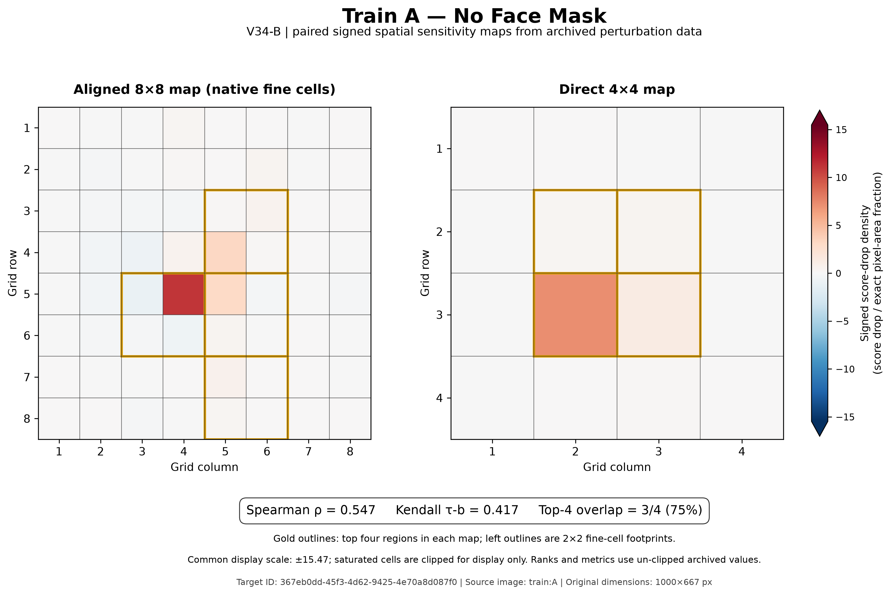

**Figure 2.** Paired signed detector-response sensitivity maps for the **No Face Mask** target in Train image A. Spearman ρ=0.5471; Kendall τ-b=0.4167; top-four region overlap=3/4 (75%).

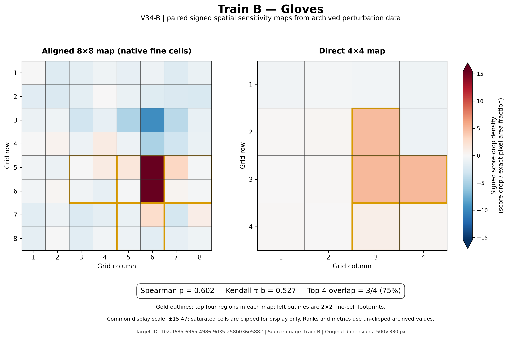

**Figure 3.** Paired signed detector-response sensitivity maps for the **Gloves** target in Train image B. Spearman ρ=0.6019; Kendall τ-b=0.5272; top-four region overlap=3/4 (75%).

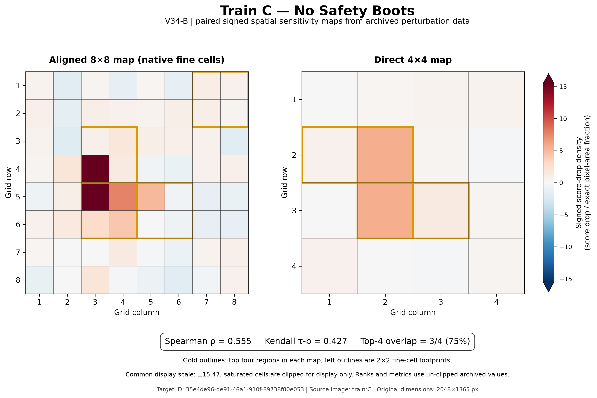

**Figure 4.** Paired signed detector-response sensitivity maps for the **No Safety Boots** target in Train image C. Spearman ρ=0.5548; Kendall τ-b=0.4268; top-four region overlap=3/4 (75%).

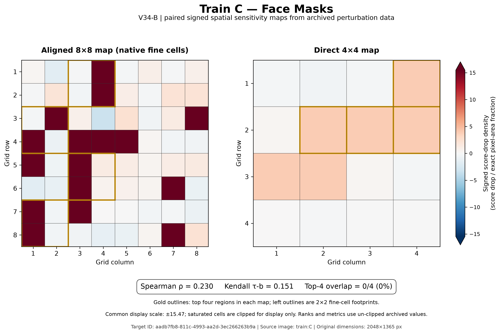

**Figure 5.** Paired signed detector-response sensitivity maps for the **Face Masks** target in Train image C. Spearman ρ=0.2295; Kendall τ-b=0.1514; top-four region overlap=0/4 (0%). This is the lowest-agreement target in the ten-target sample.

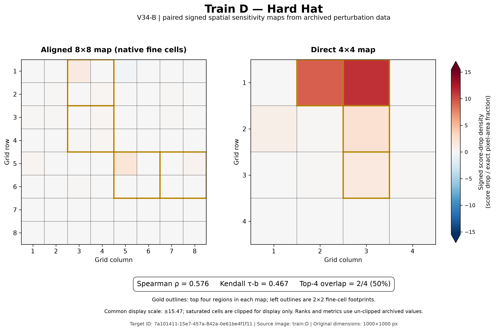

**Figure 6.** Paired signed detector-response sensitivity maps for the **Hard Hat** target in Train image D. Spearman ρ=0.5765; Kendall τ-b=0.4667; top-four region overlap=2/4 (50%).

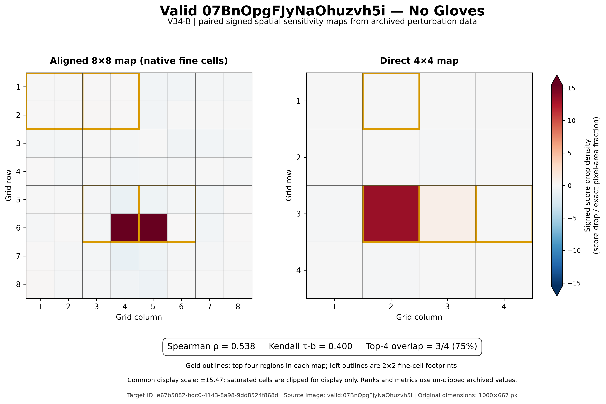

**Figure 7.** Paired signed detector-response sensitivity maps for the **No Gloves** target in Valid image 07BnOpgFJyNaOhuzvh5i. Spearman ρ=0.5382; Kendall τ-b=0.4000; top-four region overlap=3/4 (75%).

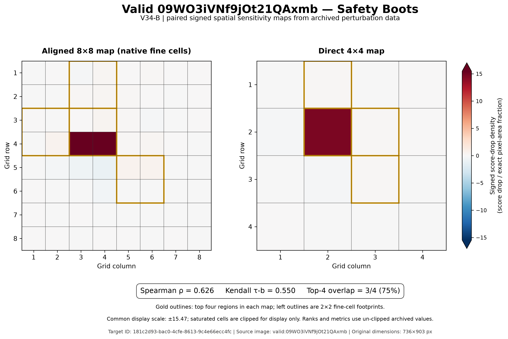

**Figure 8.** Paired signed detector-response sensitivity maps for the **Safety Boots** target in Valid image 09WO3iVNf9jOt21QAxmb. Spearman ρ=0.6265; Kendall τ-b=0.5500; top-four region overlap=3/4 (75%).

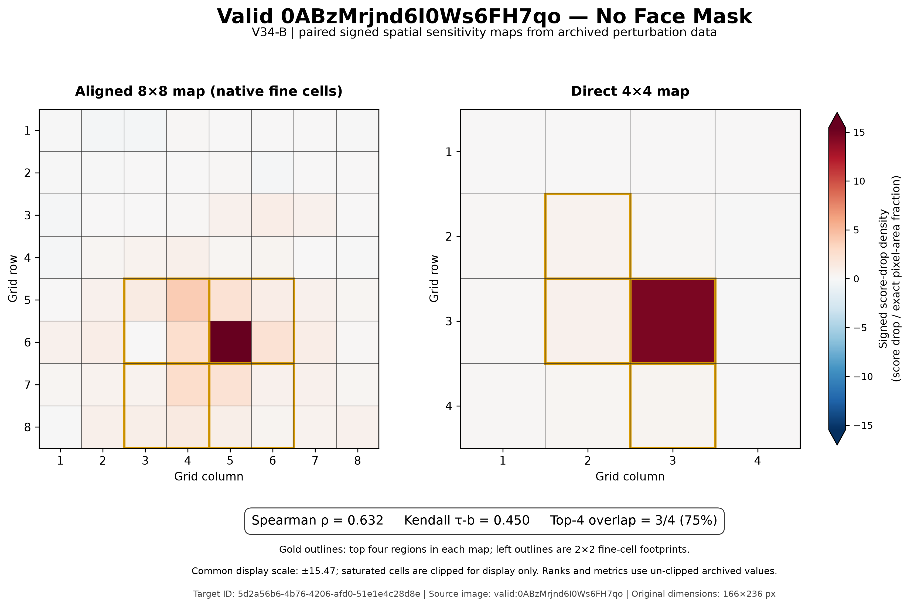

**Figure 9.** Paired signed detector-response sensitivity maps for the **No Face Mask** target in Valid image 0ABzMrjnd6I0Ws6FH7qo. Spearman ρ=0.6324; Kendall τ-b=0.4500; top-four region overlap=3/4 (75%).

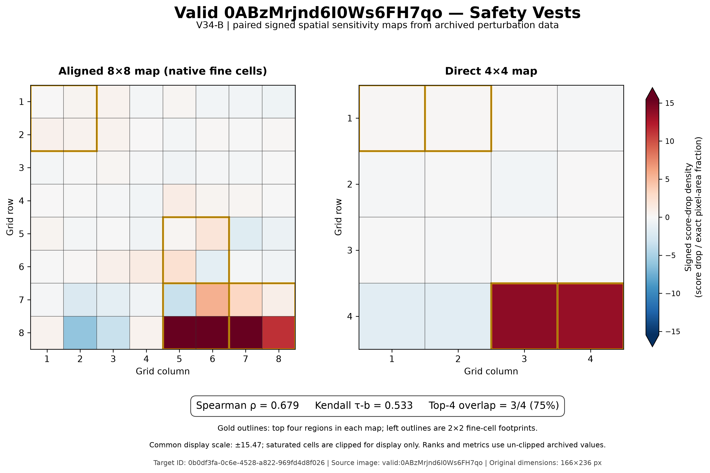

**Figure 10.** Paired signed detector-response sensitivity maps for the **Safety Vests** target in Valid image 0ABzMrjnd6I0Ws6FH7qo. Spearman ρ=0.6794; Kendall τ-b=0.5333; top-four region overlap=3/4 (75%).

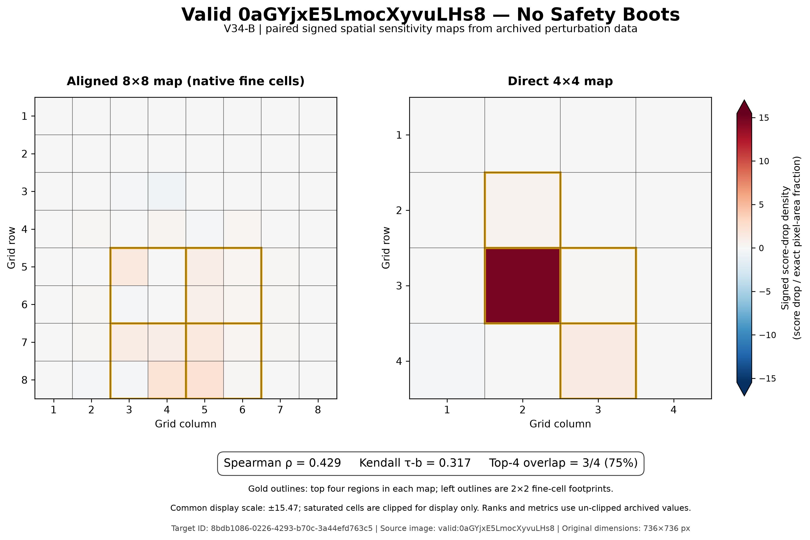

**Figure 11.** Paired signed detector-response sensitivity maps for the **No Safety Boots** target in Valid image 0aGYjxE5LmocXyvuLHs8. Spearman ρ=0.4294; Kendall τ-b=0.3167; top-four region overlap=3/4 (75%).
