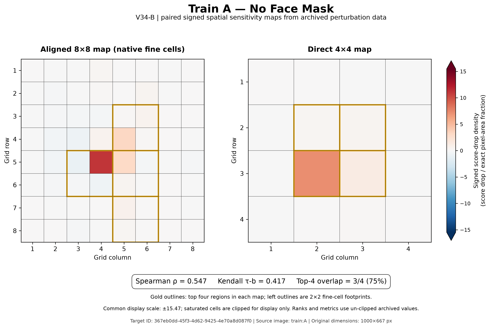
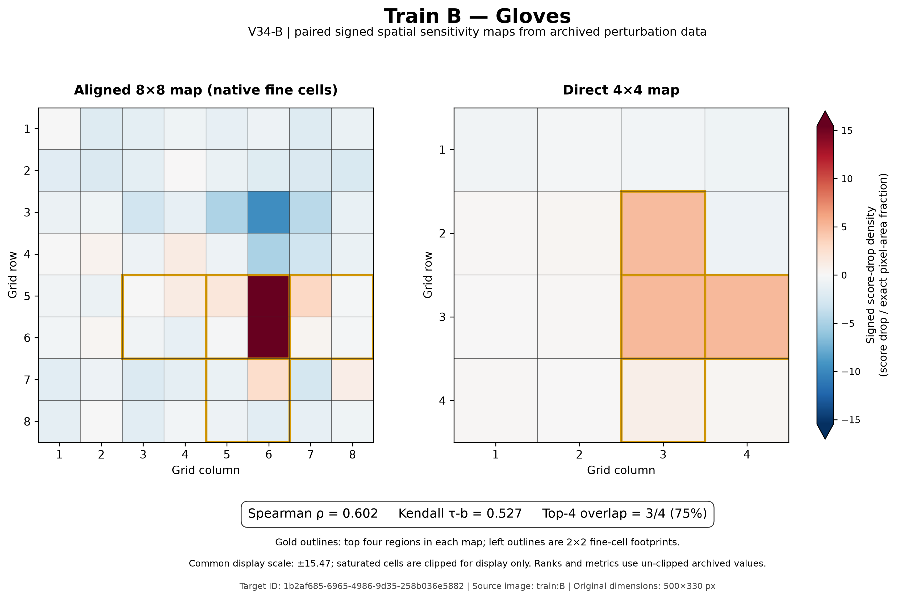
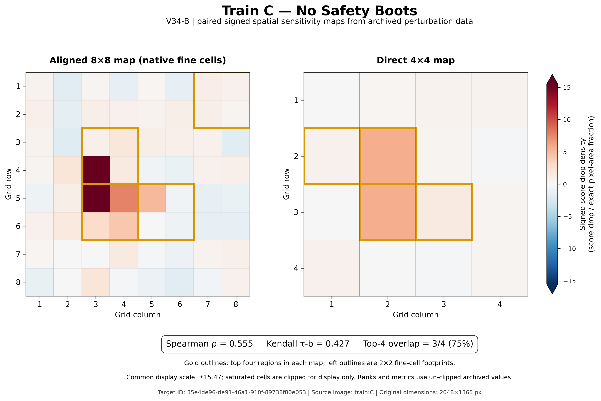
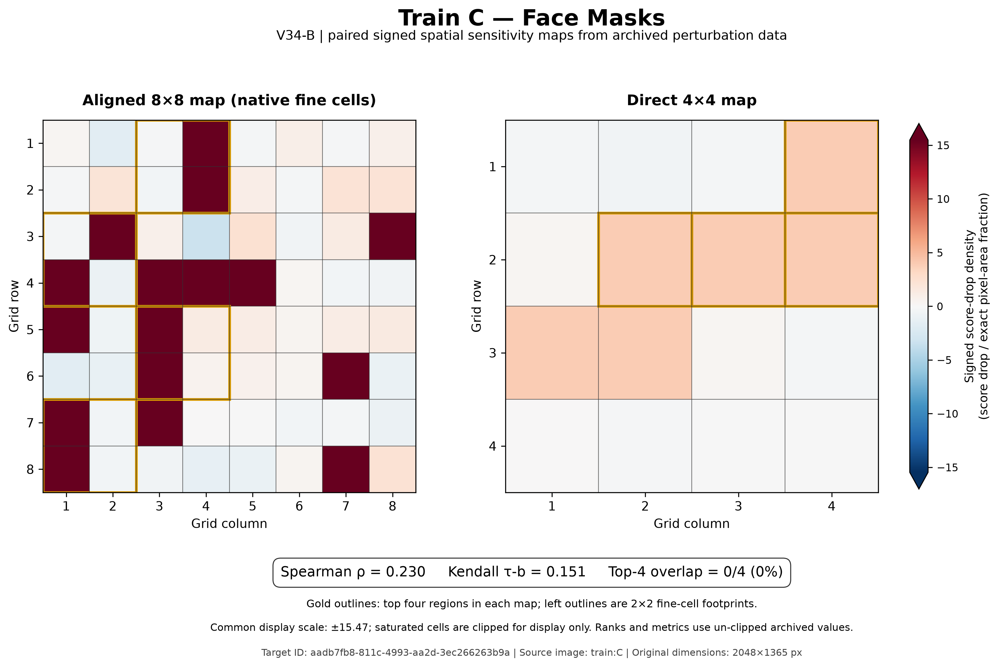
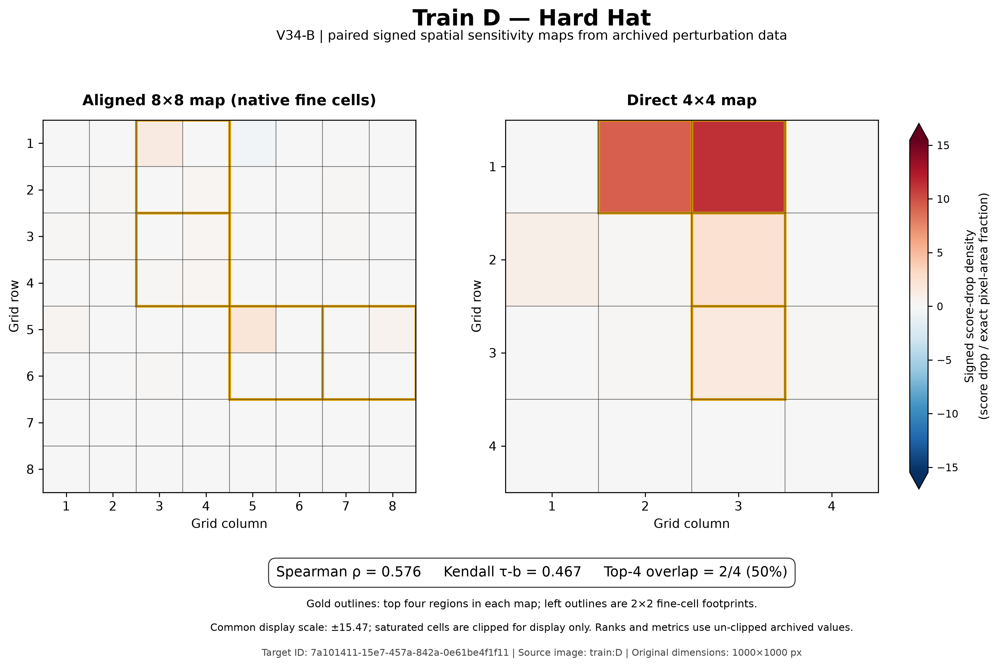
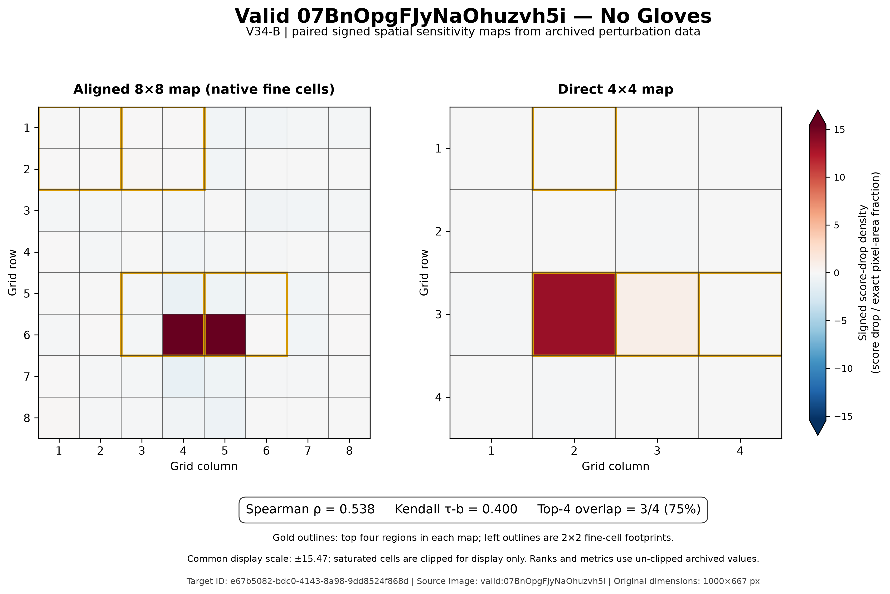
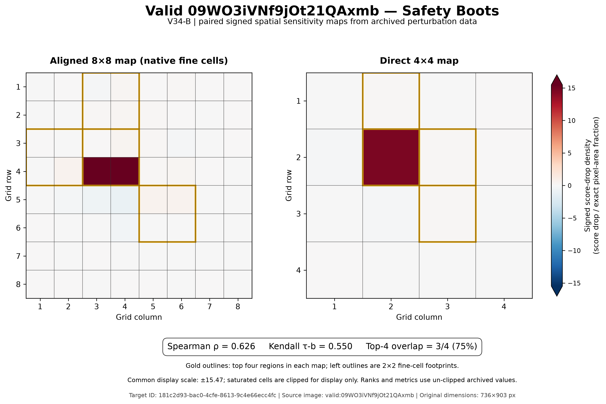
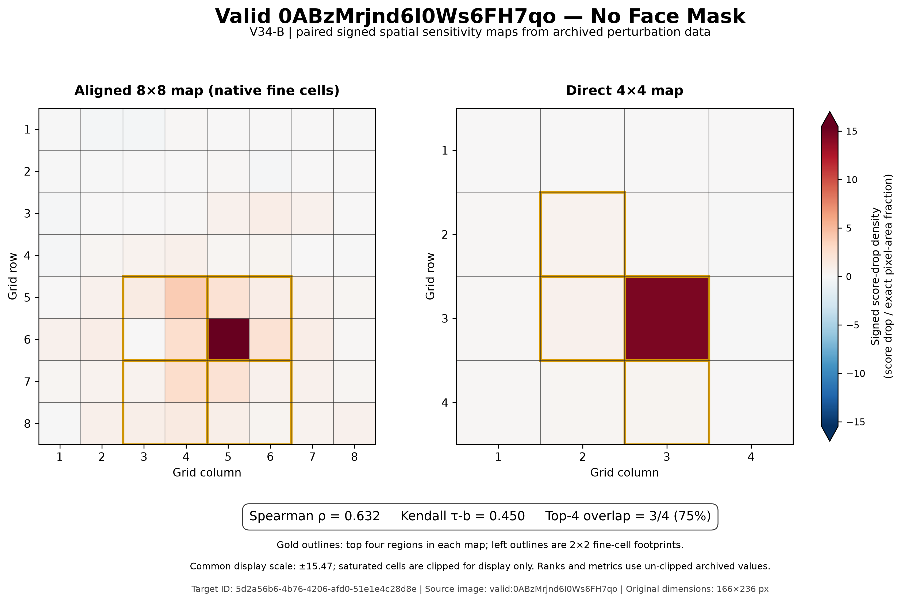
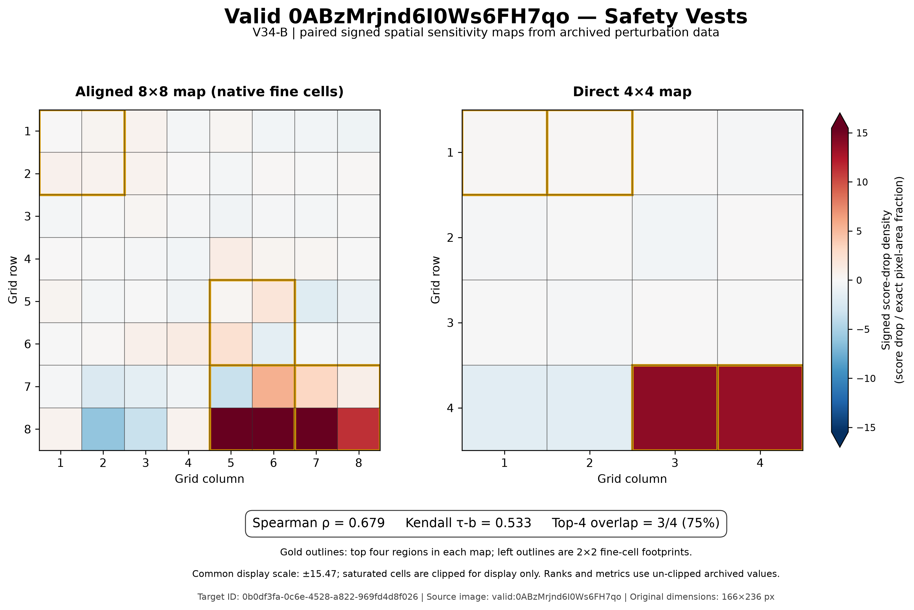
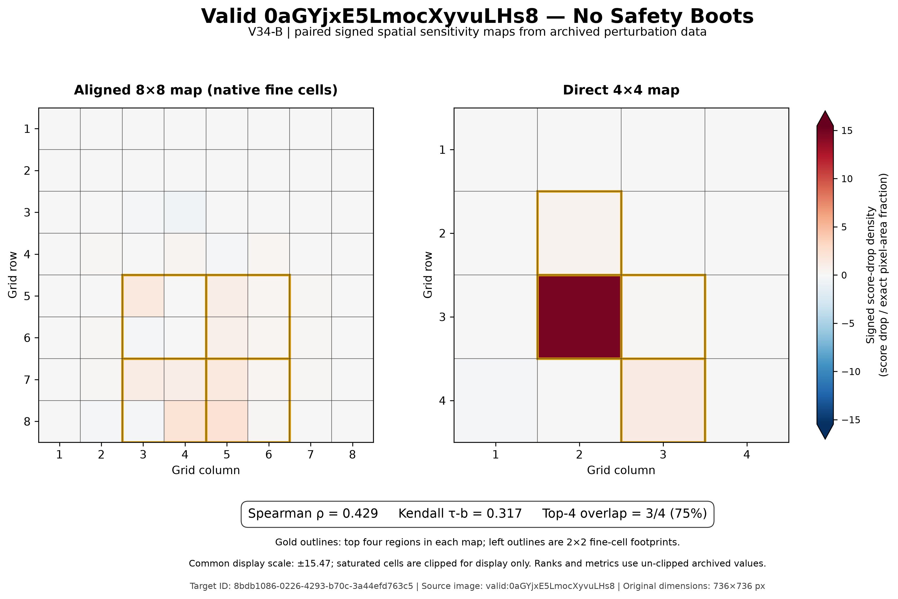

# SEER-PPE Supplementary Material

**Author:** Ezzaldeen Al-Tayar  
**Affiliation:** Faculty of Engineering and Information Technology, Taiz University, Taiz, Yemen  
**Corresponding author:** azzaltayyar@gmail.com

This file preserves non-scoring historical source-lineage and Person–PPE engineering contracts and the detailed audit appendices that support the main article. These records are supplied for transparency and reproducibility; they are not worker-level compliance outcomes or independently scored endpoints. The ten target-specific paired sensitivity maps are provided as Supplementary Figures S1–S10. The summary of spatial rank agreement is Figure 1 in the main manuscript.

## Supplementary Methods

## Supplementary Method S1. Operational source-lineage and Person–PPE evaluation contract (historical, non-scoring)

**V32 scope note:** Supplementary Methods S1–S5 below preserve historical source-lineage and Person–PPE engineering contracts from earlier study designs. They are not scored endpoints under V32 and do not reinstate a worker-compliance requirement. The current study's active methods are image-level detection, target-specific perturbation analysis and selective explanation prioritization.

To prevent a similarity shortlist from being confused with scientifically eligible Validation data, all **468 original Valid** Source IDs are now indexed in a baseline eligibility ledger. The ledger retains the five pre-existing research holds, 94 additional unsigned source-lineage candidates, and 369 no-screen-flag images whose independence is still uncertified. Original Source-ID evidence, nearest Train neighbors, observed dHash edges and 27 descriptive similarity-component IDs are linked without changing Roboflow splits. A separate append-only decision overlay is initially empty and requires per-image acquisition/source evidence, a dated reviewer signoff and an explicit Train-family comparison to record potential independent-source eligibility. Previously held cases cannot be lifted by V11's automatic gate. Evidence of same named 22 May School – Aseefrah in held cross-split images remains traceable to the earlier visual-source audit; it is not a new independent-curator signature.

A standalone Node.js Validation-only evaluator implements **structural safety gates** for source-independence decisions, original-to-Clean17 membership, signed worker coverage (including missed persons and zero-person controls), six visual status cells per worker, separate task mandates, item/person correspondence, locked reference/parameter plan and a dated research freeze. It can then compute descriptive selective visual-PPE counts and per-class retained coverage, abstention, conditional accuracy and PRESENT precision/recall, plus item-owner pair precision/recall/F1 **only conditional on verified item and person correspondence**. Human `UNKNOWN` is excluded from binary denominators and reported separately; `NOT_RECORDED` or absent prediction records cannot be silently converted to `ABSENT`. The tool never reports occupational compliance from unknown task policy, nor model mAP, energy joules or independent-Test performance. The real Validation freeze is **unsigned, with scoring disabled**. Synthetic tests exercise program logic only. This is a reproducible implementation and evaluation contract, **not** an empirical SEER policy comparison or achieved model improvement.

## Supplementary Method S2. SHA-pinned photographic-content and cross-split source-family verification (historical, non-scoring)

After the complete V12 source-ID/filename metadata crosswalk, the study performed direct image-content verification on immutable original Valid images and corresponding unaugmented Clean17 Valid export images in temporary GitHub Actions environments. Each original and cleaned/export file was individually validated against its separately archived SHA-256 fingerprint; exact cross-export raw-byte identity was not presumed because Roboflow export applies preprocessing and encoding. The comparison used EXIF-oriented RGB and ordinary resizing candidates, selected grayscale structural similarity (SSIM), normalized RGB mean absolute error and ORB matched-feature evidence. A high-consistency engineering flag required SSIM ≥0.94 with normalized RGB MAE ≤0.075 or SSIM ≥0.88 with MAE ≤0.11 and ≥24 geometric ORB inliers. The threshold is a reproducible conservative technical screen, not a calibrated false-identity probability, external source-provenance certificate or person-level performance measure. A random synthetic negative image control was included in CI.

To distinguish export identity from **Train↔Valid acquisition dependence**, the study separately re-acquired original Source image bytes for 46 prior near-dHash Train↔Valid pairs and four extra cross-split same-named-school pairings. The original SHA was revalidated; same-frame technical candidates required SSIM ≥0.90 and RGB MAE ≤0.05. Distinct frames, especially from the same named school, remain source-family dependent when supported by site evidence even if image SSIM is low. Neither screen enters individual source-family human verdicts or changes frozen Roboflow data. Full numeric records are retained without image media or private URLs, and no Test image was decoded or inferred.

## Supplementary Method S3. Conservative direct-evidence research quarantine for source-independent Validation

To avoid promoting image-similarity candidates into signed source-family decisions, the V14 source-eligibility protocol separates **existing research holds**, **additional technical overlap quarantines**, **other source-family review cases** and **images without a screening flag but without signed independence evidence**. The process joins the V11 original Valid Source-ID ledger, the 459 direct original↔Clean17 photo comparisons, and the V14 99-source Train↔Valid comparison records. It does not relabel Roboflow data and deliberately leaves all six new technical quarantines unsigned. The pre-scoring evaluator hard-rejects the five old holds and six V14 high-content overlap quarantines even if a future generic user-supplied scoring bundle asserts eligibility; a separate explicit, evidence-qualified conflict-adjudication protocol would be needed before any such case could be reconsidered. All remaining source-independent claims require individual signed acquisition/source-family comparison evidence. The [V14 preregistration draft](VALIDATION_PRE_FREEZE_STUDY_DESIGN_2026-11-21_V14.md) keeps original model parameters unchanged and prohibits Test-driven design.

## Supplementary Method S4. Evidence-locked source-group attestation and Validation reference contracts (no human signatures created)

Version V15 formalizes two independent units of research certification. **Original Valid Source-ID/source-group membership** is verified against the V13 direct source↔Clean17 image-content evidence and the V14 immutable administrative quarantine (5 old holds, 6 additional technical Train-overlap quarantines, 81 other flagged source-uncertain records and 367 unflagged but unsigned). An individual independent-source attestation, if genuinely issued in a future controlled review, must bind the exact original/clean file names, a dated reviewer and per-image observation, a site identifier, acquisition session and source-family identifier, an explicit Train site/session-family overlap examination, and SHA-256-pinned repository evidence. File hashes attest **integrity of the review record**, not that a reviewer's conclusion is true. The 11 historical-hold/high-image-overlap conflicts cannot be cleared by simply entering a generic independent-source boolean; they remain methodologically blocked until separately adjudicated.

The **human Validation Person–PPE reference** is a distinct record type, never inherited from exploratory Train-only A/B/C/D cases. Its executable V15 contract validates per-image human person count and complete person/item coverage, individually reviewed normalized boxes, each person's six PPE visual states (`PRESENT/ABSENT/UNKNOWN`) and separate PPE task mandates (`REQUIRED/NOT_REQUIRED/POLICY_UNKNOWN`), per-item ownership with consistency checks, explicit human-signed zero-person scenes and dated SHA-bound observation evidence. Undefined or unobserved equipment is not automatically classified absent, and a model prediction cannot become human ground truth. The evaluator remains unable to score a source-dependent or unsigned Validation cohort even with a technically perfect original-to-export photo mapping.

## Supplementary Method S5. Read-only Train-pilot execution, geometric person–equipment attribution and qualitative cue audit (not independent Validation)

The fixed original `altayyar-0oflt-lafos-qqauz/2` RF-DETR Small was executed on four **existing Train-only exploratory images** A/B/C/D through a previously published read-only Roboflow Workflow (`61llCTFuQ4Aq4goQ9HiP`, `SEER-PPE Conservative Review Cues v0.2`). The inference Workflow disables active learning and applies candidate confidence ≥0.20 and high-cue confidence ≥0.60; the model was neither retrained nor replaced. Only numerical predictions, detector class, confidence, geometry, case revision and workflow review codes were archived—never raw images, signed retrieval URLs or inference visualization bytes. This repeats an already documented exploratory Train Workflow pilot (V09) but now preserves reproducible item-level prediction geometry and reference comparison; it is not a new Validation experiment.

For each specific PPE cue, a deterministic read-only post-detector evaluator computed fractional overlap of the predicted PPE box within detected person boxes, accepting boxes overlapping by at least 0.25 as geometric review candidates. If one candidate covered ≥0.75 of the PPE box and either no secondary candidate exceeded 0.45 or the best–second margin was ≥0.30, it generated a *single strong geometric ownership proposal*. All other cases were routed to person coverage/overlap review. A geometric proposal is **not** an approved Person–PPE association; the negative legacy detector classes (`No Face Mask`, `No Safety Boots`, etc.) remain review cues and can never auto-label human `ABSENT`. `No Safety Attire` is a non-specific context class, not a typed PPE absence. Policy applicability remains `POLICY_UNKNOWN`; no compliance verdict is returned.

A separate exploratory crosscheck re-read the *existing researcher-entered Train reference* from Roboflow (A/B/C/D cases at revisions 2/2/4/1, 19 approved item-owner links and 38/42 visual states), and performed a globally optimal deterministic **one-to-one person-box matching** using IoU ≥0.50. Corresponding detector cue directions were checked only against already recorded `PRESENT/ABSENT/UNKNOWN` visual states, yielding qualitative review categories (direction-compatible, opposing, human-unknown, unrecorded, or no clear person geometry). This is not detector AP/precision/recall or association F1, since the correspondence, labels, sample independence and Validation eligibility are not scientific scoring-certified. Any oppositions are review candidates rather than human-confirmed model errors; GT state was never overwritten.

## Supplementary Appendices A–X

## Appendix A. Phase 4 Data Readiness and Adjudication Pilot — engineering evidence (6 November 2026)

The full current Roboflow **original** Y-PPE metadata index was read: 2,327 unique image IDs across 1,625 train, 468 validation, and 234 original test. The original test contains 104 images with a `Persons` object label and only 16 images with a `No Hard Hat` object label; these are **not worker-level confirmed violations**. Thirty deterministically sampled development images (16 train, 14 validation) from five deliberately enriched strata were read at saved-annotation level. The 30 records contained 396 object boxes; all passed basic geometric bounds checks. Eighty-nine boxes included `RFBoxPrompt/v1` model-assistance metadata; the extent of any later human verification is unknown. No human adjudication has been conducted for SEER-PPE.

The historical 2,288-image, 16,300-box 17-class corrected Y-PPE derivative remains the **candidate experimental archive** and is **not newly file-hash verified** in this phase; local binary access was unavailable. Thirty-one exact filename-string groups spanned raw dataset splits, including ten involving the original test split. Filename collisions are flags for inspection, not proof of scene leakage. Per-image source-family identifiers and source rights were absent from Roboflow's original image metadata, so true source-group independence cannot yet be certified. The 30-image stratified development review queue is provisional pending membership, rights, and source-family checks.

No SEER-PPE empirical performance, worker-level risk, explanation-fidelity, or energy metric has been measured. The journal Results section remains reserved for correctly preregistered and actually completed experiments. See the versioned companion `PHASE4_REPORT.md`, `ANNOTATION_REVIEW_PROTOCOL.md`, and `evidence/PHASE4_INDEX_AUDIT_2026-11-06.json`.

## Appendix B. Phase 5 reproducible clean-data reconstruction (6 November 2026)

The study's candidate 17-class Y-PPE v2 Clean derivative was freshly **reconstructed in a temporary GitHub Actions environment**, using unaugmented clone `master-fylfq/altayyar-0oflt-lafos-qqauz-ty5nh/2`, the archived deterministic 39-source-image correction manifest, 68 exact duplicate-label removals and one near-identical label-row removal. The successful run [#42153641457](https://github.com/EZZALDEEN049/Y-PPE-Detection-RFDETR/actions/runs/42153641457) yielded **2,288 images** (1,595/459/234 train/valid/test) and **16,300 annotations** (11,698/3,471/1,131). The mixed exported labels comprised **15,864 normalized bounding-box rows** and **436 normalized polygon-vertex rows**. The read-only audit recorded zero critical file/label errors, no cross-split byte- or pixel-exact image duplicates, and no overlap of three recognized source-video groups. Seven cross-split dHash≤4 candidate pairs remain flagged for documented visual adjudication. This engineering integrity result is not evidence of independence among all construction sites or original photo acquisitions. Source-family documentation and image-by-image viewing/redistribution rights are still unresolved.

The original pilot's 30 development images were aligned to cleaned-export filename candidates using split, normalized name and stored annotation-box counts. Twenty-nine yielded unique name-plus-count candidates; one uniquely matched name differed by exactly one object row (28 original vs. 27 clean) and the original saved annotation contains a duplicated same-label box. **All thirty links remain filename/label based and have NOT received original-to-clean pixel identity verification**. Reviewer A and B queues have been separately prepared and randomized without preloaded labels or model outputs. Human annotation and expert reconciliation remain at **zero completed records**, pending rights and source/identity clearance. The model's original historical reported 96.22% mAP50 remains a prior published result, not new SEER-PPE performance.

**Artifact-provenance statement:** The temporary runner's corrected **image archive was not persistently saved**, while metadata/checksum manifests and analysis reports were retained (manifest SHA-256: `4b7c458d6895706e7bc0886619be9ea12964ff5a9ba51a41f8af297e88a48345`). A future securely stored archive must be compared against the file-hash manifest before being called the frozen dataset. Cross-site independence, reviewer-adjudicated worker truth, explainability fidelity and energy measurement remain **OPEN**. See `PHASE5_REPORT.md` and `evidence/PHASE5_CLEAN17_AUDIT_SUMMARY_2026-11-06.json`. No new safety or energy result is claimed.

## Appendix C. Phase 6 restricted archive, image-screening and computational preflight (10 November 2026)

The successful archive reconstruction was repeated for a private, lossless backup using the same unaugmented clone and frozen corrections. A deterministic ZIP was split into three segments and saved inside the author's restricted SEER-PPE Google Drive research folder, not committed to the public source repository. A second local round trip recovered all segments, checked every individual segment digest, checked the combined archive SHA-256, ran ZIP CRC verification and extracted all **4,579 files**. The full packed archive size was **127,166,577 bytes**. The primary file count is **2,288 images** with **16,300 annotations** and **17 classes**. Internal use does not imply rights to publish individual third-party images. The online GitHub Actions storage only acted as a temporary transfer mechanism.

All **seven** cross-split dHash≤4 candidate pairs were inspected in a combined image review, showing visually different products/poses/objects. Each is recorded `ANALYST_VISUALLY_DISTINCT; INDEPENDENT_SOURCE_REVIEW_PENDING`. This single-assistant/analyst review is not independent expert double adjudication, and unseen source/video relationships beyond the known families remain unverified. The original cross-split byte- and pixel-exact audit still has zero matches.

Of the **30 development images**, an explicitly provisional analyst screen found 14 plausible fieldwork scenes, 14 visually obvious product/non-work negative controls, and 2 uncertain contexts. These are not adjudicated worker/required-PPE labels, and cannot stand in for task-specific site requirements; every case remains an unaudited occupational safety decision. The negative controls are reserved for checking eligibility routing rather than forced to count as violations. In the cleaned archive, 29 pilot links have one filename+annotation-count candidate and one pilot link has a single duplicated annotation row removed; original-to-clean photographic identity still needs independent source confirmation.

The engineering package now contains a model-agnostic per-target occlusion generator which re-runs a real predictor for each grid patch and distinguishes `MATCHED`, `LOST` and `AMBIGUOUS` instance identities. This generator has **not** produced a real 17-class ALTAYYAR explanation. The local hardware probe records PyTorch CPU-only, CUDA unavailable, no readable Intel RAPL readings and no NVML package; therefore measured electrical energy remains unavailable. The combined synthetic unit test suite passed **56/56**, including additional model-agnostic occlusion tests; synthetic unit tests are not model performance evidence.

**Experimental integrity boundary:** This phase does not claim independent worker ground truth, certified policy compliance, quantified energy saving, actual visual explanation faithfulness or empirical Q1-level novelty. For the amended v0.7 design, next tasks require an explicitly documented **single-researcher reference** with unresolved independent-adjudication limitations, actual site/task mandates or separately labeled hypothetical scenarios, the exact 17-class original checkpoint under an audited local loader, and physical energy metering only if energy efficiency in joules will be claimed. Locked calibration and executed paired baseline comparisons remain necessary before any algorithmic superiority claim. The older Phase 6 reviewer-A/B queues were prepared but yielded no independent review; they are not a prerequisite under the author-approved v0.7 design.

## Appendix D. v0.7 decisions and provenance limits (15 November 2026)

The researcher approved through question 39: joint safety/faithfulness/compute objectives; explain-on-demand routing; mandatory abstention when evidence is inadequate; worker–PPE geometric association; limited internal random-plus-hard-case reference review; historical-Test development-exposure disclosure; `SOURCE_UNKNOWN`/similarity sensitivity; explicit presence-versus-mandate distinction; risk/uncertainty calibrated on Validation only; genuine energy measurement conditional on instrumentation; matched strong selective baselines and feature ablations; target-specific Occlusion/Deletion/Insertion with `LOST` and `AMBIGUOUS`; missing-person coverage checks; capped review with unresolved backlog; and an access-controlled audit trail. These are **design decisions, not observed research findings**. No independent safety reviewers, site policies, electrical measurements, or full SEER empirical gains have been verified.

## Appendix E. Q40 ownership clarification and release planning (17 November 2026)

The author explicitly stated in Arabic that they hold full rights as the original owner of the principal dataset and have complete freedom to dispose of it. This is recorded as an **author self-attestation**, not independent proof of title to all source materials. The research plan will not treat the author's own Y-PPE annotations or original photographs as unauthorized by default. Before any public package upload, a rights inventory still separates original items from any externally sourced/unknown-rights image content, privacy/consent constraints, and separate Roboflow model-weight licenses. Q41 subsequently selected a comprehensive reproducibility package, with per-artifact rights screening and model-weight redistribution conditions preserved. This decision adds **no new model validation, safety outcome, energy measurement or release event**.

## Appendix F. Q41 comprehensive reproducibility package — author decision (17 November 2026)

**Selected option D.** Planned deliverables are (i) rights-cleared Y-PPE data/annotation manifests and author-approved image releases, (ii) SEER-PPE source, tests, configuration and dependency locks, (iii) exact input/model hashes and provenance records, (iv) privacy-filtered decision/XAI/computational log formats, (v) Colab execution notebooks and fixed-seed instructions, and (vi) scripts that regenerate tables and figures only after empirical runs produce authentic results. Package metadata will state artifact version, license/rights status, dataset split, checksum, hardware requirements, expected tests, and known limitations. Provide original-model weight bytes only when distribution terms permit; otherwise instructions to retrieve authorized weights. This is an **approved release plan**, not evidence of a completed public distribution or research effectiveness.

## Appendix G. Q42 staged verification of reproducibility — author decision (17 November 2026)

**Selected option D; planned verification protocol, not completed reproducibility evidence.** The research package must pass independently inspectable stages: **(1)** compare SHA-256 for every frozen input image archive, annotation manifest and exact original model-weight file; record dataset/split provenance, permissions, package release/version and execution commit; **(2)** run software unit tests in a clean environment and preserve machine-readable results; **(3)** load and validate the *original* 17-class ALTAYYAR checkpoint in a newly configured Google Colab environment, then reproduce a fixed permitted-Train inference sample and compare class/box/score outputs against recorded hosted/local reference within declared numerical and preprocessing tolerances; **(4)** execute the same locked sample, seeds and configurations for matched-instance explanation, baseline/ablation policies and resource accounting only after those experiments exist, storing per-image predictions, `LOST/AMBIGUOUS`, execution conditions and failure traces; **(5)** regenerate manuscript tables and figures using only authenticated empirical output tables, with summary checks and declared nondeterministic tolerances. Treat timing/energy as distributions across documented repeated hardware runs, not bit-for-bit invariant measurements. All experiments must report PASS, FAIL or NOT_RUN explicitly, together with a reason and log location. No stage-4/5 test or energy/safety result is asserted to have passed at the time of this decision. Q43 will determine the Colab environment/seed pinning policy.

## Appendix H. Roboflow-only execution amendment (17 November 2026)

**Author instruction:** All new simulations and empirical tests should be conducted in Roboflow, not Google Colab or another training platform. Prior three-month from-scratch RF-DETR training and historical outcomes must be reused, not repeated. `altayyar-0oflt-lafos-qqauz/2` and version-2 trained model remain the fixed detector. The older local-checkpoint/Colab steps in appendices F–G are historical planning options **superseded** by this latest platform-only constraint; no checkpoint handoff or further training is required for ordinary hosted comparisons.

**Native verified capabilities:** project and version metadata; 17-class/2,327-image dataset health and labels; 5,577-image augmented version-2 training metadata and original trained model; direct original-model hosted inference on permitted Train sample with five detected classes matching the saved annotation class set; readable Workflow definitions and Workflow block catalog. Built-in blocks include configurable confidence filtering, overlap-based spatial relationships, conditional routing, blur/visualization, data aggregation and event logs. These support *candidate* SEER routing components, not yet empirically validated person–PPE associations, causal explanations or safety outcomes.

**Restrictions and unresolved science:** Existing Base Workflow includes an Active Learning `roboflow_dataset_upload@v2` side-effect; do not execute it for read-only experiments. The connector denied `Manage Workflows` and `view_workflow_evals` permissions and restricted annotation-board/deployment access. User/admin authorization is needed before creating a separate read-only research Workflow or running platform Evals. Heatmap Visualization is not equivalent to Grad-CAM. Exact target-matched Occlusion/Deletion/Insertion must be demonstrated using available native transforms and repeated hosted inference before inclusion in results; otherwise mark unperformed and narrow claims. Real electrical Joules and gradient access cannot be inferred from hosted output. The original training record is baseline evidence, **not** new SEER effectiveness.

## Appendix I. First native Roboflow SEER-PPE routing prototype — engineering smoke test (17 November 2026)

The owner-approved platform-only plan produced a **separate, read-only** saved Workflow `SEER-PPE Routing Prototype v0.1` (ID `QYzcGMCrJ9uwLmkAfsfF`, editor https://app.roboflow.com/softyyemen/workflows/edit/seer-ppe-routing-prototype-v01-1794871362276), with the original frozen 17-class `altayyar-0oflt-lafos-qqauz/2` RF-DETR model, no training or source-data changes and Active Learning disabled. The native pipeline provides provisional confidence bands (detector candidate floor 0.20, high-confidence >=0.60, lower-confidence candidates 0.20–<0.60), separate person/PPE-category subsets, `Persons` center-overlap detection as a *spatial candidate heuristic*, and visualized outputs. These are not final threshold values, person–PPE assignments or compliance decisions.

On one historical **Train** smoke image `Kathiah Gets a Chance03.jpg`, returned detections were 29 candidates; 26 high-band; three lower-band candidates; four `Persons`; 25 PPE-category; 24 center-overlap PPE-category candidates. Results are observed model outputs **only**, not reference-label safety results. Built-in filters/overlap work at a technical level; no calibrated risk, verified employer PPE mandate, automatic human-review status or audit-ready review queue, matched instance explanations, blinded independent annotations, validated selective safety gains, new Test results or genuine energy measurements exist. Earlier permission-denied statements in Appendix H described the **pre-reconnection account**; after linking the owner Admin on 17 Nov 2026, creation and hosted trial of the separate baseline and routing prototype succeeded and Workflow Evals access was confirmed. Any next-stage claim must be supported by new measured experiments.

## Appendix J. V17 paired fixed-detector and conservative SEER policy offline trace — 21 November 2026

**Experimental status: executed read-only engineering preflight on historical Train outputs; no prospective Validation scientific scoring.** The original hosted 17-class RF-DETR Small model `altayyar-0oflt-lafos-qqauz/2` and Workflow `61llCTFuQ4Aq4goQ9HiP` were **not run again**. V17 deterministically reused the four real Train inference records produced in V16, retaining identical original detection IDs, classes, confidence scores and image-level pairing. A0 is the raw fixed detector output and has **no worker compliance decision policy**; A5 is an **offline proposed conservative decision layer**, not a second trained detector, live review queue or verified safety intervention. The post-hoc human reference comparison from V16 did **not** enter A5 routing features.

The saved paired trace contains **51 raw detections** (A 5 / B 16 / C 29 / D 1), including 7 Person boxes and 38 typed PPE cues, plus six context-only non-person detections. It preserves 34 tentative single-person geometric owner proposals, four ambiguous/unassigned typed items, and conservative **suggestions** for human review on all 38 typed cues. These are neither human-signed PPE links nor 38 review requests delivered to a reviewer. Four scenes remain human-person-coverage-unverified. In the no-Person detection D scene, a hard-hat cue remains without an identifiable wearer and no no-worker or safe-scene verdict is made. For every potentially affected worker, actual workplace requirement remains unknown; negative PPE class predictions are not automatically translated into visual absence or occupational violation.

Fail-closed GitHub Actions [V17 executed policy trace](https://github.com/EZZALDEEN049/Y-PPE-Detection-RFDETR/actions/runs/44851631822) passed synthetic manipulations (Test split substitution, forged person coverage, fabricated worker clearance, false source signing, invalid freeze and confidence-band drift), per-detection pairing conservation, and deterministic archival of the [numeric-only trace](PAIRED_TRAIN_DETECTOR_POLICY_TRACE_V17.json). [V17 pre-freeze protocol](PAIRED_BASELINE_SEER_PREFREEZE_PROTOCOL_2026-11-21_V17.md) and [verified execution report](GITHUB_ACTIONS_V17_VERIFIED_2026-11-21_V01.md) delimit this finding. Two parallel CI suites also passed for the trigger commit. No original images, temporary media URLs, raw checkpoint bytes or personal author-signing credentials were published by this experiment.

**Interpretation restriction:** these two paired engineering views are not a valid safety-effectiveness or efficiency comparison. Neither A0 nor A5 has signed worker outcome gold, a matched safe-clearance decision policy, measured review completion, implemented target-matched explanations or electrical energy observations. All incremental explanation and human workload/safety benefits are **unmeasured**, not zero-effect outcomes. Actual V17 additional inference calls = 0, XAI calls = 0 and dispatched reviews = 0 only describe V17 processing scope. No false-clearance denominators, mAP/F1, policy superiority, explainability fidelity or Joule savings follow from the 38 suggestions. A fair scientific A5 comparator must be chosen against a strong selective competitor under matched safeguards, review/compute budgets and a prespecified primary endpoint **before** using any Test outcome.

The **459/459 original Valid→Clean17 technical mappings** do not establish independent acquisition. V15 still records **zero** per-image signed source-independence decisions and **zero** fully signed Valid Person–PPE gold cases. Four Train B individual visual cells and Train D zero-person researcher signoff remain unresolved. Validation remains `NOT_FROZEN`, `scoring_ready=false`; the historical Test remains development-exposed and was not accessed for V17.

## Appendix K. V18 author-curator reference clarification — 21 November 2026

The original dataset author has directly confirmed that he selected, evaluated, classified and checked his images before, during and after the project acquisition/annotation stages, and previously confirmed that all images were reviewed. The design therefore **does not require the author to repeat image inspection or engage a second human annotator** simply to restate the already completed curation. Existing original annotations are adopted as a **single-curator reference** for any future appropriately scoped object-level detection analysis, provided original image IDs, classes, object boxes and fixed predictor outputs are precisely aligned. This is evidence of the annotator's provenance and intended label construction, not an independent second-rater agreement study.

The previously documented 19 accepted Train item/person links and 38 saved visual cells remain supported as previously entered; four additional B cells and the D person-coverage determination are **not inferred** from a general review-complete statement. For worker-level PPE endpoints, analyses may use already recorded person-specific observations and report missing states as *not recorded* rather than demand a new complete relabeling. Bare absence of a PPE detection is not a human-verified absence. A specific occupational *violation* also requires an applicable site/task mandate; incomplete mandate evidence precludes claims about real occupational false clearances, not all object-detection study.

This is an explicit **endpoint separation**: (1) a historical internal object-detection analysis using original author-curated object labels may be designed without imposing independent per-person human-gold reconstruction on every image; (2) strong worker-level safety, independently verified acquisition independence and external generalizability claims still need corresponding evidence and remain unmeasured. Historical test/validation development exposure, same-author confirmation/selection bias and unknown site/session source grouping are disclosed. No inter-rater kappa, independent blind reference, PPE policy proof or unseen Test is claimed.

The [V18 author-primary reference policy](AUTHOR_CURATOR_REFERENCE_POLICY_2026-11-21_V18.md) is a methodological correction; it **does not itself execute any new inference or compute metrics**. V17 engineering paired Train results are unchanged. The strict verified-worker-safety freeze remains `NOT_FROZEN` and `scoring_ready=false`; original annotations/model/splits are unmodified.

## Appendix L. V19 original-source numeric matching and computational source-overlap sensitivity — 21 November 2026

**Author-curated primary labels, not second-rater ground truth.** The author has confirmed that image acquisition, selection, classification and checking were completed throughout field and dataset development; no new human reviewer or repeated image inspection was requested. A read-only query of the original Roboflow Source annotations retrieved **48 saved object annotation boxes across four historical Train pilot images** (A 5, B 15, C 27, D 1). Seven B source annotations include `labeledByModel=RFBoxPrompt/v1` provenance markers, preserved rather than silently recategorized as purely manual independent labels. Existing polygon annotations were evaluated only via their saved enclosing bounding rectangles.

The earlier actual fixed original `altayyar-0oflt-lafos-qqauz/2` hosted RF-DETR Small inference recorded **51 bounding-box predictions** for these same four Train images. The executable V19 matcher verified original Source ID, image filename, split, image width/height, valid saved annotation labels, detection IDs and fixed model identity; used same-class greedy one-to-one matching at **bbox IoU ≥0.50**, and counted **TP=47, FP=4, FN=1**. Descriptive precision was **0.921569**, recall **0.979167** and F1 **0.949495**. These are **development-alignment diagnostics on already trained/exposed Train images**, *not* independent validation, historical Test performance, new RF-DETR generalization, a SEER versus baseline gain or verified worker-level occupational safety. Source annotations bearing the same names as model class labels are not proofs that a visible worker has or lacks legally or site-required PPE.

For optional code diagnostics, class AP averaged over 101 recall points yielded a **truncated above-confidence-0.20** AP50 macro proxy of **0.977498** and AP50–95 proxy of **0.741226** for the classes actually present in the four-source-image reference. **Neither is official full-threshold-range COCO mAP:** model predictions below the previously used hosted 0.20 confidence floor are not in the saved detection output, and the sample includes in-training images. As a sensitivity analysis to model-assisted labeling provenance, V19 excluded the entire B image rather than stripping its seven assisted labels but leaving associated detections as false positives. On three remaining Train images, the archived profile includes 33 original labels, 35 predictions, **TP=32/FP=3/FN=1**, precision **0.914286**, recall **0.969697**, F1 **0.941176**. This is a tiny exploratory perturbation, not a statistical test of label bias.

Using only already archived V14/V15 original Train–Valid metadata without opening images or running inference, a second deterministic tool constructed three **descriptive sensitivity strata of the corrected Valid set**: M0=**459** technically matched Valid photos; M1=**448** after excluding the five old held sources and six technical high-overlap quarantines; M2=**367** after also excluding 81 other flagged possible source-family cases. The original 280 reviewed cross-split candidate pairs contain **12 technical high-similarity edges**, forming **eight connected technical-hypothesis components** and touching nine original Valid source IDs (eight retained in Clean17). These components are not verified identical camera sessions or independent acquisition-group certificates. In particular, M2's 367 unflagged examples remain *independence-unknown*, not certified external holdout observations.

**Endpoint and methodological limitations:** This V19 numerical test validates the box-comparison pipeline against existing author-curated object labels in Train, but does not estimate the intended multi-level SEER policy effectiveness. It performs **zero new model inference, XAI, human review, electrical energy measurement or occupational mandate adjudication**, opens no Test images and does not change any original annotation or source split. The strict source-independent and worker-compliance freeze stays `NOT_FROZEN` with `scoring_ready=false`. A separately scoped *historical internal Valid object-detection* evaluation can use the same author's original annotation reference after freezing predictor settings, exact source IDs, matching rules and sensitivity strata; it must not be advertised as independently unseen or externally generalizable.

Executable evidence: [V19 Train source labels](TRAIN_ORIGINAL_SOURCE_ANNOTATIONS_READONLY_V19.json), [numeric bbox audit](TRAIN_SOURCE_LABEL_DETECTION_NUMERIC_PREFLIGHT_V19.json), [source sensitivity manifest](VALIDATION_SOURCE_OVERLAP_NUMERIC_SENSITIVITY_V19.json), [method](V19_AUTHOR_ANNOTATION_NUMERIC_EVAL_PROTOCOL.md), and [successful V19 GitHub Actions](https://github.com/EZZALDEEN049/Y-PPE-Detection-RFDETR/actions/runs/44853282012).

## Appendix M. V20 historical internal Valid object-detection counters and current-source reference reconciliation — 21 November 2026

**Scope restriction:** A distinct [V20 historic-internal-only protocol](VALID_HISTORICAL_INTERNAL_OBJECT_EVAL_PROTOCOL_FROZEN_V20.md) was committed before V20 retrieved individual original Valid outcomes. It fixes the same preexisting original RF-DETR Small `altayyar-0oflt-lafos-qqauz/2`, historical **2025 Roboflow model Eval version 2** `KyzP9neuyNTN5eQpGCAY`, `split=valid` exclusively, confidence threshold 0.20, exact original Source-ID match and prespecified metadata-only sensitivity cohorts M0=459, M1=448 and M2=367. **No new inference** was performed and no Test outcomes were accessed. The public hosted historical Eval's per-image `imageId` exactly matched 468/468 original Valid Source manifest records, permitting a deterministic filter to the 459 corrected Clean17-retained original Source IDs. Nine excluded original Valid images were **not** included in the 459-image analysis.

The source annotations were not newly created or visually re-reviewed. A read-only Roboflow annotation query on the 459 previously author-selected and author-checked original Valid sources returned **3,471 current stored object boxes**, **729 with existing model-assisted annotation provenance markers**. These are single-curator source labels; they are not independently blinded inter-rater adjudications. **Reference-version discrepancy:** the 2025 saved model Eval's `TP+FN` implies **3,455 historic reference objects**, compared with **3,471 presently stored source boxes**. Individual counts agree on **446 of 459** original images, while **13** differ by **16** boxes in aggregate. The legacy per-image Eval geometry endpoint reports `unavailable`, preventing box-by-box reconciliation or retroactive claims that 2025 metrics were recomputed from the **current** 459 source labels. The mismatch is therefore a documented **reference-version/measurement-compatibility limitation**, not silently overwritten or resolved by author reinspection.

### M0/M1/M2 — descriptive historical 2025 Valid-only micro-metric aggregation

| Pre-fixed source-risk cohort | Valid images | TP | FP | FN | Micro precision | Micro recall | Micro F1 |
|---|---:|---:|---:|---:|---:|---:|---:|
| M0: all current Clean17-matched original Valid sources | 459 | 3,252 | 642 | 203 | 0.835131 | 0.941245 | **0.885018** |
| M1: exclude five historical holds and six high-overlap technical quarantines | 448 | 3,217 | 639 | 200 | 0.834284 | 0.941469 | **0.884642** |
| M2: further exclude 81 other possible cross-split source-family risks | 367 | 2,851 | 589 | 183 | 0.828779 | 0.939684 | **0.880754** |

These are arithmetically reaggregated **previously existing historic-model-provider per-image counters**, not newly measured object-level predictions against current Source geometry, an independent holdout, an externally generalizable population, or a paired **SEER-PPE versus original baseline** result. The changed cohorts have different source compositions and sample sizes; the **−0.0376** and **−0.4264 percentage-point** differences in F1 for M1 and M2 relative to M0 are **descriptive source-risk sensitivity**, not proof that suspected overlap caused optimism or that exclusion improved predictor trustworthiness. The 367 M2 sources remain **unflagged but acquisition-independence unverified**. The evaluation service's proprietary class/box matching detail and unavailable geometry prohibit independent recreation of its full mAP; none is claimed here.

**Scientific interpretation and next measurement:** The historical per-source micro P/R/F1 pipeline has been successfully executed on frozen Valid source IDs and passed reproducibility/identity/count tests in [GitHub Actions 44856892166](https://github.com/EZZALDEEN049/Y-PPE-Detection-RFDETR/actions/runs/44856892166). The need for a new second human reviewer is rejected: the original author's curated source annotations remain the primary reference. For an actual **current-annotation** object detection metric, fresh prediction geometry must be collected from the **unchanged** RF-DETR model on the same Valid Source IDs at frozen settings and class/IoU matching recomputed against current saved labels; further manual image review is unnecessary. Occupational PPE compliance, worker-level false-safe events, explanation fidelity and metered electricity remain **not measured**. The separate independent-source worker-safety freeze remains `NOT_FROZEN`, `scoring_ready=false`; the historical Test remains protected and previously development-exposed.

See [V20 source counts](V20_VALID_SOURCE_ANNOTATION_COUNTS_PART1_PRIVATE_WORKING.json), [saved historical Valid-only counts](HISTORICAL_V2_VALID_PER_IMAGE_COUNTERS_V20.json), [risk-stratified descriptive output](HISTORICAL_VALID_INTERNAL_METRICS_V20.json), [frozen method](VALID_HISTORICAL_INTERNAL_OBJECT_EVAL_PROTOCOL_FROZEN_V20.md) and [V20 checkpoint](DUAL_TRACK_CHECKPOINT_2026-11-21_V20.md).

## Appendix N. V22 per-class original Valid reference support across source-risk groups — 21 November 2026

This Appendix references an **executed read-only analysis**, not a new model inference or SEER safety experiment. [The V22 audit code](tools/analyze_valid_class_support_v22.mjs) joins the author's 459 current Source Valid annotation summaries and all 17 class counts to the prespecified M0=459, M1=448 and M2=367 source-risk groups. Each image's total annotation count is checked against the sum of its own category counts, and the output is reconciled with the [historical Valid V20 result](HISTORICAL_VALID_INTERNAL_METRICS_V20.json) while remaining distinct from that Eval's own legacy labels.

Across M0, the most frequent boxes were `Persons` (**488**), `Hard Hat` (**388**) and `Safety Boots` (**365**). The rarest included `Child` (**31**) and `No Hard Hat` (**56**), which demonstrates unequal class support rather than unequal occupational risk. All 17 categories remain represented after excluding the 92 source-risk-flagged images to construct M2, but counts and image prevalence shift. M2 retains **367/459 = 79.96% of images**, **3,049/3,471 = 87.84% of current annotated boxes**. These compositional differences complicate interpretation of historic micro-F1 movements and make unadjusted across-cohort metric comparison unsuitable as proof of leakage or independent source generalization.

Current label provenance markers occur on **729/3,471** boxes in 113 of the 459 source images, compared with 655 markers on 97 of M2's 367 images. Aggregated historical counters do not provide per-class source-provenance allocation. There was **no second reviewer**, **no repeat image review**, **no Test**, **no RF-DETR inference**, and **no claim of verified worker compliance** in this extension. Complete per-class support, per-image support, image-level size distribution, stable input hashes, nested source strata and 13 historical/current reference-mismatch identifiers are in [the V22 JSON output](VALID_CURRENT_CLASS_SUPPORT_RISK_COHORTS_V22.json). The source-independent worker-safety freeze remains `NOT_FROZEN` / `scoring_ready=false`.

## Appendix O. V23 actually executed current-source geometric five-Valid-image original-model pilot — 21 November 2026

The unchanged original 17-class `altayyar-0oflt-lafos-qqauz/2` detector was queried through Roboflow's read-only hosted inference endpoint for **five original Source Valid image URLs only** at confidence **0.20** and overlap **0.50**. These exact images were lexicographically selected from the pre-existing M2 original `Valid` Source-ID manifest **before prediction outcomes** in [the frozen V23 pilot protocol](V23_VALID_CURRENT_BOX_GEOMETRY_FROZEN_PILOT_PROTOCOL.md). All model and reference rectangles were returned at the original image coordinate dimensions and checked against the author's existing current saved native annotation geometry (13 + 1 + 3 + 5 + 1 = **23** boxes). The detector returned **23** boxes. Class-exact greedy one-to-one IoU≥0.50 yielded **TP22/FP1/FN1**, P/R/F1 **0.956522**. The single erroneous prediction and missed reference were both assigned to `Safety Vests` under the object-bbox scoring rubric, not to independently verified individual safety compliance. The sample had zero recorded model-assisted source-label markers, although the full 459-image current Source snapshot contains **729**.

A dedicated script [`tools/score_current_valid_source_boxes_v23.mjs`](tools/score_current_valid_source_boxes_v23.mjs) checks original Source ID, the five predeclared filenames, original Valid status, 17-class names, current annotation counts and model-assistance provenance, dimensions, immutable original model identity, confidence floor, overlap setting, unique predictions, original image-coordinate bbox validity, one-match-per-reference conservation and Test isolation. The [V23 numeric output](VALID_CURRENT_SOURCE_REAL_MODEL_BOX_MATCH_V23.json) passed the actual [GitHub Actions run 44860810115](https://github.com/EZZALDEEN049/Y-PPE-Detection-RFDETR/actions/runs/44860810115). Original image pixels, URLs, credentials, original labels and weights were not deposited or altered by this experiment.

**Non-negotiable result classification:** **pilot feasibility in five development-exposed Validation originals; not a full held-out detector validation, not the 2025 historical provider 459-image Eval, and not a paired SEER-PPE intervention effect**. It does not measure worker occupational mandates, harmful safe-clearance errors, actual review completion, independent source transfer, explanation fidelity or electrical Joules. Strict worker-safety `NOT_FROZEN` / `scoring_ready=false` remains unchanged; original protected Test not accessed. Future prediction acquisitions must track these five as already re-used Valid development images.

## Appendix P. V24 targeted recent-literature overlap screening and claim-priority safeguards — 21 November 2026

A targeted screening of accessible official conference proceedings, publisher articles/abstracts and institutional publication records identified closely related work on selective and computationally efficient XAI (Paes et al., NeurIPS 2024), uncertainty-gated two-stage PPE verification and worker association (Vaghani, 2026), context/rule-based PPE assessment (Bouguessa et al., 2026), regulatory scene-graph reasoning (Yi et al., 2026), PPE ViT explanation-consistency measurement (Di Renzo et al., 2026), the pre-existing RF-DETR architecture (Robinson et al., 2025/2026), and previous author-owned X-RF-DETR (Al-Tayar et al., 2025). The peer-reviewed abstracts and exact DOI/reference links are compiled in [the V24 verified collision matrix](V24_VERIFIED_2024_2026_RELATED_WORK_NOVELTY_BOUNDARY.md).

**Research conclusion, not superiority:** none of selective explanation, uncertainty-gated PPE verification, context-aware task rules, PPE visualization, PPE relational models or fixed RF-DETR detection may be claimed as invented by SEER-PPE on the current record. Potentially distinctive *joint* safety-constrained, target-faithful, review- and compute-budgeted routing remains **an untested proposition** until the planned matched competitor experiment and actual workers' task-mandate reference become executable. This literature screening does not change the original model or source data, does not touch Test and produces no new SEER effects or arbitrary novelty-ranking numbers. The original scientific worker-level `NOT_FROZEN`/`scoring_ready=false` gate remains.

## Appendix Q. V25 verified nine-image A0/A2/A5 matched-budget offline routing — 21 November 2026

After precommitting [V25 exact selection and safety rules](V25_A2_A5_PAIRED_ROUTING_PROTOCOL_FROZEN_2026-11-21.md), the [V25 deterministic script](tools/run_v25_paired_selective_routing.mjs) executed A2 and A5 on **51 original RF-DETR Small Train detections** and **23 original RF-DETR Small Valid detections**, for **74 real predictions across nine images**. Source/model integrity, confidence-floor, 17-class taxonomy, original splits, cue-person geometric candidate association, deterministic priority, equal proposal caps and unknown occupational policy semantics are checked with negative tests. Ground-truth annotation/matching outcomes do not influence policy scores.

The [saved machine-readable output](ACTUAL_A0_A2_A5_PAIRED_OFFLINE_ROUTING_V25.json) records **10 person candidates, 59 typed PPE cues, 5 context objects; A2 and A5 each suggesting eight explanation/review targets; 51 pending unselected cues per arm; 6 image-level agreements and 3 disagreements**. No extra detector inference, image reinspection, Test, original model/data change, electrical energy measurement, actual XAI call or human review was performed. Every worker/scene safety outcome remained unknown, not automatically cleared.

The only known V23 Valid FP object was chosen by A2 rather than A5 in a post-ranking diagnostic, but this is **not** a safety, violation, explanation correctness or uncertainty-gated verification outcome. This engineering control is not the fully executed strong comparator required for publishing the proposed SEER efficacy hypothesis. The independent-source worker-level `NOT_FROZEN/scoring_ready=false` gate remains unchanged, and the author's completed single-curator annotation review is respected.

## Appendix R. V26 full fresh original Source Valid current-author bbox detection assessment — 21 November 2026

Using a fixed, execution-frozen [459 original-source protocol](V26_FROZEN_FULL_CURRENT_SOURCE_VALID_BBOX_PROTOCOL_2026-11-21.md) and a separately committed [uniform vectorized model execution-mode addendum](V26_FROZEN_VECTOR_BATCH_INFERENCE_ADDENDUM_2026-11-21.md), we re-inferred **all 459 current Clean17-matched original Valid Source IDs** using the original unchanged 17-class RF-DETR Small. Twelve exact-ID and saved current annotation geometry shards, each checked for split, identity, original image size, class counts, reference version and prediction provenance, contained **3,471 current author Source GT bounding boxes and 4,103 fresh original model predictions**. The independent, deterministic [V26 scorer](tools/score_original_valid_current_boxes_v26.mjs) passed [full CI tests](https://github.com/EZZALDEEN049/Y-PPE-Detection-RFDETR/actions/runs/44947700353) and computed one-to-one same-label original-image IoU≥0.50 **TP=3297, FP=806, FN=174; micro P 0.803558, R 0.949870, F1 0.870610**. Subset M1 (448): **TP3261, FP802, FN172, F1 0.870064**. M2 (367, unflagged not independent): **TP2894, FP724, FN155, F1 0.868157**. Every class and source outcome is stored in the [V26 complete per-image numeric ledger](ACTUAL_CURRENT_SOURCE_ORIGINAL_VALID_459_CLASS_BBOX_METRICS_V26.json), with a [compact 17-class summary](V26_VALID_CURRENT_SOURCE_459_NUMERIC_SUMMARY.json) and [readable report](V26_VALID_CURRENT_SOURCE_459_RESULTS_REPORT.md).

Predeclared sensitivity exclusions yielded: **446 original images after removing the 13 historical-vs-current GT-count discrepancy images** (3,152 current boxes, F1 **0.884660**); **454 M0 images after removing the five previously V23-used original Source Valid pilot images** (3,448 current boxes, F1 **0.870085**); and **362 M2 images after the same five pilot exclusions** (3,026 current boxes, F1 **0.867543**). Removing 13 images removes **319** current GT objects, and cannot isolate an effect of their net 16 reference-label count differences. Prior 2025 Roboflow provider-Valid Eval had different historical GT (geometry unavailable) and F1 0.885018/0.884642/0.880754 on M0/M1/M2, which **must not** be interpreted as a controlled same-reference performance delta. The five previously V23-used images were **re-inferred** uniformly, not mixed from old single-image runs; source acquisition independence remains uncertain and all original Valid results are development-exposed.

No original images, labels, weights or splits were changed; source image URLs and pixels were not committed, Test was untouched, no reinspection of author-curated labels or second reviewer was requested, and **no worker compliance, XAI faithfulness, actual review, A5 strong-comparator benefit or electrically metered energy** was measured. This is a completed detection diagnostic, while the strict worker-safety `NOT_FROZEN/scoring_ready=false` gate remains unchanged.

## Appendix S. V27–V28 actual target-box perturbation ledger — 22 November 2026

The full numeric outputs, detection coordinates, matched confidences and source IDs are archived in [V27 actual occlusion results](V27_ACTUAL_TARGETED_OCCLUSION_RESULTS_2026-11-22.json), [V28 actual deletion/insertion results](V28_ACTUAL_TARGET_BOX_DELETION_INSERTION_RESULTS_2026-11-22.json), and the [paired A5/A6 comparison](V27_A5_A6_COMPARISON_2026-11-22.json) / [V28 comparison](V28_A5_A6_DELETION_INSERTION_COMPARISON_2026-11-22.json). The compact table reports confidence drops and retained status; it does not substitute for the raw numeric ledger.

| Frozen target | Box area | Baseline confidence | V27 blur drop | V27 target retained | V28 black-delete drop | V28 target retained | V28 target-only insertion confidence | Insertion retained |
|:--|--:|--:|--:|:--:|--:|:--:|--:|:--:|
| Train A — No Face Mask | 4.4379% | 0.880166 | 0.880166 | No | 0.880166 | No | 0.809837 | Yes |
| Train B — Gloves | 0.1018% | 0.310984 | 0.310984 | No | 0.310984 | No | 0.000000 | No |
| Train C — No Safety Boots (A5) | 0.0250% | 0.350671 | 0.350671 | No | 0.350671 | No | 0.000000 | No |
| Train C — Face Masks (A6) | 0.0110% | 0.242264 | 0.242264 | No | 0.242264 | No | 0.000000 | No |
| Train D — Hard Hat | 63.7506% | 0.964724 | 0.020764 | Yes | 0.964724 | No | 0.968403 | Yes |
| Valid image_1282 — No Gloves | 0.7322% | 0.835100 | 0.835100 | No | 0.835100 | No | 0.899166 | Yes |
| Valid c1e5… — Safety Boots | 4.2860% | 0.912613 | 0.912613 | No | 0.912613 | No | 0.970329 | Yes |
| Valid imagem40 — No Face Mask (A5) | 7.6833% | 0.898136 | 0.898136 | No | 0.898136 | No | 0.876014 | Yes |
| Valid imagem40 — Safety Vests (A6) | 16.5561% | 0.852840 | 0.852840 | No | 0.852840 | No | 0.838768 | Yes |
| Valid a16ea… — No Safety Boots | 21.7561% | 0.919713 | 0.919713 | No | 0.919713 | No | 0.940482 | Yes |

The three target-only insertion losses are the three smallest boxes (≤0.1018% of image area). Train D's unusually large Hard Hat box (63.7506%) explains why black fill and Gaussian blur yield different retention outcomes there; this must be treated as a box-size/context limitation, not evidence of a better explanation.

## Appendix T. V29 hosted timing and resource observability — 22 November 2026

The frozen [V29 timing protocol](V29_FROZEN_HOSTED_INFERENCE_TIMING_PROTOCOL_2026-11-22.md) executed ten sequential hosted inference calls on five images, twice each. The [saved timing ledger](V29_ACTUAL_HOSTED_INFERENCE_TIMING_RESULTS_2026-11-22.json) records all ten request round-trips: mean **1.5206 s**, median **1.469 s**, minimum **1.383 s**, maximum **1.835 s**. The hosted response did not provide a separate numeric server inference-time field; prediction payloads were returned in a nested response envelope, but prediction counts were not recorded. Therefore these values are request round-trip, not pure detector latency.

No Roboflow edge devices were registered in the connected workspace. No serverless process-memory or electrical-energy telemetry was exposed, and no account-level financial credit/USD usage endpoint was available. Actual V27–V29 compute consumption was **97 original-model calls** (27 V27 + 60 V28 + 10 V29), including 30 unarchived V28 first-attempt calls; 67 calls have archived result/metadata records. No memory, Joules or financial cost is inferred.

## Appendix U. V30 full original-model progressive XAI archive and independent audit — 22 November 2026

- Frozen population/targets/model: [V30 manifest](V30_FROZEN_TARGETS_2026-11-22.json) and [prospectively frozen protocol](V30_FROZEN_PROGRESSIVE_XAI_PROTOCOL_2026-11-22.md).
- Verified original-image baselines: [8/8 image and 10/10 target real-inference record](V30_BASELINE_PREFLIGHT_ACTUAL_2026-11-22.json); [separately run eight-image SHA-256 cloud preflight](V30_CLOUD_PREFLIGHT_ACTUAL_2026-11-22.json).
- Completed real perturbations: [GitHub Actions run 44964287536](https://github.com/EZZALDEEN049/Y-PPE-Detection-RFDETR/actions/runs/44964287536), [full original numeric results](V30_ACTUAL_PROGRESSIVE_XAI_RESULTS_2026-11-22.json).
- Independent read-only numeric re-evaluation: [GitHub Actions run 44965260120](https://github.com/EZZALDEEN049/Y-PPE-Detection-RFDETR/actions/runs/44965260120), [machine-readable audit](V30_INDEPENDENT_NUMERIC_AUDIT_2026-11-22.json), [auditor script](tools/audit_v30_xai_result.py), [synthetic regression tests](tests/test_v30_result_audit.py).
- **Measured:** 8 original images, 10 frozen targets, 640 target-cell trial outcomes, 60 eleven-point curves, 60 AUCs, 1,068 real model calls, arithmetic audit PASS and matching cloud-source hashes.
- **Not measured:** independent media-family status, task mandates, qualified human worker-level gold references, actual human review/intervention, policy-level false-clearance reduction, true model energy, financial charge, held-out external generalization, statistical A5/A6 superiority or causal human-explanation faithfulness.

These data are distinct from and do not replace the original 459-image V26 current-author annotation detection benchmark. The V30 small sample was chosen from development-exposed V27/V28 detections, not through blind independent source-group selection.

## Appendix V. V33-B actual 4×4 grid-resolution robustness experiment — 22 November 2026

- Author-approved one-time execution: [read-only preflight run 45019722753](https://github.com/EZZALDEEN049/Y-PPE-Detection-RFDETR/actions/runs/45019722753); [actual V33-B run 45019831430](https://github.com/EZZALDEEN049/Y-PPE-Detection-RFDETR/actions/runs/45019831430).
- Frozen inputs: eight development-exposed original images (four Train, four Valid), ten V30 target IDs, original hosted RF-DETR Small model altayyar-0oflt-lafos-qqauz/2, confidence 0.20 and overlap 0.50. All eight downloaded image hashes matched the archived V30 cloud-runner bundle; independent source-side checksums were not available.
- Actual additional inference: **496/496 successful calls** (8 blur endpoints + 128 4×4 shared cell occlusions + 360 curve-intermediate calls); zero failures and no automatic retries. Test was not accessed, no retraining occurred and no original data/annotations/splits changed.
- Results: ten rankable 4×4 maps; 40 eleven-point curves; 39 valid AUCs and one null saliency-deletion AUC due to an ambiguous target match. Saliency favored one fixed random order in 8/9 scorable deletion curves and 10/10 insertion curves. Across 4×4/8×8 paired targets, the sign of this advantage agreed in 6/9 comparable deletion cases and 9/10 insertion cases.
- A5/A6 each selected eight target slots, with six shared and two unique per arm; common targets reuse identical target-level curves. No policy winner or statistical superiority is inferred.
- Full evidence: [actual result JSON](V33_B_GRID4_ACTUAL_RESULTS_2026-11-22.json), [interpretive report](V33_B_GRID4_ACTUAL_RESULTS_REPORT_2026-11-22.md), [independent numeric audit](V33_B_GRID4_NUMERIC_AUDIT_2026-11-22.json), [audit script](tools/audit_v33b_grid4_xai.py), [prospective protocol and authorization history](V33_B_GRID4_PROSPECTIVE_PROTOCOL_2026-11-22.md).
- Independent numeric audit CI: [run 45020503717](https://github.com/EZZALDEEN049/Y-PPE-Detection-RFDETR/actions/runs/45020503717). Maximum absolute difference between recomputed and archived valid AUCs: **2.22×10⁻¹⁶**.
- **Interpretation boundary:** this is descriptive, within-target perturbation-response robustness on a small development-exposed sample. It is not spatial map-rank correlation, external explanation ground truth, causal faithfulness, worker compliance, actual review efficacy, independent acquisition generalization, safety efficacy, energy or financial-cost evidence.

## Appendix W. V34-A spatial map alignment and rank correlation — 22 November 2026

- **Inputs:** V30 actual 8×8 target maps, V33-B actual 4×4 target maps and the frozen V30 target/image manifest. Ten target IDs across eight development-exposed images (four Train and four Valid).
- **Alignment:** exact floor-based original-pixel bounds; every 4×4 region is the exact union of four 8×8 child cells. The archive stores actual pixel and normalized-pixel bounds for every coarse region and fine child.
- **Primary metric:** signed score drop divided by exact cell area. The four fine-cell densities are area-weighted into their corresponding coarse region. Spearman uses average ranks for ties; Kendall τ-b corrects for ties. Negative values remain signed.
- **Results:** mean Spearman ρ=**0.5416** (median 0.5656; range 0.2295–0.6794); mean Kendall τ-b=**0.4239** (median 0.4384; range 0.1514–0.5500); mean top-four region overlap **65%**. All ten coefficients were positive, but the Train C Face Masks target had ρ=0.230, τ-b=0.151 and zero top-four overlap.
- **Integrity:** all target IDs matched; all twenty maps were rankable; map/trial max difference was zero; max coarse/fine area partition error was 6.94×10⁻¹⁸; 26 V30 and 17 V33-B LOST cell outcomes remained numeric under the frozen zero-score rule; no null cell scores.
- **Compute:** zero new model calls, no Test access, no retraining, no image/annotation/split mutation.
- **Evidence:** [V34-A report](V34A_SPATIAL_MAP_ALIGNMENT_RANK_CORRELATION_REPORT_2026-11-22.md), [aligned-map JSON](V34A_SPATIAL_MAP_ALIGNMENT_RANK_CORRELATION_2026-11-22.json), [analysis script](tools/analyze_v34a_spatial_map_alignment.py), [unit tests](tests/test_v34a_spatial_map_alignment.py), [engineering CI](https://github.com/EZZALDEEN049/Y-PPE-Detection-RFDETR/actions/runs/45022533089).
- **Interpretation boundary:** moderate, target-dependent spatial rank agreement only. This is not external explanation ground truth, causal faithfulness, worker compliance, A5/A6 superiority or independent-site generalization.

## Appendix X. V34-B data-derived scientific figure generation — 22 November 2026

- **Source:** V34-A aligned-map JSON (Git blob SHA 0b1ce69853b275baafe9e0abc1474a29dbd84b69; SHA-256 c3b7dfa5647e9102c63bc6160b868f2fdc07824e7c2217ea94273b84515f2c7b).
- **Outputs:** ten target PNGs at 300 dpi, one summary PNG, one 11-page paired-heatmap PDF, a CSV metrics table, a JSON manifest and a generation report under figures/V34B_2026-11-22/.
- **Renderer/tests:** tools/render_v34b_scientific_figures.py; tests/test_v34b_scientific_figures.py.
- **Maps:** left panel is the native 8×8 fine-cell signed density; right panel is the direct 4×4 signed density. The left-panel gold rectangles are 2×2 fine-cell footprints of the top four pooled 4×4 regions. Spatial statistics are computed over the 16 aligned coarse regions, not over 64-versus-16 unmatched cells.
- **Display scale:** RdBu_r, center 0, common symmetric limit ±15.470900859749108 (97.5th percentile over 800 displayed values); 17/800 (2.125%) values are color-saturated for display only. All rankings and statistics use un-clipped archived values.
- **Reproduction checks:** 10/10 target IDs matched; all 64 fine cells reconstructed per target; Spearman, Kendall τ-b, top-four sets and overlap counts independently reproduced for all ten targets; two synthetic tests passed.
- **Results:** mean Spearman ρ=0.5416; mean Kendall τ-b=0.4239; mean top-four overlap=65%. Train C Face Masks remains the lowest-agreement target (ρ=0.2295; τ-b=0.1514; overlap 0/4).
- **Compute/data boundary:** zero new detector inference calls; no Test access, retraining or dataset/annotation/split mutation.
- **Evidence:** [V34-B report](V34B_SCIENTIFIC_FIGURE_GENERATION_REPORT_2026-11-22.md), [renderer](tools/render_v34b_scientific_figures.py), [synthetic tests](tests/test_v34b_scientific_figures.py), [generated figures](figures/V34B_2026-11-22/), [engineering CI 45024648943](https://github.com/EZZALDEEN049/Y-PPE-Detection-RFDETR/actions/runs/45024648943).
- **Interpretation boundary:** figures visualize the frozen perturbation-response measurements; they do not establish human-grounded explanations, causal faithfulness, worker compliance, resolution invariance, A5/A6 superiority or external generalization.

### X.1 Target-specific paired sensitivity maps

Supplementary Figures S1–S10 show the ten frozen target-level map pairs. In every panel, the left image is the native 8×8 fine-cell signed sensitivity density and the right image is the direct 4×4 density. Gold outlines on the left identify the 2×2 fine-cell footprints of the four highest-ranked pooled 4×4 regions; gold outlines on the right identify the four highest-ranked direct 4×4 regions. The correlations compare 16 aligned coarse regions after area-weighted pooling, not 64 fine cells against 16 coarse cells. All figures use the same symmetric display scale (±15.470900859749108); 17/800 displayed values are saturated for visualization only, while all calculations use un-clipped values.

The targets come from eight development-exposed images (four Train and four Valid). Train C contributes two targets, and Valid image 0ABzMrjnd6I0Ws6FH7qo contributes two targets; therefore the ten target figures are not ten independent image acquisitions. Each caption reports the archived per-target coefficients and top-four overlap for descriptive inspection.

**Supplementary Figure S1.** Paired signed detector-response sensitivity maps for the **No Face Mask** target in Train image A. Spearman ρ=0.5471; Kendall τ-b=0.4167; top-four region overlap=3/4 (75%).

**Supplementary Figure S2.** Paired signed detector-response sensitivity maps for the **Gloves** target in Train image B. Spearman ρ=0.6019; Kendall τ-b=0.5272; top-four region overlap=3/4 (75%).

**Supplementary Figure S3.** Paired signed detector-response sensitivity maps for the **No Safety Boots** target in Train image C. Spearman ρ=0.5548; Kendall τ-b=0.4268; top-four region overlap=3/4 (75%).

**Supplementary Figure S4.** Paired signed detector-response sensitivity maps for the **Face Masks** target in Train image C. Spearman ρ=0.2295; Kendall τ-b=0.1514; top-four region overlap=0/4 (0%). This is the lowest-agreement target in the ten-target sample.

**Supplementary Figure S5.** Paired signed detector-response sensitivity maps for the **Hard Hat** target in Train image D. Spearman ρ=0.5765; Kendall τ-b=0.4667; top-four region overlap=2/4 (50%).

**Supplementary Figure S6.** Paired signed detector-response sensitivity maps for the **No Gloves** target in Valid image 07BnOpgFJyNaOhuzvh5i. Spearman ρ=0.5382; Kendall τ-b=0.4000; top-four region overlap=3/4 (75%).

**Supplementary Figure S7.** Paired signed detector-response sensitivity maps for the **Safety Boots** target in Valid image 09WO3iVNf9jOt21QAxmb. Spearman ρ=0.6265; Kendall τ-b=0.5500; top-four region overlap=3/4 (75%).

**Supplementary Figure S8.** Paired signed detector-response sensitivity maps for the **No Face Mask** target in Valid image 0ABzMrjnd6I0Ws6FH7qo. Spearman ρ=0.6324; Kendall τ-b=0.4500; top-four region overlap=3/4 (75%).

**Supplementary Figure S9.** Paired signed detector-response sensitivity maps for the **Safety Vests** target in Valid image 0ABzMrjnd6I0Ws6FH7qo. Spearman ρ=0.6794; Kendall τ-b=0.5333; top-four region overlap=3/4 (75%).

**Supplementary Figure S10.** Paired signed detector-response sensitivity maps for the **No Safety Boots** target in Valid image 0aGYjxE5LmocXyvuLHs8. Spearman ρ=0.4294; Kendall τ-b=0.3167; top-four region overlap=3/4 (75%).

