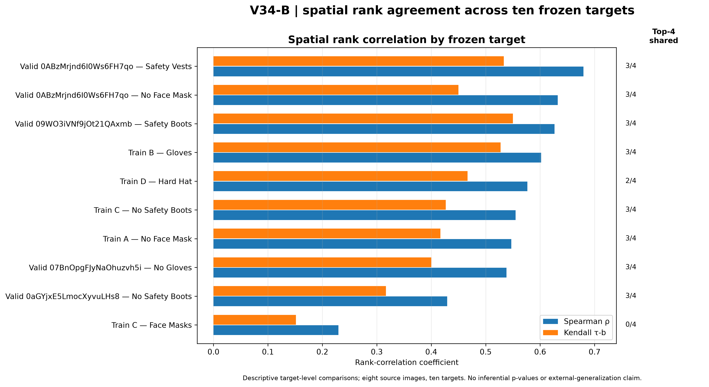

# Engineering evaluation of target-matched perturbation sensitivity and grid-resolution stability in personal protective equipment detection

**Authors:** Ezzaldeen Al-Tayar  
**Affiliation:** Faculty of Engineering and Information Technology, Taiz University, Taiz, Yemen  
**Corresponding author:** azzaltayyar@gmail.com

## Abstract

**Background.** Interpreting personal protective equipment (PPE) detections may help engineers scrutinize model responses, but saliency maps can vary with perturbation design and should not be confused with verified worker-level safety decisions. **Objective.** We investigated object-detection performance and the spatial stability of target-matched black-box perturbation sensitivity maps for a frozen 17-class RF-DETR Small PPE detector. **Methods.** We scored one-to-one, class-exact detections at intersection-over-union (IoU) ≥0.50 on 459 original-source validation images containing 3,471 current author-annotated objects. Separately, ten frozen detections from eight development-exposed images were probed with 8×8 and 4×4 single-cell occlusions and progressive deletion/insertion sequences. Fine and coarse signed score-drop maps were aligned on exact image coordinates; Spearman, Kendall τ-b and top-four overlap summarized target-level spatial agreement. **Results.** Detection yielded 3,297 true positives, 806 false positives and 174 false negatives (micro-precision 0.8036; recall 0.9499; F1 0.8706). Across ten paired targets, mean spatial agreement was Spearman ρ=0.5416, Kendall τ-b=0.4239 and 65% overlap among the four highest-ranking regions; one target had no overlap. On 8×8 curves, the saliency order had more favorable deletion/insertion responses than one fixed random ordering for most targets, but the limited random control, target dependence and overlapping A5/A6 selections do not support superiority or causal faithfulness claims. **Conclusions.** Frozen-detector, target-matched perturbation experiments can quantify instance-specific response patterns, while the observed resolution dependence argues against treating individual PPE sensitivity heatmaps as invariant or independently validated safety evidence. Independent-source generalization, worker-level compliance and human-review benefit were not measured.

**Keywords:** personal protective equipment; RF-DETR; explainable artificial intelligence; perturbation sensitivity; spatial robustness; object detection

## 1. Introduction

Visual screening of protective helmets, vests, gloves, masks and safety footwear can assist engineering inspection in complex construction environments. However, the mere detection of an equipment-class label is not a statement about whether a specific worker is equipped as required for their assigned task. Object-detector predictions may also appear visually plausible without establishing what image evidence determines the model's score.

The Y-PPE research programme previously reported an RF-DETR-based detector and a conceptual XAI/PPE decision-support framework (Al-Tayar et al., 2025a, 2025b). Subsequent studies examined BIM integration and detector comparison (Al-Tayar et al., 2026a, 2026b). These antecedents are cited as prior work, **not** represented as new detector-training, model architecture, worker-compliance or BIM experiments in the present article. RF-DETR is an established detector architecture (Robinson et al., 2026).

Existing research on selective explanations shows that explanation quality and computation must be considered jointly (Paes et al., 2024). Context-aware PPE systems can include person–item associations, symbolic rules and second-stage verification (Bouguessa et al., 2026; Yi et al., 2026; Vaghani, 2026). Qualitative and quantitative analysis of PPE-specific visual explanations has also appeared (Di Renzo et al., 2026). Hence, neither a PPE detector, an explanation heatmap, nor the idea of selective verification is itself a novel claim here.

Black-box explanation evaluation builds on meaningful perturbation (Fong and Vedaldi, 2017), randomized input sampling (Petsiuk et al., 2018), and model-randomization sanity checks (Adebayo et al., 2018). Hooker et al. (2019) illustrate why explanation methods require quantitative benchmarking rather than visual plausibility alone. A recent systematic overview of PPE computer-vision work (Barlybayev et al., 2026) highlights limitations of current deployment and validation evidence. We use these antecedents to operationalize transparent target-response diagnostics rather than claim attribution ground truth.

This study instead asks a tightly bounded empirical question: **When the detector, target instances and source images remain fixed, how consistent are target-matched occlusion-response rankings at 8×8 versus 4×4 spatial resolutions?** We combine an explicit current-reference detection evaluation with reproducible instance-matched perturbation curves and a spatial agreement analysis. Our contributions are:

1. An auditable 459-image current-label object-detection evaluation of the unchanged 17-class model, including predeclared metadata-risk cohort sensitivities.
2. A frozen-target, black-box perturbation protocol and numerical AUC checks for ten selected detections with explicit random and inverse ordering comparators, including null/ambiguous-target handling.
3. Exact-pixel alignment of paired 8×8 and 4×4 sensitivity maps, producing signed, area-normalized rank correlations and top-region agreement with reproducible image-derived figures.

These contributions concern detector behavior under specified perturbations. They do **not** demonstrate that the explanation is a causal mask, that a PPE object belongs to a given person, that a worker is compliant, or that an intervention reduces occupational risk.

## 2. Materials and methods

### 2.1. Data and fixed detector

The author-curated source corpus has 2,327 images and 16,520 object annotations, while its Clean17 research derivative has 2,288 images. The study uses the existing 17-class RF-DETR Small checkpoint (Roboflow identifier `altayyar-0oflt-lafos-qqauz/2`) without updating parameters, classes or annotation files. Earlier detector benchmark results are background rather than new outcomes. The study's present original-source validation cohort is formed from 459 identified images with 3,471 contemporary author-curated ground-truth objects. Ground-truth labels stem from a single-curator reference and may retain model-assisted annotation provenance.

All image/annotation splits and the protected Test boundary were preserved. The current Validation cohort originates from data exposed to earlier model-development activity and may contain source-family relationships across splits. Accordingly, metrics are **internal object-level diagnostic evaluations**, not evidence of independent construction-site generalization.

### 2.2. Detection endpoint and sensitivity cohorts

The 459 original-source images were inferred afresh by the unchanged hosted model at confidence threshold 0.20 and provider overlap setting 0.50. Predictions were mapped to original image coordinates and matched greedily, in descending confidence order with deterministic tie-breaks, to the highest-IoU *unused reference box of the same class* at IoU ≥0.50. Unmatched predictions and annotations were counted as false positives and false negatives, respectively. Precision, recall and F1 use pooled box counts, not per-image averages. We separately report M0 (all 459), M1 (448, removing an initial source-risk subset) and M2 (367, removing additional metadata flags). M2 is **not independently proven free of leakage**.

### 2.3. Frozen target selection for perturbation tests

The perturbation programme used ten prespecified target detections in eight original images (four Train and four Valid), all previously development-exposed. Two images contribute more than one target. The targeted instance was matched after each perturbation to its original bounding box by same class and IoU ≥0.50; absent matches received zero score under the frozen convention. Ambiguous same-class matches close in IoU were flagged rather than assigned an invented score. The original threshold and overlap settings remained fixed. Target responses cannot be treated as independent site-level observations.

A5 and A6 are selective *target-selection arms*: each selected eight target slots, **six of which are the same physical target detections**; the remaining two in each arm differ. Their selected-slot averages therefore cannot be treated as paired randomized intervention effects or as a fair global algorithm comparison.

### 2.4. Single-step target perturbation

Under the archived Gaussian experiment, a target-box blur was compared with its unperturbed baseline, plus a prespecified control box where available. In a separate black-fill experiment, the target region was removed from the original image or alone retained against a black background. The latter is a *single-step sufficiency* probe and not a progressive insertion-AUC experiment. The original model was never retrained and no Test split was used in these tests.

### 2.5. 8×8 cell occlusion and progressive deletion/insertion

An 8×8 grid was formed over each original source image, with exact floor-derived pixel bounds. One cell at a time was replaced by neutral gray RGB(127,127,127), and detector outputs were shared among targets within an image. Target sensitivity was computed as unperturbed confidence minus matched perturbed target confidence. Values could be negative and were not set to zero for spatial analysis.

For each rankable target, the grid cell order was (i) descending observed sensitivity, (ii) one reproducible SHA-256-target-ID-seeded random permutation and (iii) the inverse-sensitivity ranking. Deletion successively replaced image areas with a Gaussian-blurred version; insertion progressively restored original pixels into the blurred image. Both directions used eleven cumulative points (0–100% of cells). Score was normalized to the target's unperturbed confidence and clipped to [0,1] according to the frozen curve protocol; trapezoidal AUC used *actual pixel-area fractions*, not nominal fractions. Lower deletion AUC and higher insertion AUC were defined as favorable *perturbation responses*, not verified explanation truth.

The archived 8×8 accounting records 1,068 model calls: eight original baselines, eight blurred endpoints, 512 image-cell calls and 540 intermediate progressive-curve calls. The 512 cell calls yielded 640 target-cell records because multiple targets share images. All ten maps were rankable and all 60 planned AUCs were numerically available.

### 2.6. Paired 4×4 robustness and spatial registration

The exact ten targets and eight source-image identities were reused for a 4×4 analysis without resampling targets or repeating original baselines. This follow-up used 496 hosted detector calls (eight new blur endpoints, 128 cell calls, 360 intermediate curve calls). It generated 40 curves (saliency and seeded-random order, each in deletion and insertion directions); 39 AUCs were valid. A target's 4×4 saliency-deletion curve was invalidated by an ambiguous match at the second deletion point, and its AUC was left **null**, not imputed.

Each 4×4 region was matched by exact pixel coordinates to the corresponding four 8×8 subregions. Signed score drop was divided by its cell's original-image pixel-area fraction. The four fine values were pooled as an area-weighted mean and compared with the directly occluded coarse region's normalized value. Over the sixteen aligned regions per target, Spearman ρ (Spearman, 1904; average ranks for ties), Kendall τ-b (Kendall, 1938; tie-aware) and overlap of the four top-ranked regions were computed. Top-four ranking ties were resolved row-major; negative sensitivities remained in the comparisons. Spatial coefficients are descriptive summaries on dependent cells and targets; no cell-level independence test was performed.

### 2.7. Auditing, compute accounting and reporting

The numerical archives include fixed target IDs, per-image source hashes from the archived execution environment, per-region score records, trapezoidal curve points and summary calculations. Independent checking scripts reproduced target identifiers, AUCs, cell-area geometry and rank coefficients. This establishes **numeric reproducibility of the saved experiment**, not independent verification of image provenance, image rights, person–PPE labels or explanatory causality. Hosted API wall-clock request time was recorded separately and is not presented as model runtime, hardware latency, physical energy or carbon emissions.

## 3. Results

### 3.1. Detection evaluation on original-source validation images

All 459 image IDs and inference records were successfully joined to the current reference. The detector produced 4,103 boxes against 3,471 annotations, resulting in 3,297 true positives, 806 false positives and 174 false negatives on the M0 cohort. The complete 17-class distribution and the original per-image matching ledger are archived in the reproducibility material.

| Cohort | Study size | TP / FP / FN | Micro precision / recall / F1 |
|:--|:--|:--|:--|
| M0 | 459 images; 3,471 GT; 4,103 predictions | 3,297 / 806 / 174 | 0.8036 / 0.9499 / 0.8706 |
| M1 | 448 images; 3,433 GT; 4,063 predictions | 3,261 / 802 / 172 | 0.8026 / 0.9499 / 0.8701 |
| M2 | 367 images; 3,049 GT; 3,618 predictions | 2,894 / 724 / 155 | 0.7999 / 0.9492 / 0.8682 |

*Table 1. Prespecified current-source Validation cohorts and class-exact IoU≥0.50 results. M1 and M2 are metadata-based sensitivity groups, not independently acquired test cohorts.*

The relatively small change across these cohort definitions indicates limited movement under the specified filtering rules; it does not prove that scene-level dependence or model-development exposure is absent.

### 3.2. Single-step perturbation responses

Gaussian blur of the ten frozen target boxes led to loss of the matched target in **9/10** cases under the frozen class/IoU matching rule. Black-fill target-box deletion led to **10/10** losses, while target-only insertion retained the matched detection in **7/10** cases. The other three insertion failures involved the three smallest target boxes, but the sample is too small to identify a general causal size relation. These probes quantify sensitivity of selected detector outputs, not occupation-specific risk or visual explanation correctness.

### 3.3. Progressive deletion/insertion results and random comparator

The 8×8 experiment yielded ten rankable maps and 60 valid eleven-point progressive curves. Aggregate arm-selected AUCs appear in Table 2.

| Arm (eight target slots) | Deletion AUC (saliency / random) ↓ | Insertion AUC (saliency / random) ↑ | Favorable saliency slots (D / I) |
|:--|:--|:--|:--|
| A5 | 0.496288 / 0.635836 | 0.944195 / 0.800164 | 6/8 / 8/8 |
| A6 | 0.397182 / 0.619275 | 0.871354 / 0.752773 | 7/8 / 7/8 |

*Table 2. Descriptive target-selection-arm AUCs. The six common targets are reused, so arm means do not identify selection-policy superiority.*

Across the ten **unique** targets, the saliency order was favorable relative to the **single fixed random order** for **8/10 deletion targets** (one tie and one unfavorable) and **9/10 insertion targets**. These observed favorable directions do **not** justify a claim of superiority to a distribution of random baselines, to other attribution methods or to actual human explanations. The inverse ordering is deterministically related to the sensitivity order and is not an independent comparator. The overlap of target IDs between A5 and A6 and the heterogeneity of deletion/insertion directions prevent identification of one superior selective strategy.

### 3.4. Repeating target perturbations at 4×4 resolution

All ten targets produced rankable 4×4 maps. Of 40 planned curves, 39 AUCs were valid; one ambiguous saliency-deletion target was not scored. The saliency order was favorable to its single seeded-random comparator in **8/9 scorable deletion cases** and **10/10 insertion cases**. The saliency-minus-random advantage changed direction between spatial resolutions for three of nine deletion comparisons and one of ten insertion comparisons. The signed 4×4-minus-8×8 saliency AUC difference was mean −0.021799 for the nine valid deletion pairs, and mean −0.017560 for ten insertion pairs. This is partial, direction-dependent robustness, not invariant causal explanation performance.

### 3.5. Direct 8×8-to-4×4 spatial alignment

All ten exact-target map pairs passed identity, area partition and value-conservation checks. Each comparison was made over sixteen registered coarse regions, using both directly computed coarse sensitivity and the area-weighted 8×8 sensitivity aggregation.

| Target-level spatial summary | Value |
|:--|--:|
| Number of frozen targets / original images | 10 / 8 |
| Mean Spearman ρ | 0.5416 |
| Median Spearman ρ | 0.5656 |
| Range of Spearman ρ | 0.2295–0.6794 |
| Mean Kendall τ-b | 0.4239 |
| Median Kendall τ-b | 0.4384 |
| Mean top-four region overlap | 2.6 of 4 = 65% |
| Targets with 3/4 overlap | 8 |
| Targets with 2/4 overlap | 1 |
| Targets with 0/4 overlap | 1 |

*Table 3. Exact-pixel aligned map agreement; values are descriptive, with no independent-site statistical inference.*

The most discrepant target, Train C Face Masks, had approximately ρ=0.2295, τ-b=0.1514 and **zero** shared top-four regions. The nonzero mean correlation therefore does not support treating the 8×8 and 4×4 explanations as spatially interchangeable.

*Figure 1. Target-level Spearman ρ, Kendall τ-b and overlap of the four highest signed-sensitivity regions when the same original detections are analyzed at 8×8 and 4×4 resolution. Map values are derived from archived score-drop ledgers, not human-labeled attribution ground truth. Ten corresponding paired heatmaps are available as Supplementary Figures S1–S10.*

## 4. Discussion

### 4.1. Engineering value of the measured evidence

The study's engineering contribution is not another claimed PPE detector architecture. It is a reproducible evaluation demonstrating why a single attractive heatmap may be insufficient evidence for the reliability of a deployed computer-vision screening result. Even when the detector and target are unchanged, the occlusion granularity affects local evidence rankings. The 65% mean top-four overlap is informative as a descriptive test of sensitivity, but an individual target with zero overlap can matter in inspection practice because a reviewer may be directed to entirely different image regions.

The object-level F1 of 0.8706 characterizes performance against the **current** annotated reference at a fixed box-matching rule. It cannot be equated to a worker-compliance accuracy, an out-of-sample safety efficacy score or the historical published Roboflow mAP benchmark. The current annotations are single-curator and the original validation sources are not proven acquisition independent, limiting conclusions about generalization.

The saliency-derived ordering produced favorable measured deletion/insertion responses relative to one fixed seeded random ordering for most of the selected targets. This is evidence of sensitivity under *that specific protocol*, but not a license to assert clinical/regulatory-grade explanation faithfulness, model reliance on semantically correct features or improvement over repeated random baselines. Target-matching ambiguity at 4×4 was handled as a missing endpoint rather than falsely scored as success or failure.

### 4.2. Why no A5–A6 winner is reported

A5 and A6 each contain eight target slots, with **six identical target detections**. The observed arm-average differences therefore depend on which two arm-specific targets each selector includes. A5 has higher mean insertion AUC and A6 lower deletion AUC in 8×8, making a blanket dominance claim unjustifiable. The study does not execute a worker-level false-clearance intervention, controlled human-review trial or source-independent field deployment, so selective routing remains a framework hypothesis rather than a proven safety-improving policy.

### 4.3. Methodological boundaries and future tests

This is a deliberately bounded, development-exposed sample of ten targets in eight images; multiple detections belong to the same image. A larger independent-source dataset, multiple independent random permutations, alternative perturbation and attribution controls, image/site-clustered uncertainty analyses and a prespecified stronger selective comparator would be needed to support more general method-superiority claims. Source image provenance and consent constraints may limit raw-image redistribution; such limitations must be disclosed without promising resources that cannot lawfully be released.

The measured hosted request round-trip reflects networking and service overhead, not detector compute latency or electrical energy consumption. No worker-to-equipment ownership reference or task-specific PPE requirement was evaluated, and no safety outcome was measured. Accordingly, the present paper must not be described as validating a real-time safety-enforcement product.

## 5. Conclusion

A frozen 17-class PPE detector achieved micro-F1=0.8706 on 459 current-source validation images under class-exact IoU≥0.50 matching. Target-matched black-box experiments on ten selected detections yielded reproducible 8×8 and 4×4 response maps, but spatial rankings agreed only moderately: mean Spearman ρ=0.5416, Kendall τ-b=0.4239 and mean top-four overlap of 65%. A zero-overlap target illustrates why visual response maps should not be assumed resolution invariant. A seeded random comparator did not establish general algorithm superiority, and partially overlapping A5/A6 selections do not identify a policy winner. The defensible result is **a measured limitation on the spatial stability of object-detector perturbation sensitivity**, not verified worker-compliance or human-safety benefit. Independent-source, stronger comparator and human/occupational task validation remain future work.

## Declarations and availability

**Ethics, identifiable-worker imagery and permissions:** [AUTHOR MUST DOCUMENT the appropriate institutional determination/approval or exemption and the lawful privacy/consent/permission basis for any identifiable worker images or figure disclosures. No committee approval or blanket consent is asserted.]

**Funding:** [AUTHOR TO CONFIRM actual source(s), grant numbers, or a truthful no-specific-funding statement.]

**Declaration of competing interests:** [AUTHOR TO CONFIRM the truthful statement, using Elsevier's current form where required.]

**Author contributions (CRediT):** [AUTHOR TO CONFIRM actual contributions and final approved author order; do not infer solely from the present author block.]

**Data availability:** The numerical outcomes, derived summary figures, algorithms and audits are stored in the research repository `EZZALDEEN049/Y-PPE-Detection-RFDETR`. Raw source photographs and personal/source identifiers are **not** asserted to be publicly redistributable. [AUTHOR TO CONFIRM exactly which files, versions, access restrictions and permissions can lawfully be disclosed, and provide a persistent versioned public link if permitted.]

**Code availability:** The archived numerical analysis and synthetic checks are referenced in the same research repository; [AUTHOR/EDITOR TO VERIFY actual public access, reproducible dependencies and immutable version at submission].

**Declaration of generative AI use in manuscript preparation:** [AUTHOR MUST DISCLOSE any qualifying use as required by Elsevier's current policies; this editorial draft was prepared with ChatGPT assistance and must undergo human review and validation of every statement.]

**Prior dissemination and originality:** Previous 2025/2026 PPE/RF-DETR and XAI publications by the research group are cited as prior work. This manuscript reports the archived newly executed original-source validation and perturbation/spatial robustness measurements rather than re-publishing earlier detector-training claims. [AUTHOR MUST VERIFY all related papers, abstracts, preprints and non-overlap with existing publications, and approve the final originality statement.]

## Supplementary material

Supplementary File S1 supplies the target-by-target signed-sensitivity alignment values, the ten data-derived paired-grid sensitivity maps (Figures S1–S10), reproducibility details, and additional cohort/class-count information. The archived 34-page research dossier is a separate version-controlled audit record and is not intended to be submitted as Supplementary File S1.

## Declaration of generative AI and AI-assisted technologies in the manuscript preparation process

During preparation of this manuscript, OpenAI ChatGPT was used to assist with restructuring and language drafting based on the authors' archived research outputs and analyses. **[AUTHOR CONFIRMATION REQUIRED: review, validate, edit and personally approve this entire statement and the resulting manuscript before submission. The author(s) retain full responsibility for the final content.]** This editorial assistance did not generate new detector observations or modify the archived data.

## References

Adebayo, J., Gilmer, J., Muelly, M., Goodfellow, I., Hardt, M., & Kim, B. (2018). Sanity checks for saliency maps. *Advances in Neural Information Processing Systems, 31*. https://proceedings.neurips.cc/paper/2018/hash/294a8ed24b1ad22ec2e7efea049b8737-Abstract.html

Al-Tayar, E., Saeed, M. A., & Saif, A. (2025a). AI-driven RF-DETR decision system for real-time PPE monitoring in Yemen's development projects. In *2025 International Conference on Decision Aid Sciences and Applications (DASA)* (pp. 204–208). IEEE. https://doi.org/10.1109/DASA68193.2025.11499131

Al-Tayar, E., Al-Azazi, S. A., & Saeed, M. A. (2025b). X-RF-DETR: A framework for explainable and trustworthy PPE decision support. In *2025 International Conference on Decision Aid Sciences and Applications (DASA)* (pp. 1048–1052). IEEE. https://doi.org/10.1109/DASA68193.2025.11498849

Al-Tayar, E., Al-Azazi, S. A., Ali, A., & Alawag, A. M. (2026a). BIM-integrated explainable vision for real-time PPE safety in Yemen's construction sector. In *2026 6th International Conference on Emerging Smart Technologies and Applications (eSmarTA)*. IEEE. https://doi.org/10.1109/ESMARTA70636.2026.11652079

Al-Tayar, E., Al-Azazi, S. A., Saeed, M. A., Ali, A., & Hassan, A. (2026b). PPE detection in Yemeni construction sites: YOLOv11m vs. RF-DETRs. In *2026 6th International Conference on Emerging Smart Technologies and Applications (eSmarTA)*. IEEE. https://doi.org/10.1109/ESMARTA70636.2026.11652190

Barlybayev, A., Milosz, M., Amangeldy, N., Li, G., Razakhova, B., Tazhib, A., Nazyrova, A., & Lamasheva, Z. (2026). Systematic review of computer-vision technologies for personal protective equipment compliance monitoring. *Computers, 15*(6), 388. https://doi.org/10.3390/computers15060388

Bouguessa, A., Bekki, I., Daoud, M. A., & Mostefaoui, S. A. M. (2026). A hybrid perception–reasoning architecture for context-aware personal protective equipment compliance assessment. *Engineering Applications of Artificial Intelligence, 181*, 115725. https://doi.org/10.1016/j.engappai.2026.115725

Di Renzo, M., Niro, F., Agnello, P., Petyx, M., Martinelli, F., Cesarelli, M., Santone, A., & Mercaldo, F. (2026). On vision transformer explainability for personal protective equipment detection: A qualitative and quantitative analysis. *Journal of Imaging, 12*(5), 195. https://doi.org/10.3390/jimaging12050195

Fong, R. C., & Vedaldi, A. (2017). Interpretable explanations of black boxes by meaningful perturbation. In *Proceedings of the IEEE International Conference on Computer Vision (ICCV)*. IEEE. https://doi.org/10.1109/ICCV.2017.371

Hooker, S., Erhan, D., Kindermans, P.-J., & Kim, B. (2019). A benchmark for interpretability methods in deep neural networks. *Advances in Neural Information Processing Systems, 32*, 9737–9748. https://proceedings.neurips.cc/paper/2019/hash/fe4b8556000d0f0cae99daa5c5c5a410-Abstract.html

Kendall, M. G. (1938). A new measure of rank correlation. *Biometrika, 30*(1–2), 81–93. https://doi.org/10.1093/biomet/30.1-2.81

Paes, L. M., Wei, D., & Calmon, F. P. (2024). Selective explanations. *Advances in Neural Information Processing Systems, 37*, 55562–55590. https://doi.org/10.52202/079017-1765

Petsiuk, V., Das, A., & Saenko, K. (2018). RISE: Randomized input sampling for explanation of black-box models. In *British Machine Vision Conference (BMVC)*. https://arxiv.org/abs/1806.07421

Robinson, I., Robicheaux, P., Popov, M., Ramanan, D., & Peri, N. (2026). RF-DETR: Neural architecture search for real-time detection transformers. In *International Conference on Learning Representations (ICLR)*. https://arxiv.org/abs/2511.09554

Spearman, C. (1904). The proof and measurement of association between two things. *The American Journal of Psychology, 15*(1), 72–101. https://doi.org/10.2307/1412159

Vaghani, B. V. B. (2026). Construction safety AI that knows what it doesn't see: A Sentry–Judge hybrid for PPE absence detection. *Frontiers in Built Environment, 12*, Article 1976288. https://doi.org/10.3389/fbuil.2026.1976288

Yi, W., Xu, W., & Tan, Y. (2026). Regulation-aligned PPE compliance assessment for work-at-height using visual relationships and scene graph reasoning. *Advanced Engineering Informatics, 74*, Article 104612. https://doi.org/10.1016/j.aei.2026.104612
