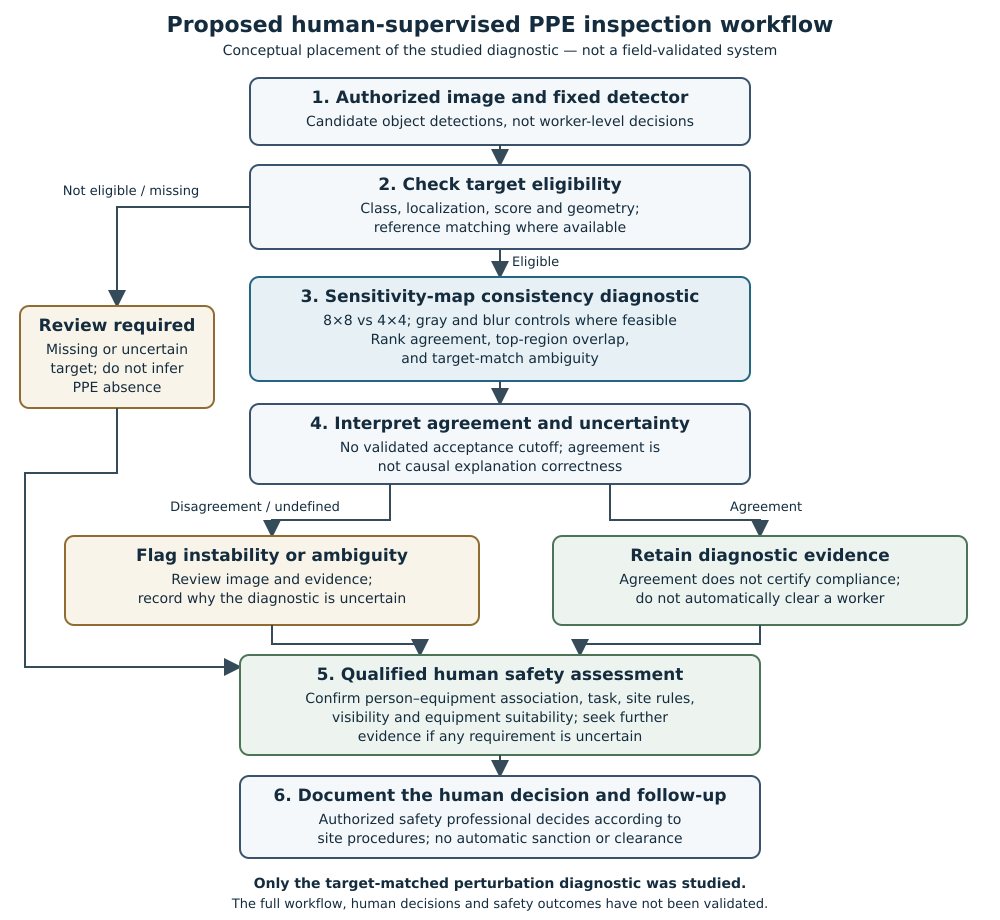

# Cross-Resolution Consistency of Target-Matched Perturbation Sensitivity Maps for Personal Protective Equipment Detection

**Author:** Ezzaldeen Al-Tayar  
**Affiliation:** Faculty of Engineering and Information Technology, Taiz University, P.O. Box 6803, Taiz, Yemen  
**Corresponding author:** Ezzaldeen Al-Tayar (azzaltayyar@gmail.com)  
**ORCID:** https://orcid.org/0009-0003-9506-6669

## Abstract

**Background.** Perturbation-based explanations of personal protective equipment (PPE) detections may change with spatial resolution and occlusion design. **Objective.** We quantified cross-resolution agreement of target-matched sensitivity maps from an unchanged RF-DETR Small detector. **Methods.** Detection was assessed on 459 development-exposed original validation images. An initial exploratory experiment compared 8×8 and 4×4 maps for ten detections in eight images. A separately frozen extension tested 48 eligible, correctly matched detections across 24 validation images using signed, area-normalized responses. Spearman correlation, Kendall tau-b and top-four region overlap quantified agreement. Eight images received a blur-fill operator control; a twelve-target subset was assigned saliency and ten seeded random-order comparisons. **Results.** Internal object-level detection micro-F1 was 0.8706. In the extension, 45/48 targets produced estimable cross-resolution coefficients; mean Spearman correlation was 0.6490, mean Kendall tau-b 0.5197 and mean top-four overlap 66.7%. Image-balanced Spearman correlation was 0.6508, with a descriptive image-resampling interval of 0.595–0.704. In 14 valid paired operator comparisons, mean Spearman correlation was 0.6943 under gray fill and 0.4811 under blur fill. Eleven of twelve curve-selected targets yielded 264 valid deletion/insertion areas under the curve (AUCs); sensitivity ordering yielded favorable AUCs versus ten random-order means in all eleven, an internal, non-independent diagnostic. **Conclusions.** Cross-resolution consistency is measurable but varies by target and occlusion operator. Results are conditional on one detector and eligible detections, not representative of all PPE detection outcomes or independently verified explanation fidelity, site generalization or worker-level safety compliance.

**Keywords:** personal protective equipment; RF-DETR; explainable artificial intelligence; perturbation sensitivity; spatial robustness; object detection

## 1. Introduction

Visual screening of protective helmets, vests, gloves, masks and safety footwear can assist engineering inspection in complex construction environments. However, the mere detection of an equipment-class label is not a statement about whether a specific worker is equipped as required for their assigned task. Object-detector predictions may also appear visually plausible without establishing what image evidence determines the model's score.

The Y-PPE research programme previously reported an RF-DETR-based detector and a conceptual XAI/PPE decision-support framework (Al-Tayar et al., 2025a, 2025b). Subsequent studies examined BIM integration and detector comparison (Al-Tayar et al., 2026a, 2026b). These antecedents are cited as prior work, **not** represented as new detector-training, model architecture, worker-compliance or BIM experiments in the present article. RF-DETR is an established detector architecture (Robinson et al., 2026).

Existing research on selective explanations shows that explanation quality and computation must be considered jointly (Paes et al., 2024). Context-aware PPE systems can include person–item associations, symbolic rules and second-stage verification (Bouguessa et al., 2026; Yi et al., 2026; Vaghani, 2026). Qualitative and quantitative analysis of PPE-specific visual explanations has also appeared (Di Renzo et al., 2026). Hence, neither a PPE detector, an explanation heatmap, nor the idea of selective verification is itself a novel claim here.

Black-box explanation evaluation builds on meaningful perturbation (Fong and Vedaldi, 2017), randomized input sampling (Petsiuk et al., 2018), and model-randomization sanity checks (Adebayo et al., 2018). D-RISE (Petsiuk et al., 2021) constructs detector explanations using randomized masks and a localization-and-category similarity score. A directly relevant industrial object-detection study in *Results in Engineering* introduced D-MFPP and assessed black-box explanation methods and detector-oriented perturbation metrics (Andres et al., 2024). D-RISE and D-MFPP use different mask-generation strategies and target-similarity definitions; consequently, their saliency magnitudes, rankings and computational costs cannot be compared fairly to the present signed-density values without a controlled common-target, common-score and comparable-budget protocol. The present design isolates a particular representation change (fine versus coarse regular grids) and tests an alternative fill, rather than selecting a superior explanation algorithm. Unlike that comparator, our specific empirical endpoint is the signed, matched-instance 8×8-to-4×4 region-ranking consistency and its dependence on the occlusion-fill operator; neither D-RISE nor D-MFPP was executed here. Randomizing the evaluation order of existing grid cells is not equivalent to generating either published method's explanation maps. Hooker et al. (2019) illustrate why explanation methods require quantitative benchmarking rather than visual plausibility alone. A recent systematic overview of PPE computer-vision work (Barlybayev et al., 2026) highlights limitations of current deployment and validation evidence. We use these antecedents to operationalize transparent target-response diagnostics rather than claim attribution ground truth.

**Novelty relative to previously disseminated work.** Table 1 summarizes the distinct *focus* of each cited work; it does not claim access to or audit of every prior paper's unpublished data, and any shared-image or text overlap requires author certification before submission.

| Reference and year | Main previously reported scope | Distinction in the present study |
|:--|:--|:--|
| Al-Tayar et al. (2025a) | RF-DETR Small training, 2,327-image/16,520-label Y-PPE corpus, historical validation/test performance and monitoring interface | Reuses the established resource; no training or deployment claim; evaluates current-reference boxes and conditional cross-grid perturbation responses |
| Al-Tayar et al. (2025b) | Explainable RF-DETR decision-support framework with a preliminary 300-image public-PPE comparison and illustrative XAI case study | Supplies archived numeric 8×8↔4×4 spatial-rank agreement and explicit missing-identity accounting, not merely a proposed XAI framework |
| Al-Tayar et al. (2026a) | BIM-integrated PPE safety vision | No new BIM integration or task-level compliance validation; focuses on detector response maps |
| Al-Tayar et al. (2026b) | YOLOv11m versus RF-DETR detector comparison using the previously reported 2,327-image Y-PPE source corpus | Holds RF-DETR Small fixed; does not recompare model architectures |
| Andres et al. (2024), D-MFPP | Model-agnostic explanations of object detectors, including perturbation benchmarking | No claim of D-MFPP superiority; tests signed cross-grid *matched-instance rank consistency* and gray/blur operator dependence |
| Present study (V34A/V38-B) | Frozen 10-target exploratory study plus separate 48-target extension | Primary descriptive endpoint: 16-region signed-density rank agreement, three undefined maps retained, and prespecified operator/random-order controls |

*Table 1. Scope of related publications and the distinct empirical contribution of the present study. The comparison concerns reported study focus, not a direct performance benchmark.*

The original Y-PPE source corpus (2,327 images and 16,520 annotations) was described in the 2025 RF-DETR decision-system study and the subsequent detector comparison (Al-Tayar et al., 2025a, 2026b). The former reports field-project collection with engineers and supervisors supplemented by selected open-source imagery, Roboflow training, a historical operating confidence range of approximately 0.46–0.48, and validation/test F1 values of 0.919/0.942. These earlier metrics and data provenance are disclosed as prior work; they do not form a paired comparison with the current fixed-0.20, current-reference validation audit. The present analysis is a new conditional endpoint rather than a new dataset or training result. It is reused here as a research resource, not claimed as a new dataset. The current-reference 459-image diagnostic evaluation and target-matched cross-grid analyses address different endpoints from that earlier architecture comparison. We do not present earlier datasets or architectures as a newly developed model, and this matrix is not a substitute for a final authorship/rights overlap assessment.

This study instead asks a tightly bounded empirical question: **When the detector, target instances and source images remain fixed, how consistent are target-matched occlusion-response rankings at 8×8 versus 4×4 spatial resolutions?** An exploratory frozen-target study and a subsequently prospectively specified, larger diagnostic replication are reported **separately** because source selection and image transport differ. We combine a current-reference detection audit with instance-matched perturbation curves, exact spatial registration and perturbation-operator controls. Our contributions are:

1. An auditable 459-image current-label object-detection evaluation of the unchanged 17-class model, including predeclared metadata-risk cohort sensitivities.
2. A frozen-target, black-box perturbation protocol and numerical AUC checks for ten selected detections with explicit random and inverse ordering comparators, including null/ambiguous-target handling.
3. Exact-pixel alignment of paired 8×8 and 4×4 sensitivity maps, producing signed, area-normalized rank correlations and top-region agreement with reproducible image-derived figures.
4. A separately frozen 48-target, 24-image diagnostic extension with image-balanced resampling uncertainty, ten seeded random-rank baselines, two occlusion-fill operators, explicit missing-result accounting and a pre-request 6,000-call hard cap.

These contributions concern detector behavior under specified perturbations. They do **not** demonstrate that the explanation is a causal mask, that a PPE object belongs to a given person, that a worker is compliant, or that an intervention reduces occupational risk.

## 2. Materials and methods

### 2.1. Data and fixed detector

The author-curated source corpus has 2,327 images and 16,520 object annotations, while its Clean17 research derivative has 2,288 images. The study uses the existing 17-class RF-DETR Small checkpoint (Roboflow identifier `altayyar-0oflt-lafos-qqauz/2`) without updating parameters, classes or annotation files. Earlier detector benchmark results are background rather than new outcomes. The study's present original-source validation cohort is formed from 459 identified images with 3,471 contemporary author-curated ground-truth objects. Ground-truth labels stem from a single-curator reference and may retain model-assisted annotation provenance.

All image/annotation splits and the protected Test boundary were preserved. The current Validation cohort originates from data exposed to earlier model-development activity and may contain source-family relationships across splits. Accordingly, metrics are **internal object-level diagnostic evaluations**, not evidence of independent construction-site generalization.

### 2.2. Detection endpoint and sensitivity cohorts

The 459 original-source images were inferred afresh by the unchanged hosted model at confidence threshold 0.20 and provider overlap setting 0.50. Predictions were mapped to original image coordinates and matched greedily, in descending confidence order with deterministic tie-breaks, to the highest-IoU *unused reference box of the same class* at IoU ≥0.50. Unmatched predictions and annotations were counted as false positives and false negatives, respectively. Precision, recall and F1 use pooled box counts, not per-image averages. With TP, FP and FN denoting true positives, false positives and false negatives, respectively, the pooled metrics are

$$
P=\frac{TP}{TP+FP}.\qquad (1)
$$

$$
R=\frac{TP}{TP+FN}.\qquad (2)
$$

$$
F_1=\frac{2PR}{P+R}=\frac{2TP}{2TP+FP+FN}.\qquad (3)
$$

We separately report M0 (all 459), M1 (448, removing an initial source-risk subset) and M2 (367, removing additional metadata flags). M2 is **not independently proven free of leakage**.

### 2.3. Frozen target selection for perturbation tests

The perturbation programme used ten prespecified target detections in eight original images (four Train and four Valid), all previously development-exposed. Two images contribute more than one target. The targeted instance was matched after each perturbation to its original bounding box by same class and IoU ≥0.50; absent matches received zero score under the frozen convention. Ambiguous same-class matches close in IoU were flagged rather than assigned an invented score. The original threshold and overlap settings remained fixed. Target responses cannot be treated as independent site-level observations.

A5 and A6 are selective *target-selection arms*: each selected eight target slots, **six of which are the same physical target detections**; the remaining two in each arm differ. Their selected-slot averages therefore cannot be treated as paired randomized intervention effects or as a fair global algorithm comparison.

### 2.4. Single-step target perturbation

Under the archived Gaussian experiment, a target-box blur was compared with its unperturbed baseline, plus a prespecified control box where available. In a separate black-fill experiment, the target region was removed from the original image or alone retained against a black background. The latter is a *single-step sufficiency* probe and not a progressive insertion-AUC experiment. The original model was never retrained and no Test split was used in these tests.

### 2.5. 8×8 cell occlusion and progressive deletion/insertion

An 8×8 grid was formed over each original source image, with exact floor-derived pixel bounds. One cell at a time was replaced by neutral gray RGB(127,127,127), and detector outputs were shared among targets within an image. Target sensitivity was computed as unperturbed confidence minus matched perturbed target confidence. Values could be negative and were not set to zero for spatial analysis.

For each rankable target, the grid cell order was (i) descending observed sensitivity, (ii) one reproducible SHA-256-target-ID-seeded random permutation and (iii) the inverse-sensitivity ranking. Deletion successively replaced image areas with a Gaussian-blurred version; insertion progressively restored original pixels into the blurred image. Both directions used eleven cumulative points (0–100% of cells). Score was normalized to the target's unperturbed confidence and clipped to [0,1] according to the frozen curve protocol; trapezoidal AUC used *actual pixel-area fractions*, not nominal fractions. Lower deletion AUC and higher insertion AUC were defined as favorable *perturbation responses*, not verified explanation truth.

The archived 8×8 accounting records 1,068 model calls: eight original baselines, eight blurred endpoints, 512 image-cell calls and 540 intermediate progressive-curve calls. The 512 cell calls yielded 640 target-cell records because multiple targets share images. All ten maps were rankable and all 60 planned AUCs were numerically available.

### 2.6. Paired 4×4 robustness and spatial registration

The exact ten targets and eight source-image identities were reused for a 4×4 analysis without resampling targets or repeating original baselines. This follow-up used 496 hosted detector calls (eight new blur endpoints, 128 cell calls, 360 intermediate curve calls). It generated 40 curves (saliency and seeded-random order, each in deletion and insertion directions); 39 AUCs were valid. A target's 4×4 saliency-deletion curve was invalidated by an ambiguous match at the second deletion point, and its AUC was left **null**, not imputed.

Each 4×4 region was matched by exact pixel coordinates to the corresponding four 8×8 subregions. Signed score drop was divided by its cell's original-image pixel-area fraction. The four fine values were pooled as an area-weighted mean and compared with the directly occluded coarse region's normalized value. Over the sixteen aligned regions per target, Spearman ρ (Spearman, 1904; average ranks for ties), Kendall τ-b (Kendall, 1938; tie-aware) and overlap of the four top-ranked regions were computed. Top-four ranking ties were resolved row-major; negative sensitivities remained in the comparisons. Spatial coefficients are descriptive summaries on dependent cells and targets; no cell-level independence test was performed.

### 2.7. Auditing, compute accounting and reporting

The numerical archives include fixed target IDs, per-image source identity records, per-region score records, trapezoidal curve points and summary calculations. The V38-B extension additionally preserved new source-raw and EXIF-canonical RGB fingerprints; original historical V26 raw-byte hashes were not available for retrospective byte equality. Independent checking scripts reproduced target identifiers, AUCs, cell-area geometry and rank coefficients. This establishes **numeric reproducibility of the saved experiment**, not independent verification of photographic publication rights, person–PPE labels or explanatory causality. Hosted API round-trip time includes service and network overhead and is not presented as detector-only runtime, energy use or carbon emissions.

OpenAI ChatGPT (OpenAI) assisted with research-code drafting and refinement, reproducibility checks, literature organization and reference checking, data-derived plotting-script preparation, and manuscript organization and language drafting/editing. The exact model-version identifiers for some historical code and manuscript sessions were not consistently retained in the project record; the Figure 4 caption identifies GPT-6.2 for the explanatory schematic. The numerical analyses use Python, NumPy and SciPy, the inference runner uses Pillow for image handling, and the plots are rendered with Matplotlib from archived numerical values. The executable scripts, inputs, deterministic selection and random-seed conventions—not chatbot output—define the numerical reproduction procedure. ChatGPT did not generate or alter primary research photographs or numerical measurements. The author remains responsible for independently checking all code, sources, analysis, interpretation and final manuscript content.

### 2.8. Prospective V38-B replication and perturbation-operator control

Following the exploratory experiment, a **distinct V38-B protocol** was frozen before additional model calls. Archived predictions and same-class current-author annotations from 459 original-source Validation records were screened using baseline confidence ≥0.55, box width/height ≥16 pixels, relative area ≥0.03%, and class-exact IoU ≥0.50. A deterministic, hash-tie-broken selection algorithm chose **48 exact detection IDs in 24 distinct source images** (two different PPE categories per image) from an eligible pool, covering **11 categories** with four or five selected targets per category. Targets previously used in the exploratory V30 cohort or flagged V23 pilot were excluded from this extension. This selection used the earlier detector's outputs and is **not independently sampled**; all 24 images were development-exposed Validation, and field-site-family independence is unverified. The frozen selection record identified 225 eligible source images among the 459 historical Validation records after screening and exclusions, including a minimum image width and height of 320 and 240 pixels. The 48 selected archived V26 baseline confidences ranged from 0.5959 to 0.9325 (median 0.8463), and their class-exact reference IoUs ranged from 0.5267 to 0.9464 (median 0.7889). These are eligibility descriptors, not new inference results. The estimand is conditional on eligible, correctly matched detections; it excludes false negatives, unmatched false positives and subthreshold or undersized candidates, and is not a representative estimate of explanation reliability across all PPE detection outcomes.

The same unchanged hosted RF-DETR Small checkpoint and confidence/overlap settings (0.20/0.50) were used. Matching required the original class and box intersection over union (IoU) of at least 0.50; when the two best eligible IoUs differed by at most 0.03, the match was classified as ambiguous. The frozen baseline check rejected confidence drift greater than 0.08 relative to the archived V26 target, rather than widening thresholds. Original image identity was checked against new raw and orientation-corrected RGB hashes, with EXIF orientation applied before constructing pixel masks; one image required orientation correction. The extension transmitted **all** baselines, perturbations and progressive masks as JPEG quality 95 with 4:4:4 chroma rather than the earlier PNG-based setup. This fixed lossy wire format was recorded before live execution after an unperturbed PNG size-limit preflight. Because image encoding and sample selection differed, historical V34 and prospective V38-B estimates are **not pooled or interpreted as paired improvements**.

Each of the 24 images contributed 64 independent one-cell 8×8 and 16 one-cell 4×4 neutral-gray (RGB 127) occlusions shared across its two targets. Response was original matched-target confidence minus perturbed matched-target confidence; negative changes were retained. Absent target matches were zero-scored under the frozen convention; ambiguous same-class matches were marked undefined rather than imputed. A zero target score denotes the absence of a qualifying matched detection under the fixed inference-output and IoU thresholds. It does not necessarily indicate a zero internal model response or complete absence of visual evidence for the target. For each coarse region, we compared the directly measured coarse signed response divided by the region's exact pixel-area fraction with the **sum of the four corresponding fine-cell signed responses divided by that same coarse-region area fraction**. This sum-of-responses analysis preserves the V34A normalized-density convention; it must not be interpreted as physical equivalence of single-cell and joint multi-cell occlusion. Tie-aware Spearman rho and Kendall tau-b used sixteen registered regions per target; deterministic row-major tie-breaking defined overlap of the top four signed-density regions.

For transparent implementation, write $s_0(t)$ for the baseline target-matched score and $s_{c}^{(g)}(t)$ for its score after individually occluding cell $c$ of grid $g$. The signed response is

$$
\Delta^{(g)}_{c}(t)=s_0(t)-s^{(g)}_{c}(t).\qquad (4)
$$

If $a_c$ is the exact coarse-cell pixel count and $a_{\mathrm{img}}$ is image pixel count, define $A_c=a_c/a_{\mathrm{img}}$. A coarse 4×4 region $c$ corresponds to a set $\mathcal C(c)$ of four exactly registered 8×8 cells. The *two distinct measurements* compared are

$$
S^{(4)}_c(t)=\frac{\Delta^{(4)}_c(t)}{A_c}.\qquad (5)
$$

$$
S^{(8\to4)}_c(t)=\frac{\sum_{j\in\mathcal C(c)}\Delta^{(8)}_j(t)}{A_c}.\qquad (6)
$$

The second expression equals the area-weighted average of fine-cell density values when child-cell areas partition the coarse area exactly; it is **not** a physically equivalent joint four-cell perturbation. Sixteen signed region pairs per target are ranked using average ranks for ties; Spearman rho, Kendall tau-b and top-four overlap quantify this *conditional perturbation-response agreement*. Missing/ambiguous matched target scores remain undefined. Coarse occlusion may induce nonlinear response interactions that no algebraic area normalization removes.

For a prespecified set of **12 targets from 12 different images**, 8×8 deletion and insertion orders included sensitivity sorting and ten independent SHA-256-seeded random permutations per target. A 4×4 sensitivity order was also tested. Eleven equally spaced cumulative percentages produced area-aware AUC, where **lower deletion and higher insertion AUC** are favorable *within-protocol* responses. Endpoints were shared, and each sequence used nine intermediate hosted calls. A target was not replaced after any map or matching failure. On a separate fixed subset of eight images (16 selected targets), one-cell occlusions were repeated with Gaussian-blurred fill (Gaussian radius in pixels: max(3, round(0.01 × min(image width, image height), 3)), shared across both grids); gray-fill versus blur-fill comparisons were reported only when **both** paired maps were valid.

A journaled one-time executor recorded the model attempt index on disk **before** each remote call, used a single HTTPS request without automatic retries, and enforced a hard upper bound of 6,000 attempted calls. All 4,984 recorded attempts succeeded; request accounting, 48 frozen IDs and all intermediate outputs were independently rechecked against the immutable stored ledger. The prespecified primary summary was the equal-image mean Spearman correlation; the target-weighted mean was also reported. Descriptive uncertainty was summarized using 5,000 deterministic bootstrap resamples of **image-level averages**, not pretending that two targets or sixteen regions per image were independent studies. Resulting percentile ranges are **descriptive within a purposively selected, development-exposed cohort**, not independent-site population confidence intervals. The analysis has 24 image clusters, 48 selected target instances and repeated within-target perturbation records; the 4,984 hosted requests measure computation, not independent statistical observations. Sample size was fixed by the purposive diagnostic design and call budget, not a formal population power calculation. No null-hypothesis significance test is used to claim population generalization. As a secondary mathematical sensitivity analysis, let V denote estimable targets, N=48 the frozen denominator, and m=3 the undefined coefficients. If each undefined coefficient could be assigned any hypothetical value in [−1,1], the target-weighted mean of the completed set is bounded by

$$
\bar{\rho}_{\min}=\frac{\sum_{i\in V}\rho_i-m}{N},\qquad
\bar{\rho}_{\max}=\frac{\sum_{i\in V}\rho_i+m}{N}.\qquad (7)
$$

These are range-based hypothetical completion bounds for the target-weighted mean only, not a confidence interval, imputation, proof that a coefficient exists for an ambiguous map, or a replacement for the primary equal-image analysis.

## 3. Results

### 3.1. Detection evaluation on original-source validation images

All 459 image IDs and inference records were successfully joined to the current reference. The detector produced 4,103 boxes against 3,471 annotations, resulting in 3,297 true positives, 806 false positives and 174 false negatives on the M0 cohort. The complete 17-class distribution and the original per-image matching ledger are archived in the reproducibility material; Table 2 summarizes the three evaluated cohorts.

| Cohort | Study size | TP / FP / FN | Micro precision / recall / F1 |
|:--|:--|:--|:--|
| M0 | 459 images; 3,471 GT; 4,103 predictions | 3,297 / 806 / 174 | 0.8036 / 0.9499 / 0.8706 |
| M1 | 448 images; 3,433 GT; 4,063 predictions | 3,261 / 802 / 172 | 0.8026 / 0.9499 / 0.8701 |
| M2 | 367 images; 3,049 GT; 3,618 predictions | 2,894 / 724 / 155 | 0.7999 / 0.9492 / 0.8682 |

*Table 2. Prespecified current-source Validation cohorts and class-exact IoU≥0.50 results. M1 and M2 are metadata-based sensitivity groups, not independently acquired test cohorts.*

The relatively small change across these cohort definitions indicates limited movement under the specified filtering rules; it does not prove that scene-level dependence or model-development exposure is absent. Supplementary File S2 reports all 17 M0 classes: the unweighted macro-F1 recalculated from the exact class counts is 0.8678, with individual F1 values spanning 0.7763 (No Safety Boots) to 0.9378 (Hard Hat). The No Safety Boots category has precision 0.6746 and recall 0.9140; No Gloves has precision 0.7281 and recall 0.9390. These differences highlight class-specific limitations of visual screening. The negative-category labels are annotation categories, not person-specific violations; neither false-positive nor false-negative boxes can be translated directly into false safety alerts or missed worker violations.

### 3.2. Single-step perturbation responses

Gaussian blur of the ten frozen target boxes led to loss of the matched target in **9/10** cases under the frozen class/IoU matching rule. Black-fill target-box deletion led to **10/10** losses, while target-only insertion retained the matched detection in **7/10** cases. The other three insertion failures involved the three smallest target boxes, but the sample is too small to identify a general causal size relation. These probes quantify sensitivity of selected detector outputs, not occupation-specific risk or visual explanation correctness.

### 3.3. Progressive deletion/insertion results and random comparator

The 8×8 experiment yielded ten rankable maps and 60 valid eleven-point progressive curves. Aggregate arm-selected AUCs appear in Table 3.

| Arm (eight target slots) | Deletion AUC (saliency / random) ↓ | Insertion AUC (saliency / random) ↑ | Favorable saliency slots (D / I) |
|:--|:--|:--|:--|
| A5 | 0.496288 / 0.635836 | 0.944195 / 0.800164 | 6/8 / 8/8 |
| A6 | 0.397182 / 0.619275 | 0.871354 / 0.752773 | 7/8 / 7/8 |

*Table 3. Descriptive target-selection-arm AUCs. The six common targets are reused, so arm means do not identify selection-policy superiority.*

Across the ten **unique** targets, the saliency order was favorable relative to the **single fixed random order** for **8/10 deletion targets** (one tie and one unfavorable) and **9/10 insertion targets**. These observed favorable directions do **not** justify a claim of superiority to a distribution of random baselines, to other attribution methods or to actual human explanations. The inverse ordering is deterministically related to the sensitivity order and is not an independent comparator. The overlap of target IDs between A5 and A6 and the heterogeneity of deletion/insertion directions prevent identification of one superior selective strategy.

### 3.4. Repeating target perturbations at 4×4 resolution

All ten targets produced rankable 4×4 maps. Of 40 planned curves, 39 AUCs were valid; one ambiguous saliency-deletion target was not scored. The saliency order was favorable to its single seeded-random comparator in **8/9 scorable deletion cases** and **10/10 insertion cases**. The saliency-minus-random advantage changed direction between spatial resolutions for three of nine deletion comparisons and one of ten insertion comparisons. The signed 4×4-minus-8×8 saliency AUC difference was mean −0.021799 for the nine valid deletion pairs, and mean −0.017560 for ten insertion pairs. This is partial, direction-dependent robustness, not invariant causal explanation performance.

### 3.5. Direct 8×8-to-4×4 spatial alignment

All ten exact-target map pairs passed identity, area partition and value-conservation checks. Each comparison was made over sixteen registered coarse regions, using both directly computed coarse sensitivity and the area-weighted 8×8 sensitivity aggregation (Table 4).

| Target-level spatial summary | Value |
|:--|--:|
| Number of frozen targets / original images | 10 / 8 |
| Mean Spearman ρ | 0.5416 |
| Median Spearman ρ | 0.5656 |
| Range of Spearman ρ | 0.2295–0.6794 |
| Mean Kendall τ-b | 0.4239 |
| Median Kendall τ-b | 0.4384 |
| Mean top-four region overlap | 2.6 of 4 = 65% |
| Targets with 3/4 overlap | 8 |
| Targets with 2/4 overlap | 1 |
| Targets with 0/4 overlap | 1 |

*Table 4. Exact-pixel aligned map agreement; values are descriptive, with no independent-site statistical inference.*

Figure 1 summarizes the ten historical target comparisons. The most discrepant target, historical target H04 (Face Masks), had approximately ρ=0.2295, τ-b=0.1514 and **zero** shared top-four regions. The nonzero mean correlation therefore does not support treating the 8×8 and 4×4 explanations as spatially interchangeable.

### 3.6. Enlarged 48-target diagnostic replication (V38-B)

The one-time prospective extension completed **24/24 images and 48/48 fixed targets**, under the original detector checkpoint, with **4,984 successful attempted model-image requests** and no provider failures, retraining or Test access. All image IDs, target IDs and the sequential write-ahead call ledger were independently checked. Three target maps contained ambiguous same-class matching regions; **45/48** yielded estimable paired spatial statistics. Their missing rank coefficients were not zero-imputed and the targets were not replaced. Table 5 summarizes the extension endpoints.

| V38-B endpoint | Result | Denominator / interpretation |
|:--|--:|:--|
| Frozen image / target set | 24 images / 48 targets | All retained, development-exposed Valid |
| Rankable cross-resolution target maps | 45 | 3/48 undefined for ambiguous regions |
| Target-weighted mean Spearman rho | **0.6490** | 45 estimable targets |
| Image-balanced mean Spearman rho | **0.6508** | 24 image-level aggregates |
| Exploratory 95% image-resampling interval for rho | **0.595–0.704** | 5,000 resamples; descriptive, not site-population CI |
| Target-weighted mean Kendall tau-b | **0.5197** | 45 estimable targets |
| Mean top-four overlap | **2.667 of 4 (66.67%)** | 45 estimable targets |
| Zero top-four overlap | **0** | Within the 45 estimable extension targets only |
| Successful hosted model attempts | **4,984/4,984** | Author-approved hard ceiling 6,000 |

*Table 5. Independent analysis of frozen V38-B execution. The 48-target selected cohort and the earlier ten-target cohort use different image selections and transport encodings; values are not combined. Missing coefficients remain null.*

The three non-estimable target maps came from the categories **No Safety Vest** (one ambiguous 8×8 response), **Safety Vests** (four ambiguous 8×8 and four ambiguous 4×4 responses), and **Hard Hat** (two ambiguous responses at each grid). Their presence was prespecified in the selection manifest and their exclusion from numeric rank averaging is a consequence of the matching protocol, not a discretionary image removal. Individual target rows, ambiguity statuses and original exact match data remain available in the numeric supplement. Figure 2 displays the extension's descriptive target and category distributions.

**Distributional and clustered sensitivity check.** Across the 45 valid rho values, the median was **0.6873**, with Q1–Q3 **0.5147–0.8118**, observed range **−0.0176–0.9265**, and **11/45 values <0.50** (descriptive threshold, not a prespecified failure rule). The unweighted mean recomputed after excluding each source image in turn (all targets from that image) ranged from **0.6410 to 0.6649** over 24 iterations. This leave-one-image-out range assesses the influence of individual selected images; it is **not** a confidence interval for new project sites. Three non-estimable map pairs could be nonrandom missingness, so the reported 45-target mean applies conditionally to cases with identifiable target responses. Applying Eq. (7) to all 48 frozen targets yields hypothetical completion bounds **0.5459–0.6709** using the unrounded 45-target mean (0.6489788814589973). The primary reported estimates and undefined statuses remain unchanged. The bounds do not establish a population interval or resolve target identity.

The archived gray-fill map records contain 45 LOST target-cell outcomes among 3,072 fine-grid records (1.46%) and 52 among 768 coarse-grid records (6.77%); ambiguous outcomes numbered 7 and 6, respectively. These are dependent target-cell records (48 targets × 64 or 16 cells), not independent trials or counts of distinct images. The contrast is descriptive: the larger coarse masks and fixed output/matching thresholds may jointly influence the frequency of non-matches, and it cannot isolate threshold effects from changes in detector response.

### 3.7. Fixed alternative-occlusion and repeated-random controls

Among the eight prespecified blur-fill images (16 targets), **15** supplied valid blur-fill map correlations and **14** had estimable results **under both** blur-fill and gray-fill. In these 14 *paired* cases, the mean rho was **0.6943** under neutral gray occlusion versus **0.4811** under Gaussian-blur fill, giving a descriptive mean paired difference (blur minus gray) of **−0.2132**; ten of the fourteen paired values were lower under blur fill and four higher. The unpaired 15-target blur-fill mean was 0.5088 and should **not** be subtracted from the 45-target gray-fill mean. This sensitivity to the replacement operator is a measured methodological limitation, not an alternative-explainer benchmark.

**Paired-operator distribution.** In these 14 valid paired targets spanning eight images, the median within-target change (blur rho minus gray rho) was **−0.1765**. Recomputing the paired mean after removing all observations from one image at a time produced **−0.2480 to −0.1787** across the eight image-cluster deletions; this is descriptive sensitivity analysis, not an external-project confidence interval. Image clustering and the different valid denominators for 14 paired, 15 blur-valid and 45 overall gray-valid targets are retained.

One of the twelve prespecified progressive-curve targets was blocked because its 8×8 map contained an ambiguous region; **eleven targets** yielded **264/264 numerically valid** AUC curves (11 targets × 24 curves). In these eleven targets, the sensitivity-ranked sequence had more favorable deletion AUC than the *mean of ten seeded random orders* for 11/11 targets, and more favorable insertion AUC for 11/11. The mean saliency-minus-random-mean AUC difference was **−0.4084 for deletion** (lower is favorable) and **+0.3720 for insertion** (higher is favorable). These comparisons reuse the same target responses to construct and evaluate the ranking, so they do not establish an independent attribution-faithfulness benchmark or superiority to a published XAI algorithm. Table 6 summarizes the operator and random-order controls; Figure 3 visualizes these paired differences and curve contrasts.

| V38-B control / outcome | Result | Relevant denominator |
|:--|:--|:--|
| Valid gray/blur paired map rankings | 14 / 16 | Eight selected images, two targets each |
| Paired mean rho, gray → blur | 0.6943 → 0.4811 | Same 14 targets |
| Paired mean rho difference, blur − gray | −0.2132 | Descriptive; no causal attribution |
| Targets with lower rho under blur | 10 / 14 | Four targets increased |
| Valid progressive-curve target sets | 11 / 12 | One blocked, not substituted |
| Valid deletion/insertion AUC curves | 264 / 264 run | 24 sequences × 11 targets |
| Saliency favorable to mean of ten random orders | 11/11 deletion; 11/11 insertion | AUCs on the same frozen target set |
| Mean AUC difference, saliency − random mean | −0.4084 deletion; +0.3720 insertion | Favorable direction differs |

*Table 6. Operator-ablation and repeated random-order diagnostics. These are perturbation-protocol measurements with dependence between a ranking and its measurement; no claim of causal saliency correctness or method-wide superiority follows.*

## 4. Discussion

### 4.1. Engineering value of the measured evidence

The study's engineering contribution is not a new PPE detector architecture. It is a reproducible evaluation demonstrating why a single attractive heatmap may be insufficient evidence for the reliability of a deployed computer-vision screening result. Even when the detector and target are unchanged, the occlusion granularity affects local evidence rankings. The initial ten-target cohort's 65% mean top-four overlap is informative as a descriptive test of sensitivity, but an individual target with zero overlap can matter in inspection practice because a reviewer may be directed to entirely different image regions.

The object-level F1 of 0.8706 characterizes performance against the **current** annotated reference at a fixed box-matching rule. It cannot be equated to a worker-compliance accuracy, an out-of-sample safety efficacy score or the historical published Roboflow mAP benchmark. The current annotations are single-curator and the original validation sources are not proven acquisition independent, limiting conclusions about generalization.

The historical exploration used one frozen random ordering per target; the subsequent V38-B extension used **ten frozen random orders** for each of eleven scorable targets. In each cohort, the ranked response is measured with the same perturbation mechanism that helped construct that ranking. Favorable deletion/insertion AUCs are therefore *within-protocol response diagnostics*, not independent explanation ground truth, verified causal reliance, or a head-to-head comparison against D-MFPP/D-RISE. Target identity ambiguity remained a missing endpoint rather than a fabricated success or failure.

**Practical engineering interpretation (not a validated intervention).** A safety reviewer using a visual heatmap to prioritize human inspection should treat a change in high-ranked image regions across plausible grid/fill settings as a *stability warning*, rather than assuming one displayed map identifies a true failure cause. A conservative workflow would compare at least two parameterizations, document changed regions, and defer any person-specific PPE compliance judgment to context-appropriate human/occupational review. Figure 4 places the measured cross-grid diagnostic within a proposed human-supervised inspection workflow. Ineligible, missing or ambiguous detections require further review rather than an inferred absence of PPE. For eligible detections, cross-grid and fill-operator agreement can be documented as a diagnostic signal, not a compliance clearance. No validated agreement cutoff or automated decision rule is proposed. All paths require a qualified human safety assessment of person–equipment association, task-specific requirements, visibility, site rules and equipment suitability before any intervention or clearance; this assessment was not tested. We have **not** measured how this proposed workflow affects inspection time, injury rates, acceptance decisions or site-level outcomes.

*Figure 4. Proposed human-supervised PPE inspection workflow showing the position of the studied target-matched map-consistency diagnostic. Conceptual illustration only; the complete workflow, decision thresholds, human-review performance and safety outcomes were not validated. Draft vector schematic prepared with OpenAI ChatGPT (GPT-6.2) assistance; final author review and approval pending.*

### 4.2. What the larger replication adds—and does not prove

The 48-target extension increases the number of studied PPE classes, images and detection instances while retaining a fixed detector and explicit per-image score accounting. Among the 45 estimable maps, mean cross-grid Spearman rho was 0.6490 and top-four overlap was 66.7%; three prespecified targets were non-estimable after ambiguity detection. This gives stronger **descriptive coverage** of resolution-dependent responses than the initial ten targets, but the apparent higher mean rho cannot be interpreted as an experimental improvement over V34. The sample, selected target distributions and JPEG compression protocol differ. No external-site acquisition-independence claim is supported.

The matched operator comparison provides an additional caution: the gray-to-blur change decreased average cross-resolution rho by 0.2132 among 14 paired cases. Apparent spatial "stability" therefore depends on **how perturbations are inserted into an image**, not only on the grid size. Gaussian blur and gray replacement introduce different out-of-distribution image content and boundary artifacts. The paired differences motivate operator-robustness reporting rather than selecting a single attractive heatmap. The positive random-order AUC margins are a valid internal check that ranked regions modulate the measured detector response; they are not proof that those regions are semantically or causally correct. The 24 selected images still share development exposure and may not represent independent construction sites.

### 4.3. Why no A5–A6 winner is reported

A5 and A6 each contain eight target slots, with **six identical target detections**. The observed arm-average differences therefore depend on which two arm-specific targets each selector includes. A5 has higher mean insertion AUC and A6 lower deletion AUC in 8×8, making a blanket dominance claim unjustifiable. The study does not execute a worker-level false-clearance intervention, controlled human-review trial or source-independent field deployment, so selective routing remains a framework hypothesis rather than a proven safety-improving policy.

### 4.4. Methodological boundaries and future tests

The original exploratory experiment was deliberately bounded to ten targets in eight images; V38-B expands diagnostic coverage to 48 prespecified detections in 24 development-exposed Validation images and adds ten random rankings and an operator control. Nevertheless, the study lacks a truly acquisition-independent site-level cohort, a human-labeled explanation-reference standard, a comparable D-RISE/D-MFPP runtime arm, an independent multimethod faithfulness experiment, and outcome-linked human safety verification. The 24-image bootstrap interval remains exploratory; the secondary missing-coefficient bounds are not a confidence interval. No formal power analysis was used for this purposive diagnostic experiment; a genuinely independent-source design with source-clustered uncertainty is still necessary for population generalization. Source-image permissions and identifiable-worker constraints may limit raw-image redistribution and must be disclosed without claiming rights not established by the authors.

The study isolates grid resolution within a single fixed RF-DETR Small checkpoint, rather than estimating architecture-independent behavior. Its conclusions cannot be transferred to other checkpoints, YOLO detectors, deployment settings or resolutions without additional controlled tests. Only two grid sizes were evaluated; neither monotonicity across resolutions nor an optimal grid size is established. The observed cross-grid and gray/blur contrasts do not isolate JPEG compression effects, because the historical and extension cohorts also differ in selection. The progressive curves use a related perturbation mechanism to the one used to construct the sensitivity ranking, so their advantage over random orders is an internal response diagnostic rather than an independent faithfulness measure. No human explanation annotations or expert localization ground truth were collected; agreement between maps does not establish their correctness. A zero target score denotes the absence of a qualifying matched detection under the fixed inference-output and IoU thresholds. It does not necessarily indicate a zero internal model response or complete absence of visual evidence for the target. Threshold censoring, displacement or class changes, and provider output filtering may all contribute to LOST outcomes; the archived outputs cannot distinguish these mechanisms or recover below-threshold scores. A lower-threshold replay would require a prospectively controlled new experiment. The versioned hosted checkpoint identifier documents the model used, but neither downloadable weights nor immutable future availability of the provider endpoint, preprocessing or runtime is established. The archived numerical analysis can be repeated offline; end-to-end inference reproducibility remains conditional on access to the original model and environment.

The measured hosted request round-trip reflects networking and service overhead, not detector compute latency or electrical energy consumption. No worker-to-equipment ownership reference or task-specific PPE requirement was evaluated, and no safety outcome was measured. Accordingly, the present paper must not be described as validating a real-time safety-enforcement product.

## 5. Conclusion

The unchanged 17-class PPE detector achieved micro-F1=0.8706 on 459 current-source, development-exposed Validation images at class-exact IoU≥0.50. The historical ten-target 8×8/4×4 study had mean Spearman ρ=0.5416 and 65% top-four overlap, including a zero-overlap target. A separately frozen 24-image, 48-target diagnostic extension yielded 45 estimable map pairs (mean Spearman ρ=0.6490; Kendall tau-b=0.5197; top-four overlap 66.7%) and retained three ambiguity-flagged, unscorable targets. In 14 paired cases, changing neutral-gray to blur-filled perturbations decreased the average cross-resolution rho by 0.2132, indicating **both spatial grid and occlusion operator dependence**. Eleven targets yielded favorable internal sensitivity-order versus ten-random AUC margins but not an independent attribution-faithfulness benchmark. The estimates concern a selected set of qualifying detections, not missed objects or all detector outputs, and cannot be generalized across architectures or untested spatial resolutions. The defensible result is a reproducible quantitative diagnosis of *conditional, target-specific sensitivity-map consistency*; no independent-site generalization, explanation causal truth, worker-level PPE compliance or safety benefit has been demonstrated.

## Declarations and availability

**Ethics, identifiable-worker imagery and permissions:** This study is a retrospective computational analysis of an existing occupational-safety image corpus assembled from field-project imagery. The author reports having obtained permissions for publication of images and depicted individuals. The reported analysis concerns object-detector outputs, not participant interventions, individual compliance judgments or human safety outcomes. The M0 reference includes 31 object annotations labelled Child across 22 images; this is not a count of unique individuals, verified ages, employment status or confirmed child-labor cases. The Child label is outside the 11-class V38-B target sample. Because images may depict minors, the applicable research-use safeguards, legal-representative permissions and any assent requirements must be addressed in the competent institutional determination, without assuming that the author's general publication-permission attestation covers them. The intended publication and public archive will exclude raw field photographs, personal information and consent documents; only rights-cleared aggregate numerical outputs, pseudonymized derived maps and permitted code are intended for release. The current working Figure 1 still displays Roboflow image identifiers, and the historical S1 heatmaps display target UUIDs; these are working figures, not cleared publication artwork, and must be replaced with pseudonymous aliases before release. [RELEASE GATE: obtain the competent institutional determination, including any safeguards for potentially depicted minors; establish the scope of research-use, individual/legal-representative and organization permissions; and complete a figure-by-figure privacy and rights review. Do not assert ethics approval, exemption, or unrestricted image rights without evidence.]

**Funding:** This research was self-funded by the author and received no specific research grant. Hosted inference used the author's Roboflow Research Plan, which included 50 monthly credits; this was non-cash computational/platform support rather than a cash grant. The project record identifies Roboflow as the hosted inference platform; no additional sponsor role is documented.

**Declaration of competing interests:** The author declares no known competing financial interests or personal relationships that could have appeared to influence the work reported in this paper. The non-cash Roboflow Research Plan support is disclosed in the funding statement and must also be entered in the publisher's declaration-of-interests workflow as applicable.

**Author contributions (CRediT):** Ezzaldeen Al-Tayar: Conceptualization, Formal analysis, Investigation, Methodology, Software, Validation, Visualization, Resources, Project administration, Writing – original draft, Writing – review & editing.

**Data availability:** The author has approved preparation of a rights-cleared archive containing numerical results, pseudonymized derived sensitivity maps and analysis code. The intended archive is Zenodo; no deposit or DOI currently exists. The public working GitHub repository is not the approved archival release: it contains internal drafts and source/target identifiers, and must not be cited as the sanitized publication dataset until a privacy, rights, version and license audit is complete. Original photographs, personal information, source-identifying records and consent documents are excluded from the intended public release. [RELEASE GATE: complete rights and metadata review, deposit only approved materials, verify accessibility and insert the actual persistent DOI or other approved stable archive link.]

**Code availability:** The analysis and verification scripts are maintained in the project repository. The proposed public archive will include only rights-cleared code, execution instructions and pinned dependencies. The detector was accessed as an unchanged hosted Roboflow checkpoint; redistribution of its weights is not claimed. No explicit code license is currently present in the public repository, so no reuse license is implied. [RELEASE GATE: approve an appropriate code/data license, pin dependencies and create the sanitized immutable archive identifier.]

**Prior dissemination and originality:** Previous 2025/2026 PPE/RF-DETR and XAI publications by the research group are cited as prior work. This manuscript reports the archived newly executed original-source validation and perturbation/spatial robustness measurements rather than re-publishing earlier detector-training claims. The sole author confirms that the current 8×8/4×4 XAI results have not been published previously and that this manuscript has not been submitted to another journal. [FINAL CHECK REQUIRED: all four identified prior publications have undergone scientific-scope full-text screening; complete thesis/dissemination comparison, exact text/figure reuse and rights/contributor-eligibility assessment remain pending; author to approve final statement.]

## Supplementary material

Supplementary File S1 preserves the **historical** ten-target signed-sensitivity alignments and ten data-derived paired-grid maps (Figures S1–S10). **Supplementary File S2** summarizes the separately frozen 48-target extension, the three ambiguous-map outcomes, 11-class subgroups, 14 matched operator controls and the 11-target randomized-curve experiment, with a reproducible reference to the immutable execution and audit ledgers. The extension remains a separate development-exposed study and is not pooled with S1.

## Declaration of generative AI and AI-assisted technologies in the manuscript preparation process

During the preparation of this work, OpenAI ChatGPT was used to support manuscript organization, language drafting and editing, literature-reference checks, research-code drafting and data-derived figure scripting based on the author's experimental archives, and drafting a conceptual vector workflow schematic (Figure 4) using OpenAI ChatGPT (GPT-6.2). Generated draft text, code and visualizations were subject to reproducible numerical and document-quality checks, but those checks do not replace the author's independent scientific judgment. No primary research photos were created or edited with generative-image tools for this manuscript. The author has authorized disclosure of the actual AI-assisted activities described here and in the Methods. **[FINAL AUTHOR PROOF: the author must complete review and editing of the AI-assisted content and confirm responsibility for the final submitted article.]**

## References

Adebayo, J., Gilmer, J., Muelly, M., Goodfellow, I., Hardt, M., & Kim, B. (2018). Sanity checks for saliency maps. *Advances in Neural Information Processing Systems, 31*. https://proceedings.neurips.cc/paper/2018/hash/294a8ed24b1ad22ec2e7efea049b8737-Abstract.html

Al-Tayar, E., Saeed, M. A., & Saif, A. (2025a). AI-driven RF-DETR decision system for real-time PPE monitoring in Yemen's development projects. In *2025 International Conference on Decision Aid Sciences and Applications (DASA)* (pp. 204–208). IEEE. https://doi.org/10.1109/DASA68193.2025.11499131

Al-Tayar, E., Al-Azazi, S. A., & Saeed, M. A. (2025b). X-RF-DETR: A framework for explainable and trustworthy PPE decision support. In *2025 International Conference on Decision Aid Sciences and Applications (DASA)* (pp. 1048–1052). IEEE. https://doi.org/10.1109/DASA68193.2025.11498849

Al-Tayar, E., Al-Azazi, S. A., Ali, A., & Alawag, A. M. (2026a). BIM-integrated explainable vision for real-time PPE safety in Yemen's construction sector. In *2026 6th International Conference on Emerging Smart Technologies and Applications (eSmarTA)*. IEEE. https://doi.org/10.1109/ESMARTA70636.2026.11652079

Al-Tayar, E., Al-Azazi, S. A., Saeed, M. A., Ali, A., & Hassan, A. (2026b). PPE detection in Yemeni construction sites: YOLOv11m vs. RF-DETRs. In *2026 6th International Conference on Emerging Smart Technologies and Applications (eSmarTA)*. IEEE. https://doi.org/10.1109/ESMARTA70636.2026.11652190

Andres, A., Martinez-Seras, A., Laña, I., & Del Ser, J. (2024). On the black-box explainability of object detection models for safe and trustworthy industrial applications. *Results in Engineering, 24*, Article 103498. https://doi.org/10.1016/j.rineng.2024.103498

Barlybayev, A., Milosz, M., Amangeldy, N., Li, G., Razakhova, B., Tazhib, A., Nazyrova, A., & Lamasheva, Z. (2026). Systematic review of computer-vision technologies for personal protective equipment compliance monitoring. *Computers, 15*(6), 388. https://doi.org/10.3390/computers15060388

Bouguessa, A., Bekki, I., Daoud, M. A., & Mostefaoui, S. A. M. (2026). A hybrid perception–reasoning architecture for context-aware personal protective equipment compliance assessment. *Engineering Applications of Artificial Intelligence, 181*, 115725. https://doi.org/10.1016/j.engappai.2026.115725

Di Renzo, M., Niro, F., Agnello, P., Petyx, M., Martinelli, F., Cesarelli, M., Santone, A., & Mercaldo, F. (2026). On vision transformer explainability for personal protective equipment detection: A qualitative and quantitative analysis. *Journal of Imaging, 12*(5), 195. https://doi.org/10.3390/jimaging12050195

Fong, R. C., & Vedaldi, A. (2017). Interpretable explanations of black boxes by meaningful perturbation. In *Proceedings of the IEEE International Conference on Computer Vision (ICCV)*. IEEE. https://doi.org/10.1109/ICCV.2017.371

Hooker, S., Erhan, D., Kindermans, P.-J., & Kim, B. (2019). A benchmark for interpretability methods in deep neural networks. *Advances in Neural Information Processing Systems, 32*, 9734–9745. https://proceedings.neurips.cc/paper/2019/hash/fe4b8556000d0f0cae99daa5c5c5a410-Abstract.html

Kendall, M. G. (1938). A new measure of rank correlation. *Biometrika, 30*(1–2), 81–93. https://doi.org/10.1093/biomet/30.1-2.81

Paes, L. M., Wei, D., & Calmon, F. P. (2024). Selective explanations. *Advances in Neural Information Processing Systems, 37*, 55562–55590. https://doi.org/10.52202/079017-1765

Petsiuk, V., Das, A., & Saenko, K. (2018). RISE: Randomized input sampling for explanation of black-box models. In *British Machine Vision Conference (BMVC)*. https://arxiv.org/abs/1806.07421

Petsiuk, V., Jain, R., Manjunatha, V., Morariu, V. I., Mehra, A., Ordonez, V., & Saenko, K. (2021). Black-box explanation of object detectors via saliency maps. In *Proceedings of the IEEE/CVF Conference on Computer Vision and Pattern Recognition (CVPR)* (pp. 11443–11452). https://doi.org/10.1109/CVPR46437.2021.01128

Robinson, I., Robicheaux, P., Popov, M., Ramanan, D., & Peri, N. (2026). RF-DETR: Neural architecture search for real-time detection transformers. In *International Conference on Learning Representations (ICLR)*. https://arxiv.org/abs/2511.09554

Spearman, C. (1904). The proof and measurement of association between two things. *The American Journal of Psychology, 15*(1), 72–101. https://doi.org/10.2307/1412159

Vaghani, B. V. B. (2026). Construction safety AI that knows what it doesn't see: A Sentry–Judge hybrid for PPE absence detection. *Frontiers in Built Environment, 12*, Article 1976288. https://doi.org/10.3389/fbuil.2026.1976288

Yi, W., Xu, W., & Tan, Y. (2026). Regulation-aligned PPE compliance assessment for work-at-height using visual relationships and scene graph reasoning. *Advanced Engineering Informatics, 74*, Article 104612. https://doi.org/10.1016/j.aei.2026.104612
