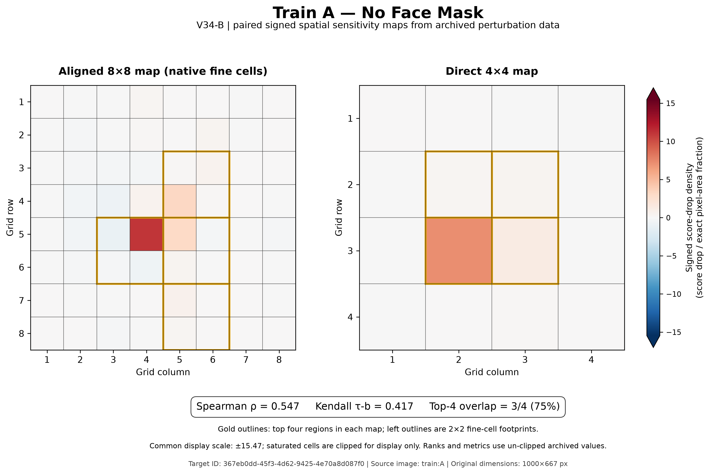
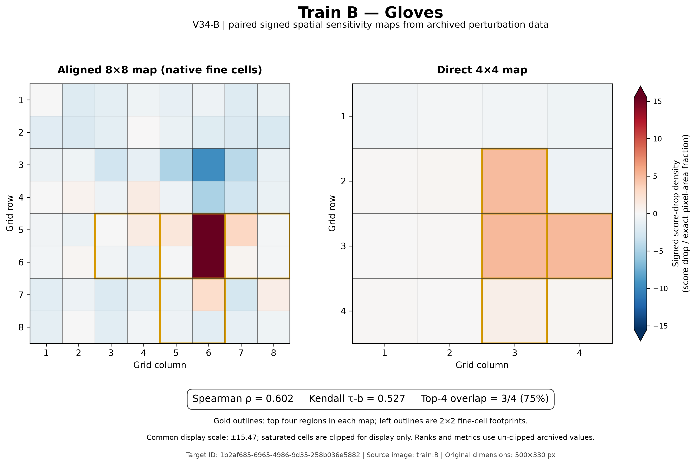
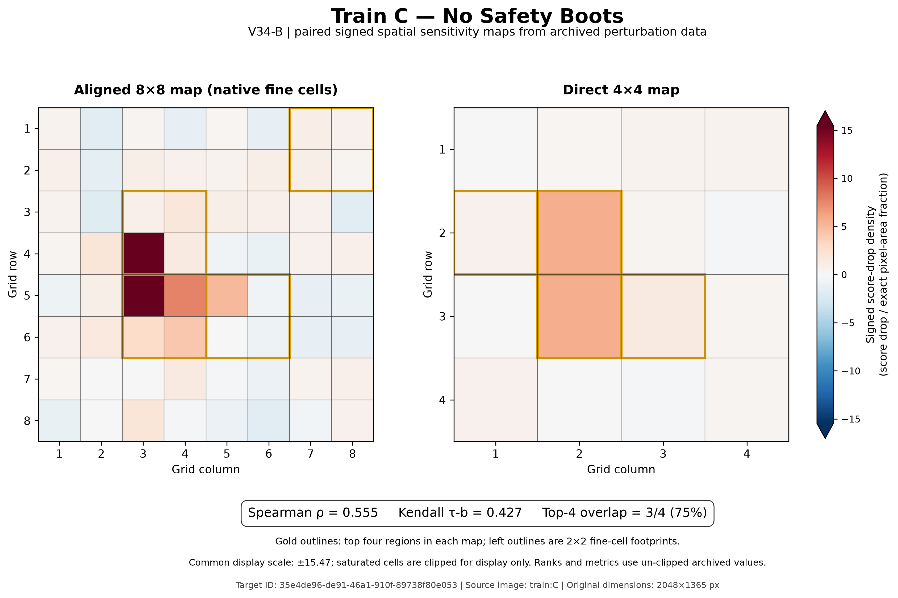
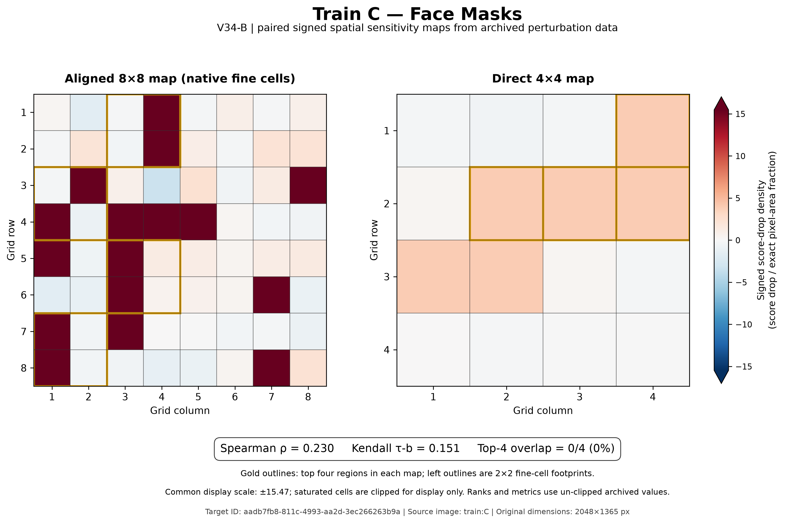
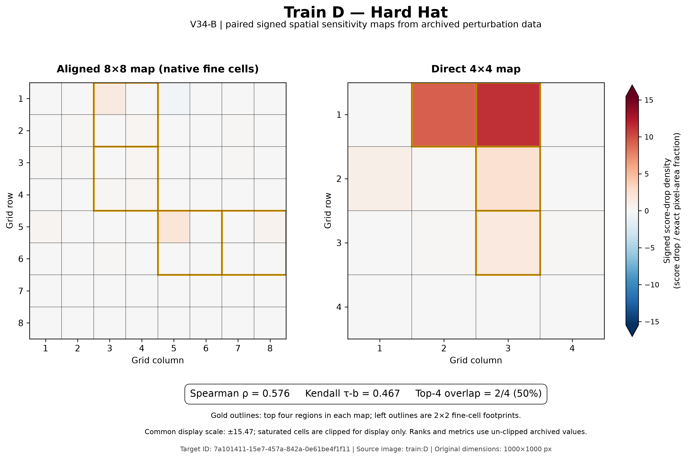
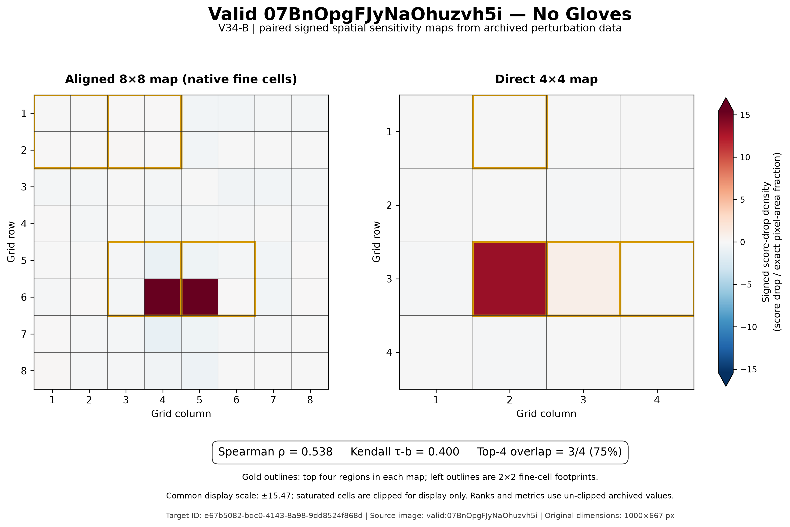
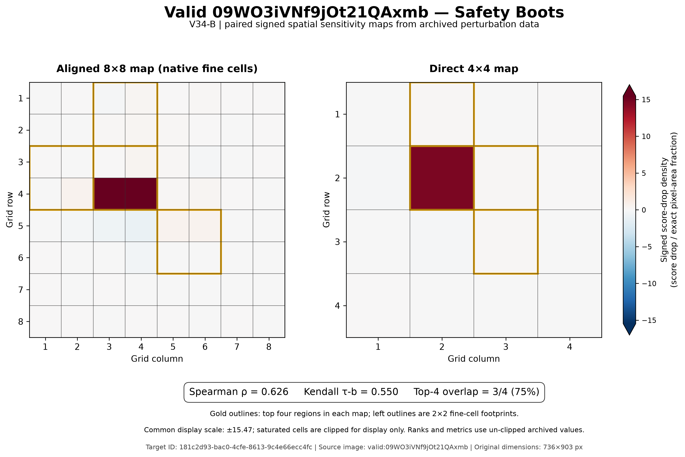
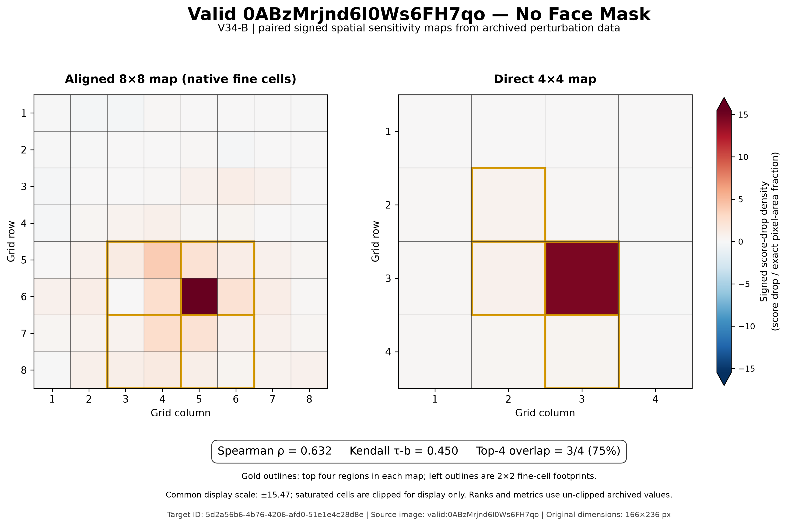
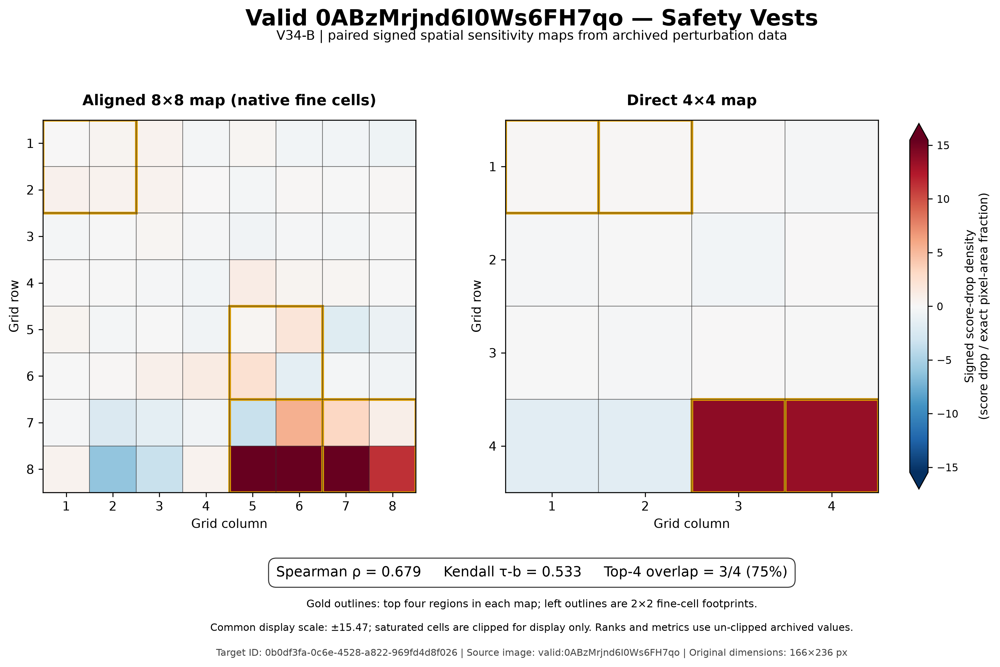
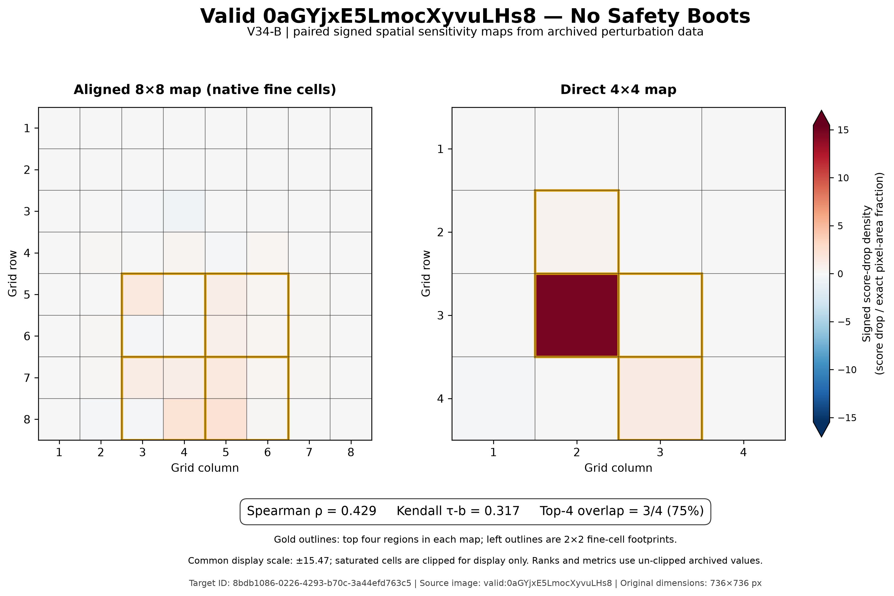

# Supplementary File S1 — Target-matched PPE detector perturbation and spatial-map results

**Associated manuscript:** Engineering evaluation of target-matched perturbation sensitivity and grid-resolution stability in personal protective equipment detection  
**Target journal:** Results in Engineering (Elsevier)  
**Status:** V36 editorial supplement — figure/data checks required before upload

## S1. Reproducibility and interpretation

The experiment uses an unchanged 17-class RF-DETR Small detector, with confidence threshold 0.20, provider overlap setting 0.50, and same-class IoU≥0.50 target matching. Its 459-image current-source validation cohort measures object detections; it is not an independent external site test. Ten frozen PPE detector target instances were selected from eight development-exposed images (four Train and four Valid). At both grid resolutions, a target's score after each perturbed inference was the confidence of its uniquely matched same-class detection, or zero when no match remained; ambiguous matches were left unresolved.

One-cell gray occlusion used RGB(127,127,127). The 8×8 test comprised 64 cells per image and the 4×4 test 16 cells. After normalizing each signed target score drop by its exact cell-area fraction, four 8×8 child cells were aligned to each corresponding 4×4 cell using exact source pixel boundaries; the area-weighted average fine-grid signed sensitivity was compared with the direct coarse-grid signed sensitivity. Ties used average ranks (Spearman) and tie corrections (Kendall τ-b), while top-four ranking ties used row-major order. Negative values were preserved for spatial statistics. All coefficients are descriptive, because image cells and multiple targets from some images are not independent.

The source numerical assets, algorithms, runtime ledgers and independent checks are retained in the project's V30, V33-B, V34-A and V34-B source archives at the research commit. The 8×8 and 4×4 inference totals were 1,068 and 496 calls respectively. There was no new inference for figure generation. Raw identifiable worker images are not included in this supplement and their public use or sharing is **not** claimed authorized.

## S2. Complete ten-target map-level agreement table

| Figure | Frozen source and target class | Spearman ρ | Kendall τ-b | Top-four overlap |
|:--|:--|--:|--:|:--:|
| F01 | Train A — No Face Mask | 0.5471 | 0.4167 | 3/4 (75%) |
| F02 | Train B — Gloves | 0.6019 | 0.5272 | 3/4 (75%) |
| F03 | Train C — No Safety Boots | 0.5548 | 0.4268 | 3/4 (75%) |
| F04 | Train C — Face Masks | **0.2295** | **0.1514** | **0/4 (0%)** |
| F05 | Train D — Hard Hat | 0.5765 | 0.4667 | 2/4 (50%) |
| F06 | Valid 07BnOpgFJyNaOhuzvh5i — No Gloves | 0.5382 | 0.4000 | 3/4 (75%) |
| F07 | Valid 09WO3iVNf9jOt21QAxmb — Safety Boots | 0.6265 | 0.5500 | 3/4 (75%) |
| F08 | Valid 0ABzMrjnd6I0Ws6FH7qo — No Face Mask | 0.6324 | 0.4500 | 3/4 (75%) |
| F09 | Valid 0ABzMrjnd6I0Ws6FH7qo — Safety Vests | 0.6794 | 0.5333 | 3/4 (75%) |
| F10 | Valid 0aGYjxE5LmocXyvuLHs8 — No Safety Boots | 0.4294 | 0.3167 | 3/4 (75%) |

These values were copied from the machine-validated V34-B figure report. Per-target numbers are rounded for presentation; the primary archived computations used unrounded values. Mean signed area-normalized ρ=0.5416 and τ-b=0.4239; mean top-four overlap 2.6/4 (65%). The Train C Face Masks target has no top-four overlap. The common figure color scale is symmetric at ±15.470900859749108, with 17/800 displayed cell values saturated *only for color visualization*; ranking/correlation operations never use the saturated display values.

## S3. Original-source validation reference class distribution

The following 17-class box counts are the current single-curator reference for the full M0 original-source validation cohort and its predeclared M2 metadata-sensitivity subset. They are *not* a prospective second-annotator assessment.

| Original detector class | M0 GT | M0 TP | M0 FP | M0 FN | M2 GT |
|:--|--:|--:|--:|--:|--:|
| Animal | 66 | 66 | 9 | 0 | 60 |
| Child | 31 | 29 | 8 | 2 | 28 |
| Face Masks | 80 | 74 | 27 | 6 | 69 |
| No Hard Hat | 56 | 55 | 9 | 1 | 50 |
| No Safety Boots | 93 | 85 | 41 | 8 | 82 |
| Soft Hat | 60 | 57 | 12 | 3 | 54 |
| Hard Hat | 388 | 377 | 39 | 11 | 330 |
| No Safety Vest | 160 | 156 | 42 | 4 | 146 |
| Pants | 207 | 201 | 62 | 6 | 185 |
| No Face Mask | 280 | 269 | 51 | 11 | 253 |
| No Safety Attire | 87 | 80 | 25 | 7 | 75 |
| No Gloves | 328 | 308 | 115 | 20 | 298 |
| Gloves | 278 | 250 | 80 | 28 | 240 |
| Safety Boots | 365 | 337 | 105 | 28 | 315 |
| Safety Vests | 315 | 297 | 45 | 18 | 273 |
| Goggles | 189 | 183 | 33 | 6 | 154 |
| Persons | 488 | 473 | 103 | 15 | 437 |

## S4. Paired signed-sensitivity maps

All ten figures derive from the frozen and numerically audited V34-A aligned maps. Left panel: native 8×8 fine-cell signed density, with the fine-cell footprints of top four pooled regions marked. Right panel: direct 4×4 signed density, with its top four marked. The same diverging color scale applies to all ten figures. No figure is a true worker–PPE compliance assessment, learned causal explanation or independently annotated ground-truth saliency map.

### Figure S1

**Supplementary Figure S1.** Paired signed detector-response sensitivity maps for the **No Face Mask** target in Train image A. Spearman ρ=0.5471; Kendall τ-b=0.4167; top-four region overlap=3/4 (75%).

### Figure S2

**Supplementary Figure S2.** Paired signed detector-response sensitivity maps for the **Gloves** target in Train image B. Spearman ρ=0.6019; Kendall τ-b=0.5272; top-four region overlap=3/4 (75%).

### Figure S3

**Supplementary Figure S3.** Paired signed detector-response sensitivity maps for the **No Safety Boots** target in Train image C. Spearman ρ=0.5548; Kendall τ-b=0.4268; top-four region overlap=3/4 (75%).

### Figure S4

**Supplementary Figure S4.** Paired signed detector-response sensitivity maps for the **Face Masks** target in Train image C. Spearman ρ=0.2295; Kendall τ-b=0.1514; top-four region overlap=0/4 (0%). This is the lowest-agreement target in the ten-target sample.

### Figure S5

**Supplementary Figure S5.** Paired signed detector-response sensitivity maps for the **Hard Hat** target in Train image D. Spearman ρ=0.5765; Kendall τ-b=0.4667; top-four region overlap=2/4 (50%).

### Figure S6

**Supplementary Figure S6.** Paired signed detector-response sensitivity maps for the **No Gloves** target in Valid image 07BnOpgFJyNaOhuzvh5i. Spearman ρ=0.5382; Kendall τ-b=0.4000; top-four region overlap=3/4 (75%).

### Figure S7

**Supplementary Figure S7.** Paired signed detector-response sensitivity maps for the **Safety Boots** target in Valid image 09WO3iVNf9jOt21QAxmb. Spearman ρ=0.6265; Kendall τ-b=0.5500; top-four region overlap=3/4 (75%).

### Figure S8

**Supplementary Figure S8.** Paired signed detector-response sensitivity maps for the **No Face Mask** target in Valid image 0ABzMrjnd6I0Ws6FH7qo. Spearman ρ=0.6324; Kendall τ-b=0.4500; top-four region overlap=3/4 (75%).

### Figure S9

**Supplementary Figure S9.** Paired signed detector-response sensitivity maps for the **Safety Vests** target in Valid image 0ABzMrjnd6I0Ws6FH7qo. Spearman ρ=0.6794; Kendall τ-b=0.5333; top-four region overlap=3/4 (75%).

### Figure S10

**Supplementary Figure S10.** Paired signed detector-response sensitivity maps for the **No Safety Boots** target in Valid image 0aGYjxE5LmocXyvuLHs8. Spearman ρ=0.4294; Kendall τ-b=0.3167; top-four region overlap=3/4 (75%).

## S5. Archived research record pointers and missing-data handling

- Object-level 459-image evaluation and per-class records: `research/seer-ppe/ACTUAL_CURRENT_SOURCE_ORIGINAL_VALID_459_CLASS_BBOX_METRICS_V26.json` and `V26_VALID_CURRENT_SOURCE_459_NUMERIC_SUMMARY.json`.
- 8×8 curves, target-by-cell scores and the single target-seeded random comparator: `V30_ACTUAL_PROGRESSIVE_XAI_RESULTS_2026-11-22.json`.
- 4×4 curves and target-by-cell scores: `V33_B_GRID4_ACTUAL_RESULTS_2026-11-22.json`. Of 40 planned progressive curves, one deletion saliency curve with ambiguous target identity has null AUC; **39/40** valid AUCs, with no imputation.
- Signed aligned maps, tie-aware spatial correlations and exact area weights: `V34A_SPATIAL_MAP_ALIGNMENT_RANK_CORRELATION_2026-11-22.json`.
- Rendering script and figure hashes: `tools/render_v34b_scientific_figures.py` and `V34B_SCIENTIFIC_FIGURE_GENERATION_REPORT_2026-11-22.md`.
- The complete historical source-lineage and non-scoring Person–PPE preflight records remain in the preserved v0.43 research dossier, *not* in this publication supplement. A retrospective metadata warning from V27 and a nested duplicate figure-PDF with a different hash remain part of the internal audit, not new performance endpoints.

**Author approval pending:** Confirm the exact access permitted for numeric ledgers, code, images and any source identifiers. DOI-backed immutable archive/release is not yet established. Confirm the journal's actual supplementary formatting and figure file requirements from its Guide for Authors before submission.
